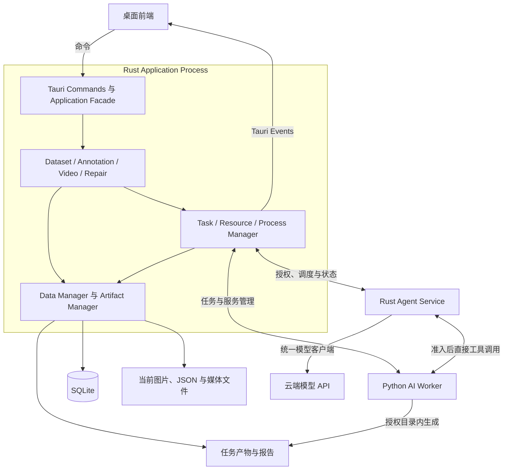
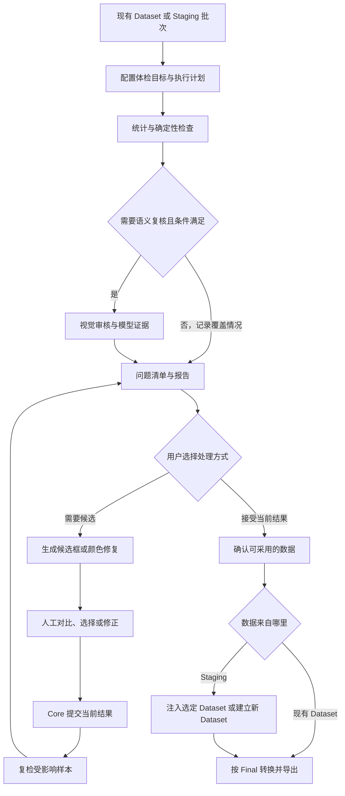
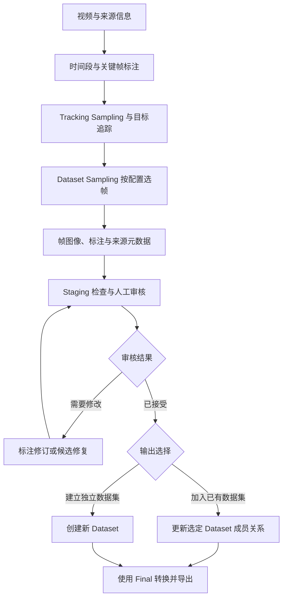
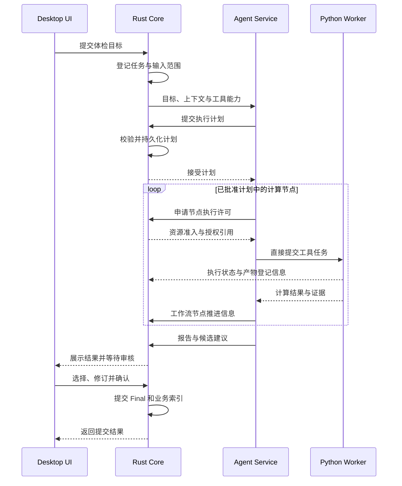

# Dataset Doctor — L1 系统架构定稿

**文档编号：** DD-ARCH-L1-001  
**文档版本：** 1.0  
**确认日期：** 2026-11-23  
**设计状态：** Confirmed；L1 系统架构已完成确认  
**实现状态：** 尚未进入编码  
**技术验证状态：** Rig SDK 独立 PoC 已通过；真实模型、业务集成、打包或性能仍待验证  
**建议归档路径：** `docs/architecture/l1_system_architecture.md`

## 0. 文档定位与决策状态

本文记录 Dataset Doctor 已确认的 L1 系统架构，作为后续 L2 模块、接口、数据与配置设计的统一输入。用户已明确接受 Agent / Workflow、运行生命周期、前端与跨平台交付三组补齐方案，并要求 L1 定稿。

本文遵循用户提供的《软件项目设计与开发规范 v1.1》，整合此前的架构基线、服务与通信 checkpoint、后续数据管理决策和 v0.3 收束评审稿。旧文件作为历史记录保留；其中与本文冲突的数据版本、标注历史、资源复制和 Agent 组织等描述，不再作为当前实现依据。

| 标记 | 含义 |
|---|---|
| Confirmed | 已确认的架构决策，后续模块设计应遵循 |
| To Validate | 已明确验证目标，集成前需要验证，不表示能力已经实现 |
| L2 / L3 | 在后续模块契约或实现约束阶段细化，不再作为未决 L1 小题 |

**本文为当前有效的 L1 架构基线。L1 讨论已经完成；下一阶段为 L2，本文不启动生产代码或技术验证代码的编写。**

文档版本 1.0 用于管理架构文档的变更，不表示产品增加了 Dataset 或 Annotation 内容版本管理。

### 0.1 最终确认的三组补齐决策

| 编号 | 主题 | 已确认决策 | 状态 |
|---|---|---|---|
| L1-R-A | Agent 与工作流 | 两个逻辑 Agent：治理协调、视觉审核；模板化工作流、受约束计划、确定性执行、有限异常调整 | Confirmed |
| L1-R-B | 系统生命周期 | Core 管理本地服务；一次一个活动 Workspace；退出不保留后台计算；切换前结束旧任务；按任务能力恢复 | Confirmed |
| L1-R-C | 前端与交付 | Tauri 2 + React + TypeScript + Vite；随应用提供受控 Python 运行环境；按平台分发；模型按需配置 | Confirmed |

上述编号保留与评审稿的对应关系，不重编号原服务通信 checkpoint 中的 ADR。后续若需要改变进程边界、数据所有权、执行权限或交付形态，应记录新的架构变更及影响；普通模块和实现细节在 L2 / L3 推进。

---

## 1. 系统边界

**定位：** 面向工业视觉数据集的本地优先桌面软件，组织数据体检、标注审核、候选修复、复检和训练数据导出。

### 1.1 当前范围 — Confirmed

| 能力 | 系统负责的内容 |
|---|---|
| 数据集管理 | 打开 Workspace，管理多个 Dataset、视频和检查任务；导入、统计、格式转换和导出 |
| 图片质量检查 | 损坏、模糊、曝光、重复及近似重复等问题检测；具体算法与适用条件在 L2 确定 |
| 标注检查 | 标注结构、空标注、越界框、异常框尺寸、类别和内容一致性等检查；空标注是否是合法负样本由检查规则判断 |
| 语义审核 | 结合传统检查、模型预测和多模态模型输出标记可疑样本，给出证据和候选 |
| 标注修订 | 比较 Human / AI Candidate / 当前 Final；选择、组合或手动修正；只导出确认的 Final |
| 视频数据生成 | 播放与定位、时间段关键帧标注、追踪、按间隔采样、来源记录、进入 Staging 后检查审核 |
| 图片修复 | 当前聚焦用户指定区域的颜色调整；先生成候选和对比，再由用户应用 |
| 报告与记录 | 每次任务独立报告、问题说明、执行信息、修复产物和来源信息 |

当前主要数据对象为图像、目标类别、bbox 标注和视频帧；区域形状可服务于颜色修复。文本 JSON / YAML 是标注或格式配置，并不意味着当前支持所有文本、语音、表格或大模型训练数据集。

视频产生的训练样本可以加入用户选定的 Dataset，也可以建立新 Dataset。Tracking Sampling 与 Dataset Sampling 分开配置；执行任务以一个 Dataset 的统一类别集合为上下文。

### 1.2 当前不实现 — Confirmed

- Dataset / Annotation 内容版本管理和历史快照。
- 完整的独立静态图片标注平台；保留质量审核所需的标签和 bbox 修订能力。
- 跨视频相似帧和数据泄漏检查。
- 模糊恢复等复杂图像复原。
- 标注团队权限、协作分配、完整 MLOps 平台。
- 远程微服务集群、消息中间件和独立 HTTP API Gateway。

“版本管理不实现”指数据集内容的产品功能，不取消协议兼容、JSON 格式识别和数据库 Schema 迁移所需的技术标识。

---

## 2. 总体架构与职责 — Confirmed

采用 **Tauri Command API + Rust Application Facade + 本地独立服务**。三个主要后端执行边界为 Rust Application Process、Rust Agent Service、Python AI Worker。WebView、解码工具或 Worker 实例可能形成额外操作系统进程，不能把这张图理解为恰好三个 OS 进程。

### 2.1 系统架构图

Core、Rust Agent Service 与 Python AI Worker 之间的本地服务通信使用 gRPC + Protobuf + TCP Loopback。前端通过 Tauri Commands / Events 与主应用交互；云模型调用通过选定供应商的 API 适配器完成。Worker 可以读取授权输入；图中只突出其产物写入方向。正式文件的应用和标注提交由 Core 控制。

### 2.2 主要边界

| 组件 | 负责 | 边界约束 |
|---|---|---|
| Desktop Frontend | 交互、图片与视频展示、图层切换、审核操作、进度显示 | 通过 Tauri 入口调用业务；不直接操作 SQLite、Worker 或模型密钥 |
| Tauri Commands / Facade | 接收请求、校验、路由至 Core 用例 | 属于 Rust 主应用；不额外部署网关进程 |
| Rust Application Core | 业务规则、数据提交、任务与资源控制、服务生命周期 | 是系统控制和权威状态的归属方 |
| Rust Agent Service | 规划、专业审核、工作流推进、工具选择、模型调用 | 不直接修改正式图片、Final 或核心数据库 |
| Python AI Worker | 调用 Python 库和模型，执行检查、追踪、抽帧、颜色处理 | 生成结构化结果和候选产物，不决定正式采用哪些数据 |

### 2.3 Core 内部模块

| 模块 / 职责 | L1 边界 |
|---|---|
| Workspace Manager | 打开、关闭和切换 Workspace；工作空间上下文 |
| Dataset Manager | Dataset 索引、成员关系、类别集合、Staging 注入、导入导出协调 |
| Annotation Manager | Human / AI Candidate / Final 的业务规则、审核与提交校验 |
| Video Manager | 视频来源、时间段、帧定位、追踪和采样任务的业务协调 |
| Repair Manager | 修复请求、候选对比、采用结果与复检协调 |
| Task / Resource Manager | 任务登记、权威状态、队列、配额、优先级和资源准入 |
| Process Manager | Agent / Worker 启动、握手、健康检查、退出和恢复 |
| Data Manager | Core 内 SQLite 访问和写入事务的统一所有者 |
| Artifact Manager / 文件访问组件 | Asset / Artifact 引用、权限、产物登记和受控文件提交 |
| Export 职责 | 将当前已确认数据转换为训练格式；可在 L2 决定是否独立模块 |

这些是逻辑职责，不要求一项对应一个服务、一套数据库或一个独立进程。

---

## 3. 数据归属与持久化 — Confirmed

### 3.1 权威来源

| 数据 | 权威来源 | 说明 |
|---|---|---|
| 当前图片标注 | 图片旁的自定义同名 JSON | 参考 X-AnyLabeling 字段习惯；通过适配器导入导出，不假定完全原生兼容 |
| Dataset 与 Asset 的关联 | Workspace SQLite | Asset 在 Workspace 注册；当前不引入跨 Dataset 共用同一资源的业务 |
| 资源标识与路径、任务和 Workflow 状态 | SQLite | Agent / Worker 上报，由 Core 持久化 |
| 图片、视频、修复结果等二进制内容 | 本地文件系统 | SQLite 保存引用与必要元信息 |
| 每次体检的完整报告 | 任务独立目录中的 JSON / JSONL 等报告文件 | SQLite 保存任务状态、定位信息和检索所需摘要 |
| 全局设置和 Workspace 列表 | 全局轻量 SQLite | 与当前 Workspace 的业务数据库区分 |

JSON 管理标注内容，SQLite 管理系统运行和业务索引。SQLite 可以保存可重建的派生索引，但不维护另一套与 JSON 竞争的标注真值。

采用全局 `app.db` 与每 Workspace 的 `workspace.db` 分工，数据库技术仍只有 SQLite。

### 3.2 文件与来源规则

- 外部 Dataset 直接引用原目录，导入不复制；JSON 保存在原图片旁，要求相关目录具备读写权限。
- 允许未标注图片没有 JSON；首次保存标注时创建。
- Asset 使用独立 ID，原始文件名保留；文件路径不作为唯一身份。
- 外部视频可以保持原位置；抽取的视频帧和配对 JSON 保存在 Workspace 内。
- 视频帧目录采用 `video_annotations/<视频名>/`，图片与 JSON 平铺；同名视频目录采用 `(1)` 等方式区分。目录名不代替视频 ID。
- 视频帧记录源视频 ID、帧索引、时间戳、采样配置标识和提取方法；每帧当前 track map 保存相应 `track_id`；不将其写入标准 COCO annotations。
- Staging 是 Workspace 中独立的待审核管理区域。帧可以已经在最终物理目录中；审核后更新 Dataset 成员关系，不重复复制。
- 外部资源丢失时标记离线，支持重新定位；文件变化需要重新加载并判断旧检查是否失效。
- Workspace 备份包含所登记的外部资源及关联标注；不意味着复制外部目录中所有无关文件。
- 删除 Dataset、删除单张图片和解除关联是不同操作；物理删除不设置回收站。
- 删除 Dataset 时，外部原始图片不因移除 Dataset 自动被批量删除；保留导入前已有的 JSON，仅按已确认清理规则处理 Dataset Doctor 自行创建的 JSON 和受管理产物。
- 单张图片操作支持仅解除关联，或明确选择永久删除对应图片与 JSON。实际物理删除需要核对归属，不能波及其他 Dataset 的资源。
- 文件创建来源、清理执行顺序和失败恢复在 L2 定义；目录位置本身不构成任意批量删除权限。

Workspace 统一的是资源登记与管理边界，不能将其误写成“所有外部文件必须搬入 Workspace”。

### 3.3 标注与最终数据

Dataset 使用当前类别名称集合，允许直接维护 Label Schema 并新增类别；不要求类别描述，也不引入 Label Schema 内容版本管理。类别变更的具体校验与格式映射在 L2 定义。

审核阶段可比较 Human、AI Candidate 和已有 Final。图层提供显隐按钮；对 AI 建议展示疑点、证据和差异，不预设 AI 必然更优。

用户确认后，由 Annotation Manager 验证选择，Core 将当前 Final 写入单图 COCO bbox profile 工作文件。人工草稿与 AI 候选保存在独立 Artifact 中；**仅在保存成功后清理活动候选与草稿引用**，不维护完整历史版本。具体字段、track map 与清理规则见 [L2 数据契约](../data/data_contracts_and_sqlite.md)。

现有 Dataset 维护当前状态。新帧通过检查和用户确认后直接加入成员关系，或加入新建 Dataset；不创建 Dataset Version。

必须区分：

- **标注确认：** 哪些框和类别成为当前 Final。
- **样本接收确认：** 哪些 Staging 样本允许加入 Dataset。

这两项可以由一个界面动作协调完成，但分别由 Annotation Manager 与 Dataset Manager 承担业务责任。

### 3.4 一致性约束

Core 统一协调 JSON 写入、文件应用和索引更新。对输入内容做冲突检查，避免迟到的 AI 结果覆盖新的人工修改。

SQLite 事务不自动涵盖外部 JSON 和图片文件。文件写入失败、数据库提交失败或中途崩溃必须可识别和恢复；原子替换、提交记录与重新核对流程在 L2 定义。

内容摘要、执行尝试编号和内部修改标识用于冲突与恢复控制，不构成用户可浏览的数据集版本系统。

---

## 4. 通信与调度 — Confirmed

| 主题 | 既定方案 |
|---|---|
| 调用拓扑 | 混合调用；控制权集中、执行权分散 |
| Core → Worker | 手动操作、确定性任务及服务管理 |
| Agent → Worker | 经过 Core 登记、授权和资源准入后，直接执行工具调用 |
| 跨进程协议 | gRPC + Protobuf + TCP，监听 127.0.0.1 |
| 短操作 | Unary 请求响应；不等于阻塞 UI 线程 |
| 长任务 | 提交后异步执行，返回任务标识；Streaming 报告进度 |
| 前端同步 | Tauri Events 通知；重连时查询 Core 快照并重新订阅 |
| 文件传输 | Artifact ID 或授权文件引用；媒体不作为大段 base64 塞入普通 RPC |
| 调度 | Core 队列、优先级、资源配额与 Semaphore 准入；Worker 有界执行队列 |
| 数据修改 | 资源级冲突控制、数据库事务与乐观校验；不锁住整条 Workflow |
| 异常 | RPC 超时与业务任务超时分开；有限重试、指数退避、幂等和结果核对 |
| 中断 | 统一 INTERRUPTED，按任务能力重试或从有效 Checkpoint 恢复 |
| 本地安全 | 动态端口、随机认证凭据、Artifact 访问授权、密钥保护与日志脱敏 |

Task、Workflow 节点、执行尝试和工具调用不是同一个层次；L2 定义映射。Agent 推进工作流，Core 管理执行准入和权威业务状态，两者不会同时成为同一状态的独立写入者。

gRPC 提供 RPC 和流式通信机制，业务终态持久化、去重和重连核对由本应用设计。RPC 超时可能出现服务端已完成而客户端未收到结果的情况，取消也不自动回滚已发生的修改，因此提交类操作不能盲目重试。[S4]

Semaphore 用于 Core 的调度准入，不是所有进程自动共享的系统级锁，也不等于硬性显存隔离。Artifact 授权同样不是操作系统沙箱。

---

## 5. Agent / Workflow 总体设计 — Confirmed：L1-R-A

### 5.1 初版两个逻辑 Agent

| 角色 | 主要责任 | 典型输出 |
|---|---|---|
| 治理协调 Agent | 理解体检目标；组织检查；解释问题；提出修复建议；异常时调整方案 | 受约束的执行计划、问题优先级、修复建议、工作总结 |
| 视觉审核 Agent | 结合图像、类别名称、现有框和工具证据检查语义与标注疑点 | 结构化审核意见、证据、候选及不确定性说明 |

两个角色运行在同一个 Rust Agent Service 中，共享统一模型客户端与 API Key，不要求独立进程或独立模型账户。普通检查和成功路径不需要每一步都调用大模型。

初版的修复建议和报告组织由协调 Agent 承担。若后续职责复杂，再把专业角色拆开；当前不为每一种算法建立独立 Agent。

Workflow Engine、Tool Adapter、Cleanlab、CleanVision、追踪器和颜色处理算法分别属于执行程序或工具。它们不因为被 Agent 调用就变成需要模型推理的 Agent。

### 5.2 规划、执行、调整

采用 **工作流模板 + Agent 受约束规划 + 确定性执行 + 有限异常调整**。

1. Core 创建任务，明确目标 Dataset 或对应 Staging 批次、输入资源、允许工具和执行预算。
2. 协调 Agent 选择模板，建议检查项、依赖顺序和需要语义复核的范围。
3. Core 校验并登记计划。工具必须在注册清单内，参数必须满足结构和业务规则。
4. Workflow Engine 推进就绪节点；节点执行前由 Core 进行资源准入。
5. Agent 经 Tool Adapter 直接调用 Worker，或通过统一模型客户端执行云模型节点。
6. Worker 上报执行事实，Agent 上报工作流推进信息；Core 接收并持久化相应权威状态。
7. 普通临时故障由程序执行有限重试；需要替代方法或修改后续步骤时才请求 Agent 重规划。
8. 修改后的计划再次校验，不得自行扩大 Dataset 范围、文件权限、工具能力或调用预算。
9. 达到预算、持续失败或结果无法判断时停止自动尝试，保留已完成结果并转人工处理。

初版模板覆盖现有 Dataset 体检、视频采样后体检、候选修复后复检。模板与工具注册可以配置，不要求开放插件平台。

### 5.3 输入条件与结果可信度

- 类别上下文使用用户维护的类别名称，不强制增加类别描述。
- 视觉审核可以使用全图、区域裁剪、现有标注和检查证据；具体提示词与图像组织放 L2。
- 精确 bbox 候选优先由可验证的检测、分割或追踪工具提供；VLM 负责辅助判断，不将其自由输出坐标直接当成正确答案。
- Cleanlab 的目标检测标注质量接口使用标签和模型预测作为输入。没有适用预测时，对应检查必须记为未执行或缺少前置条件，不能宣称通过；不隐式启动额外模型训练。[S5]
- 每个检查报告说明适用范围、已执行项目、跳过项目和未解决问题。
- “计算任务成功完成”与“数据质量审核通过”分开表达。

### 5.4 检查、审核与修复流程

图中修复循环由用户操作和有限执行策略约束，不表示 Agent 可以无限自动修复。用户可以不采用候选、继续人工修正或保留未解决问题。

生成候选不会修改正式图片或 Final。用户采用结果后由 Core 提交；修复后仍需复检。区域改色是受控数据处理，不宣称从单张失真图像还原了真实物理颜色。

### 5.5 视频生成训练数据流程

图中的 Tracking Sampling 决定追踪计算的取帧策略，Dataset Sampling 决定最终训练样本的取样策略；间隔由用户配置。进入 Dataset 前，所采用样本必须具备确认的 Final 并完成用户的质量审核确认。

视频帧和 JSON 保留在 Workspace 的视频目录，注入通过关系更新完成，不额外复制、不创建 Dataset Version。合并按当前范围执行格式转换；不加入跨视频重复检查或新的类别本体分析。

### 5.6 跨进程核心时序

时序仅表达主要责任。等待队列、失败重试、事件确认和取消消息在 L2 展开。等待人工审核时不占用 GPU 等计算配额。

### 5.7 框架采用条件

2026-11-26 更新：采用 Rig v0.47.1（Rust 1.97.1），SDK 独立 PoC 三平台已通过（每平台 10 项），不等同于生产应用集成。Core 持久化、资源准入、授权、人工审核和 Python Worker 职责不变。真实模型、完整恢复与打包仍需验收。

框架置于 Agent Service 内的适配边界后，业务流程、Core 状态、工具契约和数据格式不依赖框架私有对象。

验证至少覆盖结构化工具调用、错误传递、取消、节点状态上报和有限重规划。若框架不满足要求，保持相同服务边界，采用明确的工作流状态机和可替换模型客户端；是否采用该替代实现，在验证结果出现后再记录。

---

## 6. 系统运行与生命周期 — Confirmed：L1-R-B

### 6.1 生命周期规则

| 场景 | 已确认运行规则 |
|---|---|
| 应用启动 | 启动 Tauri / Core，读取全局设置；打开或选择 Workspace |
| Workspace 打开 | 检查访问权限和资源在线状态，加载索引，识别未完成任务 |
| 服务启动 | Process Manager 启动 Agent / Worker，完成版本、能力和认证握手后开放相应功能 |
| 模型加载 | 按任务需要加载，不在首次打开应用时加载所有模型 |
| 运行中 | Core 管理准入、取消和权威状态；服务只报告其负责的执行信息 |
| 等待人工审核 | 保存等待上下文和产物引用，释放计算配额 |
| 切换 Workspace | 停止旧 Workspace 新任务准入；等待任务结束或取消，再保存、关闭和切换 |
| 最小化窗口 | 应用保持运行，已准入任务可以继续执行 |
| 正常退出 | 不保留独立后台计算；停止准入，完成已开始的必要提交，取消或等待执行任务并关闭服务 |
| 强制退出 / 崩溃 | 未得到完整终态的执行标记 INTERRUPTED；下次打开先核对，再按任务能力恢复 |
| 服务不可用 | 仅受影响能力暂停；可用的浏览、审核和本地操作继续提供 |

用户明确取消且执行端确认停止的任务可以进入取消终态；无法确认安全结束的任务使用 INTERRUPTED，不能仅因发送了取消请求就假定计算和文件操作均已结束。

### 6.2 Workspace 与恢复边界

MVP 一次只激活一个 Workspace。切换后，旧 Workspace 的晚到结果不能写入新 Workspace；提交时核对工作空间、输入内容和执行尝试的归属。

同一个 Workspace 不能由两个 Core 同时承担可写管理权。具体进程锁、会话标识和超时参数在 L2 设计。

恢复先核对任务、已生成产物和已提交结果。能安全重试的检查可以重跑；支持 Checkpoint 的视频任务才允许续跑。最终数据提交必须先确认之前是否已经完成，避免重复注入。

Agent 崩溃不自动意味着所有 Worker 任务已失败；Core 根据执行事实停止新增派发并核对在途任务。Core 不可用后，服务停止接受新的执行授权，避免形成失去管理的后台任务。

### 6.3 云模型边界

共享 API Key 由 Core 管理，Agent Service 的统一客户端受控使用；Python Worker 默认不持有该 Key，前端也不直接调用模型供应商。

未配置 Key 或网络不可用时，本地检查仍可以运行；依赖云模型的步骤明确显示未执行。不能把这类运行报告表示为完成了全部语义检查。

“本地优先”指管理、存储和可本地执行的计算留在用户设备；启用云端 VLM 时所需图像或裁剪内容会发送给选定供应商。任务配置需清楚显示云端步骤及发送范围。

---

## 7. 技术栈与跨平台交付 — Confirmed：L1-R-C

### 7.1 技术选择

| 层次 | 方案 | 选择理由与状态 |
|---|---|---|
| 桌面容器 | Tauri 2 | 延续已确认的 Rust 主应用与 Command API 方向 |
| 前端 | React + TypeScript + Vite | Confirmed；采用单页应用，按审核、视频与任务页面组织组件 |
| 标注画面 | 前端 Canvas / SVG 绘制能力 | 业务上需要框、图层、缩放与区域选择；具体绘图库在 L2 验证 |
| Core 与 Agent Service | Rust | 已确认；异步运行时和依赖版本在集成前锁定 |
| Python Worker | 受控 Python 运行环境与算法适配器 | 已确认语言和进程方向；具体打包组合待验证 |
| 跨进程 | gRPC / Protobuf / Loopback | 已确认；Rust tonic、Python grpcio 为生态方向 |
| 数据库 | SQLite | 已确认；不引入其他数据库 |
| 媒体、JSON 与产物 | 本地文件系统 | 已确认；使用 Core 管理引用、提交和访问范围 |
| Agent 框架 | Rig v0.47.1；可替换适配器 | Validated（独立 SDK PoC）；完整业务集成待验证 |
| 云模型 | 一个共享 Key 和统一模型客户端 | 已确认；供应商和模型按配置能力接入 |

React 是本项目已确认的前端选择；Tauri 本身不限定使用 React。Tauri 支持多种前端框架，官方推荐 Vite 用于 React、Vue 等 SPA 项目；其桌面前端可以交付静态构建产物。[S1]

因此，本方案的前端开发需要 JavaScript / TypeScript 工具链，但发布形态不增加独立 Node.js 后端服务。组件库、状态库、绘图库、具体小版本和路由结构在 L2 定义。

### 7.2 Python 与模型交付

标准安装包的确定交付形态包含主应用、Rust Agent Service、受控 Python 运行环境和基础算法依赖，用户无需自行管理系统 Python。模型权重按需获取或由用户导入；不承诺把所有模型和 GPU 依赖都放进一个小安装包。

Tauri 支持 sidecar 外部可执行文件，包括打包后的 Python 应用，并要求针对目标平台架构提供对应二进制产物。[S2]

交付形态已经确认；Python 具体冻结工具、动态依赖收集、模型缓存和升级方式在 L2 验证。本文不将任何未经验证的打包命令视为已解决全部模型依赖。

### 7.3 三平台支持边界

目标仍为 Windows、Linux、macOS，分别构建并验证安装包。基础工作流、文件格式和业务语义保持一致；具体 GPU 后端、性能和可用模型按环境探测。

- 基础数据浏览、JSON 审核、索引和可用的 CPU 检查作为共同能力。
- GPU 为可选加速能力；缺失时明确是否支持 CPU 替代，不能静默跳过后报告通过。
- 云模型步骤依赖网络与供应商权限，不等同于本地 GPU 能力。
- 最低系统版本、Linux 发行版和 CPU 架构矩阵在部署验证时锁定，不凭“跨平台”一词承诺所有组合。

Tauri 在 Windows 使用 WebView2，在 macOS 和 Linux 使用 WebKit 系列实现，因此需要实际核验视频播放和绘制行为。[S3]

### 7.4 视频交付的关键规则

前端负责播放、时间轴和标注交互；Video Manager 负责业务协调；Worker 的视频适配层负责精确解码、抽帧和追踪。

**进入帧标注时，以后端返回的实际帧图像及帧身份为准。** 播放位置是定位请求，不能仅用“播放秒数 × FPS”推导所有视频的真实帧身份。必要的预览代理或帧缓存是派生产物，必须保持与原视频帧的映射。

FFmpeg 类成熟媒体组件可作为解码候选；具体调用或绑定方式、编码支持和目标平台打包在 L2 验证。官方文档说明寻址、时间戳和帧率处理有各自的语义，预览位置与训练帧对应关系需要显式设计。[S6]

### 7.5 页面边界

L1 只保留 Workspace / Dataset、检查与任务、问题审核、视频标注、修复对比、导出与报告、设置这些功能入口。页面路由、组件拆分、按钮布局和状态库在 L2 设计。

---

## 8. 关键风险与验证计划

以下均为设计风险和待验证项，不是已经执行的测试结果。

| 风险 | L1 处理方向 | 后续通过条件 |
|---|---|---|
| Agent 输出无效计划或无效候选 | 结构校验、受控工具、有限调整、人工确认 | 非法输出不能绕过准入或修改正式数据 |
| 检查缺少模型输入仍被误判为通过 | 显式前置条件与覆盖报告 | 缺预测、缺模型或断网能清楚显示未执行项 |
| JSON 与 SQLite 不一致 | Core 提交协调、输入冲突检测与恢复核对 | 提交中断后能识别状态，不丢失已成功确认的 Final |
| 任务取消或重试引起重复写入 | 幂等与执行结果核对 | 取消、断线与重复请求不能重复注入样本 |
| 视频播放画面与训练帧不一致 | 后端帧身份权威、来源映射 | 变帧率、跳转和采样场景仍能对应同一帧 |
| 三平台 Python / 媒体 / GPU 依赖差异 | 按平台构建、能力探测、分阶段验证 | 每个承诺支持的组合通过基础业务流程 |
| 第三方组件与模型分发条件 | 按锁定依赖核验集成与分发方式 | 不将尚未核验的组件作为不可替换核心 |
| 多进程异常后遗留任务 | Core 生命周期管理、停止新准入、恢复核对 | 崩溃与 Workspace 切换不会跨空间误提交 |

为关键风险安排小范围技术验证；本文记录验证目标。Rig SDK 独立 PoC 已完成，见 [验证报告](../testing/rig_sdk_validation.md)；表中完整业务行为仍需逐项验证。框架验证失败优先更换适配实现；如果失败必须改变进程边界、数据归属或交付形态，则回到相应 L1 决策。

吞吐量、最大数据集规模、显存预算和模型准确率尚未实测；L2 按目标设备和代表性数据设定指标，不能将未定义指标写成已达成承诺。

---

## 9. L1 完成记录与 L2 入口

### 9.1 最终进度

| L1 主题 | 最终状态 |
|---|---|
| 1. 服务职责与边界 | Confirmed；L1 已完成 |
| 2. 服务通信与调用拓扑 | Confirmed；L1 已完成 |
| 3. 数据管理与存储 | Confirmed；按最新 JSON / Final / 无内容版本方向整合，模块细节移交 L2 |
| 4. Agent / Workflow | Confirmed；L1-R-A 已接受 |
| 5. 系统运行与生命周期 | Confirmed；L1-R-B 已接受 |
| 6. 跨平台部署与技术选型 | Confirmed；L1-R-C 已接受，工程验证按计划执行 |
| 7. L1 总体评审 | 已完成；用户明确接受补齐方案并要求定稿 |

### 9.2 L1 完成核对

以下系统设计事项已具备明确结论：

1. 系统边界、三个主要执行边界和主要模块职责已经确定。
2. Core、Agent、Worker 的控制、执行和提交权限已经确定。
3. JSON、SQLite、文件及 Dataset 成员关系的权威来源已经确定。
4. 现有 Dataset 体检修订、视频标注采样后注入 Dataset 的核心路径已经形成闭环。
5. Agent、生命周期、前端与交付三组补齐方案已经获得用户确认。
6. 技术验证目标、失败替代方向和进入 L2 的范围已经记录。

**L1 设计阶段已完成。** 框架能力、打包可行性、性能和具体平台支持情况仍按第 8 节进行验证；这些事项的验证状态没有被自动改为“已通过”。

### 9.3 L2 下一步

L2 按依赖推进，先定义契约，再展开各模块：

| 顺序 | 主要交付内容 |
|---|---|
| 1 | 最小领域模型、Annotation JSON 契约、SQLite 核心表与权威来源映射 |
| 2 | Tauri Command、gRPC / Protobuf、工具输入输出、错误和任务事件契约 |
| 3 | Agent 工作流模板、计划结构、执行状态、资源准入与恢复协议 |
| 4 | 视频帧与追踪、颜色修复、审核界面、导出适配器及部署验证设计 |

文件名规范、表字段、索引、提示词、超时数值、并发数值、具体算法阈值、组件库和源码目录，在对应 L2 / L3 文档中定义。原第 3 项中与这些内容重叠的小题，不再作为 L1 独立讨论轮次。

后续维护一份系统架构主文档及必要决策记录。既有背景与延期功能文档仍作为补充材料；发生架构冲突时，以本文以及后续明确批准的架构变更为准。

---

## 10. 依据与参考资料

### 用户材料

- [《软件项目设计与开发规范 v1.1》](https://chatgpt.com/library?file_id=libfile_f60c6275c940819194dfb9eb04b37608&account_id=personal)：L1 / L2 / L3 的阶段边界和完成标准。
- [《Dataset Doctor L1 Architecture Checkpoint 01 v0.2》](https://chatgpt.com/library?file_id=libfile_652472de28288191a52114ff85bb07c5&account_id=personal)：已确认的服务边界、通信、调度和恢复方向；数据版本相关内容按后续决策更新。
- [《Dataset Doctor L1 架构收束评审稿 v0.3》](https://chatgpt.com/library?file_id=libfile_2ef4138050908191810f311778251bc6&account_id=personal)：本次定稿的直接来源，现作为历史评审记录保留。
- 本次对话中用户确认的 SQLite、Workspace、单图 JSON、外部引用、Final 清理、取消内容版本管理和视频帧组织等决定，以及对 L1-R-A / B / C 的最终接受。

### 官方技术资料

资料核对日期：2026-11-23。资料支持相关技术机制；本文区分已确认的架构选择与尚待执行的工程验证。

- [S1：Tauri Frontend Configuration](https://v2.tauri.app/start/frontend/)。
- [S2：Tauri Embedding External Binaries](https://v2.tauri.app/develop/sidecar/)。
- [S3：Tauri Webview Versions](https://v2.tauri.app/reference/webview-versions/)。
- [S4：gRPC Core Concepts, Architecture and Lifecycle](https://grpc.io/docs/what-is-grpc/core-concepts/)。
- [S5：Cleanlab Object Detection — Rank](https://docs.cleanlab.ai/stable/cleanlab/object_detection/rank.html)。
- [S6：FFmpeg Documentation](https://ffmpeg.org/ffmpeg.html)。

## 11. 文档版本与维护

| 文档阶段 | 状态 | 用途 |
|---|---|---|
| 原架构基线与第 1、2 项 checkpoint | 历史记录 | 保留讨论来源；与本文冲突的旧结论不再生效 |
| v0.3 收束评审稿 | 历史评审记录 | 保存本次补齐方案的讨论状态 |
| v1.0 系统架构定稿 | 当前有效基线 | 统一指导 L2 设计与后续实施 |

- 当前定稿不会把待验证项写成已实现能力。
- L2 / L3 可以细化接口、状态机和实现方法，但应遵循本文的进程边界、数据所有权及提交权限。
- 后续如需改变关键架构，应记录变更原因、影响范围、确认状态，并同步相关文档。
- 任务报告和执行记录可以保留，但不得据此重新引入已排除的数据集与标注历史版本产品功能。

**Checkpoint：** L1 系统架构已于 2026-11-23 完成确认，本文为当前正式基线。后续 L2 方案Ⅰ与 L3 已形成基线，Rig SDK 独立 PoC 已执行通过；产品编码尚未开始。当前入口见 [docs/README.md](../README.md)。

> 2026-11-26 更新：采用 Rig v0.47.1（Rust 1.97.1），SDK 独立 PoC 三平台已通过（每平台 10 项），不等同于生产应用集成。Core 持久化、资源准入、授权、人工审核和 Python Worker 职责不变。真实模型、完整恢复与打包仍需验收。
