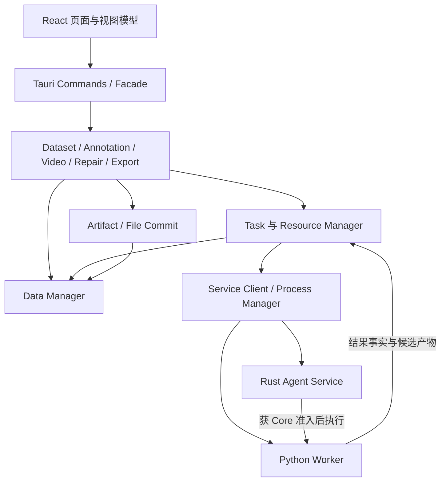
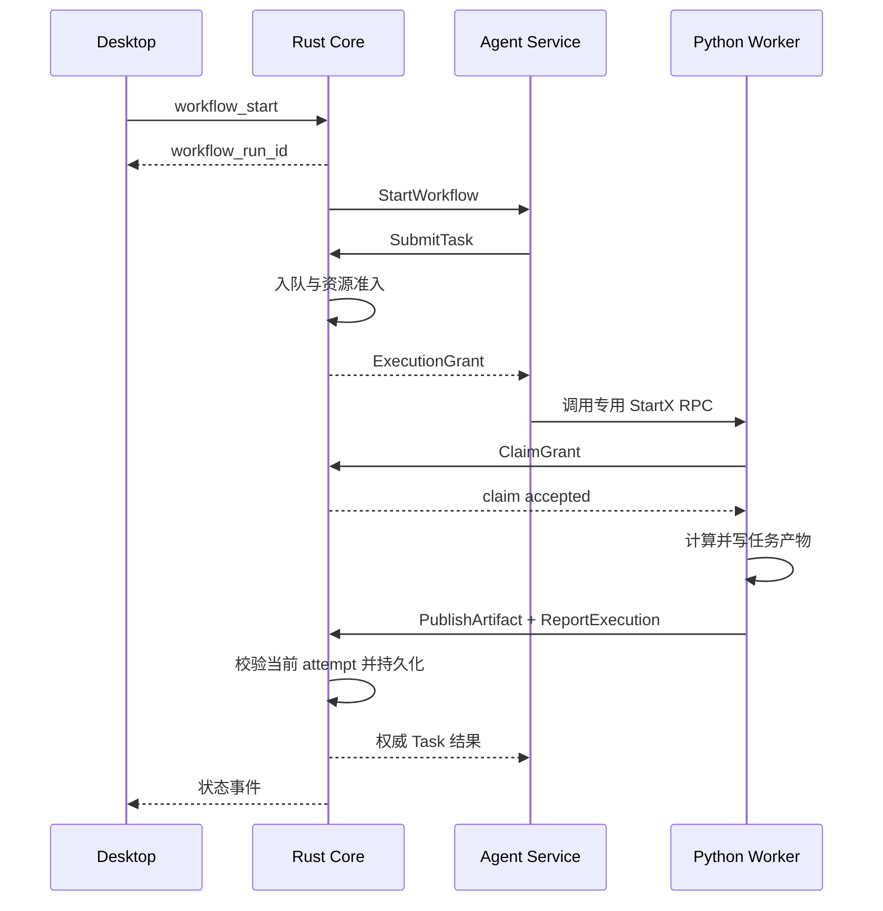
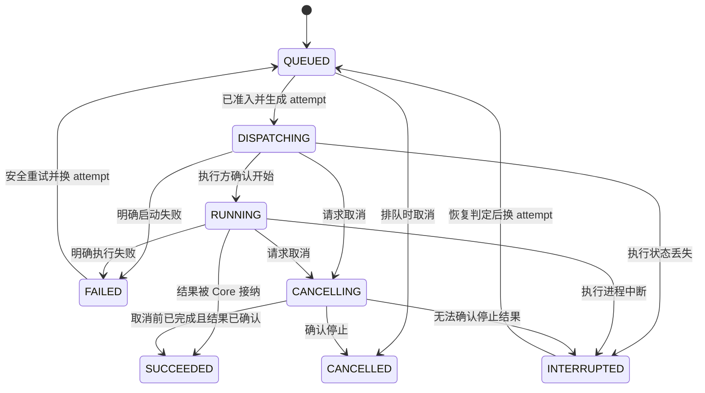
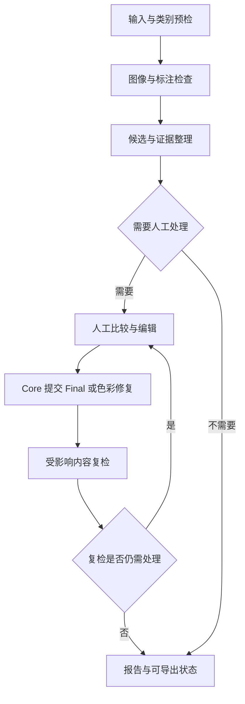
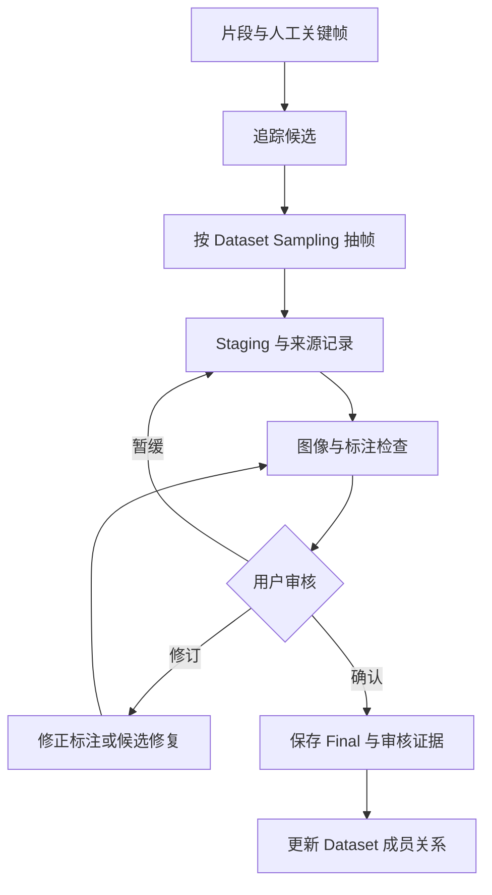
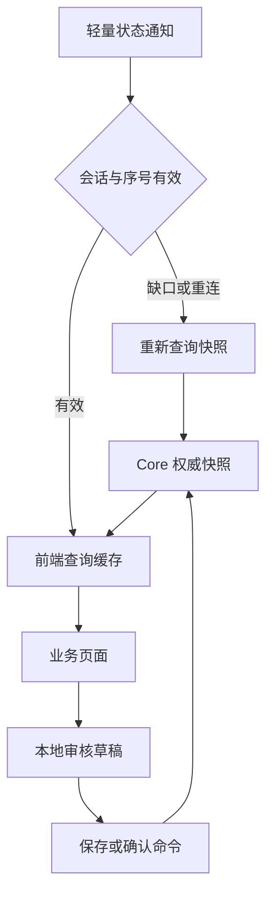

# Dataset Doctor — L2 方案Ⅰ设计基线

**文档编号：** DD-DESIGN-L2-001  
**文档版本：** 1.0  
**方案确认日期：** 2026-11-25  
**决策状态：** Confirmed — 用户已明确选择方案Ⅰ  
**基线状态：** Baselined — 以模板工作流与专用类型接口作为唯一当前实现方向  
**实现与验证状态：** 未开始应用编码；工程 PoC、平台打包、模型效果和性能均待验证  
**适用阶段：** L2 模块、数据、API、工作流、前端与配置设计

## 当前结论与使用方式

用户于 2026-11-25 明确回复：“那么我选择方案1”。本文据此将原双方案评审稿收敛为方案Ⅰ，保留已有模块、数据、审核、视频及恢复契约，采用 **模板工作流 + 专用类型接口 + Agent 有限规划与异常调整**。

本文中的状态作如下区分：

| 标记 | 含义 |
|---|---|
| Confirmed | 已有对话明确确认的决策，包括本次方案Ⅰ选择和既定 L1 边界 |
| Design Default | 选定方案的配套设计默认值与具体契约；可用于后续设计细化，不表示用户曾逐字段确认 |
| To Validate | 需要通过真实工程验证才能成立的能力与运行参数，不表示已经实现 |

具体字段、接口名、COCO 工作 profile、类别字典位置、并发数、超时和重试默认值沿用配套设计。它们作为本基线的工作约定维护；若后续实现发现冲突，应记录调整及影响。无需为普通字段重复进行架构选型。

**当前方向已确定：** Agent 从已注册模板中选择检查项、参数、允许分支与替代策略；Workflow Engine 确定性推进；Core 统一准入和正式提交；Worker 使用明确的 StartX RPC 执行计算。

方案Ⅱ未被选用，其通用能力子图和 Execute 入口不属于当前实现清单。原双方案评审内容保留于本文件的历史版本，供理解选型来源。此处的文档版本与数据库格式版本不增加 Dataset / Annotation 内容版本管理功能。

### 文档内容

| 部分 | 内容 |
|---|---|
| 一、决策边界与已选方案 | 方案Ⅰ决策记录、继承的 L1 约束与首版范围 |
| 二、模块契约 | Core、Agent、Worker、前端职责与用例 |
| 三、数据契约与 SQLite B | 单图 COCO、八张业务表、类别、来源、审核与文件一致性 |
| 四、API、RPC、工具与执行契约 | 前端命令、专用服务接口、状态机、事件与恢复 |
| 五、前端、视频、修复、配置与验收 | 页面映射、双采样、颜色处理、配置与验证标准 |
| 六、设计检查点与下一阶段 | 当前完成状态和 L3 细化入口 |

---

## 一、决策边界与已选方案

### 1.1 有效基线与本轮调整

依据为已确认的《Dataset Doctor L1 系统架构定稿 v1.0》、用户提供的《软件项目设计与开发规范 v1.1》，以及用户在进入 L2 后的最新决定。**新决定优先于旧文档中的冲突描述。**

| 事项 | 当前状态与处理 |
|---|---|
| Rust 主应用、Rust Agent Service、Python Worker | Confirmed；三个后端执行边界，Managers 是逻辑模块 |
| 桌面前端 | Confirmed；Tauri 2 + React + TypeScript + Vite |
| 本地服务通信 | Confirmed；gRPC + Protobuf + TCP Loopback；UI 使用 Tauri Commands / Events |
| 调用拓扑 | Confirmed；Core 控制准入和持久化，Agent 获准后可以直接调用 Worker |
| Agent 组织 | Confirmed；治理协调与视觉审核两个逻辑 Agent，共享一个模型 Key |
| Python 集成 | Confirmed；Rust 管理本地 Worker，Python 库由 Worker 内适配器调用 |
| 标注文件组织 | Confirmed；每张图片旁边一个 JSON，导出时汇总为一个 Dataset COCO JSON |
| 单图文件具体结构 | Design Default；本文建议单图 COCO bbox 工作格式，不等同于 X-AnyLabeling 原生格式 |
| 原 L1 的 Human / Candidate / Final 放同一自定义 JSON | 被最新 COCO 方向替代；本文提出审核草稿与候选外置，当前正式标注写单图 COCO |
| 数据库 | Confirmed；SQLite 方案 B 八张核心业务表；具体字段与约束在本文提出 |
| 当前标注与版本 | Confirmed；保存当前事实，不引入 Dataset / Annotation 内容版本管理 |
| 类别 | Confirmed；一个 Dataset 一个类别集合，仅需名称，允许修改和新增 |
| 类别字典具体权威位置 | Design Default；采用 datasets.categories_json；单图 categories 是可携带的投影 |
| Staging 注入 | Confirmed；检查与用户确认后进入目标 Dataset，或新建 Dataset；不额外复制视频帧 |
| 外部 Dataset | Confirmed；原地引用，外部 JSON 与图片相邻；不在导入时复制全部媒体 |
| 视频双采样 | Confirmed；Tracking Sampling 与 Dataset Sampling 独立配置 |
| 框架、打包、性能 | To Validate；设计未自动证明第三方框架或平台依赖已经可用 |

文档版本、数据库 Schema 版本、协议版本和输入摘要只服务于兼容性与正确性，不是重新引入被排除的数据历史版本功能。

### 1.2 已确认方案与决策记录

| 项目 | 当前决策 |
|---|---|
| 决策编号 | DD-L2-ADR-001 |
| 决策日期与状态 | 2026-11-25；Confirmed |
| 用户确认 | “那么我选择方案1” |
| 执行组织 | 已注册工作流模板、允许的并行步骤与有限条件分支 |
| Agent 权限 | 选择模板、范围、参数和已有替代策略；异常调整有预算与校验 |
| 计划类型 | TemplateInstancePlan；plan_kind 固定为 template_instance |
| Worker 计算入口 | StartProfileDataset、StartImageQualityInspection、StartTracking 等专用类型 RPC |
| 控制与提交 | Core 统一资源准入、任务状态持久化、人工批准和正式文件提交 |
| Agent 组织 | 治理协调 Agent、视觉审核 Agent；共享一个模型客户端和 Key |
| 数据与交付 | 沿用 SQLite B、单图 JSON/导出 COCO、Tauri 桌面与 Python Worker |
| 未采用内容 | 通用能力子图、任意节点端口组合和统一 Execute 计算入口 |
| 后续改动规则 | 普通实现细节在 L3 细化；改变进程边界、数据权威或正式提交权限需记录架构变更 |

选定方案支持“检查 → 候选 → 人工选择 → Core 提交 → 复检 → 导出”的完整闭环，视频生成样本复用同一套治理逻辑。模板可以包含并行和条件分支，不要求每一步都调用模型。

### 1.3 首版格式与能力边界

本文将首版的正式标注目标限定为 **COCO bbox 检测数据**，加上本项目按图片拆分的 COCO 工作文件。COCO 还包含分割、关键点等格式；使用 COCO JSON 并不表示本项目已经支持这些任务。[S1]

| 能力 | 首版契约 |
|---|---|
| 单图 JSON | 一个 images 条目、该图 annotations、类别字典；正式保存时按本文 profile 校验 |
| Dataset 导入 | COCO bbox 聚合文件及本项目单图 COCO；预览后登记或拆分，原地转换必须显式选择 |
| Dataset 导出 | 默认输出一个合法聚合 COCO bbox JSON；图片路径与导出清单一致 |
| X-AnyLabeling / YOLO | 预留具名格式适配器；首版必选适配范围须在实现清单中声明。不能因“一图一 JSON”就宣称原生兼容 |
| 不支持的标注形状 | 明确列出并阻止有损转换；不能悄悄把 polygon、旋转框或 crowd 当普通矩形 |
| 图片质量 | 可执行的结构/图像/重复检查；各检查有独立适用条件和覆盖状态 |
| 标签质量 | 确定性几何与类别检查；需要模型预测的检查，必须先有匹配的有效预测 |
| 语义检查 | 选择疑点样本调用模型；结果是候选意见，不直接升级为 Final |
| 视频 | 时间段标注、追踪、间隔采样、来源追溯、进入 Staging；不做跨视频泄漏检查 |
| 修复 | 区域颜色调整候选；人工选择应用；不承诺恢复真实物理颜色 |
| 模型训练 | 不隐式训练模型。若缺预测或模型，报告检查未执行，而不是质量通过 |

Cleanlab 的目标检测标签质量接口同时接收 labels 和 predictions，因此本项目必须把“预测可用性”建模为前置条件；不能仅安装 Cleanlab 就认为所有标签问题都能检查。[S2]

---

## 二、共同模块契约

### 2.1 依赖方向

前端只表达用户意图；领域模块决定业务规则；Core 的控制组件执行准入与持久化；外部进程执行计算。执行结果只有经 Core 校验后，才影响正式标注或 Dataset 成员。



模块之间传业务 DTO 和引用，不传裸数据库连接，不让前端执行任意文件路径写入。Data Manager 是业务 SQLite 写入唯一入口；Artifact / File Commit 是正式媒体和 JSON 的受控提交入口。两者协作，不把数据库事务误当成跨文件系统事务。

### 2.2 模块职责与输入输出

表内的接口归属是逻辑所有权；对应 Tauri 命令与 gRPC 名称在 API 章节统一规定。

| 模块 | 输入与输出 | 主要责任与依赖 | 持久化与边界 |
|---|---|---|---|
| Workspace Manager | 打开/切换/关闭请求 → WorkspaceContext、生命周期状态 | 注册目录、建立 session、恢复未完文件操作、检查服务状态 | app.db 登记；workspace.db 会话内业务；不允许两个活动 Workspace 同时提交 |
| Dataset Manager | 导入清单、类别变更、成员接收 → DatasetView、成员结果、长任务句柄 | 格式预检、类别映射、成员关系、Staging 接收；依赖 Annotation 和 Data | datasets、dataset_assets、staging_items；不直接维护第二套 bbox |
| Annotation Manager | 当前 JSON、候选、人工选择 → ReviewSnapshot、确认结果 | 类别/几何校验、候选合并、负样本确认、冲突检测；依赖 File Commit | review_sessions 与当前单图 JSON；不负责模型推理或自由图片标注平台 |
| Video Manager | 视频引用、时间段、关键帧、双采样参数 → FrameRef、追踪/采样任务 | 定位帧身份、管理标注时间段、组织追踪与输出归属；依赖 Worker | assets 来源元数据、任务产物；前端播放时间不是帧身份权威 |
| Repair Manager | 图片指纹、区域、颜色参数 → 修复候选、应用结果 | 创建候选任务、对比、提交后使相关检查失效并安排复检 | task artifacts、file_operations；Worker 不覆盖正式图片 |
| Export Manager | Dataset、格式、输出位置、选定样本 → 导出任务和清单 | 校验当前 Final、一致性读清单、COCO ID 重映射、产物发布 | task artifacts/清单；不导出未确认或已过期的候选 |
| Task / Resource Manager | TaskSpec、预算、结果事实 → 准入授权、TaskSnapshot | 队列、资源配额、attempt、状态迁移、取消/重试/恢复、事件 | tasks、workflow_runs；不自己判断 VLM 结论正确与否 |
| Process Manager | 运行环境、能力要求 → ServiceSession、健康状态 | 启动、握手、凭据、退出、崩溃恢复；依赖受控运行环境 | 最小运行配置与诊断；不将进程存活等同于任务成功 |
| Data Manager | 受限 Repository/事务操作 → 领域记录 | SQL、FK、事务、乐观更新、迁移、索引和恢复查询 | 独占业务写入口；Agent/Worker 无 workspace.db 连接 |
| Artifact / File Commit | AssetRef/ArtifactRef、写入意图、预期摘要 → 授权引用、提交结果 | 授权范围、临时产物、摘要校验、提交日志、清理 | 文件系统与 file_operations；不接受模型提供的任意路径 |
| Agent Service | 目标、模板、能力、证据、预算 → 受约束计划/视觉候选/摘要 | 协调 Agent、视觉审核 Agent、Workflow Engine、Tool Adapter、统一模型客户端 | 上报 Core；自己的缓存不成为业务权威 |
| Python Worker | 已准入的类型化工具请求 → CheckResult、Frame/Track/Repair 产物 | Python 库与模型适配、批处理、取消检查、输出验证 | 仅可写授权任务产物位置；无业务 DB 写入，无正式 Final 写入 |
| Frontend View Models | 查询快照、状态事件、交互 → 命令与可见状态 | 分页、过滤、图层、编辑草稿、任务展示、错误和冲突处理 | UI 缓存可丢失；不得以“按钮成功”替代 Core 的持久化确认 |

### 2.3 核心用例的业务步骤与失败边界

#### 用例 A：导入一个已有 Dataset

1. 用户选定目录/标注文件，Core 创建受限选择引用，不能让普通字符串路径自动获得读写权限。
2. 导入预检生成清单：格式、图片与 JSON 配对、类别映射、同名冲突、缺失文件、不支持字段和权限情况。
3. 用户确认导入方案。原地文件转换是单独明确的副作用，不能作为只读扫描的一部分偷偷发生。
4. Core 登记 Dataset 和 Asset，建立成员关系；未被人工确认的数据保留待审核状态。
5. 确定性检查与模型检查各自报告覆盖情况；无法执行的检查不会被计作通过。

**失败规则：** 单个文件不可读可以生成逐项报告，但导入必须说明接受/拒绝数量。未知格式不得默认为空标注。涉及写入的转换按 file_operations 恢复；输入变化则要求重新预检。登记不意味着复制原图，也不意味着立即认可外部标注为 Final。

#### 用例 B：现有图片审核与提交

1. Annotation Manager 读取当前图片/JSON 指纹及确认状态，创建或复用该 Asset 的活动审核会话。
2. UI 同时显示人工草稿、AI 候选和已有 Final，各图层可独立显隐；候选包含证据、不确定性和来源。
3. 用户选择、组合、修改或补框；所有坐标换算到原图像素空间。追加修改覆盖当前草稿，不积累用户可浏览的标注历史。
4. 提交包含会话 ID、预期输入摘要、最终选择、是否确认负样本和幂等键。Core 重新校验。
5. Core 完成文件提交及审核状态登记后，才清理当前候选和草稿；失败或冲突时不能先清候选。
6. 当前 Final 指的是成功提交并绑定当前输入的标注。重新审阅时可保留上一次当前 Final 供对比；默认在活动重审或输入已变化时阻止该样本导出，直到再次确认。

**失败规则：** 晚到 AI 候选、修改前图片的预测、重复提交和旧 workspace session 均不能覆盖新结果。用户不采纳候选时，仍可保留已有有效 Final；取消审核的明确语义见审核契约。空标注只有显式确认成负样本后才可导出。

#### 用例 C：视频生成训练数据

1. Video Manager 登记源视频与流信息；用户选择时间段和类别上下文。
2. UI 播放或 seek 后，请求 Worker 定位真实解码帧，返回带来源摘要的 FrameRef，再允许标注关键帧。
3. Tracking Sampling 决定追踪算法处理哪些帧；Dataset Sampling 决定哪些实际帧生成训练样本。
4. Worker 输出追踪候选和选定帧；Core 校验产物，登记来源、track 关联与 Staging。
5. 视频帧与 JSON 保存在 Workspace 的视频文件夹中；审核后不再复制一份媒体。
6. 样本进入统一体检/审核流程，用户接收后更新 Dataset 成员关系；导出仍使用同一 Export Manager。

**失败规则：** 追踪丢失、遮挡或不可信区间必须显式断轨/待审；不得跨越失败帧“自动宣布正确”。缺失精确采样帧的标注时需补算或人工审核，不能把邻帧框直接复制当成已确认标签。源视频变更后，旧追踪和采样来源失效。

#### 用例 D：区域改色与复检

1. 用户在确定图片上定义矩形或多边形区域及颜色调整参数。
2. Worker 在任务目录生成候选和摘要；显示原图/候选、区域及颜色变化。
3. 用户应用时 Core 核对图片摘要与区域归属，按文件提交协议替换当前工作图片。
4. 图片摘要变化使相关质量检查与语义审核依据失效；原 bbox 可以保留为待复核几何信息，不因几何未变就自动保留全部质量结论。
5. 复检后重新人工确认；Agent 可以提出建议或说明失败，不能自行把修复结果升级为 Final。

**失败规则：** 区域外像素变化超过约定、候选尺寸改变、色彩解释不明确或输入变化，应拒绝直接应用。颜色参数不会由 Agent 静默从“黄色”改为“红色”的真实标签判断。

#### 用例 E：导出与备份

导出关注训练可用数据，备份关注 Workspace 可恢复性，两者使用不同清单。导出使用成员及指纹清单、逐图校验和 COCO ID 重映射；备份包含登记的外部媒体、JSON 与业务索引，并记录新路径映射。SQLite 的在线备份机制只解决数据库副本；完整 Workspace 的媒体一致性仍需要应用协调。[S3]

**失败规则：** 导出中途变化不能生成一个看似成功、实际混合前后状态的数据集。备份不能遗漏 WAL 中尚未 checkpoint 的业务状态，也不能把只复制 workspace.db 描述为完整备份。未完成产物保留为未发布，UI 不提供成功下载/打开标记。

### 2.4 内部调用、锁与状态规则

- 普通 Core 模块间使用 Rust 类型化调用；本机网络接口只存在于跨进程边界。
- I/O 或计算步骤可异步执行，但状态改变必须经过所属 Manager 的规则校验。
- 任务资源使用 Core 的 Semaphore/配额；文件提交使用 Asset 级互斥与预期摘要；SQLite 使用短事务。
- 不跨整个 Workflow 持有数据库事务或图片写锁；等待模型和人工审核时不占 GPU 许可。
- 数据库行的 row_revision、计划修订号和 attempt 是并发控制，不是用户数据版本。
- 外部不协作软件可能在摘要检查后继续改文件；本应用只能降低和检测冲突，不能宣称普通文件原子替换天然具有跨软件 compare-and-swap 语义。
- 对用户长期编辑但未提交的草稿，不让异步刷新自动覆盖。UI 检测冲突时提供重新加载、保留草稿和重新比对的明确操作。

### 2.5 模块契约的验收对应

| 模块 | 必须证明的关键结果 |
|---|---|
| Workspace / Process | 切换后旧任务回报不能污染新 Workspace；退出无失控后台计算 |
| Dataset | 类别映射、成员唯一性和 Staging 接收不会重复注入 |
| Annotation | 当前图片/JSON 不匹配时拒绝提交；负样本与缺标签区分 |
| Video | 变帧率、seek、重复采样仍能对应相同真实帧 |
| Repair | 只应用用户确认的候选，冲突不覆盖，应用后复检依据更新 |
| Export | 局部 COCO ID 重复不造成聚合碰撞；未确认样本不被偷带入 |
| Task / Agent | 无准入不可执行，旧 attempt 不改新状态，重规划不能绕过人工关卡 |
| Data / File Commit | 崩溃窗口可识别；恢复不能猜测并静默删除/覆盖外部内容 |
| Frontend | 图层与状态一致；事件丢失可查询恢复，密钥和完整路径不经全局事件广播 |

后面的数据字典、API、状态机和验收矩阵是上述模块的具体输入输出契约，而不是独立于模块的另一套设计。


---

## 三、数据契约与 SQLite B

> 状态：方案Ⅰ的配套数据设计基线（Design Default），不是已经实施的数据库。
>
> 本章落实选定方案的数据权威、审核门槛和存储布局。
>
> 已确认的前提：SQLite B 方案；工作时每图一份 JSON，导出时汇总 COCO；外部图片默认引用原目录；无数据集或标注历史版本；Core 统一提交正式修改。单图 COCO 最小结构、类别字典位置及本章具体字段作为本基线的配套设计默认维护。

### 1. 什么由谁负责

| 内容 | 权威位置 | 约束 |
|---|---|---|
| 当前框及其类别引用 | 图片对应的工作 JSON | SQLite 不保存 bbox 或第二套 annotations |
| Dataset 类别字典 | datasets.categories_json，正式建议 | 单图 categories 是解释文件所需的副本；名称不要求附加描述 |
| 资源身份、当前位置、来源 | assets | UUID 独立于文件名、路径及 COCO 整数 ID |
| 正式 Dataset 成员 | dataset_assets | 同一图片当前最多属于一个 Dataset |
| 尚未注入的数据 | staging_items | 不靠物理目录判断；审核后只改关系，不复制帧 |
| 人工确认是否有效 | review_sessions 及成员的 final_review_id | 必须与当前图片、标注及当前类别字典指纹对应 |
| Workflow 与 Task 状态 | workflow_runs、tasks | Agent、Worker 上报；Core 校验并持久化 |
| 检查报告、候选、模型输出 | 任务目录中的 Artifact | SQL 保存引用，不复制报告正文 |
| 当前帧定位、当前跟踪关联 | assets 元数据所引用的正式 Artifact | 属于当前数据依赖，不能作为临时候选清除 |

一个 Workspace 使用自己的 workspace.db。Workspace UUID 放在建议的 workspace.json 标志/配置文件中；Core 打开数据库后绑定这一身份，不能仅凭路径认定工作区。全局应用注册库仍按 L1 管理，以下八表是工作区业务库。另有一个 schema_meta 技术表保存数据库格式号及 Workspace UUID；打开时与 workspace.json 比对，不匹配就拒绝写入，不能把移错的数据库自动改成当前身份。

#### 1.1 通用类型与身份

所有业务 ID 均采用 UUID 字符串：workspace_id、workspace_session_id、dataset_id、asset_id、workflow_run_id、node_id、task_id、attempt_id、request_id、idempotency_key、artifact_id；本章的 review_id、operation_id、sampling_config_id、track_id 也采用 UUID。UUID 由指定调用方生成并经 Core 验证，不是访问授权凭据。

workspace_session_id 在每次打开工作区后重新生成，用于拒绝旧会话的迟到执行结果。request_id 标识一次调用；同一业务操作重发时保留 idempotency_key，但可以使用新的 request_id。幂等作用域为 (workspace_id, operation_kind, idempotency_key)，并绑定规范化请求的 request_fingerprint；workspace.db 内 Workspace 已隐含。Task 是逻辑可调度工作；重试保持 task_id，生成新的 attempt_id。输入、目标或计算目的变化属于新 Task，不能当成旧尝试。

时间字段为 UTC Unix 毫秒 INTEGER；界面按用户时区显示。摘要使用 64 位小写十六进制 SHA-256 字符串，与公共 DTO 一致；示例中的 SHA256_HEX_64 是形状占位符。JSON 列为 UTF-8 TEXT，由 Core 按对应契约验证；SQL NULL 与 JSON null 不混用。下方 DDL 中标注 NOT NULL 的字段必须提供，未写 DEFAULT 的字段由 Core 显式赋值；可空字段默认 SQL NULL。

row_revision 只是乐观并发控制序号，变更时递增。它不提供历史浏览、还原或数据集版本功能。

### 2. 单图工作 JSON：COCO bbox profile

本章建议使用一张图片的 COCO 结构，而非 AnyLabeling 原生 JSON：

```json
{
  "images": [
    {"id": 1, "file_name": "frame_000012.jpg", "width": 1920, "height": 1080}
  ],
  "annotations": [
    {"id": 1, "image_id": 1, "category_id": 3,
     "bbox": [120.0, 80.0, 40.0, 60.0], "area": 2400.0, "iscrowd": 0}
  ],
  "categories": [
    {"id": 3, "name": "red_light"}
  ]
}
```

规则：

- images 恰好一条；annotations 可以为空；所有 image_id 必须引用该条图片。
- 图片、标注、类别 ID 是各自文件内的整数；MVP 使用非负安全整数。不同图片的 JSON 可以重复使用相同 image.id、annotation.id。
- 新建文件默认 image.id 为 1，但读取已有文件时不要求其等于 1。annotation.id 在该文件内唯一。
- bbox 为像素坐标的 x、y、width、height；写入正式结果前验证数值有限、宽高为正，并执行适用的几何质量检查。读取有问题的文件时保留诊断信息，不能悄悄修正数值。
- categories 至少覆盖本文件使用的类别。新文件使用当前 Dataset 类别字典的 ID 和名称；不用缺失的类别描述补造语义。
- 本轮 MVP profile 是普通轴对齐 bbox。polygon、segmentation、旋转框、关键点等不因“COCO”这个名字就自动获得支持。
- 文件不添加 Human、AI Candidate、Final、Workflow 或 track_id 等业务字段；这些信息在审核记录、候选 Artifact 和来源元数据中表达。
- file_name 是文件解析所需的名称或相对位置。最终导出时重新生成，不能把本机绝对路径泄漏到训练包中。

“有工作 JSON”不等于“审核通过”。它可能是导入的人工标注，也可能是此前确认的当前结果：

| 情形 | 含义 |
|---|---|
| 没有 JSON | 资源已登记，尚未保存工作标注 |
| JSON 存在，无有效确认记录 | 有标注正文，但未满足当前导出确认条件 |
| JSON 的 annotations 为空，无确认记录 | 无法仅凭空数组认定为合法负样本 |
| annotations 为空，有有效确认记录 | 用户已确认没有目标，可以作为负样本 |
| JSON 有框，有有效确认记录 | 当前 Final；导出只使用这一套正文 |

候选放在任务 Artifact 中；人工尚未提交的修改放审核草稿 Artifact。确认成功后，Core 将最终选择的结果写入工作 JSON，再结束审核并清除活动候选、草稿引用。成功前不得先删除候选。保留检查报告和确认摘要不等于保留 Human、AI Candidate 的完整历史副本。

### 3. 类别、导入及外部文件

#### 3.1 类别唯一权威

datasets.categories_json 的建议结构如下：

```json
[{"id": 1, "name": "helmet"}, {"id": 3, "name": "red_light"}]
```

类别 ID 在 Dataset 内唯一、稳定；类别名称在 Dataset 内按精确字符串唯一。显示顺序由数组顺序决定，不把顺序位置或 YOLO 类别序号当作 COCO ID。删除类别后不立即复用旧 ID。新增类别直接修改当前字典；没有 Label Schema Version。

本轮推荐保守规则：任何类别字典变化，包括增加新类别，都使旧类别摘要对应的确认暂时失效。用户可以在查看变更影响后批量确认既有标注，无需重新画框。代价是增加确认操作；好处是避免软件自行认定新类别与既有图片无关。以后如需按所用类别精确失效，应另行评审，不能暗中启用。重命名保留类别 ID，由 Core 创建可恢复的批量操作，同步受影响 JSON 的 categories。重写 JSON 会改变其摘要，原 track map 的绑定需要重建并重新核验；该批量操作不能自动刷新 CONFIRMED 摘要伪装成已人工复核。操作完成前阻止相冲突的导出和标签提交；不要出现 SQL 已改名、部分 JSON 仍使用旧名称却被认定完全同步。删除仍被使用的类别需要先处理引用，不能静默删除对应框。

导入时先根据源 categories 建立“源 ID—源名称—目标 ID”映射；不同源文件中相同数字不代表同一类别。不存在的名称可以经导入预览加入当前字典。没有自动同义词合并、类别描述生成或跨数据集本体对齐。

#### 3.2 导入分为 inspect、preview、apply

默认操作是引用原图和保留原文件，而不是转换后覆盖。

1. inspect 检查格式、图片对应关系、类别与几何类型，读取文件摘要。
2. preview 展示哪些文件原样引用、哪些需要转换、输出位置、名称冲突、不能保留的字段和预计改动。
3. apply 只执行用户选择的计划，并核对预览时的输入摘要；原文件已经改变则要求刷新预览。

对已经符合单图 COCO bbox profile 的文件，可以无损注册。对 Dataset 级 COCO 拆分，需预览每图输出位置、ID 映射及原有文件冲突。

AnyLabeling 原生 JSON 不自动成为本软件的正式契约。若检测到 polygon、旋转框或当前适配器不支持的字段，默认保留原文件并报告不支持；不能把它们默默转换为 bbox 或丢弃。需要有损输出时必须明确列出损失并由用户选择，且该转换能力必须实际实现后才能开放。初版可以只开放无损 COCO bbox 导入。

用户可选择独立转换目录，或明确选择覆盖原标注。选择独立目录不自动切换当前 Dataset 的路径；转换完成后按预览约定登记或由用户重新导入。若用户选择覆盖，必须显示精确路径、字段损失和不可撤销影响；这不改变“默认引用原目录、默认保持原文件”的行为。

#### 3.3 文件对应与冲突

正常的新工作文件使用图片旁同主体名称的 JSON。若同目录同时有 foo.jpg 和 foo.png，则 foo.json 不能自动绑定给任意一张。新文件可分别使用 foo.jpg.json、foo.png.json，并在预览中展示；注册表记录真实 annotation_path，后续不靠文件名重新猜测。

预先存在的 AnyLabeling foo.json 也不能被普通“保存标注”悄悄改写成 COCO。只有显式转换操作可以改变其格式；保存接口应拒绝尚未完成格式适配的文件。

外部目录缺失时标记 OFFLINE，不自动删除记录。重新定位保留 Asset ID，通过内容摘要、已有绑定和用户选择核对身份。相同字节可能属于两个独立 Asset，摘要不能充当唯一主键。复制过的 sidecar 也不能使两个物理资源自动合并。

### 4. 来源、跟踪与输入指纹

#### 4.1 来源元数据

source_metadata_json 使用带 kind 的结构。video_frame 的最小形状为：

```json
{
  "kind": "video_frame",
  "frame": {
    "source_video_id": "UUID",
    "source_digest": "SHA256_HEX_64",
    "stream_index": 0,
    "frame_index": "12",
    "pts_us": "480000",
    "pts": "12",
    "time_base_num": 1,
    "time_base_den": 25,
    "timestamp_ms": 480
  },
  "sampling": {
    "tracking": {"sampling_config_id": "UUID", "mode": "EVERY_N_FRAMES", "every_n": 1},
    "dataset": {"sampling_config_id": "UUID", "mode": "TIME_INTERVAL",
                "interval_ms": 1000, "include_keyframes": false}
  },
  "extraction_method": "registered_decoder_capability",
  "extraction_task_id": "UUID",
  "extraction_attempt_id": "UUID"
}
```

frame_index、pts_us、底层 pts 用十进制整数字符串避免前端整数精度损失；time_base_den 必须为正。frame_index 是选定视频流按展示顺序排列的帧索引，不是压缩包或解码到达次序；timestamp_ms 仅用于展示，不通过秒数乘 FPS 反推正式帧号。两种 sampling 分别有 sampling_config_id，记录实际生效值。mode 只能是 EVERY_N_FRAMES 或 TIME_INTERVAL；前者记录正整数 every_n，后者记录正整数 interval_ms，实际来源记录不混入未激活模式的偏好。源视频列与来源 JSON 中的 source_video_id 必须一致。

普通导入图片使用 kind=imported_image；源视频使用 kind=source_video。未标注图片没有 JSON 时，来源仍由 assets 保存，不强迫先创建空标签文件。

#### 4.2 正式跟踪关联不是临时候选

assets.metadata_json 可以包含 current_track_map_ref、video_frame_index_ref 和 video_annotation_manifest_ref。对外引用复用公共 ArtifactRef，owner 明确为 TASK、ASSET 或 REVIEW 及对应 UUID，不强制所有产物都依附 Task，不暴露内部路径；Core 的持久 manifest entry 保存 artifact_id、relative_path、sha256、kind、media_type 等定位信息，由 Core 校验后解析。

video_annotation_manifest_ref 指向当前视频工作清单，包含已保存片段、精确端点、关键帧及人工草稿引用。video_save_segment 必须更新这一正式依赖并持久化；它需要备份，不能作为 AI 临时候选清理。每张图片当前 track map 的载荷建议为：

```json
{
  "asset_id": "UUID",
  "annotation_digest": "SHA256_HEX_64",
  "bindings": [
    {"local_annotation_id": 1, "track_id": "UUID",
     "tracking_task_id": "UUID", "tracking_attempt_id": "UUID"}
  ]
}
```

跟踪算法的局部数字 ID 可以在产物中保留，但对外绑定到 Core 分配的 track_id。人工新增且没有跨帧身份的框可以不建立绑定。正式标注 ID 改变时必须同步重建映射；外部修改导致摘要不匹配时映射失效，不能猜测对应关系。

正式 track map、视频帧索引和视频工作清单是当前数据依赖，备份时包含，候选清理时排除。候选自己的 track map 可以清理。MVP 不强制另外建立 tracks 业务表，也不将 track_id 硬塞进标准 COCO annotations。

#### 4.3 输入指纹是审核、复查与恢复的依据

任务输入 manifest 保存下述逻辑结构，实际 UUID 和摘要必须有效：

```json
{
  "dataset_id": "UUID",
  "label_schema_digest": "SHA256_HEX_64",
  "assets": [
    {"asset_id": "UUID", "media_digest": "SHA256_HEX_64",
     "annotation_digest": null, "source_metadata_digest": "SHA256_HEX_64"}
  ],
  "resolved_config": {},
  "capability_id": "registered_capability_name",
  "implementation_version": "recorded-version",
  "model_identity": null,
  "input_fingerprint": "SHA256_HEX_64"
}
```

此处是 InputManifest 唯一字段定义；公共 API 通过引用复用，不另外定义删减版。dataset_id、label_schema_digest 在 video_probe 等非 Dataset 操作中可以为 null，纯控制操作的 assets 可以为空；Dataset 检查与审核操作必须有 Dataset 和类别摘要，不得借可空规则忽略实际输入。assets 中 media_digest 绑定实际媒体字节；annotation_digest 可空，source_metadata_digest 无来源信息时可空。resolved_config 是有效配置对象；model_identity 为 null 或包含 provider、model_id、可空 revision 的对象，不含密钥。

input_fingerprint 由 Core 对规范化输入计算，排除摘要自身。规范化格式与摘要算法只由 Core 实现；Worker 接收经授权的输入 manifest 引用及其指纹，不要求 Rust、Python 各自重新序列化并算出同一个值。annotation_digest 为 null 表示该输入明确没有工作 JSON，而不是任意忽略未知文件。调用模型时记录实际可获得的模型标识；未知版本不能伪造。该记录能判断输入是否改变，不承诺云模型输出完全可复现。

### 5. 工作区八业务表与技术元数据 DDL

下面是可评审的 SQLite DDL，不是已执行的迁移。每个数据库连接启用外键；状态值由对应状态机章节统一定义，不在此复制另一套枚举。schema_meta 是技术元数据，不是新增业务域或历史版本表。时间和 UUID 由 Core 注入。JSON 格式、UUID 格式、摘要形状、跨行业务关系由 Core 验证。

```sql
PRAGMA foreign_keys = ON;
-- 部署初始化时在实际本地工作区数据库启用并核验 WAL。
-- journal_mode=WAL 和连接配置见本章存储策略，不代表在内存示例中运行 WAL。

CREATE TABLE schema_meta (
    singleton INTEGER PRIMARY KEY CHECK (singleton = 1),
    workspace_id TEXT NOT NULL UNIQUE,
    schema_version INTEGER NOT NULL CHECK (schema_version >= 1),
    created_at_ms INTEGER NOT NULL,
    updated_at_ms INTEGER NOT NULL
);

CREATE TABLE datasets (
    dataset_id TEXT PRIMARY KEY NOT NULL,
    name TEXT NOT NULL,
    categories_json TEXT NOT NULL DEFAULT '[]',
    config_json TEXT NOT NULL DEFAULT '{}',
    row_revision INTEGER NOT NULL DEFAULT 0 CHECK (row_revision >= 0),
    created_at_ms INTEGER NOT NULL,
    updated_at_ms INTEGER NOT NULL
);

CREATE TABLE assets (
    asset_id TEXT PRIMARY KEY NOT NULL,
    kind TEXT NOT NULL CHECK (kind IN ('IMAGE', 'VIDEO')),
    location_kind TEXT NOT NULL
        CHECK (location_kind IN ('WORKSPACE', 'EXTERNAL')),
    path TEXT NOT NULL,
    original_filename TEXT NOT NULL,
    file_origin TEXT NOT NULL CHECK (file_origin IN ('IMPORTED', 'GENERATED')),
    availability TEXT NOT NULL DEFAULT 'ONLINE'
        CHECK (availability IN ('ONLINE', 'OFFLINE')),
    annotation_path TEXT,
    annotation_format TEXT,
    annotation_origin TEXT NOT NULL DEFAULT 'NONE'
        CHECK (annotation_origin IN ('NONE', 'PREEXISTING', 'APP_CREATED')),
    annotation_local_image_id INTEGER CHECK (annotation_local_image_id >= 0),
    media_digest TEXT,
    annotation_digest TEXT,
    source_video_id TEXT REFERENCES assets(asset_id) ON DELETE RESTRICT,
    source_metadata_json TEXT NOT NULL DEFAULT '{}',
    metadata_json TEXT NOT NULL DEFAULT '{}',
    row_revision INTEGER NOT NULL DEFAULT 0 CHECK (row_revision >= 0),
    created_at_ms INTEGER NOT NULL,
    updated_at_ms INTEGER NOT NULL,
    UNIQUE (location_kind, path),
    CHECK (kind = 'IMAGE' OR annotation_path IS NULL),
    CHECK (
        (annotation_path IS NULL AND annotation_origin = 'NONE')
        OR (annotation_path IS NOT NULL AND annotation_origin <> 'NONE')
    )
);
CREATE UNIQUE INDEX uq_assets_work_annotation
    ON assets(location_kind, annotation_path)
    WHERE annotation_path IS NOT NULL AND annotation_format = 'COCO_IMAGE_BBOX';
CREATE INDEX idx_assets_source_video ON assets(source_video_id);
CREATE INDEX idx_assets_availability ON assets(availability);

CREATE TABLE workflow_runs (
    workflow_run_id TEXT PRIMARY KEY NOT NULL,
    dataset_id TEXT REFERENCES datasets(dataset_id) ON DELETE SET NULL,
    workspace_session_id TEXT NOT NULL,
    template_key TEXT NOT NULL,
    plan_kind TEXT NOT NULL
        CHECK (plan_kind = 'template_instance'),
    plan_json TEXT NOT NULL,
    node_states_json TEXT NOT NULL DEFAULT '{}',
    status TEXT NOT NULL DEFAULT 'DRAFT',
    request_id TEXT NOT NULL,
    operation_kind TEXT NOT NULL,
    idempotency_key TEXT NOT NULL,
    request_fingerprint TEXT NOT NULL,
    input_manifest_path TEXT,
    checkpoint_manifest_path TEXT,
    result_manifest_path TEXT,
    error_code TEXT,
    error_message TEXT,
    row_revision INTEGER NOT NULL DEFAULT 0 CHECK (row_revision >= 0),
    created_at_ms INTEGER NOT NULL,
    updated_at_ms INTEGER NOT NULL,
    started_at_ms INTEGER,
    finished_at_ms INTEGER,
    UNIQUE (operation_kind, idempotency_key)
);
CREATE INDEX idx_workflows_dataset_status ON workflow_runs(dataset_id, status);

CREATE TABLE tasks (
    task_id TEXT PRIMARY KEY NOT NULL,
    workflow_run_id TEXT REFERENCES workflow_runs(workflow_run_id)
        ON DELETE RESTRICT,
    node_id TEXT,
    dataset_id TEXT REFERENCES datasets(dataset_id) ON DELETE SET NULL,
    workspace_session_id TEXT NOT NULL,
    capability_id TEXT NOT NULL,
    status TEXT NOT NULL DEFAULT 'QUEUED',
    current_attempt_id TEXT,
    attempt_no INTEGER NOT NULL DEFAULT 0 CHECK (attempt_no >= 0),
    request_id TEXT NOT NULL,
    operation_kind TEXT NOT NULL,
    idempotency_key TEXT NOT NULL,
    request_fingerprint TEXT NOT NULL,
    input_manifest_path TEXT NOT NULL,
    input_fingerprint TEXT NOT NULL,
    resource_profile_json TEXT NOT NULL DEFAULT '{}',
    execution_metadata_json TEXT NOT NULL DEFAULT '{}',
    output_manifest_path TEXT,
    progress REAL DEFAULT NULL
        CHECK (progress IS NULL OR (progress >= 0 AND progress <= 1)),
    error_code TEXT,
    error_message TEXT,
    row_revision INTEGER NOT NULL DEFAULT 0 CHECK (row_revision >= 0),
    created_at_ms INTEGER NOT NULL,
    updated_at_ms INTEGER NOT NULL,
    started_at_ms INTEGER,
    finished_at_ms INTEGER,
    UNIQUE (operation_kind, idempotency_key),
    CHECK (
        (workflow_run_id IS NULL AND node_id IS NULL)
        OR (workflow_run_id IS NOT NULL AND node_id IS NOT NULL)
    )
);
CREATE INDEX idx_tasks_workflow_node ON tasks(workflow_run_id, node_id);
CREATE INDEX idx_tasks_status_created ON tasks(status, created_at_ms);
CREATE UNIQUE INDEX uq_tasks_current_attempt
    ON tasks(current_attempt_id) WHERE current_attempt_id IS NOT NULL;

CREATE TABLE review_sessions (
    review_id TEXT PRIMARY KEY NOT NULL,
    asset_id TEXT NOT NULL REFERENCES assets(asset_id) ON DELETE CASCADE,
    dataset_id TEXT NOT NULL REFERENCES datasets(dataset_id) ON DELETE CASCADE,
    source_task_id TEXT REFERENCES tasks(task_id) ON DELETE SET NULL,
    status TEXT NOT NULL DEFAULT 'OPEN',
    baseline_media_digest TEXT NOT NULL,
    baseline_annotation_digest TEXT,
    baseline_label_schema_digest TEXT NOT NULL,
    review_manifest_path TEXT,
    confirmed_media_digest TEXT,
    confirmed_annotation_digest TEXT,
    confirmed_label_schema_digest TEXT,
    row_revision INTEGER NOT NULL DEFAULT 0 CHECK (row_revision >= 0),
    created_at_ms INTEGER NOT NULL,
    updated_at_ms INTEGER NOT NULL,
    confirmed_at_ms INTEGER,
    UNIQUE (review_id, asset_id, dataset_id)
);
CREATE UNIQUE INDEX uq_review_active_asset ON review_sessions(asset_id)
    WHERE status IN ('OPEN', 'COMMITTING', 'CONFLICT');
CREATE INDEX idx_reviews_dataset_status ON review_sessions(dataset_id, status);

CREATE TABLE dataset_assets (
    dataset_id TEXT NOT NULL REFERENCES datasets(dataset_id) ON DELETE CASCADE,
    asset_id TEXT NOT NULL REFERENCES assets(asset_id) ON DELETE CASCADE,
    final_review_id TEXT,
    added_at_ms INTEGER NOT NULL,
    PRIMARY KEY (dataset_id, asset_id),
    UNIQUE (asset_id),
    FOREIGN KEY (final_review_id, asset_id, dataset_id)
        REFERENCES review_sessions(review_id, asset_id, dataset_id)
        ON DELETE RESTRICT
);

CREATE TABLE staging_items (
    asset_id TEXT PRIMARY KEY NOT NULL
        REFERENCES assets(asset_id) ON DELETE CASCADE,
    target_dataset_id TEXT REFERENCES datasets(dataset_id) ON DELETE SET NULL,
    review_id TEXT REFERENCES review_sessions(review_id) ON DELETE SET NULL,
    check_task_id TEXT REFERENCES tasks(task_id) ON DELETE SET NULL,
    check_acceptance_digest TEXT,
    check_accepted_at_ms INTEGER,
    created_at_ms INTEGER NOT NULL,
    CHECK (
        (check_acceptance_digest IS NULL AND check_accepted_at_ms IS NULL)
        OR (check_acceptance_digest IS NOT NULL AND check_accepted_at_ms IS NOT NULL)
    )
);
CREATE INDEX idx_staging_target ON staging_items(target_dataset_id);

CREATE TABLE file_operations (
    operation_id TEXT PRIMARY KEY NOT NULL,
    idempotency_key TEXT NOT NULL,
    request_id TEXT NOT NULL,
    request_fingerprint TEXT NOT NULL,
    workspace_session_id TEXT NOT NULL,
    operation_kind TEXT NOT NULL,
    dataset_id TEXT REFERENCES datasets(dataset_id) ON DELETE SET NULL,
    asset_id TEXT REFERENCES assets(asset_id) ON DELETE SET NULL,
    review_id TEXT REFERENCES review_sessions(review_id) ON DELETE SET NULL,
    task_id TEXT REFERENCES tasks(task_id) ON DELETE SET NULL,
    status TEXT NOT NULL DEFAULT 'PREPARED',
    manifest_path TEXT NOT NULL,
    manifest_digest TEXT NOT NULL,
    result_json TEXT,
    error_code TEXT,
    error_message TEXT,
    created_at_ms INTEGER NOT NULL,
    updated_at_ms INTEGER NOT NULL,
    completed_at_ms INTEGER,
    UNIQUE (operation_kind, idempotency_key)
);
CREATE INDEX idx_file_operations_status ON file_operations(status);
CREATE INDEX idx_file_operations_asset ON file_operations(asset_id);
```

#### 5.1 不能只靠上面 DDL 表达的规则

- Dataset 名称可以重复，ID 不可重复；类别名称唯一性在 JSON 字典校验中实现。review 和 Task 的 label_schema_digest 均涵盖本次使用的完整 Dataset 类别字典，避免两套失效规则。
- 路径先按所属文件系统解析与规范化，再比较；不能为跨平台方便就把所有路径强制转小写。
- 源视频必须引用 VIDEO 资源；Dataset 成员只能是 IMAGE。普通原视频不成为训练图片成员。
- 同一 Asset 不能同时出现在 dataset_assets 与 staging_items；Core 的注入事务同时删除后者并新增前者。
- 活动审核只有一个；候选可以多份，存 review manifest，不新增审核会话来表示每一个候选。
- CONFIRMED 审核必须有三个 confirmed 摘要及 confirmed_at_ms。final_review_id 必须指向同图片、同 Dataset 的有效确认。
- 导入的现有图片可以先登记为 Dataset 成员，但 final_review_id 为空时不满足最终导出条件。批量确认现有标注可以生成确认记录，不要求逐张重新画框。
- staging_items 的 review_id、check_task_id 必须对应当前 Asset 和目标 Dataset；没有目标 Dataset 时不能确认并注入。
- check_acceptance_digest 绑定用户确认的检查输入。检查报告不因完成就自动“通过”；输入变化后此前确认失效。
- 删除 Dataset 时先结束活动任务，并在事务内解除成员和 Staging 的审核引用，再清理 Dataset；不要直接执行裸 DELETE 期待外键代替业务删除流程。

progress 为 NULL 表示未知进度，0 表示已经知道进度且尚未推进，两者不能混用。

plan_json 记录 TemplateInstancePlan 模板实例及参数。node_states_json 保存节点绑定与控制进度，不能成为 tasks.status 的另一权威副本。运行中调整必须通过计划校验和 row_revision 检查。

一行 Task 记录当前尝试。旧 attempt 的执行信息写入任务日志/manifest，不保留第二张 attempts 业务表；日志应记录任务 ID、尝试 ID、输入指纹和产物。它们不自动构成跨崩溃 exactly-once 保证。Core 只接受当前会话、当前 attempt 和合法状态迁移的结果。新的检查输入应创建新 Task 并记录前因，节点到 Task 的历史绑定可放运行记录；不能覆盖旧 Task 的输入。

#### 5.2 执行授权、游标与终态如何持久化

tasks.execution_metadata_json 保存当前 attempt 的对账信息，字段复用公共执行契约：

```text
ExecutionMetadata {
  executor_session_id: UUID,
  workspace_session_id: UUID,
  grant_id: UUID,
  resource_reservation_id: UUID,
  node_spec_fingerprint: SHA256_HEX_64,
  operation_digest: SHA256_HEX_64,
  input_fingerprint: SHA256_HEX_64,
  grant_state: ISSUED | CLAIMED | REVOKED,
  claimed_execution_id?: UUID,
  last_source_event_seq?: decimal_string,
  last_execution_event_id?: UUID,
  terminal_receipt?: {
    completion_fingerprint: SHA256_HEX_64,
    accepted_at: RFC3339_UTC,
    result_manifest_ref?: ArtifactRef
  },
  checkpoint_ref?: ArtifactRef
}
```

尚未分配尝试时该对象为 {}。执行结果被接受时，当前 attempt 的元数据与任务状态在同一 SQL 事务提交。旧 attempt 的明细保存在执行记录中；新 attempt 不复用旧授权或终态收据。

Core 重启后旧凭据与 Grant 全部失效。持久字段用于判断发生过什么，不恢复旧信号量和授权。执行方失联时不能凭“没收到心跳”立即把同一 GPU 额度发给另一个任务；先确认执行已停止或相关进程已经退出。

每个进程的 stream_epoch、event_seq 以及有界事件重放缓冲保存在内存，重启后换 epoch。last_source_event_seq 只用于当前执行来源的去重对账；不等于持久完整事件流。前端断线超过窗口或 Core 重启后重新获取快照，不承诺永久回放所有进度事件。

TASK 归属的 Artifact 由 tasks.output_manifest_path 中已接受的产物清单解析；ASSET、REVIEW 归属的当前工作 Artifact 分别由资源元数据、审核工作 manifest 定位。tasks.output_manifest_path 指向已接受的任务产物清单。Core 读取并校验清单条目后才对外解析 artifact_id；Worker 报出一个 ID 不等于该产物已正式注册。正式视频工作清单、track map 等另由 assets.metadata_json 保持当前引用，禁止随旧候选任务清理。

#### 5.3 app.db 的既有全局职责

以下两张表位于独立 app.db，不加入 Workspace 八业务表，也不存图片、标注或任务正文。它们落实 L1 已确认的全局注册与设置职责。

```sql
CREATE TABLE workspace_registry (
    workspace_id TEXT PRIMARY KEY NOT NULL,
    root_path TEXT NOT NULL UNIQUE,
    name TEXT NOT NULL,
    last_opened_at_ms INTEGER,
    availability TEXT NOT NULL DEFAULT 'ONLINE'
        CHECK (availability IN ('ONLINE', 'OFFLINE'))
);

CREATE TABLE app_settings (
    singleton INTEGER PRIMARY KEY CHECK (singleton = 1),
    config_json TEXT NOT NULL DEFAULT '{}',
    config_revision INTEGER NOT NULL DEFAULT 0 CHECK (config_revision >= 0),
    updated_at_ms INTEGER NOT NULL
);
```

workspace_registry 是入口索引；真正打开时仍验证目标 Workspace 标志和 schema_meta，不能仅按同名目录复用 ID。app_settings.config_json 保存全局资源上限、界面偏好和非秘密连接设置，API Key 仍由安全凭据存储管理。全局修改以 config_revision 校验；Dataset 覆盖保存在 datasets.config_json，实际任务配置冻结在输入 Artifact。

### 6. 导出时重新分配 COCO ID

导出以用户选定 Dataset 的正式成员为范围，逐图检查当前内容与确认摘要，然后读取工作 JSON。建立三组映射：

1. asset_id → export image.id；
2. (asset_id, local annotation.id) → export annotation.id；
3. 单图类别引用 → 当前 Dataset 的类别 ID。

所以不能建立 UNIQUE(dataset_id, local_image_id)；每图 image.id=1 是允许的。类别 ID 不因文件读取顺序变化；图片和标注 ID 可按稳定排序连续分配。file_name 以实际导出的文件布局产生，名称冲突在生成包前处理。

结果写入独立导出目录，包含汇总 COCO、所需图片以及本次导出的映射/来源清单；不修改原 Dataset 的 ID。该导出产物不建立 Dataset Version 业务。正式 track map 可用于生成来源清单，但不默认向标准 COCO 增加扩展字段。

导出开始和完成时核对受读资源摘要；MVP 可在 Core 内阻止所选数据的并发写入。其他软件仍可能修改外部文件，因此读取前后发现变化必须失败或明确要求重试，不能承诺对任意外部程序的瞬时快照。

### 7. 文件提交、幂等与故障恢复

单图 JSON 修改由 Annotation Manager 校验，文件提交模块执行；Data Manager 负责 SQL。SQLite 事务与文件替换不是一个原子事务。

#### 7.1 正常提交顺序

1. 验证 request、session、目标 Asset、当前 row_revision、基线图片/标注/类别摘要、授权路径及审核状态。
2. 以 operation_kind 和 idempotency_key 查询 file_operations，并比对 request_fingerprint。已完成返回原结果；同 key 不同意图返回冲突；未完成恢复原操作，不另起第二次覆盖。
3. 在受控临时位置准备新 JSON、必要的正式 track map 和操作 manifest。manifest 记录每个目标的旧摘要、新摘要、临时文件、预期 SQL 变更和产物身份。
4. 临时内容验证通过后，持久化 PREPARED 意图；Core 获取相关资源的提交锁并再次检查基线。
5. 逐个替换目标文件。单图文件用完整文件替换避免留下半截正文；多文件操作逐项记录进度，不宣称整体文件系统事务。
6. 校验新摘要，执行一个 SQL 事务：更新登记摘要和正式依赖、确认审核、更新成员关系，并将操作记为 COMMITTED。
7. 成功后清除活动候选/草稿引用，按依赖关系清理临时文件；返回保存过的结果。

审核待人确认期间不长期占用 GPU 或文件提交锁。类别重命名之类多文件操作使用 Dataset 级变更门槛，普通单图提交按 Asset 串行；计算任务仍可并行，只是旧输入的结果不能直接提交。

#### 7.2 恢复判定

| 故障窗口 | 恢复动作 |
|---|---|
| 临时文件写完，但没有 PREPARED | 原工作文件未变；识别并清理无引用临时文件 |
| PREPARED 已写，目标仍是旧摘要 | 检查用户授权仍有效与临时文件完好，再安全继续，或记为中止 |
| 部分目标为新摘要、部分仍旧 | 按 manifest 逐项核对后完成剩余步骤；发现第三种内容则进入 CONFLICT |
| 文件已更新，SQL 尚未提交 | 以新摘要验证实际文件，幂等补齐同一操作的 SQL 更新 |
| SQL 已提交，客户端没收到结果 | 根据同一 key 返回已保存的结果，不重复修改文件或注入成员 |
| 旧、新摘要都不匹配 | 保留冲突证据，不自动覆盖外部变更，等待明确处理 |

文件操作状态建议为 PREPARED、FILES_APPLIED、COMMITTED、CONFLICT、ABORTED、FAILED；即使状态写入滞后，也必须检查实际文件，不能仅凭状态推进。操作完成后可压缩临时记录，但在允许的重发窗口内保留幂等键及结果；不能刚成功就删除去重依据。

对应用内部采用提交锁与摘要校验；对未配合的外部软件，“检查摘要后到替换文件前”仍存在竞争窗口。MVP 不宣称严格跨进程 CAS。检测到变化要停写或进入冲突；外部软件对受管理文件的并行编辑不属于无损合并承诺。

图片修复同样先产生候选文件，用户接受后才替换目标图片；替换会使旧检查和旧标签确认失效，必须复查或重新确认。file_operations 是恢复日志，不是原图和旧标签的长期版本库。

### 8. 删除与备份边界

#### 8.1 本地 SQLite 运行约束

MVP 的 workspace.db 放在本地文件系统；不把网络共享目录或多机器同时同步修改的数据库作为运行方式。初始化真实数据库时设置并核验 journal_mode=WAL；每次新建连接在事务前启用 foreign_keys=ON。写连接采用 synchronous=FULL，并配置有限 busy timeout；这些是建议默认，不能通过无限等待掩盖死锁或重复提交。Core 仍是业务写入入口，连接池不改变这一点。

WAL 模式下备份使用 SQLite 备份接口生成一致的数据库副本，或在干净关闭连接、完成检查点后复制关闭的数据库；不能在应用运行时只复制 workspace.db 并忽略未检查点的内容。不要把 sqlite 主文件、wal、shm 随意按不同时间复制后当作一致备份。备份目标可以位于其他位置，但不能让两个 Core 同时打开同一个活动工作区数据库。

#### 8.2 删除与备份范围

Dataset 删除和单张资源删除不是同一动作。默认保护外部原图及导入前已经存在的 JSON；只按用户已选择的规则清理软件创建的标签/生成产物。annotation_origin 不能因为软件编辑过一个旧 JSON 就从 PREEXISTING 改为 APP_CREATED。外部路径范围必须在删除计划中明确列出。

单张图片可解除关系或显式物理删除；物理删除无回收站。物理删除前先记录可恢复的操作意图，完成后删除相应引用；不把恢复日志当作能恢复已删除原文件的备份。源视频仍被帧引用时保留来源登记，不能级联清除帧；若源视频物理文件被用户删除，则标记来源离线。

备份包含 SQLite 的一致副本、所有注册的外部图片/JSON/源视频、内部帧、正式来源、track map、视频工作清单及当前人工草稿、必要任务报告和恢复记录。先暂停提交并明确备份边界，备份期间检测外部文件变化；必要时标记不完整并重试。不会因为登记一个目录就把其中所有无关文件自动复制。模型缓存和临时候选可按保留规则排除，API Key 不作为普通明文配置打包。

备份 manifest 记录原路径、包内相对路径及摘要，恢复到用户选择的新根目录后重建定位。备份恢复是一项显式操作，不构成日常 Dataset Version 功能。

### 9. 本章采用的配套设计约定

1. 单图工作 JSON 使用 COCO bbox profile；AnyLabeling 作为可选格式适配，不默认为同一格式。
2. Dataset 类别字典由 datasets.categories_json 管理，工作 JSON 保留必要类别副本。
3. B 八表的职责及上述约束；详细状态值复用统一状态机。
4. 源帧和当前 track map 作为正式元数据依赖，避免标准 COCO 承担业务扩展。
5. 对外部修改采用检测与冲突处理；文件和数据库使用可恢复提交，明确不承诺外部并发严格 CAS。

上述约定为本方案的数据契约；不再维护另一套并行 JSON、数据库或审核实现。


---

## 四、API、RPC、工具与执行契约

> 状态：**Design Default / 方案Ⅰ接口基线**。本章给出可映射到 Rust、Protobuf 和 TypeScript 的契约；尚未编码或完成工程验证。接口名、枚举与字段须同步生成和检查，变更按同一基线维护。

### C1. 接口与进程边界

| 边界 | 公开方式 | 可执行的事情 | 不承担的事情 |
|---|---|---|---|
| Desktop → Rust Core | Tauri Command，返回 DTO；Tauri Event 通知状态 | 用户意图、读取、任务提交、人工批准、配置 | 直连 SQLite、持有云模型密钥、直接调用 Worker |
| Core 内部模块 | Rust 类型化接口 | 业务规则、事务、授权文件提交、资源调度 | 再套一层 HTTP 服务 |
| Core ↔ Agent Service | 本机 gRPC | 注册模板、启动/恢复工作流、查询状态、请求规划 | Agent 改写数据库或绕过人工批准 |
| Core ↔ Python Worker | 本机 gRPC | 健康管理、人工发起的确定性任务、执行事实回传 | Worker 写入正式标注或正式图片 |
| Agent → Python Worker | Core 准入后的本机 gRPC | 调用已注册检查、检测、追踪、修复预览 | 绕过 Core 队列、任意路径访问、任意 shell/Python 执行 |
| Agent 内部 → 模型提供方 | 统一 Model Client Adapter | 两个逻辑 Agent 共用一个模型配置和 API Key | 为每个 Agent 单独创建 Key，向 Worker/UI 分发 Key |

Core 统一拥有任务事实和业务数据；Agent 拥有规划与下一步选择的逻辑；Worker 拥有一次计算的执行事实。三者不是三个互相竞争的任务数据库。

本方案使用已注册工作流模板和显式 Worker RPC；模板的人工批准、Core 提交及复检关卡不得由模型移除。

### C2. 公共类型和参数规则

#### C2.1 标识、时间与单位

| 类型/字段 | 契约 |
|---|---|
| workspace_id、dataset_id、asset_id、workflow_run_id、node_id、task_id、attempt_id、review_id、artifact_id、issue_id | 标准 UUID 字符串；文件名、COCO 本地整数 ID 不代替这些标识 |
| workspace_session_id | 每次打开 Workspace 生成的新 UUID；旧会话结果不能写入新会话 |
| executor_session_id | 每次服务进程启动/注册生成的新 UUID；重启不能继承旧执行授权 |
| request_id | 每次请求的追踪 UUID；**不用于保证幂等** |
| idempotency_key | 关键副作用请求的 UUID 去重键；同键必须绑定同一请求指纹 |
| revision | 并发校验计数，不是内容历史版本；JSON 使用十进制字符串，Protobuf 使用 uint64 |
| created_at / updated_at | API 采用 UTC RFC 3339；Protobuf 使用 google.protobuf.Timestamp |
| duration_ms | 非负整数毫秒；单独的具体字段规定上限 |
| pts_us | 有符号十进制字符串，表示解码后帧的展示时间微秒值；原始 PTS 与 time_base 留在来源元数据 |
| bbox_xywh | 原始、方向已规范化图像坐标中的 [x, y, width, height]，单位为像素，float64；不是归一化坐标 |
| size_bytes、event_seq、frame_index | JSON 中以十进制字符串表示大整数；frame_index 是视频流按展示顺序确定、0 起始的帧序号，不是压缩包或解码到达次序 |
| sha256 / fingerprint | 64 位小写十六进制字符；必须说明所覆盖的内容，不能把修改时间当内容指纹 |
| progress | 可空的 [0,1] 浮点数；未知进度用 null，不伪造百分比 |
| page_size | 默认 100，范围 1–500；游标由 Core 生成，列表顺序稳定 |

UUID 是应用身份；COCO 的 image.id、annotation.id 只在对应 JSON 的作用域内使用。帧序号由统一的解码索引策略产生，不能按播放时间乘以帧率推算。

#### C2.2 CommandContext、返回与错误

除打开/创建 Workspace 等引导操作外，所有前端命令包含：

```text
CommandContext {
  request_id: UUID,
  workspace_id: UUID,
  workspace_session_id: UUID,
  idempotency_key?: UUID
}
```

需要防覆盖的修改另有 expected_revision、expected_image_digest 或 expected_annotation_digest。服务端从已经认证的调用来源识别 actor；**不接受调用者自行传 actor="human" 来获得批准权限**。

成功通过 Tauri invoke 返回对应 Response DTO；失败返回结构化 AppError。长任务的正常返回值是 OperationRef，代表“已受理”，不代表检查、写入或导出已经完成。

```text
OperationRef {
  operation_kind: enum,
  task_id?: UUID,
  workflow_run_id?: UUID,
  status: enum,
  accepted_at: timestamp
}
AppError {
  code: stable_string,
  message: user_safe_string,
  request_id: UUID,
  retryable: boolean,
  field_errors?: [{ field, code, message }],
  resource_id?: UUID,
  current_revision?: decimal_string,
  details_ref?: ArtifactRef
}
```

OperationRef 至少有 task_id 或 workflow_run_id；完整治理流程可以同时返回 workflow_run_id 和第一项任务的 task_id。进度页面以 Workflow 为整体、Task 为具体执行单位，不能把两者合并成一个 ID。

| AppError.code | gRPC 状态建议 | 客户端行为 |
|---|---|---|
| INVALID_ARGUMENT / INVALID_BBOX / UNSUPPORTED_FORMAT | INVALID_ARGUMENT | 高亮字段或提示格式；不原样重试 |
| WORKSPACE_NOT_OPEN / STALE_WORKSPACE_SESSION | FAILED_PRECONDITION | 重新获取当前 Workspace；拒绝旧页面写入 |
| NOT_FOUND / ASSET_OFFLINE | NOT_FOUND / FAILED_PRECONDITION | 重新定位或刷新列表 |
| PERMISSION_DENIED / ARTIFACT_ACCESS_DENIED | PERMISSION_DENIED | 检查授权目录/资源范围 |
| REVISION_CONFLICT / INPUT_CHANGED | ABORTED / FAILED_PRECONDITION | 重新读取并比较；不能静默覆盖 |
| REVIEW_REQUIRED / REPORT_STALE / SCHEMA_MISMATCH | FAILED_PRECONDITION | 回到审核、复检或类别映射 |
| RESOURCE_BUSY / CAPACITY_EXCEEDED | RESOURCE_EXHAUSTED | 返回排队信息或稍后再试 |
| MODEL_UNAVAILABLE / CAPABILITY_UNSUPPORTED | FAILED_PRECONDITION | 显示该项未执行，可调整能力选择 |
| DEADLINE_EXCEEDED | DEADLINE_EXCEEDED | 先按 task_id/幂等键查询，不能直接重新创建副作用 |
| IDEMPOTENCY_CONFLICT | ALREADY_EXISTS | 同一键载荷不同；拒绝 |
| INTERNAL / DATA_CORRUPTION | INTERNAL / DATA_LOSS | 保留诊断引用，停止相关提交 |

gRPC 状态描述传输/服务调用结果，AppError 描述业务原因；“RPC 成功但检测发现缺陷”属于正常业务结果，不应编码为 INTERNAL。

#### C2.3 ArtifactRef、输入清单和路径授权

```text
ArtifactRef {
  artifact_id: UUID,
  owner: { kind: TASK | ASSET | REVIEW, id: UUID },
  kind: enum,
  media_type: string,
  size_bytes: decimal_string,
  sha256: string,
  schema_id?: string
}
InputManifestRef = ArtifactRef(schema_id = "datasetdoctor.input-manifest.v1")

```

InputManifest 的完整持久结构以数据章节“输入指纹”小节为唯一权威，使用 label_schema_digest、assets[].media_digest、annotation_digest、source_metadata_digest、resolved_config、capability_id、implementation_version、model_identity 和 input_fingerprint；本章不另建同名简化格式。输入清单以任务 Artifact 保存，RPC 只传引用、摘要和数量；批次大时分片。清单是“本次计算使用哪些现有文件”的证明，不复制全部数据，也不产生 Dataset 内容版本。

前端选目录后由 Core 建立受限 PathGrant；后续 API 传 grant_id，不把任意前端字符串当成可读写路径。Worker 得到 Core 为本次任务解析后的只读输入定位符和独立可写任务目录；定位符有角色、资源、执行实例与生命周期约束。ArtifactRef 是标识，不是 bearer 授权本身；具体读写仍需经过 Core 的调用身份与范围校验。owner 为 TASK、ASSET 或 REVIEW 的判别归属：任务产物按任务 manifest 解析，正式视频工作清单/track map 按 Asset 元数据解析，当前审核草稿按 Review manifest 解析。ASSET/REVIEW 正式当前依赖不会随旧候选 Task 清理。

### C3. 检查、模型证据和候选标注的结果契约

#### C3.1 CheckResult

```text
CheckResult {
  check_id: string,                 // 注册项，例如 image.blur
  check_contract_version: string,
  execution_status: COMPLETED | SKIPPED | UNSUPPORTED | FAILED | CANCELLED,
  assessment: PASS | FINDINGS | INCONCLUSIVE | NOT_EVALUATED,
  input_fingerprint: string,
  processed_assets: integer,
  total_assets: integer,
  finding_count: integer,
  findings_ref?: ArtifactRef,
  evidence_refs: ArtifactRef[],
  skip_or_failure_reason?: { code, message },
  started_at, finished_at
}
```

只有执行完成且覆盖范围满足检查规则，才可给出 PASS。没有预测结果、未安装模型、不支持某格式、网络失败、VLM 无法判断，分别形成明确状态，不能折算成“检查通过”。治理报告分别显示已检查比例、发现的问题和未执行的检查。

#### C3.2 Finding、PredictionEvidence、CandidateRegion

| DTO | 必填字段 | 可选字段与规则 |
|---|---|---|
| Finding | issue_id、check_id、finding_code、severity、input_fingerprint、explanation | asset_id 可空以表示 Dataset 级问题；region、evidence_refs、suggested_action、uncertainty、related_issue_ids |
| PredictionEvidence | evidence_id、asset_id、input_fingerprint、model_id、model_config_fingerprint、prediction_ref | model_weights_digest、model_version、runtime_info、score_definition；没有真实权重 hash 时不能捏造 |
| CandidateRegion | candidate_id、asset_id、review_id、category_id、label_name、bbox_xywh、source、input_fingerprint | confidence、confidence_meaning、evidence_refs、track_id、uncertainty、supersedes_candidate_id |
| AnnotationDraft | review_id、asset_id、draft_revision、image_digest、base_annotation_digest、coco_document | confirmed_negative 是用户提交的明确选项；候选并不因被写进草稿而自动正式确认 |

severity 采用 INFO / WARNING / ERROR / CRITICAL，具体映射由检查规则配置决定，不宣称跨模型的置信度可直接比较。source 采用 HUMAN_IMPORTED / HUMAN_EDITED / DETECTOR / TRACKER / VLM_PROPOSED。置信度只有在来源明确时展示，VLM 自述置信度必须标记为模型自述。

Finding 的 explanation 说明证据与理由；uncertainty 说明缺少什么信息或为什么不能下结论。建议动作仅限 REVIEW_LABEL、REVIEW_BOX、REVIEW_IMAGE、COLOR_PREVIEW、RECHECK、NO_ACTION 等注册类型，不是可以直接执行的脚本文本。

候选框采用全图像素坐标；模型裁剪、缩放、填充产生的预测必须先逆变换，记录 transform/evidence，才能提供给审核界面。bbox 要求有限数值、width>0、height>0；是否允许小数、边界截断和最小尺寸由统一的几何验证器执行。若框越界，检测结果记录问题；不得把原标注悄悄裁剪后当作已通过。

当前审核有效性采用保守的完整 Label Schema 摘要；本轮类别新增、删除、重命名都使旧确认需要重新核对，可提供人工批量确认。活动审核阻止该图片导出；取消审核可返回仍然有效的旧 Final，但输入图像、标注或类别摘要已变时不能借取消恢复有效状态。

标准 COCO 没有 Human/AI/Final 审核状态。当前正式内容保存在单图 COCO 文件；候选和草稿放审核任务 Artifact；审核状态与内容摘要放 SQLite。track_id 的持续映射由数据章节规定的当前追踪元数据保存，不能随着候选清理丢失。

### C4. 前端 Command API 完整职责清单

以下命令组成当前桌面应用的公开业务入口。输入隐含 CommandContext；“异步”返回 OperationRef，“同步”返回具体 DTO。所有数组需有明确上限，批量任务可将大清单落成受控 Artifact。这里的命令是 Tauri 公开命令名，不是 URL 路由。

#### C4.1 Workspace、Dataset、Asset

| 命令 | 输入 DTO 核心字段 | 输出 | 规则/失败重点 |
|---|---|---|---|
| path_select | purpose、kind、access | PathGrant | Core 打开系统选择对话框并登记范围，完整字段见 C13；请求 access 本身不授予权限 |
| workspace_create | directory_grant_id、display_name | WorkspaceSnapshot | 创建标志文件与 workspace.db；目录已包含 Workspace 时引导打开 |
| workspace_open | directory_grant_id | WorkspaceSnapshot + workspace_session_id | 校验格式、恢复未完成文件操作、产生新会话；不默认执行未完成旧任务 |
| workspace_get | context | WorkspaceSnapshot | 包含能力、离线资源统计、进行中任务 |
| workspace_close | mode=WAIT/CANCEL、expected_session_id | CloseReceipt | 停止新任务；等待/取消在途任务；只有实际关闭成功才切换页面 |
| workspace_backup_submit | destination_grant_id、include_reports=true | 异步 | 包含登记的外部资源；创建可恢复清单；不能把复制目录视为 SQLite 一致备份 |
| dataset_create | name、category_names[] | ImportPlan | plan_id、input_manifest_ref、plan_fingerprint、source_format、proposed_dataset、file_actions[]、category_mapping、conflicts[]、unsupported_fields[]、requires_explicit_choices[]；file_actions 明确 REFERENCE/CREATE_CONVERTED/WRITE_CONVERTED_TO_SELECTED_ROOT/EXPLICIT_OVERWRITE，不自动选择有损覆盖 |
| SecretStatus | model_profile_id、configured:boolean、credential_ref?、credential_revision；永远不返回已有 Key；new_secret 为非空字符串，最大 8192 UTF-8 字节，不落普通配置与诊断 |
| DatasetSummary | 类名唯一、非空；初始化空 Dataset |
| dataset_import_inspect | root_grant_id、format、image_selection、annotation_locator、target_dataset_id? | 异步，结果 ImportPlan | 只检查和生成预览；列出文件/类别/格式冲突、转换计划和原文件摘要 |
| dataset_import_external | import_plan_ref、plan_fingerprint、category_mapping、approved_conversion_choices、target_dataset_id? | 异步 | 执行已选择的导入计划；源改变拒绝旧计划；默认原地引用，转换/覆盖按显式选择 |
| dataset_get / dataset_list | dataset_id / page_cursor、page_size | DatasetDetail / Page<DatasetSummary> | 返回当前类别、成员统计、报告摘要；不把 bbox 全部塞进列表 |
| dataset_update_categories | dataset_id、expected_revision、categories:[{id:int,name:string}]、mapping? | OperationRef（异步） | 类别新增可直接修改；已有类别删除/重命名影响现有引用时执行显式映射/拒绝悬空引用 |
| dataset_delete_preview | dataset_id | DeleteImpact | 区分受管理资源与外部原文件；列出将删的对象 |
| dataset_delete_submit | dataset_id、impact_fingerprint、idempotency_key | 异步 | 重新验证影响清单；清理受管理数据，外部原数据按已确认所有权规则保留 |
| asset_list | dataset_id?、staging_filter?、kind?、cursor、page_size | Page<AssetSummary> | 本轮不提供跨 Dataset 共享写入 |
| asset_get | asset_id | AssetDetail | 包含来源、路径显示、可用性、当前标注状态和摘要 |
| asset_relink | asset_id 或 registered_root_id、new_grant_id、expected_source_digest | OperationRef（异步） | 验证身份；不将同名但内容不同的文件当原资源 |
| asset_remove_preview | asset_id、mode=UNLINK/DELETE_FILES | DeleteImpact | 列出关系、确切文件和外部原件影响，产生 impact_fingerprint |
| asset_remove_submit | asset_id、mode=UNLINK/DELETE_FILES、impact_fingerprint | 异步 | 物理删除必须是明确用户动作；无回收站；对外部目录规则不能由 Agent 改写 |

Dataset “导入格式”是外部适配器输入；工作文件写成本项目选定的单图 COCO 契约。原文件不是 COCO 时，是否创建相邻新 JSON、如何识别已有同名文件必须由导入预检清单解决；不能以格式转换之名无提示覆盖其他软件文件。

#### C4.2 标注审核与候选

| 命令 | 输入 | 输出 | 规则/失败重点 |
|---|---|---|---|
| annotation_get | asset_id | AnnotationView | 当前正式文件内容、当前审核状态、草稿/候选引用、image/annotation digest |
| review_open | asset_id、base_image_digest、base_annotation_digest? | ReviewSession | 同一 Asset 仅一个活动审核；重复请求返回当前会话或明确占用 |
| review_save_draft | review_id、expected_review_revision、expected_draft_revision、coco_document | DraftReceipt | 验证几何/类别/图像关联；只保存草稿，不覆盖正式文件 |
| review_candidates_submit | review_id、model_profile_id、check_scope、candidate_policy | 异步 | 创建视觉审核任务；绑定基础图像与标签摘要；不保证新候选更优 |
| review_commit | review_id、expected_review_revision、draft_digest、base_image_digest、base_annotation_digest?、confirmed_negative | 异步 | 用户批准入口；Core 提交最终 JSON；成功后清理活动 Human/AI 草稿与候选，保留报告/证据按保留策略 |
| review_cancel | review_id、expected_revision | ReviewSession | 丢弃活动审核草稿，不改当前正式文件 |
| media_get_locator | asset_id 或 artifact_id、purpose=DISPLAY | DisplayLocator | 返回限范围、可到期的本地展示定位符；不返回 API Key 或任意可写路径 |

“额外手动编辑覆盖人工草稿”体现于 review_save_draft 更新同一份草稿；最终审核可以选择人工、AI 或再次手改的组合。显示/隐藏框、显示颜色、透明度属于前端视图状态，不应每次切换都改业务数据库。

#### C4.3 视频、采样与 Staging

| 命令 | 输入 | 输出 | 规则/失败重点 |
|---|---|---|---|
| video_import | file_grant_id、display_name? | 异步 | 注册视频 Asset、解析流与时间基准；外部原视频继续被引用 |
| video_get | source_video_id | VideoDetail | 媒体信息、来源状态、标注片段、采样配置引用 |
| video_resolve_frame | source_video_id、target={timestamp_ms 或 frame_index}、seek_policy=NEAREST/AT_OR_AFTER | 异步或命中缓存后 FrameRef | 未命中时返回 OperationRef；返回 resolved timestamp 和精确 FrameRef，不承诺请求时间必有同一帧 |
| video_save_keyframe_draft | source_video_id、target_dataset_id、frame_ref、coco_document、expected_video_revision | KeyframeDraftReceipt | Core 保存当前人工关键帧草稿，返回 ASSET 所属的 annotation_ref；不生成 Final 或 Dataset 成员 |
| video_save_segment | source_video_id、target_dataset_id、segment_id?、start_us、end_us、keyframes:[{frame_ref,annotation_ref}]、expected_revision | SegmentReceipt | 区间为 [start_us,end_us)；关键帧引用已保存草稿；全部落在区间内且属于同一源视频摘要与目标类别上下文 |
| video_track_submit | source_video_id、segment_id、tracking_sampling_config、tracker_profile、input_fingerprint | 异步 | 输出逐帧候选轨迹与低置信区间；不直接产生成员关系 |
| video_sample_submit | source_video_id、segment_id、tracking_result_ref?、dataset_sampling_config、target_dataset_id | 异步 | 在 Workspace 视频目录生成图片与单图 JSON/候选；登记 Staging；采样值由用户配置 |
| staging_list | target_dataset_id?、status?、cursor | Page<StagingItem> | 显示标注/检查/审核状态以及来源帧 |
| staging_commit | asset_ids[]、target_dataset_id、quality_report_ref、acknowledged_findings[]、expected_schema_fingerprint | 异步 | 用户明确确认；核对当前摘要、Final 与报告新鲜度；更新关系不复制帧 |
| staging_remove_submit | asset_ids[]、delete_generated_files | 异步 | 删除关系和明确指定的已生成文件；不删除源视频 |

FrameRef 结构见视频章节。video_resolve_frame 响应是明确的判别联合：{kind:"ready",frame:FrameRef} 或 {kind:"accepted",operation:OperationRef}，前端不能把 accepted 当作已有图片。其余长期计算统一使用异步接口，避免客户端猜测是否已完成。

本稿建议在开始某次视频标注时选定目标 Dataset；需要“新建独立 Dataset”时先创建空 Dataset，再标注和注入。这样类别来源明确，同时满足导出新数据集或合入已有数据集两种选择。

#### C4.4 治理、修复、报告和导出

| 命令 | 输入 | 输出 | 规则/失败重点 |
|---|---|---|---|
| workflow_plan_preview | dataset_id 或 staging_scope、template_id、goal、policy_overrides | 异步 | 生成待查看计划与覆盖说明；不应用修复；可选入口，不强制每次先点预览 |
| workflow_start | scope、template_id、plan_ref?、input_fingerprint?、policy_overrides | 异步 | Core 校验已注册模板和授权范围；合法计划在策略内执行；人工提交仍单独批准 |
| workflow_get / workflow_list | workflow_run_id / query | WorkflowSnapshot / Page | 包含固定关卡、节点、关联任务、等待人工事项 |
| workflow_pause / workflow_resume | workflow_run_id、expected_revision；resume 另含恢复策略 | WorkflowControlReceipt | pause 停止继续派发，等待当前计算结束后进入 PAUSED；resume 校验输入与计划后继续，INTERRUPTED 时先核对旧执行并重新准入 |
| workflow_cancel | workflow_run_id、reason? | CancellationReceipt | 停止安排后续节点并请求取消在途任务；不回滚已经确认的文件 |
| task_get / task_list | task_id / filters、cursor | TaskSnapshot / Page | 包含当前 attempt、错误、结果引用、恢复能力 |
| task_cancel | task_id、reason? | CancellationReceipt | 返回 requested=true 不等于已经停止 |
| task_retry | task_id、expected_task_revision、mode=RETRY/RESUME_IF_AVAILABLE | OperationRef | 仅安全失败/中断任务；相同输入重试换 attempt；输入变更须新任务 |
| repair_color_preview | asset_id、region、color_operation、parameters、base_image_digest | 异步 | 输出候选图片和操作掩膜；不改正式图像 |
| repair_color_apply | candidate_artifact_id、asset_id、base_image_digest、expected_asset_revision | 异步 | 用户批准后 Core 应用；图像摘要变化触发相关检查/审核过期 |
| report_get | report_id 或 workflow_run_id/task_id | ReportSummary + ArtifactRef | 展示未执行项、范围、模型/规则来源、问题与修复后的复检 |
| report_export_submit | report_ref、format=JSON/MARKDOWN、destination_grant_id | 异步 | 导出完整报告与必要引用；不导出密钥、临时授权 |
| dataset_export_submit | dataset_id、format=COCO_DETECTION、destination_grant_id、selection、export_policy | 异步 | 仅正式成员与当前可导出 Final；聚合 COCO 并重建整数 ID；未确认条目默认阻止或由明确选择排除 |
| sync_snapshot | known_stream_epoch?、last_event_seq?、requested_scopes | SyncSnapshot | 事件重连后的权威状态快照 |
| settings_get | scope | SettingsSnapshot | 返回非秘密设置、作用层和 config_revision |
| settings_update | scope、patch、expected_config_revision | SettingsSnapshot | 类型化白名单补丁；重启项明确返回 restart_required，密钥使用专用只写接口 |
| model_connection_test | model_profile_id | OperationRef（异步） | 只做最小连接/结构化输出能力检查，不承诺模型精度 |
| model_secret_set | model_profile_id、new_secret、expected_credential_revision | SecretStatus | 只写接口；Core 安全保存并通知 Agent 更新受控内存凭据；请求体与日志不回显 Key |
| model_secret_clear | model_profile_id、expected_credential_revision | SecretStatus | 禁止新的模型请求使用已删除凭据；已发出的远程调用不能声称被撤回 |

所有用户批准写入、删除、导出、备份命令只向 UI 用户入口开放。Agent 的工具目录不注册这些方法，即使模型输出同名 tool call 也必须拒绝。

### C5. gRPC 协议与服务契约

#### C5.1 公共握手、鉴权与消息预算

所有本地服务只绑定 127.0.0.1 的动态端口。Core 启动服务时通过受控启动通道提供服务凭据与端口；凭据不放进命令行日志、工作文件或报告。握手检查 role、executor_session_id、支持的 protocol major、构建信息与 capability 清单。进程可以协商支持的能力；major 不兼容时拒绝运行。

建议包名 datasetdoctor.v1。认证放 gRPC metadata，业务请求仍包含 Workspace/执行范围；客户端不能仅凭知道 task_id 就调用任意任务。单条控制消息默认上限 4 MiB，结果/清单超过上限转 Artifact；不得把高分辨率媒体转 Base64 夹进 RPC。

所有 unary 调用显式设置 deadline；长计算不以延长 unary deadline 代替任务模型。Streaming 有独立保活和重连策略，不能依赖 gRPC 自动提供业务事件持久化。

#### C5.2 Core Control Service

本表除 WatchAssignments 和 WatchCoreEvents 为 **server-streaming** 外，其余均为 **unary**。ReportExecution 采用有界、限流的 unary 事件上报，终态带幂等 execution_event_id；不另造必须维持双向长连接才能提交终态的条件。C5.3 和 C5.4/C5.5 列出的方法均为 unary，Start 迅速受理、实际计算异步。

| RPC | 调用方 | 请求要点 | 返回/行为 |
|---|---|---|---|
| RegisterExecutor | Agent / Worker | role、executor_session_id、protocol、capabilities | 服务注册与可用能力；不授予任意数据访问 |
| SubmitPlan / ProposePlanAdjustment | Agent | workflow_run_id、expected_revision、template_id、计划/变化、reason、input_fingerprint | Core 验证固定关卡、预算与允许范围，持久化或拒绝 |
| SubmitTask | Agent 或 Core 内部适配器 | node_id、TaskSpec、input_manifest_ref、idempotency_key | 持久化 QUEUED 任务；返回 TaskRef |
| WatchAssignments | 获授权的调度调用方，Agent 或 Core 适配器 | dispatch_owner_session_id、stream_epoch、after_seq | 发给负责调用 Worker 的一方；Grant 仍绑定实际目标 Worker 的 executor_session_id；断线需查询待派发任务 |
| WatchCoreEvents | 已授权 Agent 控制器 | workflow_scope、stream_epoch、after_seq | server-streaming 权威任务/工作流事件；超过窗口返回 RESYNC_REQUIRED 并重新取快照 |
| ClaimGrant | 实际执行方，通常 Worker | grant_id、attempt_id、executor_session_id、input/operation 指纹 | 单次领取与身份验证；重复相同领取返回既有执行，不重复准入 |
| ReportExecution | Worker 或执行该任务的 Agent | ExecutionEvent、task/attempt/会话标识、输入与节点规范指纹 | 校验、持久化事实并返回 ReportAck |
| GetTask / GetWorkflow | 已授权 Agent / Worker | 标识与范围 | 权威快照；用于断线或未知提交结果恢复 |
| PublishArtifact | Worker / Agent | task_id、attempt_id、manifest_entry、output fingerprint | 校验本任务产物路径、完成状态和摘要；注册可被上层引用的 Artifact |
| AcknowledgeReviewWait | Agent | workflow_run_id、review_item_refs、expected_revision | Core 切换工作流等待人工；计算资源及时释放 |

Grant 中包含 workspace_session_id、task_id、attempt_id、executor_session_id、operation_digest、input_fingerprint、resource_reservation_id、allowed_artifact_scope、start_deadline。它是准入授权，不是任意机器可复用的任务令牌。

Core 持久化的是与业务恢复有关的 Task/attempt 归属；最小字段落在 tasks.execution_metadata_json，详见 C12。Artifact 索引由 tasks.output_manifest_path 指向的 manifest 保存；不另建第九张业务表。短期随机凭据、活跃连接和信号量不是要在数据库中恢复的全局锁。Core 重启后重新建立进程/会话，旧 Grant 全部失效。

#### C5.3 Agent Service 生命周期

| RPC | 请求 | 响应/责任 |
|---|---|---|
| GetCapabilities | 无业务数据 | 模板、视觉审核能力、模型接口支持、契约版本 |
| StartPlanPreview | 已登记规划任务与 Grant、目标摘要、模板/策略 | 立即返回 ExecutionHandle；稍后提交 PlanProposal |
| StartWorkflow | workflow_run_id、accepted_plan_ref、expected_plan_revision、workspace_session_id | 立即返回 AgentRunHandle；按 Core 已接受状态推进 |
| RestoreWorkflow | workflow_run_id、Core 快照引用、allowed_resume_policy | 从已持久化事实重新构建引擎；不自行推断旧副作用已完成 |
| StartSemanticReview | TaskContext、输入引用、review_scope、model_profile | 立即返回 ExecutionHandle；统一 Model Client 调用 VLM |
| CancelWorkflow / CancelExecution | workflow_run_id 或 task_id+attempt_id | 请求取消；终态另外确认 |
| GetExecution | task_id、attempt_id | Agent 内部执行状态，仅用于与 Core 对账 |
| Health / Shutdown | 健康查询/受控退出模式 | 明确 loaded capabilities、active executions；不暴露 Key |

Core 管理 API Key 的安全持久化，并通过受控方式让已授权 Agent 进程在内存中使用；两个逻辑 Agent 共用 Agent Service 内的 Model Client。不要为了“统一入口”把所有云模型 HTTP 请求再转发到 Rust Core。

#### C5.4 方案Ⅰ Worker API：显式类型方法

| RPC | 输入特化参数 | 结果类型 |
|---|---|---|
| StartProfileDataset | InputManifestRef、统计配置 | DatasetProfile |
| StartImageQualityInspection | 检查项、阈值、解码配置 | CheckResultSet |
| StartAnnotationGeometryAudit | 类别表引用、bbox 验证策略 | CheckResultSet |
| StartDetectorPrediction | detector_profile、批量配置、输入引用 | PredictionBundle |
| StartCleanlabAudit | annotation_ref、prediction_ref、类别映射 | CheckResultSet |
| StartEmbeddingAnalysis | encoder_profile、分析配置、输入引用 | EmbeddingAnalysisResult |
| StartVideoProbe / StartFrameResolve | 视频引用、流/精确定位请求 | VideoMetadata / FrameRef |
| StartTracking | 片段、关键帧标注、tracking_sampling_config、tracker_profile | TrackBundle |
| StartFrameSampling | 片段、dataset_sampling_config、候选轨迹引用 | SampledFrameBundle |
| StartColorPreview | 图像引用、区域掩膜、色彩操作配置 | RepairPreview |
| GetExecution / CancelExecution | task_id、attempt_id | ExecutionSnapshot / CancellationReceipt |
| Health / GetCapabilities / Shutdown | 管理请求 | 管理结果 |

所有 Start 方法都包含相同 TaskContext 与 Grant，并迅速返回 ExecutionHandle，计算在后台完成。显式方法增加时更新 Protobuf 和对应适配器，编译期可发现大部分参数不一致。Embed 分析可注册为可选能力；缺少依赖时返回 UNSUPPORTED，不为维持 API 名单强制 MVP 装入所有模型。

#### C5.5 专用 Worker RPC 的 Protobuf 示例

能力清单继续用于握手、配置与输入校验。CapabilityDescriptor 包含 capability_id、contract_version、executor_role、input_type、output_type、resource_profile、checkpoint_support、idempotency_class、side_effect_class、allowed_template_stages。它描述当前发布的内置工具，不启用通用节点端口组合。

下面保留公共消息，并以明确的 StartX 方法表示方案Ⅰ的服务入口。输入消息、任务上下文和结果类型与 C5.4、C12 及领域章节一一对应。

```protobuf
syntax = "proto3";
package datasetdoctor.v1;

message TaskContext {
  string workspace_id = 1;
  string workspace_session_id = 2;
  string workflow_run_id = 3;
  string node_id = 4;
  string task_id = 5;
  string attempt_id = 6;
  string executor_session_id = 7;
  string input_fingerprint = 8;
  string node_spec_fingerprint = 9;
  string grant_id = 10;
}
message ArtifactRef {
  string artifact_id = 1;
  oneof owner {
    string owner_task_id = 2;
    string owner_asset_id = 10;
    string owner_review_id = 11;
  }
  string kind = 3;
  string media_type = 4;
  uint64 size_bytes = 5;
  string sha256 = 6;
  optional string schema_id = 7;
}
message ExecutionHandle {
  string task_id = 1;
  string attempt_id = 2;
  string worker_execution_id = 3;
}
message StartImageQualityInspectionRequest {
  TaskContext context = 1;
  ArtifactRef input_manifest_ref = 2;
  ImageQualityInput parameters = 3;
}
service PythonWorker {
  rpc StartProfileDataset(ProfileRequest) returns (ExecutionHandle);
  rpc StartImageQualityInspection(StartImageQualityInspectionRequest)
      returns (ExecutionHandle);
  rpc StartAnnotationGeometryAudit(GeometryAuditRequest)
      returns (ExecutionHandle);
  rpc StartDetectorPrediction(DetectorRequest) returns (ExecutionHandle);
  rpc StartCleanlabAudit(CleanlabRequest) returns (ExecutionHandle);
  rpc StartEmbeddingAnalysis(EmbeddingRequest) returns (ExecutionHandle);
  rpc StartVideoProbe(VideoProbeRequest) returns (ExecutionHandle);
  rpc StartFrameResolve(FrameResolveRequest) returns (ExecutionHandle);
  rpc StartTracking(TrackingRequest) returns (ExecutionHandle);
  rpc StartFrameSampling(SamplingRequest) returns (ExecutionHandle);
  rpc StartColorPreview(ColorPreviewRequest) returns (ExecutionHandle);
  rpc GetExecution(ExecutionLookup) returns (ExecutionSnapshot);
  rpc CancelExecution(CancelExecutionRequest) returns (CancellationReceipt);
  rpc GetCapabilities(CapabilityQuery) returns (CapabilityList);
  rpc Health(HealthRequest) returns (HealthSnapshot);
  rpc Shutdown(ShutdownRequest) returns (ShutdownReceipt);
}
```

这是设计示例，不是完整可编译的 proto 文件。完整消息需按本基线生成和校验；不能以任意 bytes 或无约束 JSON 替代尚未展开的类型。Artifact.owner 等判别联合仍然保留；它们与是否采用通用计算入口是不同事项。

### C6. 调度、授权与结果提交顺序



同一任务如果来自用户的“抽帧/修复预览”，Core 替代 Agent 发起 Worker Start；仍使用同一队列、Grant 和结果协议。图中的 PublishArtifact 与 ReportExecution 可做一次包含 manifest 的终态请求，但仍应先确保产物写完并可验证，再发布成功。

1. Core 首先持久化 Task，再取得资源并生成本次 attempt 和 Grant。
2. Agent 接到授权后可直调 Worker，不经过 Core 中转全部图像数据。
3. Worker 必须 ClaimGrant；Core 检查该 attempt 仍当前、运行会话有效、参数指纹一致、该授权未被不同执行占用。
4. Worker 内部按 task_id+attempt_id 去重；重复 Start 返回同一 ExecutionHandle。无法确定旧执行是否存在时先查 GetExecution，不启动第二份。
5. Worker 写入自己的任务临时文件，完成后原子命名并提交产物清单；业务层只接纳清单已封存的文件。
6. Core 用 current_attempt_id、Workspace 会话、输入指纹和节点规范指纹校验终态，并按当前任务状态进行条件更新。旧 attempt 的晚到“成功”不能覆盖新尝试。
7. 若整体计划 revision 变化但此节点规范、输入和授权未变，Core 可接受仍被当前计划引用的在途任务；被替换节点的旧结果仅作历史运行产物，不进入新计划。
8. 若报告 RPC 超时，Worker 重报同一 execution_event_id 或查询 Task；不能重新计算并重新产生未知副作用。

计算资源槽位不等于数据锁。GPU/CPU/视频信号量控制占用；Asset 写操作按对象串行化和 revision/digest 校验。心跳丢失时不能立即释放 GPU 槽位并启动重试；先确认旧执行已停止或进程已结束，否则资源保持隔离并显示恢复中。

### C7. Workflow、Node、Task、Attempt 的状态语义

| 对象 | 含义 | 唯一事实来源 |
|---|---|---|
| WorkflowRun | 一次完整数据治理目标、模板及固定关卡 | Core 的 workflow_runs |
| Node | 计划中的一个步骤/阶段内能力节点；可以不需要计算 | workflow_runs 的结构化节点状态 |
| Task | 一项可排队执行的逻辑工作 | tasks |
| Attempt | 同一 Task 的一次执行尝试 | tasks 当前 attempt + 执行日志 Artifact |
| ReviewSession | 一张图的人工审核/提交过程 | review_sessions |

任务重试保留 task_id、产生新 attempt_id；更改输入或重做被修改的标注检查要新建 Task，不能伪装成原任务重试。当前 Task 行保存当前尝试与最终摘要，旧尝试的细节由任务日志保存，不为本轮增加独立 attempts 表。

#### C7.1 Task 状态机



Task 不使用 WAITING_REVIEW。计算完成并产生候选即可 SUCCEEDED；等待人工属于 Workflow 和 ReviewSession。取消响应仅确认请求已接收，实际停止由后续状态确认。已经提交成功的 Core 文件操作不能通过取消倒退；界面必须展示真实结果。

#### C7.2 Workflow 状态与固定关卡

Workflow 状态：DRAFT、READY、RUNNING、WAITING_REVIEW、PAUSED、COMPLETED、FAILED、CANCELLING、CANCELLED、INTERRUPTED。DRAFT 为尚未正式执行的草案；READY 为已通过 Core 规则校验且待启动；PAUSED 为用户或策略主动暂停且已停止继续派发。暂停不承诺把任意正在 GPU 上执行的 kernel 冻结。

模板的固定业务关卡为：



本图体现用户纠正循环；自动重规划次数和复检次数仍受预算限制，不能无限循环。复检发现不确定或无法修复时，可输出“需人工处理/未修复”的明确结果，不应为了让流程完成而伪造通过。自动检查无问题也不等于替用户确认新增训练标签；Staging 注入仍需明确用户确认。

### C8. 模板工作流与有限异常调整

#### C8.1 固定模板 + 有限分支 + 显式调用

注册模板示例为 industrial_dataset_healthcheck.v1 和 video_to_dataset.v1。模板规定先后、允许并行的检查、依赖、审核屏障与复检范围；Planner 从允许清单选择开关、阈值、模型与候选生成策略。

workflow_start 未带 plan_ref 时，Core 先持久化 DRAFT run 和规划 Task，再调用 Agent 的规划入口；合法计划被 Core 接纳后进入 READY，随后 StartWorkflow 推进。携带 plan_ref 时仍重新核对输入与权限。计划预览是可选交互，不要求每次运行额外点击确认。模型未配置时，可以按已注册模板默认参数执行确定性检查，并记录 Agent 规划/语义步骤未执行；不能把默认模板伪称为已经完成的模型规划。

```text
TemplateInstancePlan {
  plan_kind: "template_instance",
  template_id,
  template_contract_version,
  input_manifest_ref,
  enabled_checks[],
  typed_parameters_by_step,
  allowed_fallbacks_by_step,
  max_adjustments,
  required_review_gates[],
  expected_scope_fingerprint
}
```

协调 Agent 根据 Profiler 结果决定“哪些检查值得运行、先查哪些风险、是否需要预测/Embedding/VLM、失败后用哪种已有能力替代”。视觉审核 Agent 负责对可疑样本执行受限的语义判断和候选说明。Worker 负责计算。这仍然是 Agent 参与决策的工作流，不是每个步骤都调用 LLM，也不是只能固定顺序一条线。

示例：图像质量检查与几何检查并行；发现类别可疑时才调用检测/语义复核；缺少检测预测时跳过 Cleanlab 相关项并明确覆盖缺口；追踪置信下降时停止扩展该段、请求补关键帧；模型超时可重试或退回人工，不得改为自动确认。

调整操作只允许 ENABLE_CHECK、CHANGE_ALLOWED_MODEL、REDUCE_BATCH、RETRY_SAFE_STEP、REQUEST_HUMAN_REVIEW、SKIP_WITH_REASON 等预定义变化。每次变化都经 Core 检验并记录原因。开发者新增一种流程能力需要修改模板/适配器并发布应用；契约直观、测试组合相对可控，适合第一版。


### C9. Agent 工具契约与模型接入

#### C9.1 工具不等于 RPC，不等于 Agent

Agent 可使用的工具由服务内适配器注册，例如 read_dataset_profile、request_image_quality_check、request_detector_predictions、request_semantic_review、propose_color_preview、propose_plan_adjustment。工具输入先经过 JSON Schema 与作用域校验，再转成 Core SubmitTask 或受限读取；不把模型输出直接拼接为 RPC 名称或文件路径。

示例工具描述（其余工具复用同样限制）：

```json
{
  "name": "request_image_quality_check",
  "input_schema": {
    "type": "object",
    "additionalProperties": false,
    "required": ["input_manifest_id", "checks"],
    "properties": {
      "input_manifest_id": { "type": "string", "format": "uuid" },
      "checks": {
        "type": "array",
        "minItems": 1,
        "maxItems": 8,
        "uniqueItems": true,
        "items": {
          "enum": ["corrupt", "blur", "overexposure", "underexposure",
                   "exact_duplicate", "near_duplicate"]
        }
      },
      "sample_limit": { "type": "integer", "minimum": 1, "maximum": 100000 }
    }
  }
}
```

跨视频相似帧与泄漏检查不在本轮范围。相似度工具的 cross_video 固定为 false，Agent 无权开启；相同 source_video_id 的帧可组内检查，其他视频来源之间不得比较。普通导入图片可按已选 Dataset 作用域检查；来源未知不等于自动获得跨视频分析能力。

UUID 格式校验之外还需验证该 manifest 在当前工作流可访问。适配器自行注入 task_id、会话、幂等键、资源参数与预算，模型不能自行扩权。sample_limit 只是限制本工具处理量的示例上限；若检查只覆盖子集，报告必须写明抽样范围，不能标记全量通过。

工具返回 ToolResult，包含 execution_status、structured_summary、task_ref、artifact_refs、next_allowed_actions；所有自由文本作为数据处理。来自图片、JSON、模型解释或工具输出的文字不能修改系统工具权限、关闭审核或覆盖既定规则。

#### C9.2 统一模型接口

```text
ModelRequest {
  model_profile_id,
  purpose: PLAN | VISUAL_REVIEW | EXPLAIN_FINDINGS,
  policy_context_ref,
  messages,
  approved_media_refs[],
  response_schema_id,
  max_output_tokens,
  deadline_ms,
  budget_reservation_id
}
ModelResponse {
  provider_request_id?,
  parsed_output?,
  finish_reason,
  usage_report?,
  validation_errors[],
  uncertainty?,
  raw_response_artifact_ref?
}
```

协调 Agent 与视觉审核 Agent 使用不同的系统指令和输出 Schema，共用一个客户端与凭据。Provider Adapter 负责供应商请求格式、结构化输出差异、速率限制、图片尺寸限制与错误映射。不能假定任何模型都支持同一种工具调用或 schema；能力测试失败时降级到明确可解析的受限输出或停用相应能力。

模型输出不符合 Schema 时只允许有限修正重试；超过次数转人工或标记 FAILED/INCONCLUSIVE。模型“建议改红色”只创建 RepairPreview 请求，不能触发正式改图。远程模型会接收选中的图像/裁剪，界面应在模型配置及任务范围中明确这一行为；“本地优先”不等于使用云 VLM 时仍完全离线。

本轮不要求用户给类别写描述。可以使用类别名字和已确认上下文生成系统提示；确有语义歧义时记录不确定性、请求人判断，不能把缺少描述视为必须补填的字段。

### C10. 事件、断线、取消、重试与恢复

#### C10.1 权威事件格式与发布时机

```text
CoreEvent {
  stream_epoch: UUID,
  event_seq: decimal_string,
  event_id: UUID,
  workspace_id,
  workspace_session_id,
  entity_type,
  entity_id,
  entity_revision,
  event_type,
  emitted_at,
  payload
}
ExecutionEvent {
  executor_session_id, task_id, attempt_id,
  source_event_seq, execution_event_id,
  input_fingerprint, node_spec_fingerprint,
  oneof: Started | Progress | Checkpoint | Completed | Failed | Cancelled
}
```

| 事件 | 生产者 → 消费者 | 发布前条件 |
|---|---|---|
| task.state_changed / task.progress | Core → UI/Agent | 核心状态已持久化；高频进度可限流合并 |
| workflow.state_changed / workflow.plan_changed | Core → UI/Agent | 计划/节点变更已经被 Core 接纳 |
| review.required / review.committed | Core → UI | 审核状态已落库；committed 要求正式文件提交完成 |
| asset.changed / asset.offline | Core → UI/Agent | 来源和变更证据已登记，相关旧报告已标过期 |
| staging.ready / dataset.membership_changed | Core → UI | 审核/成员关系已满足业务规则 |
| execution.progress / execution.completed | Worker/Agent → Core | 绑定本次 attempt；只是执行事实，不能直接改变 UI 权威状态 |
| diagnostic.log | 任一组件 → 日志/诊断 | 脱敏；日志不充当业务状态 |

一个 Workspace 会话内的 Core 事件有递增序号；Core 重启换 stream_epoch。MVP 不增加独立持久事件表，也不保证无限重放。Core 保留有限内存事件窗口，持久化的是业务状态、任务、报告与必要恢复信息；超出窗口必须取快照。

UI 先注册事件监听并暂存收到的事件，再调用 sync_snapshot 获取带 epoch/seq 的快照。应用快照后丢弃不大于快照序号的缓存事件，再按序应用后续事件；发现缺口、epoch 变化或会话变化就重新同步。前端的已完成列表不以“是否收到那条成功通知”为唯一依据。

gRPC Streaming 的发送顺序不能代替跨服务全局顺序。Worker 与 Agent 有各自 source_event_seq；Core 根据任务身份和状态规则接纳，之后生成自己的权威序号。重复终态以 execution_event_id 和 completion fingerprint 去重；旧 attempt、旧 Workspace 会话和不再授权的节点结果必须拒绝进入当前状态。

#### C10.2 超时与取消

RPC deadline 限制一次调用等待；task_timeout 限制计算；model_request_timeout 限制供应商调用；idle/heartbeat timeout 仅表示失联。四者不能共用一个“超时后删除任务”的逻辑。

计算取消由 TaskManager 发起、执行方响应；Core 文件提交进入短暂的不可中断提交阶段后，先确定提交结果，再处理取消。用户点击取消后先看到 CANCELLING，只有确认停止才显示 CANCELLED。进程意外退出而结果未知使用 INTERRUPTED。

真实退出应用前停止准入、请求取消/等待、封存可以封存的产物、结束服务并关闭 Workspace；最小化不属于退出。不得在 UI 已切到另一个 Workspace 后让旧回调写入新数据。

#### C10.3 重试、幂等与不确定结果

| 情况 | 推荐动作 |
|---|---|
| 网络瞬断、未收到 Start 响应 | 查询相同 task_id+attempt_id 是否已启动；必要时重发同一 Start |
| 同一 key、同一请求指纹 | 返回既有 Task 或文件操作结果 |
| 同一 key、不同请求指纹 | IDEMPOTENCY_CONFLICT |
| 可重入计算失败 | 有限指数退避；同 Task 新 attempt |
| 输入文件、类别或算法参数变更 | 新 Task；旧结果标过期，不假称重试 |
| 云模型调用响应未知 | 尽可能查询 provider_request_id/日志；不能保证供应商计费恰好一次 |
| Final/修复/导出提交响应未知 | 查询 file_operations / Task；恢复协调器决定，不盲目重做 |
| Worker 崩溃 | 确认进程与子任务停止，Core 标记 INTERRUPTED，重启服务，再按能力决定重试或续跑 |
| Checkpoint 不存在或不匹配当前输入/模型 | 从头安全重试或等待人工，不继续使用过期 Checkpoint |

幂等 key 对关键副作用以 workspace + operation_kind + key 为作用域，绑定请求指纹，保存在 tasks 或 file_operations。request_id 只追踪调用。普通短元数据修改采用 expected_revision 与“赋值”操作防重复；不凭空宣称全部命令都具备跨崩溃的 exactly-once 执行。

Checkpoint 只适用于能力明确支持的粒度，例如一批图片中已完成的独立样本、已封存的视频采样批次。通用模型调用、任意追踪器内部状态和未完成的图片文件不自动具备可恢复性。导出临时目录和待提交文件由文件操作协调器处理，不由 Agent 猜测。

### C11. 与模块实现和测试的交接要求

本章是 L2 合同，进入实现前需要把它映射为单一权威类型来源：Protobuf 管跨进程消息；Rust DTO/生成类型管 Tauri；JSON Schema 管 Agent 工具及 Artifact 内容。三者应由明确适配层转换，不能把同名字段当成天然一致。

建议契约验收至少覆盖：

1. 同一长任务重复提交得到同一 OperationRef；不同载荷重复使用同 key 被拒绝。
2. Worker 没有可认领 Grant 时拒绝执行；同 Grant 重复调用不产生第二个执行。
3. 旧 attempt 的成功消息、旧 Workspace 会话的回调、过期 input fingerprint 不改变当前 Final 和任务结果。
4. RPC 超时但任务完成后，可以通过快照查到成功；不会因此自动重复改图/写标签。
5. 漏掉 UI 状态事件、Core 重启、流窗口过期后，页面可以用快照恢复。
6. 未安装模型、缺少预测、VLM 无法判断分别显示未执行/不确定，不被合计成通过。
7. 拒绝非法模板分支、绕过人工审核、未注册工具和预算越界；有限调整必须再次验证。
8. 任何模型产生的 Final 写入、数据删除、任意路径或任意程序执行请求都无法从工具目录进入执行。
9. 改动图像后旧审核/检查不再视为当前有效；复检和再次确认的结果绑定新摘要。
10. Task 完成只代表该计算或提交完成；工作流、用户审核、Staging 注入、Dataset 导出分别显示自身真实状态。


### C12. DTO 引用闭合与持久化映射

本节补足接口表中的复合类型。字段后标 ? 为可选；未标者必填。列表的 Page<T> 固定为 {items:T[], next_cursor?:string, total_estimate?:uint64}；total_estimate 不是分页一致性保证。所有变更命令还受 C2 的 Context、CAS 与授权规则约束。

#### C12.1 资源、视频、审核与结果 DTO

| 类型 | 必填/可选字段及约束 |
|---|---|
| WorkspaceSnapshot | workspace_id、workspace_session_id、display_name、status=OPENING/OPEN/CLOSING、config_revision、active_task_count、offline_asset_count、capabilities；关闭后返回 {status:CLOSED, workspace_id?}，不保留可写的旧 session |
| CloseReceipt | workspace_id、workspace_session_id、close_state=CLOSING/CLOSED、blocking_task_ids；返回 CLOSING 后通过 workspace_get 和事件确认关闭，不能假定已完成 |
| ImportPlan | plan_id、input_manifest_ref、plan_fingerprint、source_format、proposed_dataset、file_actions[]、category_mapping、conflicts[]、unsupported_fields[]、requires_explicit_choices[]；file_actions 明确 REFERENCE/CREATE_CONVERTED/WRITE_CONVERTED_TO_SELECTED_ROOT/EXPLICIT_OVERWRITE，不自动选择有损覆盖 |
| SecretStatus | model_profile_id、configured:boolean、credential_ref?、credential_revision；永远不返回已有 Key；new_secret 为非空字符串，最大 8192 UTF-8 字节，不落普通配置与诊断 |
| DatasetSummary | dataset_id、name、row_revision、asset_count、pending_count、schema_fingerprint、updated_at |
| DatasetDetail | DatasetSummary 全字段 + categories:[{id:int,name:string}]、import_origin?、latest_report_ref?、availability_summary |
| AssetSummary | asset_id、kind=IMAGE/VIDEO、display_name、availability、annotation_state、thumbnail_ref?、dataset_id? |
| AssetDetail | AssetSummary + row_revision、source_metadata、image_digest?、annotation_digest?、current_review_id?、width?、height?、source_ownership |
| DeleteImpact | target_ids、managed_files[]、external_preserved_files[]、relationship_changes[]、estimated_bytes、impact_fingerprint、expires_at；只返回获授权的显示路径 |
| AnnotationView | asset_id、image_digest、annotation_digest?、formal_coco?、annotation_state、active_review?、candidate_refs[]、draft_ref?；无 JSON 时 formal_coco=null，不生成虚假空 Final |
| ReviewSession | review_id、asset_id、status、row_revision、base_image_digest、base_annotation_digest?、base_label_schema_digest、draft_revision?、draft_ref?、candidate_refs[] |
| DraftReceipt | review_id、draft_revision、draft_digest、review_revision、validation_warnings[] |
| DisplayLocator | locator、media_type、expires_at、resource_digest；仅用于本地展示，范围由 Core 授权；UI 不拿它写文件 |
| VideoDetail | source_video_id、source_digest、duration_ms、streams[]、rotation、variable_frame_rate、video_annotation_manifest_ref?、source_availability |
| FrameRef | source_video_id、source_digest、stream_index、frame_index、pts_us、timestamp_ms、width、height、image_ref；source_video_id 实际引用一个 VIDEO Asset |
| VideoSegment | segment_id、source_video_id、source_digest、start_us、end_us、keyframes:[{frame_ref,annotation_ref}]、target_dataset_id、revision；端点为规范化时间轴微秒十进制字符串，半开区间 [start_us,end_us)，要求 start_us < end_us |
| SegmentReceipt | segment_id、revision、video_annotation_manifest_ref、validation_warnings[]；manifest 为当前标注工作状态，保存在 assets.metadata_json，不随候选清理 |
| TrackingSamplingConfig | sampling_config_id:UUID、mode=EVERY_N_FRAMES/TIME_INTERVAL、every_n?:uint32>0、interval_ms?:uint32>0；按 mode 只填一个；提交参数时可不带ID，由 Core 校验后分配，冻结配置与来源记录中必填 |
| DatasetSamplingConfig | 同上 + include_keyframes:boolean、max_frames?:uint32>0；去重同一帧身份，不把相邻帧默认全部导出 |
| TrackBundle | source_video_id、source_digest、segment_id、tracker_profile_id、input_fingerprint、tracks_ref、uncertain_ranges[]、processed_frame_count；轨迹为候选，不能跳过审核 |
| SampledFrameBundle | source_video_id、source_digest、sampling_config_id、items:[{asset_id,frame_ref,annotation_ref?,staging_state}]、skipped_frames[]、manifest_ref |
| StagingItem | asset_id、target_dataset_id、state、review_state、current_report_ref?、source_frame_ref?、blocking_reasons[]；state 按 C13 推导，不新增数据库状态列 |
| Region | kind=RECT/POLYGON，RECT 使用 bbox_xywh，POLYGON 使用 points_xy；简单多边形至少 3 个不同顶点、不自交、无 NaN，坐标在规范化原图像素坐标系；实际掩膜由 Worker 生成并记录 |
| ColorOperation | method=HUE_REMAP/SOLID_FILL、target_rgb 为 sRGB 三个 0–255 整数、strength 为 [0,1] 默认 1、feather_px 为 0–64 默认 0、source_color_gate? 为色相区间；精确行为以颜色修复契约为准 |
| RepairPreview | preview_id、candidate_artifact_id、asset_id、base_image_digest、region_mask_ref、candidate_image_ref、method、parameters、before_after_metrics?、limitations[]；preview_id 解析至已登记 Artifact |
| ReportSummary | report_id、scope、input_fingerprint、execution_coverage、findings_by_severity、unexecuted_checks[]、repair_outcomes[]、human_ack_status、report_artifact_ref |
| DatasetProfile | input_fingerprint、asset_count、annotation_count、resolution_histogram、class_counts、empty_annotation_count、unannotated_count、file_errors_ref? |
| PredictionBundle | input_fingerprint、model_profile_id、category_mapping_fingerprint、predictions_ref、evidence_refs[]、coverage |
| EmbeddingAnalysisResult | input_fingerprint、encoder_profile_id、embedding_ref、similarity_findings_ref、scope_policy；scope_policy 必须排除跨视频比较 |
| CheckResultSet | checks:CheckResult[]、report_artifact_ref、input_fingerprint；每项有独立执行/评估状态 |

标注状态至少区分 UNANNOTATED、UNREVIEWED、CONFIRMED_POSITIVE、CONFIRMED_NEGATIVE、STALE。活动审核作为独立 active_review 存在；不能用“JSON 存在”推断该枚举。图像/标签修改后根据摘要重新评估。

ColorOperation 使用领域章节已经给出的 HUE_REMAP / SOLID_FILL 名称与参数。source_color_gate 若启用，采用 {hue_min_deg,hue_max_deg,wraps_zero}，角度范围 [0,360)，wraps_zero 明确是否跨越 0 度；不能让数值范围的含义由不同 Worker 各自推断。

#### C12.2 执行与事件 DTO

```text
OperationKind = PLAN_PREVIEW | PROFILE | IMAGE_QUALITY | GEOMETRY_AUDIT |
  DETECTOR_PREDICT | CLEANLAB_AUDIT | EMBEDDING_ANALYSIS | SEMANTIC_REVIEW |
  VIDEO_PROBE | FRAME_RESOLVE | TRACK_SEGMENT | SAMPLE_FRAMES | COLOR_PREVIEW |
  APPLY_REVIEW | APPLY_COLOR | STAGING_COMMIT | EXPORT_DATASET | EXPORT_REPORT |
  IMPORT_INSPECT | IMPORT_APPLY | BACKUP | DELETE_RESOURCE | UPDATE_CATEGORIES |
  RELINK_RESOURCE | TEST_MODEL_CONNECTION | BUILD_REPORT
TaskSpec {
  operation_kind: OperationKind,
  executor_role: CORE | AGENT | PYTHON_WORKER,
  input_manifest_ref: ArtifactRef,
  input_fingerprint: sha256,
  node_spec_fingerprint: sha256,
  typed_parameters: operation-specific union,
  resource_profile_id: registered string,
  timeout_ms: positive integer,
  checkpoint_policy: NONE | REGISTERED_CAPABILITY
}
TaskSnapshot {
  task_id, workflow_run_id?, node_id?, operation_kind, status,
  current_attempt_id?, attempt_no, row_revision,
  progress?, submitted_at, started_at?, finished_at?,
  input_fingerprint, output_manifest_ref?, error?,
  retry_allowed, resume_available, interruption_reason?
}
WorkflowSnapshot {
  workflow_run_id, template_id, plan_kind, status, row_revision,
  plan_revision, input_fingerprint,
  nodes: [{node_id,stage_id,status,task_id?,blocking_reason?}],
  waiting_review_ids[], adjustment_count, report_ref?
}
CancellationReceipt {
  target_kind: TASK | WORKFLOW,
  target_id, requested: boolean, observed_status, revision
}
ExecutionHandle {
  task_id, attempt_id, worker_execution_id
}
ReportAck {
  execution_event_id,
  disposition: ACCEPTED | DUPLICATE | STALE_ATTEMPT | REJECTED,
  current_task_revision,
  current_task_status,
  reason_code?
}
SyncSnapshot {
  stream_epoch, event_seq, workspace_session_id,
  workspace, workflows[], tasks[], reviews[], dataset_summaries[],
  truncated_scopes[], next_page_cursors
}
```

Node 状态为 PENDING、READY、RUNNING、WAITING_REVIEW、SUCCEEDED、SKIPPED、FAILED、CANCELLED、INTERRUPTED。WAITING_REVIEW 节点是人工屏障，没有需要持续占 GPU 的计算 Task。Node 的 task_id 指向 Task 权威行；不另存一份可以独立修改的任务进度。

Task Artifact manifest 是 UTF-8 JSON，结构固定为 {manifest_contract_version, task_id, attempt_id, input_fingerprint, entries:[{artifact_id, relative_path, kind, media_type, size_bytes, sha256, schema_id?}], sealed_at}。relative_path 只能位于该任务获准产物目录；禁止绝对路径、目录穿越和解析后越界。Core 通过 Task 索引定位 manifest，验证并缓存 artifact_id 映射；不根据 Agent 提供的文件路径直接授予访问。ASSET/REVIEW 的当前 manifest 使用相同 entries 字段，头部改为 owner_kind、owner_id、content_revision、input_fingerprint，不要求虚构 owner_task_id；Core 在所属 Asset/Review 行中保持当前 manifest 引用。

tasks.execution_metadata_json 定义为以下当前尝试对象：

```text
CurrentExecutionMetadata {
  executor_session_id,
  workspace_session_id,
  grant_id,
  resource_reservation_id,
  operation_digest,
  input_fingerprint,
  node_spec_fingerprint,
  grant_state: ISSUED | CLAIMED | REVOKED,
  claimed_execution_id?,
  last_source_event_seq?,
  last_execution_event_id?,
  terminal_receipt?: {
    completion_fingerprint,
    accepted_at,
    result_manifest_ref?
  },
  checkpoint_ref?
}
```

排队尚未准入时该对象可为空，current_attempt_id 也可空；开始准入时一起创建。当前 attempt 的终态与 terminal_receipt 同事务更新，旧尝试元数据在任务日志封存后保留摘要。该字段支持恢复核对，不表示在重启后复活旧 Grant 或旧资源槽位。进度没有逐条永久事件历史承诺。

工作流节点状态、接受的计划、调整原因与 adjustment_count 落 workflow_runs 的结构化 JSON；Task 执行状态落 tasks；实际文件提交进度落 file_operations。CoreEvent 的 stream_epoch 和有限回放窗口只存在于当前 Core 进程；重启以数据库快照和任务产物重建 UI 状态。

#### C12.3 幂等、配置和短命令的保存位置

| 操作类型 | 去重/并发字段 | 持久位置 | 未知结果后的行为 |
|---|---|---|---|
| 长任务提交、导入、导出、备份、物理删除 | operation_kind + idempotency_key + request_fingerprint | tasks | 返回/查询既有 Task，不另建第二项 |
| Final 提交、色彩应用及多文件协调 | 同上 + file_operation_id + result receipt | tasks + file_operations | 恢复协调器核对文件与日志 |
| Workflow 初始提交 | 初始 key + request_fingerprint | workflow_runs | 查询既有 run |
| Dataset 元数据、类别配置 | expected_revision；新值显式赋值 | datasets.row_revision | 冲突后查询，不盲目自动重放 |
| 审核草稿 | expected_review_revision + draft_revision/digest | review_sessions + 当前草稿 Artifact | 查询当前草稿摘要；不把请求超时当保存失败 |
| 全局/Workspace 设置 | expected_config_revision | app.db settings / Workspace 配置文件的 config_revision | 查询当前设置再决定；不持久化明文 Key |
| 纯查询 | 无幂等键要求 | 无新业务行 | 可安全重试 |

workspace_create 对既有目录使用 Workspace 标志身份校验；dataset_create 失败且结果不明时根据返回/请求关联和列表查询确认，不能对所有创建操作泛称“无限跨崩溃去重”。如果实施时需要强保证，可将创建封装为已定义的 Core Task，而非偷偷增加全局去重数据库。

schema_fingerprint、row_revision、plan_revision、config_revision 都用于兼容与并发控制；它们不会保存可切换的历史训练数据集，不与“本轮不做内容版本管理”的决定冲突。

### C13. 跨模块闭合规则

本节固定接口之间的衔接语义，作为方案Ⅰ的配套 Design Default 契约。

#### C13.1 审核状态与 Staging 状态

ReviewSession.status 的完整集合为 **OPEN、COMMITTING、CONFIRMED、CANCELLED、CONFLICT、STALE**：

| 迁移 | 条件与动作 |
|---|---|
| 无活动会话 → OPEN | review_open 读取当前基线；同 Asset 只能有一份活动审核 |
| OPEN → COMMITTING | review_commit 已持久受理；冻结被提交草稿，进入 Core 文件协调 |
| COMMITTING → CONFIRMED | 正式文件、摘要和确认记录均已成功提交；随后清理活动候选 |
| OPEN / COMMITTING → CONFLICT | 输入或类别变化且不能安全提交；保留草稿和冲突信息 |
| COMMITTING → OPEN | 已明确证明正式写入尚未发生且操作已安全中止；结果未知时不能这样回退 |
| CONFLICT → OPEN | 用户重新加载当前基线并复核保留草稿；旧候选不能直接转为当前候选 |
| OPEN / CONFLICT → CANCELLED | 用户取消当前审核，清理活动草稿引用，不修改当前正式文件 |
| CONFIRMED → STALE | 当前图片、标注或完整类别字典的摘要改变；不自动更新确认摘要 |

COMMITTING 状态下取消请求先等待文件操作确定结果。当前 Final 的引用和摘要仍需校验；活动审核阻止导出。取消审核只解除活动阻塞，不能让已经失效的旧 Final 重新有效。旧确认记录可作为操作摘要保留，但不存整套旧标签用于版本回退。

Staging 没有独立 state 列。每次查询由 Asset、Review、任务与报告推导，按下列优先级返回：

| 派生状态 | 判断 |
|---|---|
| OFFLINE | 图片或必须读取的标注不可访问 |
| CONFLICT | 该资源存在未解决的审核/文件提交冲突 |
| ACCEPTING | 当前资源已有正在执行的 STAGING_COMMIT Task |
| CHECKING | 当前输入有 QUEUED / DISPATCHING / RUNNING 的相关检查或报告任务 |
| NEEDS_ANNOTATION | 尚无可用标注内容，且不是有效确认负样本 |
| NEEDS_REVIEW | 无有效 Final、Final 已失效或有活动审核 |
| NEEDS_CHECK | 当前输入没有匹配的检查报告，或报告已失效 |
| READY_FOR_ACCEPTANCE | 当前 Final 有效且报告可供用户作出明确接收决定 |

注入成功后删除 staging_items 记录并建立 dataset_assets 关系，查询结果不再把该资源作为 Staging；完成结果放在任务回执中，不新增 ACCEPTED 行。

质量门槛分为两种：不可读取媒体、无效 COCO 结构、悬空类别/图像引用及不合法 Final 不允许强制注入；模糊、可疑语义等质量意见可以由用户明确接受并记录理由。可选检查因缺模型未执行时，报告保留覆盖缺口，不能显示 PASS。staging_commit 增加可选的 acknowledged_incomplete_checks:[{check_id,reason}]，用于显式接受这种已知缺口；不能用它绕过必需结构校验。acknowledged_findings 使用 issue_id 和可选 reason，不接收模型代替用户填写的批准。

#### C13.2 视频人工关键帧与采样配置

KeyframeDraftReceipt 固定为 {source_video_id, target_dataset_id, frame_ref, annotation_ref, draft_digest, video_revision}。video_save_keyframe_draft 接收实际 COCO 文档，Core 验证图像尺寸、坐标与 Dataset 类别后，保存为 owner=ASSET、id=source_video_id 的工作 Artifact。它服务于追踪种子，不意味着已经生成训练 Asset 或确认 Final。

video_save_segment 只接收已保存关键帧的 {frame_ref,annotation_ref} 引用。Core 验证引用归属、源摘要、类别摘要和区间；所有关键帧必须满足 start_us ≤ pts_us < end_us。用户所说的“尾部关键帧”是区间内最后一张被选择的实际帧，不把 end_us 边界外的帧纳入。已有片段更换目标 Dataset 时必须重新验证类别及草稿，不能直接沿用不匹配的类别数字。

video_annotation_manifest 的当前载荷固定包含 contract_version、source_video_id、source_digest、target_contexts、segments、unassigned_keyframe_drafts。segments 使用 C12 的 VideoSegment；target_contexts 按 dataset_id 记录 label_schema_digest；unassigned_keyframe_drafts 保存尚未加入片段的关键帧引用。此清单经 Core 文件提交与 assets.row_revision 校验，恢复/备份时保留，候选清理时排除。

传入追踪/采样命令的配置是 SamplingConfigInput；Core 校验并分配 sampling_config_id 后形成 ResolvedSamplingConfig。两者只在是否已有配置 ID 上有区别。每 N 帧模式使用 every_n；时间模式使用 interval_ms；Dataset Sampling 另有 include_keyframes，默认 false。任务开始后冻结解析值；用户修改设置会产生新的配置 ID，不改变旧任务的抽帧含义。

#### C13.3 报告、Artifact 和字段表示

- 每条完整体检流程包含 BUILD_REPORT 节点，由 Core 执行确定性聚合；可把 Agent 已生成的说明作为证据引用，不依赖再次调用模型才能生成报告。
- 聚合报告列出所需检查、实际覆盖、失败/跳过原因、问题和输入摘要。workflow_runs.result_manifest_path 指向其产物；staging_items.check_task_id 指向这个聚合报告 Task，不随意指向最后一个算法任务。
- report_id 是相应报告 Artifact 的 artifact_id，不增加 reports 业务表。模型调用失败也能生成包含未执行项的有效报告。
- Artifact 的归属与读取授权分开。TASK 所属产物经任务 manifest 定位；ASSET / REVIEW 所属产物经当前元数据/审核 manifest 定位。候选清理先核对正式依赖，不能删除当前 track map、视频工作状态、已引用报告或仍待恢复的文件。
- Core 内部的路径字段与对外 ArtifactRef 是不同 DTO。对外引用不带任意可写路径；内部定位字段只由 Core 解析与授权。
- API JSON 的 uint64、revision、frame_index 使用十进制字符串；COCO 安全整数及本地 SQLite INTEGER、Workspace 配置文件中的非负修订整数保持各自格式。Rust DTO 适配层负责转换，前端不能把 uint64 转为不安全的 JavaScript Number。
- API 时间用 UTC RFC 3339；SQL 时间用 Unix 毫秒；原始视频 PTS 与规范化 pts_us 分开保存。它们的单位和表示不同不代表多个相互竞争的时间事实。

#### C13.4 入口、执行控制与限额

补充 path_select 命令：输入 purpose=WORKSPACE/IMPORT/EXPORT/RELINK、kind=FILE/DIRECTORY、access=READ/READ_WRITE；由 Core 打开系统选择对话框，返回 PathGrant {grant_id,display_path,allowed_operations,expires_at}。授权范围由目的与用户选择共同决定；调用者传 access 不能单独获得任意目录写权。创建/打开 Workspace 的引导操作不要求先有 Workspace 会话。

WorkflowControlReceipt 固定为 {workflow_run_id,requested,observed_status,revision,blocking_task_ids}。workflow_pause 是“停止派发后续任务并等待当前计算结束”，不强制冻结任意计算；pause_requested 放入 workflow_runs.node_states_json.control，实际进入 PAUSED 后发布状态事件。node_states_json 采用 {nodes,control} 包装，其中 nodes 保存节点控制状态及 Task 引用；Task 的运行事实仍从 tasks 读取。workflow_resume 先核对输入、模板与待恢复任务；不恢复旧 Grant，不能将 CANCELLED run 直接改为 RUNNING。

workflow_runs.plan_json 采用 {plan_revision,plan,adjustment_count,adjustments} 包装，plan 是 TemplateInstancePlan，adjustments 只保存调整原因和节点规范摘要。plan_revision 只在计划结构/参数被 Core 接纳变更时递增；row_revision 负责整个 Workflow 行的并发校验，两者不能混用。

当前方案内置模板至少包含：

| template_id | 固定业务目标 |
|---|---|
| industrial_dataset_healthcheck.v1 | 现有 Dataset 预检、质量检查、审核候选、按需提交/复检、报告 |
| video_to_dataset.v1 | 片段/关键帧、追踪、间隔采样、Staging 检查、人工审核与注入 |
| repair_recheck.v1 | 用户指定候选修复、对比、应用后复检和更新报告 |

普通批量修改命令单次 asset_ids 不超过 1000；更大计算范围使用 Core 创建的选择清单引用，成员变更按显式批次提交。一个关键帧草稿不超过 10000 个框、片段关键帧不超过 1000 条；超过控制消息 4 MiB 时返回 PAYLOAD_TOO_LARGE，禁止静默截断或自动丢框。各限制是初始产品保护值，不是已经测得的吞吐能力。

RPC unary 默认 10000 ms。安全计算最多执行 3 次，包含首次；重试退避初始 500 ms、倍率 2、上限 5000 ms，加入 0.8–1.2 倍抖动；只有能力明确允许且当前输入未变时才使用。模型结构化输出最多额外修正 1 次，计入云调用与 Token 预算，不再叠加一层无限重试。task_timeout 必填，来自能力配置；队列等待不消耗执行超时，任务总等待与资源预算分别显示。

所有控制 JSON、参数 Schema 和注册能力由程序定义。配置中的预算可以更严格，不能被 Agent 放宽。模板分支与有限调整规则见 C8，Core 的最终验证不信任 Agent 自报的“已经验证”。


#### C13.5 格式、协议与数据迁移

本项目 JSON 和工作清单采用 UTF-8，拒绝重复对象键、非有限数值和不合法类型。Agent 工具 Schema 按 JSON Schema 2020-12 定义；format 校验和业务条件由验证器显式开启/实现，不能以解析成 JSON 作为验证成功。[S12]

Protobuf 新增可选字段使用新编号；删除字段保留其编号和名称；不复用编号、不更换既有字段的单位或含义。新旧组件不能理解同一个 oneof 分支或必需能力时，握手/能力校验失败，不将未知输入当空请求执行。[S11]

数据库迁移由 Core 单点执行。打开前检查 Workspace 标志和 schema_meta 的身份一致性及 Schema 版本；遇到高于本应用支持的版本拒绝写入。升级在停止计算准入后执行，先建立数据库可恢复副本，再进行已登记迁移并校验；这份技术恢复副本不增加 Dataset Version 功能。不能将 app.db 与 workspace.db 的两个独立事务描述为一个跨库原子提交：全局入口索引可以从实际 Workspace 重新登记，业务事实以对应工作区为准。

实际使用 SQLite 时，每个连接核验 foreign_keys=ON，业务写入由 Data Manager 串行控制；短事务不跨越模型等待或媒体计算。WAL 仅用于适用的本地文件系统，并使用锁定、已修补的 SQLite 发行版本。数据库备份采用 SQLite 支持的一致副本机制，文件媒体另行协调，不用直接复制仍在运行的单个 db 文件替代完整备份。[S3][S4][S5][S6]

Tauri Commands 负责有返回值的业务调用，事件负责轻量状态通知；跨进程 gRPC 提供请求响应与流通道。本项目自行定义上述持久化、幂等、快照及恢复规则；这些不是换用某种 RPC 后自动获得的业务保证。[S7][S8][S9][U1]


---

## 五、前端、视频、修复、配置与验收

### 领域执行细则：视频、标注审修、颜色修复

本节规定方案Ⅰ的领域、页面和配置契约。已确认的产品能力保持有效；DTO 补充、具体参数和页面组织作为 **Design Default** 维护，工程验收尚待执行。这里的流程编号、格式标识和输入摘要用于通信与一致性，不引入 Dataset / Annotation 历史版本功能。

#### 视频业务模块与计算适配层

Video Manager 是 Rust Core 中的业务模块。它管理视频来源、用户选定的时间段、关键帧、目标身份、追踪和采样任务；前端负责播放交互，Python Worker 的视频适配层负责解码、权威帧定位与追踪计算。Worker 输出的追踪框仍是候选。

| 能力 / 命令 | 输入和前置条件 | 输出与副作用 | 失败处理 |
|---|---|---|---|
| `video_import` | 用户授予访问的路径、当前 Workspace；视频内容可读 | 注册 `source_video_id`，异步探测媒体并建立帧索引；外部视频不复制 | 缺少解码能力时保留来源记录，标明能力不可用；不能伪报成功抽帧 |
| `video_get` | `source_video_id` | 返回编码、尺寸、时间轴、可用流、索引状态、预览能力、已有片段 | 源文件离线和解码失败分别展示 |
| `video_resolve_frame` | `source_video_id`、目标时间或既有帧身份、当前源摘要 | 返回权威 `FrameRef` 和受限预览引用 | 目标超范围、源文件变化、索引未就绪分别报告；旧 seek 请求不得覆盖新请求画面 |
| `video_save_segment` | 原视频、半开时间区间、目标 Dataset、关键帧及标注草稿 | 保存工作片段定义；不生成正式 Dataset 成员 | 关键帧不在片段内、类别不存在、空区间时拒绝保存 |
| `video_track_submit` | 已保存片段、人工种子框、Tracking Sampling、所选追踪器 | 返回异步操作引用；形成逐帧候选和轨迹产物 | 丢失、遮挡、低置信度和算法不支持的种子约束标为待审核；不补造“成功”轨迹 |
| `video_sample_submit` | 已有追踪结果或人工标注、Dataset Sampling、目标 Dataset | 提取实际原视频帧；落盘到视频目录；创建 Staging 记录和待审核内容 | 缺少候选的采样帧可补算或标未标注，不能仅复制上一帧框后宣称确认 |

##### 1. 帧身份和显示坐标

`FrameRef` 的领域语义如下；RPC 中具体类型以公共契约章节为准。

| 字段 | 类型 / 单位 | 约束 |
|---|---|---|
| `source_video_id` | UUID | Workspace 中稳定的视频身份，不由文件名推导 |
| `source_digest` | 摘要字符串 | 绑定当次索引所依据的视频内容；源变化后旧索引和候选失效 |
| `stream_index` | 非负整数 | 在有多个视频流时明确选择，不能默认混用 |
| `frame_index` | 十进制字符串编码的非负整数，展示顺序，0 起始 | 表示该视频流中实际解码帧的位置；不是简单的 `time × fps` 结果 |
| `pts_us` | 十进制字符串，微秒 | 规范化显示时间轴上的实际帧时间；RPC 保持整数语义，前端不靠浮点秒恢复身份 |
| `timestamp_ms` | 数值，毫秒 | 可由 `pts_us` 派生，仅用于时间轴展示和来源信息；不作为唯一键 |
| `width` / `height` | 正整数，像素 | 已应用显示旋转后的标注平面尺寸 |
| `image_ref` | 受授权的 Artifact / 媒体引用 | 对应这一个实际帧，供画布读取；不在通知事件内放大图 |

原始 PTS、time base、视频旋转和时间轴偏移保存在帧索引或来源产物中；显示时间轴以第一张可显示视频帧为零点。若输入有重复时间戳，仍由 `frame_index` 区分。若时间戳严重缺失或不可可靠排序，当前 MVP 明确限制该视频的时间采样功能，可提供按已建立帧索引采样；不能悄悄把估算时间当作真实 PTS。

视频导入可以先显示媒体信息，再异步建立/补齐索引。支持标注的帧必须已经完成可靠定位；“可播放”不自动等于“可精确定位”。包含 B 帧的视频按显示顺序建立索引，不能拿解码顺序代替。

所有 bbox、修复区域和鼠标坐标都转换到原始标注平面坐标后提交。画布缩放、平移、设备像素比只影响显示。旋转归一化策略必须由解码适配器记录，预览、抽帧图片和 COCO 尺寸采用同一策略；改变策略会使旧坐标待复核。

##### 2. Tracking Sampling 与 Dataset Sampling 的具体规则

| 配置 | Tracking Sampling | Dataset Sampling |
|---|---|---|
| 目的 | 决定追踪器处理哪些帧 | 决定生成哪些训练样本 |
| 默认建议 | `EVERY_N_FRAMES`，`every_n=1` | `TIME_INTERVAL`，`interval_ms=1000` |
| 可选模式 | 每 N 帧；算法声明支持时可用固定时间间隔 | 每 N 帧或固定时间间隔 |
| 结果 | 跟踪工作产物，不自动注入 Dataset | 图片、对应标注工作文件、来源信息、Staging 记录 |
| 人工关键帧 | 始终作为约束保留，不受追踪间隔丢弃 | 默认不强制额外导出，可配置 `include_keyframes=true` |
| 边界 | `[start_us, end_us)` | `[start_us, end_us)` |

两组配置各自具有 `sampling_config_id`。ID 用于指明“本次取帧依据了哪些参数”，不是 Dataset 内容版本号。配置的解析后副本进入任务输入产物，任务开始后不随设置页面变化。

固定时间间隔采样使用目标序列 `start + k × interval`，每个目标选择区间内第一张实际显示时间不早于目标的帧；多个目标落到同一实际帧时只保留一次。最后一个目标或关键帧必须仍在半开区间内，不额外复制边界外的帧。固定帧间隔从片段第一张有效帧开始按实际帧索引取样。相邻片段共享边界时，半开区间减少重复；最终仍按实际帧身份去重。

例如一个 30 秒片段用每帧追踪、每 1000 毫秒采样，追踪器可以计算大量连续帧，训练样本只取规定时间点对应的真实帧。变帧率视频采用实际时间戳；不会按名义 FPS 制造本来不存在的帧。FFmpeg 的 `fps` 过滤器可能通过丢帧/重复帧形成指定恒定帧率，因此若选用相关工具，适配器必须保留源帧映射并落实本产品“不重复导出同一源帧”的规则，而不能把过滤器输出序号直接当原视频帧身份。[V1]

对于追踪稀疏、训练采样更密的配置：采样器先检查目标帧是否具有有效候选。需要时发起该帧补算；如果所用算法不能补算，则保留“未标注 / 待审核”状态。对 bbox 做线性插值可以作为明确标记的候选生成方法，但不能在未审核的情况下变成 Final。

##### 3. 片段、关键帧和轨迹

片段定义包含 `segment_id`、`source_video_id`、源摘要、时间区间、目标 Dataset、两组采样配置和关键帧引用。手工标记开头与结尾可作为追踪器的约束：支持双向约束的适配器按其能力使用；只支持首帧种子的适配器可以向前追踪并将尾部关键帧用于核对。界面必须说明采用了哪一种方式。

`track_id` 在一个视频的工作上下文内唯一，推荐 UUID；同一对象跨帧沿用该 ID。跨视频重识别不在 MVP 范围。类别变化、对象消失、遮挡和中途重现由用户修订或确认，系统不把“同一轨迹”直接当作正确类别的证据。

标准 COCO 检测文件没有统一的 `track_id` 字段。本方案将当前轨迹映射保存在持久来源元数据/专用产物中：`asset_id + local_annotation_id → track_id + segment_id + FrameRef`。通过 `assets.metadata_json.current_track_map_ref` 关联当前映射，映射同时绑定 `annotation_digest`；源视频的索引使用 `video_frame_index_ref`。确认 Final 后清除的是当次候选和草稿，当前已采用标注对应的轨迹映射必须保留。导出单份标准 COCO 时可不携带轨迹字段；可选来源清单不改变 COCO 主文件契约。

##### 4. 从视频到 Dataset 的提交关卡



采用目标 Dataset 的当前类别集合开展标注。若用户要独立创建 Dataset，可先建立空 Dataset 作为类别上下文，再将通过审核的 Staging 批次注入。该选择不要求先生成一份训练导出，也不增加一个暂存类别数据库。

帧与同名 JSON 保存在 `video_annotations/<视频名>/`；同名视频目录追加 `(1)` 等后缀。注入只改变成员关系，文件留在该目录。缺少 JSON 的未标注帧可以留在 Staging，但不能越过“确认 Final + 用户质量确认”的注入关卡。

#### 标注审核交互的契约

“Human”在界面中表示导入的人工内容或正在编辑的人工草稿；“AI Candidate”表示某次检查/推理提供的建议；“Final”表示当前正式内容及其审核状态。采用每图 COCO 工作文件后，这三个视图不要求在同一个 COCO 文件里同时嵌套三套自定义字段；具体存储由数据契约章节规定。

| 交互 / 状态 | 必须满足的行为 |
|---|---|
| 人工 / AI / Final 图层 | 各自提供可见开关；隐藏只影响显示，不改变选中、保存或导出结果 |
| 单框对比 | 显示类别、坐标差异、来源、候选分值和可用证据；“更高分”不得改称“已证明更正确” |
| 选择组合 | 支持逐框采用人工候选、AI 候选或手工修订结果；不要求整图只能二选一 |
| 手工修订 | 更改类别、调整框、删除错框、补充漏框；写当前审核草稿，不立即覆盖正式文件 |
| `review_save_draft` | 保存当前工作选择及乐观并发条件；不是 Final 提交；页面离开后可恢复 |
| `review_commit` | 用户明确提交选定结果；Core 检查输入摘要和类别、几何约束，保存成功后才清当前草稿与候选 |
| 空标注 | 用户确认“该图片无目标”才成为已审核负样本；空数组本身不能证明审核通过 |
| 外部变化 | 显示冲突，旧审核证据失效；先重新加载/复查，再允许新的确认 |
| 提交进行中 | 禁止重复提交和切换当前编辑对象造成的隐式保存；失败仍保留可恢复草稿 |
| 重开审核 | 保留现有正式内容，建立新的当前审核会话；最终采用什么由新的提交决定，不创建历史浏览版本 |

画布用颜色与线型共同区分来源，不能只靠红绿颜色。AI 候选的分数与算法名称一起显示，不把不同模型的原始分数直接作为同一尺度排名。用户要求的“眼睛”按钮对应图层可见性；“采用”按钮对应业务选择，两种状态分开保存。

需要修正导入图片标签时，复用同一审核画布；当前版本不再扩展一个具有团队任务分发、复杂标注模板和全类型绘制工具的独立图片标注平台。

#### 颜色修复契约

Repair Manager 负责用户意图、候选与提交；Worker 仅按授权读取图片、计算候选并输出任务产物。正式应用由 Core 进行，且以当前图片摘要和对应标注状态为条件。

| 字段 | 类型 / 默认建议 | 校验与含义 |
|---|---|---|
| `asset_id` / `base_image_digest` | UUID / 必填摘要 | 避免把旧预览应用到已被改过的图片 |
| `region` | `RECT` 或 `POLYGON` | 原图坐标；矩形正面积；简单多边形至少 3 点，拒绝自交和无效区域 |
| `method` | `HUE_REMAP` | MVP 默认改变色相、尽量保留原亮度；`SOLID_FILL` 可作为明确选项 |
| `target_rgb` | 3 个 0–255 整数 | 用户选定的目标 sRGB 颜色；不推断物理真实颜色 |
| `strength` | 0–1，默认 1 | 改色强度；0 产生无变化结果，界面提前提示 |
| `feather_px` | 0–64 像素，默认 0 | 羽化边界；实现统一按原图像素解释 |
| `source_color_gate` | 可空的色相范围 | 只修改区域内符合条件的像素；空表示使用完整区域 |
| `candidate_artifact_id` | 预览成功后返回 | 指定被用户看到并采用的候选，不在提交时悄悄换算法再算 |

`repair_color_preview` 返回异步操作引用，完成后提供候选、差异预览、处理参数和变更区域。`repair_color_apply` 使用候选 ID、预期输入摘要和幂等键，交给统一文件提交机制处理。预览不改正式图片；应用成功后产生新的当前事实，触发需要的图像质量/语义复检和标注复核。

颜色变化不改变几何尺寸时可以保留已有 bbox 内容，但既有审核证据不能被假定对新图像自动成立；例如红灯改为绿色可能改变类别判断。修复后是否接受由用户审核，系统不自动把类别一并改成某个猜测结果。纯色填充和色相调整也可能抹去工业缺陷证据，因此报告必须记录实际操作与参数。

PNG 等无损编码可约束区域外解码像素保持不变；若覆盖 JPEG 并重新编码，区域外像素也可能因压缩发生数值变化。预览与应用必须使用同一编码结果，界面说明这种差异；不对所有格式承诺“只修改框内像素”。暂不加入去模糊、重建细节、过曝恢复或生成式图像修补。

### 前端模块、状态与接口映射

#### 页面和组件边界

React + TypeScript + Vite 以及 Tauri 已确认。本轮确定组件职责和接口，不再增加一次绘图库、UI 库的选型讨论；Canvas / SVG 的具体实现可在 L3 验证后锁定，但必须服从同一 `AnnotationCanvas` 契约。

| 页面 / 模块 | 主要组件与负责内容 | 对接命令 | 不在该层承担的职责 |
|---|---|---|---|
| Workspace 入口 | 最近列表、打开/创建、缺失路径重定位、运行能力摘要 | Workspace 创建/打开/关闭/定位命令 | 不直接读写数据库，不绕过退出关卡切目录 |
| Dataset 浏览 | 列表、样本缩略图、类别筛选、统计、导入、Staging 列表 | Dataset 查询/导入命令、`staging_list` | 不以页面筛选结果代替正式 Dataset 成员关系 |
| 体检配置 | 检查项、模型可用性、云端范围、预算、计划预览 | `workflow_plan_preview`、`workflow_start` | 不生成任意 RPC 或任意 Python 参数 |
| 任务与计划 | 进度、节点/步骤、日志摘要、重试、暂停/继续、取消、等待审核入口 | `task_get`、`workflow_get`、`task_cancel`、`task_retry`、`workflow_pause`、`workflow_resume`、`workflow_cancel` | 不根据本地计时器推断任务成功 |
| 问题审核 | `AnnotationCanvas`、来源图层、候选证据、人工修订、确认 | `annotation_get`、`review_open`、`review_save_draft`、`review_commit`、`review_cancel` | 不直接写 COCO 文件，不把隐藏图层当作删除 |
| 视频工作台 | 播放、时间轴、片段、关键帧、轨迹、采样设置、帧审核 | `video_get`、`video_resolve_frame`、`video_save_keyframe_draft`、`video_save_segment`、`video_track_submit`、`video_sample_submit` | 不用浏览器当前画面自动认定权威帧 |
| 修复对比 | 区域选择、颜色参数、前后对比、采用候选 | `repair_color_preview`、`repair_color_apply` | 不自动覆盖原图片 |
| 导出与报告 | 范围、缺失/未审核样本说明、目标位置、报告阅读 | `dataset_export_submit`、任务/报告查询、`staging_commit` | 不临时拼一个绕过审核的导出文件 |
| 设置与能力 | 模型连接、Key 更新、资源配额、默认采样、工具能力 | `settings_get`、`settings_update`、`model_connection_test` | 不读取或展示完整已保存 Key，不加载未授权可执行文件 |

计划页面显示模板步骤、当前分支、任务状态和调整原因。当前不增加通用工作流编辑器。

桌面应用采用同一套内部 hash 路由；路由中的 ID 仅用于选中资源，不能成为越过 Core 授权的访问证明。推荐路由映射如下：

| 路由 | 页面 / 进入条件 |
|---|---|
| `#/workspaces` | Workspace 入口；无活动 Workspace 时默认页面 |
| `#/workspace` | 当前 Workspace 概览；要求活动会话 |
| `#/datasets/:dataset_id` | Dataset 浏览与统计；ID 必须属于当前 Workspace |
| `#/datasets/:dataset_id/staging` | 该 Dataset 的待注入批次 |
| `#/datasets/:dataset_id/checks/new` | 体检配置与计划预览 |
| `#/reviews/:review_id` | 当前审核会话；找不到时转到相应样本并说明失效 |
| `#/videos/:source_video_id` | 视频工作台；片段选择作为可选查询参数 |
| `#/repairs/:asset_id` | 颜色修复对比；候选选择可作查询参数，不隐式应用 |
| `#/runs/:workflow_run_id` | Workflow 阶段、任务与人工关卡 |
| `#/tasks/:task_id` | 单任务详情，可从 Workflow 中跳转 |
| `#/datasets/:dataset_id/export` | 导出范围与资格预检 |
| `#/reports/:task_id` | 通过 `report_get` 读取报告，`report_export_submit` 导出报告 |
| `#/settings` | 设置、模型连接与执行能力 |

页面导航不会自动提交脏草稿。离开编辑页时先保存草稿、明确放弃，或取消导航；正式 Final 仍必须显式确认。Workspace 关闭和备份分别调用 `workspace_close`、`workspace_backup_submit`，不会通过页面卸载事件直接触碰文件。

`AnnotationCanvas` 的输入是不可变图像引用、原图尺寸、各图层框/区域、可见性、当前选择和显示变换。输出是 `select_object`、`change_bbox`、`change_category`、`create_bbox`、`delete_object`、`change_region` 等受限编辑意图；组件不接收 SQLite 连接、任意文件路径或模型密钥。几何修改先进入本地草稿，再经显式命令保存。

#### 状态来源、缓存和通知

前端将状态分成三类，避免出现“界面认为成功、Core 实际失败”的第二套业务真相：

1. **Core 快照**：Dataset、任务、审核状态和配置等；查询后缓存，收到通知后更新或重新查询。
2. **会话草稿**：尚未正式提交的框、区域和候选选择；有脏状态，并可通过 `review_save_draft` 持久化。
3. **纯显示状态**：缩放、平移、图层可见性、表格排序；不影响 Final、任务状态或导出资格。

查询缓存键至少包含 `workspace_session_id` 和资源 ID。切换 Workspace 后清理旧缓存和订阅；任何晚到响应只有匹配当前会话与请求序号才可显示。以同一幂等键重发保存请求时不能同时构造另一份内容，否则应返回幂等冲突。

启动订阅时按公共事件契约取快照与游标；通知丢失、游标失效或 Core 重启时重新查询。前端页面重载不丢失已入库任务，任务是否可恢复由 Core 判断。事件只用于轻量通知；Tauri 官方事件机制并不针对大体积、高吞吐数据，图片、视频和完整报告使用受限引用读取。[U1]



长任务按钮点击后展示“已受理 / 排队”，不能立即显示“完成”。取消按钮先展示“正在请求取消”，收到终态才显示“已取消”。`WAITING_REVIEW` 展示明确操作入口，不显示仍占用 GPU 的假进度。进度未知时显示阶段和处理计数，不拼出不可信的精确百分比。

#### 前端媒体与权限边界

媒体读取走 Core 解析的 `asset_id` / `artifact_id`，返回短生命周期、绑定 Workspace 会话和窗口的读取引用。文件选择对话框只授权用户选定范围。Core 检查实际解析路径、符号链接和访问根，不能仅依赖字符串前缀判断路径合法。

Tauri 窗口能力、可调用命令清单和 CSP 采用最小集合；权限在命令处理器内再次按 Workspace / 对象 / 操作检查。界面不获得通用 shell、任意 SQL 或 Worker 直接连接能力。Tauri 的能力机制约束前端能调用的接口，但不等于给 Rust Core 或 Python Worker 增加操作系统沙箱；事件内容也不能假定受到与命令完全相同的精细权限控制。[U1][U2]

导入的标签名称、模型说明和报告文本作为数据渲染，禁止拼接成可执行脚本或不受过滤的 HTML。界面展示云端检查会发送哪些图像/裁剪，由用户配置的云端开关和任务范围控制；不能把“本地优先”表述成“从不向外发送数据”。

### 配置契约与生效规则

#### 配置分层

配置采用 `内置默认值 → 应用设置 → Workspace 设置 → Dataset 检查设置 → 本次任务显式参数` 的优先级。只有列入该层白名单的字段可覆盖；任务参数不能覆盖认证、授权根、进程管理和全局资源上限。

| 位置 | 保存什么 | 不保存什么 |
|---|---|---|
| 应用设置 | 最近 Workspace、界面偏好、全局资源上限、模型连接的非秘密参数 | 完整 API Key、数据集 bbox |
| Workspace 根目录 `workspace.json`（文件名 Design Default） | Workspace 身份、格式标识、Workspace 默认采样/检查设置；同时作为唯一标志文件 | 每个样本的标注副本 |
| `datasets.config_json` | 本 Dataset 允许覆盖的检查项、阈值和默认导出选项 | 全局资源授权、秘密信息 |
| 任务输入产物 | 开始执行时解析后的配置、工具/模型标识、输入摘要 | 模型 Key；之后不断变化的实时配置引用 |
| 操作系统安全存储 | 单个共享模型 Key 的秘密值 | 普通模型输出和日志 |

技术配置可有 `config_format_version`；只用于解析与迁移。`config_revision` 是当前配置的乐观并发序号：Workspace 保存在 `workspace.json`；应用设置保存在 `app.db` 对应记录；Dataset 配置复用 `datasets.row_revision`。它们不提供旧配置或数据集历史浏览。任务产物冻结实际参数，是为了说明“这次检查用了什么”，不构成 Dataset 内容版本管理。

当前 MVP 不使用环境变量或 CLI 参数覆盖用户业务设置。开发构建中的调试变量不进入发布配置契约，也不能放宽认证、文件授权或人工关卡。全局上限与下级请求同时存在时取允许的较小值；下级配置不能通过同名键扩大执行权限。

下面是一份完整、可解析的 Workspace 标志/配置文件示例。应用级模型连接和资源上限由 Core 在运行时合并，所以不在该文件重复存放；JSON 内不允许注释。

```json
{
  "config_format_version": 1,
  "config_revision": 0,
  "workspace_id": "2c823c8a-1a3a-4b0d-97b3-0982e5f2aca9",
  "name": "Industrial Vision",
  "defaults": {
    "checks": {
      "image_quality": { "enabled": true },
      "annotation_geometry": { "enabled": true },
      "semantic": { "enabled": false },
      "cleanlab": { "enabled": false }
    },
    "video": {
      "tracking": {
        "mode": "EVERY_N_FRAMES",
        "every_n": 1,
        "interval_ms": 100
      },
      "dataset": {
        "mode": "TIME_INTERVAL",
        "every_n": 30,
        "interval_ms": 1000,
        "include_keyframes": false
      }
    },
    "workflow": {
      "max_adjustments": 2,
      "max_cloud_calls": 20,
      "max_total_tokens": 100000
    },
    "review": { "autosave_ms": 1000 },
    "repair": { "feather_px": 0 },
    "export": { "unreviewed_policy": "BLOCK" }
  }
}
```

文件为 UTF-8，禁止重复键；未知字段和高于支持范围的 `config_format_version` 拒绝写入并返回明确错误。`workspace_id` 创建后不可通过普通设置补丁更换；`name` 为 1–128 个字符。Workspace 只写自身允许项；`config_format_version` 迁移由 Core 管理。读取旧配置遇到可补齐的缺省字段时使用当前明示默认值，返回其来源，不静默重写原文件。

#### 推荐参数

下表的数值是 **MVP 初始建议**，需要在目标机器上验证；不是依赖库保证，也不是已测得性能。对于显著改变任务语义的参数，任务启动后使用其冻结值。

| 配置键 | 类型 / 建议默认值 | 范围 / 校验 | 生效时机 |
|---|---|---|---|
| `scheduler.gpu_slots` | 整数，1 | 1–可用设备策略上限；没有 GPU 时相关能力不可用 | 新任务；减额不强杀在途任务 |
| `scheduler.cpu_slots` | 整数，`min(2,可用逻辑CPU)` | ≥1 且不超过配置上限 | 新任务 |
| `scheduler.video_slots` | 整数，1 | 1–4；与总资源配额共同约束 | 新任务 |
| `model.max_parallel` | 整数，2 | 1–8；仍受供应商限流和全局配额约束 | 新请求 |
| `rpc.unary_deadline_ms` | 整数，10000 | 1000–60000；不代表长任务总超时 | 新 RPC |
| `retry.max_attempts` | 整数，3，包含首次 | 1–5；只用于允许安全重试的错误 | 新任务 |
| `workflow.max_adjustments` | 整数，2 | 0–5；所有模板均受限制 | 新 Workflow |
| `workflow.max_cloud_calls` | 整数，20 | 0–100；达到后停止云端扩展步骤并报告 | 新 Workflow |
| `workflow.max_total_tokens` | 整数，100000 | 0–1000000；作为预算，未知用量不得当作0 | 新 Workflow |
| `model.provider` / `model.name` | 字符串，未配置 | 必须属于适配器支持范围；模型具备所需图像能力 | 新任务；旧任务保留既有标识 |
| `model.endpoint` | HTTPS URL，供应商默认端点 | 按所选适配器校验；不接受模型输出修改端点 | 新连接 |
| `model.secret_ref` | 不透明引用，可空 | 指向 Core 管理的一个秘密；非秘密本身 | 更新后重建受控客户端 |
| `checks.semantic.enabled` | 布尔，false | 连接验证、能力和用户启用后生效 | 新任务 |
| `checks.image_quality.enabled` | 布尔，true | 没有可用适配器时显示未执行 | 新任务 |
| `checks.annotation_geometry.enabled` | 布尔，true | 对未标注图像给出“无标注”，不得当成正常负样本 | 新任务 |
| `checks.cleanlab.enabled` | 布尔，false | 需要兼容的标签与预测结果，能力检查通过后可启用 | 新任务 |
| `video.tracking.mode` | 枚举，`EVERY_N_FRAMES` | `EVERY_N_FRAMES` / `TIME_INTERVAL`；后者需工具声明支持 | 新追踪任务 |
| `video.tracking.every_n` | 整数，1 | 1–1000；过大可能降低追踪质量，界面显示实际采样密度 | 新追踪任务 |
| `video.tracking.interval_ms` | 整数，100 | 1–3600000；仅时间模式有效，且所选算法须支持 | 新追踪任务 |
| `video.dataset.mode` | 枚举，`TIME_INTERVAL` | `TIME_INTERVAL` / `EVERY_N_FRAMES` | 新采样任务 |
| `video.dataset.interval_ms` | 整数，1000 | 1–3600000；仅时间模式有效 | 新采样任务 |
| `video.dataset.every_n` | 整数，30 | 1–100000；仅帧模式有效，不作为时间的替代解释 | 新采样任务 |
| `video.dataset.include_keyframes` | 布尔，false | true 时额外加入区间内人工关键帧，并按源帧身份去重 | 新采样任务 |
| `review.autosave_ms` | 整数，1000 | 300–10000；只保存草稿，不自动确认 Final | 前端新编辑会话 |
| `repair.feather_px` | 整数，0 | 0–64，原图像素 | 新预览 |
| `export.unreviewed_policy` | 枚举，`BLOCK` | `BLOCK` / `EXCLUDE_WITH_MANIFEST`；不支持悄悄包含未确认样本 | 新导出 |
| `ui.overlay_visibility` | 各图层布尔值，默认显示 | 纯显示偏好，不改变提交集合 | 即时 |

未激活模式对应的参数可被保存为用户偏好，但解析后的任务配置只含实际生效字段，防止“every_n 与 interval_ms 同时生效”的歧义。置信度阈值必须按工具分别命名；不同算法分数不可共享一个无含义的总阈值。数据质量“通过”不等于某个通用数值阈值，仍保留人工质量确认关卡。

云端默认预算不是“20 次调用足以覆盖任意 Dataset”的承诺。计划预览必须列出计划检查范围、预计调用、抽查策略与可能未覆盖样本；预算不足时可缩小本次语义抽查或中止该阶段，报告明确写出覆盖率/未检查范围。不能在预算耗尽后把整个 Dataset 标成完成了全量 VLM 语义审核。

任务总超时使用工具能力描述中的 `execution_timeout_ms`，由工具类型和输入规模策略产生，必须在计划预览中可见；不能用上表 RPC deadline 替代。具体上限值与指数退避、取消等待时间统一以公共任务契约为准。

#### 设置 API 和密钥使用

`settings_get` 返回解析后的非秘密设置、来源层和能力状态。`settings_update` 接收带字段白名单的补丁、预期设置修订号及请求幂等键；返回已接受字段和何时生效。修订号用于防止两个窗口互相覆盖，不是 Dataset 版本。未知键、错误类型或越界值拒绝更新，不默默忽略。

前端可以提供用户输入的新 Key，但不能读取已保存 Key；保存后只返回 `configured=true` 与非秘密的连接标识。Core 持久保管 Key，按已确认 L1 在受控启动/授权通道中交给可信 Agent Service 的进程内统一模型客户端；不经命令行参数、普通日志、业务数据库或 Worker 配置传递。更换 Key 时建立新会话，旧在途调用按既有策略完成或被取消。

`model_connection_test` 验证连接/认证/模型能力，返回非秘密结果；若仅验证认证不需要图片，不能顺手上传用户 Dataset。真正的图像能力测试使用明确说明的测试输入。云端限流、供应商超时和无可用 Key 产生清晰的未执行/失败原因，本地检查可以继续。

任务清单上的调用预算是应用层控制。已经发给供应商的请求在本地超时后可能仍执行或计费；预算核算需保留“结果未知”项，不能宣称取消请求保证没有外部成本。

### 跨平台交付、技术验证与验收

#### 可交付边界

三个平台共用业务模型、契约和报告语义，安装包与运行依赖按平台构建。随应用提供受控 Python 环境，用户不需要先配置一套任意版本 Python；实际安装包布局与锁定版本在构建验证后确定。模型文件按需配置/下载并记录来源与摘要，模型包不必全部塞入桌面安装包。

能力握手至少报告：协议版本、Worker 版本、可用算法及版本、可用设备、解码能力、模型就绪状态、可接受输入格式和限制。Core 依能力启用功能，不因系统名称相同就推断 CUDA、GPU 推理或某个视频编码一定可用。

| 场景 | 必须交付的行为 | 不作出的承诺 |
|---|---|---|
| Windows / Linux / macOS | 能打开 Workspace，运行支持的本地检查，审核并导出 | 所有发行版/CPU/GPU/编码器组合均可工作 |
| 无 GPU | CPU 支持的检查正常；GPU 专属能力明确不可用 | 所有模型 CPU 下仍有可接受速度 |
| 缺少模型 / Key | 本地检查继续，相关项记录未执行 | 没执行的语义检查自动通过 |
| 视频浏览器不能播放 | 能力允许时生成预览代理；代理保持原视频映射 | 所有 WebView 原生支持所有视频编码 |
| 用户真正退出 | 停止准入，处理取消/受保护提交，停止受管理计算进程 | 应用关闭后继续后台任务 |
| Workspace 切换 | 处理旧任务、保存恢复信息、切换会话并拒绝旧结果 | 两个 Workspace 同时作为活动业务上下文 |

预览代理可改变编码和显示尺寸，但正式帧抽取仍依据源视频身份；绘制坐标经映射回原图平面。代理缓存是可重建产物，不能取代用户原视频。Tauri 的 WebView 和 sidecar 支持为交付提供机制，但仍需要目标平台实际验证。[U3][U4]

#### 进入主体实现前的验证门槛

本轮仅设计验证要求，没有执行这些验证。以下验证用于解决具体风险，不要求为低风险 UI 文字或可逆配置改动堆积测试。

| 验证 | 最小验证内容 | 通过条件 | 未通过时采取什么 |
|---|---|---|---|
| Agent 框架适配 | Rust 中运行两个逻辑 Agent；工具参数结构校验；取消/超时；状态导出与重启恢复适配 | 框架不夺走 Core 的状态权威、资源准入和审核权限；模型输出能收敛到受限计划 | 用显式状态机和模型客户端实现已定接口；不推翻业务契约 |
| Python 打包与启动 | 各目标平台空白用户环境中启动 Worker，握手，运行一个真实检查 | 无用户自备 Python；依赖/模型缺失有明确报告；子进程退出可控 | 调整封装方式或公开缩小首发支持矩阵，不宣称已经全平台支持 |
| 视频精确定位 | 恒定/变帧率、有 B 帧、旋转、时间轴偏移、跳转、边界采样样本 | 画面、FrameRef、抽帧图片与来源记录对应一致；重复时间戳不混帧 | 限定输入能力或替换解码适配器；不能把估算 FPS 算法上线 |
| 文件提交与恢复 | 在写临时文件、替换文件、SQLite 提交等边界注入中断 | 恢复可判定已提交/未提交/冲突，且不产生重复 Dataset 注入 | 先修复提交协议，再开放真实外部目录写入 |
| 画布几何 | 不同缩放、设备像素比、旋转预览和窗口尺寸 | 保存 bbox/区域仍对齐原图坐标，候选可见开关不修改内容 | 调整渲染适配层；业务 DTO 不变化 |
| 导出兼容 | 两个每图文件均使用局部 `image.id=1`，类别局部顺序不同，含已审核负样本 | 导出全局 ID 唯一、引用正确、目标 COCO 读取器成功加载；未确认样本处理可追溯 | 修正重映射与校验，阻止发布错误导出 |

验证聚焦已选模板、有限调整、资源准入和正式数据提交；不增加通用能力子图的实现门槛。

#### 验收用例矩阵

| ID | 场景 | 应得到的结果 |
|---|---|---|
| UI-01 | 隐藏 AI 图层再显示 | 候选内容、选择和持久文件均不变化 |
| UI-02 | 一张图组合采用人工框、AI 框和手工修订框 | 保存的当前文件正好对应用户确认集合；成功后清除当前候选/草稿 |
| UI-03 | 空标注文件导入，用户尚未审核 | 仍属未确认；用户明确确认负样本后才具备相应导出资格 |
| UI-04 | 保存草稿后页面重载 | 恢复草稿；正式文件没有因自动保存被替换 |
| UI-05 | 切换 Workspace 后旧 seek / 任务通知晚到 | 不污染新 Workspace 的页面状态或数据 |
| VID-01 | 变帧率视频按 1 秒间隔采样 | 每个样本指向实际源帧，重复目标映射到同帧时不重复导出 |
| VID-02 | 标注首尾关键帧，追踪中间发生遮挡 | 丢失/不确定段标出，用户能补种子；不直接生成已确认 Final |
| VID-03 | 追踪间隔大于训练采样间隔 | 缺失候选得到补算或待审核标识，不能无说明复制上一帧框 |
| VID-04 | Staging 审核后注入已有 Dataset | 原帧文件保持位置，成员关系改变，无重复拷贝和新 Dataset Version |
| VID-05 | 同名不同源视频 | 各有独立 ID 和带后缀目录，不互相覆盖帧和 JSON |
| VID-06 | 确认后清除候选 | Final 对应的 track_id、原视频/帧来源仍可追溯 |
| REP-01 | 区域改色仅预览 | 原图摘要不变，候选可查看但未生效 |
| REP-02 | 预览后原图被外部修改 | 应用被判为冲突，不把旧候选覆盖到新图像 |
| REP-03 | JPEG 候选与正式应用 | 保存的编码结果与审核预览相同；不虚报区域外像素绝对不变 |
| EVT-01 | 重复/乱序状态通知 | Core 权威终态不被旧进度覆盖；界面通过序号与快照收敛 |
| EVT-02 | 取消请求后执行端仍在停止 | 界面显示取消中；停止确认后才显示已取消 |
| OFF-01 | 无云模型 Key、云端超时或模型未安装 | 本地结果可用，未执行项明确列出，不等同完整体检通过 |
| CFG-01 | 任务执行中改变默认采样或模型名 | 已运行任务继续使用冻结配置；新任务使用新默认值 |
| SEC-01 | 前端提供越权路径、跨 Workspace Artifact 或过期读取引用 | Core 拒绝访问；日志不出现秘密值 |
| REC-01 | 文件替换后、数据库状态提交前应用崩溃 | 启动恢复检查 file_operations，明确完成/回滚/冲突处置，不重复覆盖或注入 |
| PLAN-01 | Agent 规划无权工具或超出预算 | 本方案拒绝执行，输出可解释的受限失败或可接受替代计划 |

验收以场景的业务结果为准。测试用的小样本集需要涵盖正/负样本、越界框、类别映射冲突、图片损坏、VFR 视频和外部修改。算法准确率与软件契约是不同指标：模型可能漏判，软件仍必须准确说明输入、模型、未执行范围和人工审核结论；不能用“流程跑完”证明模型检测效果。

#### L2 何时可以结束

方案Ⅰ选择已完成。以下清单作为本基线的完整性要求，后续契约固化与 L3 细化沿此推进，不重新开展普通字段选型：

1. 模块输入输出、状态权威、依赖方向和公开 API 的必填字段、返回类型、错误、权限与幂等规则已对齐。
2. SQLite B、每图 JSON、导出 COCO、类别映射、审核确认、文件提交恢复已有单一一致的契约。
3. Workflow、Task、Attempt、节点与事件的状态机完整，人工关卡不能被模板分支或 Agent 调整绕过。
4. 视频身份/双采样、候选确认/清理、颜色修复/复检、前端状态与配置生效规则能够对应验收用例。
5. 未验证的框架/平台能力被明确列为技术验证门槛；没有把“待验证”写成已经实现的功能。

验收矩阵不要求在设计阶段执行完；设计定稿与 PoC 验证是不同状态。L3 负责将已选契约映射到具体 crate、依赖版本、目录、实现方式与开发任务，不重新开放已接受的产品边界。


---

## 六、设计检查点与下一阶段

### 6.1 当前状态

| 事项 | 状态 | 下一步 |
|---|---|---|
| L1 系统架构 | Confirmed | 作为模块设计约束继承 |
| L2 执行方案选择 | Confirmed | 方案Ⅰ为当前唯一实现方向 |
| L2 综合设计文档 | Baselined | 本文收敛模块、数据、API、模板、页面与配置 |
| 具体字段和参数 | Design Default | 在同一契约下细化；变化需同步相关定义 |
| 可编译 Protobuf / JSON Schema / 类型与迁移文件 | 待固化 | 按本文生成并进行契约核验，不能让各端独立猜字段 |
| Agent 框架、Python 打包、视频定位等 | To Validate | 按既定 PoC 门槛验证，不能先宣称通过 |
| 应用实现 | 未开始 | 本次只收敛设计，没有启动业务代码开发 |

L2 已形成一套方案Ⅰ设计基线。方案选择完成与工程验证通过是不同状态；本次确认不把未实现能力改写为已完成。

### 6.2 L3 的范围与交付清单

下一阶段针对既定契约形成可交给 AI Coding 的实现约束，重点为：

1. Rust workspace / crates、前端、Agent Service、Python Worker、contracts、migrations、tests 和 docs 的目录与依赖规则。
2. 每个模块的实现入口、公开接口、可调用依赖和禁止跨越的持久化边界。
3. Protobuf、Tauri DTO、Agent 工具 Schema 与文件 Schema 的生成和映射方法。
4. 任务取消、文件提交、数据库迁移、服务启动/关闭及恢复所需的实现约束。
5. 第一个纵向功能闭环、开发任务拆分、可复核验收标准和必要 PoC 顺序。

这些内容细化既定架构，不需要重新比较两套工作流方案。普通库选择和参数可采用合适默认值；只有影响业务边界、数据归属或交付能力的变化才需要单独记录决策。

### 6.3 后续实现切分

| 顺序 | 实现路径 | 可验收结果 |
|---|---|---|
| 1 | Workspace、资源登记、单图 COCO 与安全提交 | 一张图可登记、审核、保存与重开；中断不伪报成功 |
| 2 | Dataset、有效 Final 与 COCO 导出 | 局部 ID 可正确重映射，负样本和未审核样本区分 |
| 3 | Core 调度、Worker 计算、状态查询和通知 | 真实检查可从提交走到终态，并处理服务中断 |
| 4 | 工作流模板、两个 Agent 与受限工具 | 合法规划与有限调整可执行，正式数据提交仍有批准关卡 |
| 5 | 视频定位、关键帧、追踪、双采样与 Staging | 视频样本进入同一审核及导出路径 |
| 6 | 区域改色、复检、备份和平台交付 | 应用候选后正确复核，登记资源可备份恢复 |

本表是后续实施顺序，不是本次已经执行的工作。当前没有创建工程骨架、运行生产迁移或开始真实数据修改。

### 6.4 文档变更记录

| 版本 | 日期 | 变更 |
|---|---|---|
| 0.1 | 2026-11-23 | 双方案评审稿，形成共同模块与数据/API契约 |
| 1.0 | 2026-11-25 | 根据用户选择收敛方案Ⅰ；移除未采用的子图计划及 Execute 入口；同步 DDL、RPC 示例、页面和验收要求 |

原评审稿作为本文件历史版本保留。默认值与待验证项保持清楚标识；后续修改继续维护同一基线，避免多个相互冲突的执行方案并行流转。

---

## 七、设计依据与官方技术资料

### 7.1 项目依据

- [Dataset Doctor L1 系统架构定稿 v1.0](https://chatgpt.com/library?file_id=libfile_fe732826028481919dab17195345d30c&account_id=personal)。
- [软件项目设计与开发规范 v1.1](https://chatgpt.com/library?file_id=libfile_f60c6275c940819194dfb9eb04b37608&account_id=personal)。
- 此前对话中用户对每图 JSON、导出汇总 COCO、SQLite B、无内容版本及 L1 其他事项的确认。
- 2026-11-25 用户对方案Ⅰ的明确选择：“那么我选择方案1”。
- 本文历史版本 v0.1 双方案评审稿，作为本次收敛来源。

L1 文件中的旧自定义标注字段与本轮 COCO 方向有差异，本稿已在第 1.1 节明确列出修订；没有声称旧文件已经被自动改写。

### 7.2 官方技术资料

核对日期：2026-11-23。引用支持协议和库的既有机制；本文的模块拆分、默认值和产品规则是本项目的设计建议。

| 编号 | 来源 | 本文使用范围 |
|---|---|---|
| S1 | [COCO 官方数据格式](https://raw.githubusercontent.com/cocodataset/cocodataset.github.io/master/dataset/format-data.htm) | 图像/标注/类别结构、bbox 坐标；单图工作 profile 是本项目约定 |
| S2 | [Cleanlab Object Detection Rank](https://docs.cleanlab.ai/stable/cleanlab/object_detection/rank.html) | 标签质量检查对 labels 与 predictions 的输入要求 |
| S3 | [SQLite Online Backup API](https://www.sqlite.org/backup.html) | 备份数据库需要正确快照机制；媒体备份由本项目协调 |
| S4 | [SQLite Foreign Key Support](https://www.sqlite.org/foreignkeys.html) | 每连接外键启用与约束机制 |
| S5 | [SQLite Transactions](https://www.sqlite.org/lang_transaction.html) | 读写事务边界与单写者行为 |
| S6 | [SQLite WAL](https://www.sqlite.org/wal.html) | WAL 文件、checkpoint、同机文件系统和正确备份约束 |
| S7 | [Tauri Calling Rust from the Frontend](https://v2.tauri.app/develop/calling-rust/) | Tauri Command、参数和返回机制 |
| S8 | [gRPC Core Concepts](https://grpc.io/docs/what-is-grpc/core-concepts/) | Unary、Streaming、调用终态与取消边界 |
| S9 | [gRPC Deadlines](https://grpc.io/docs/guides/deadlines/) | 客户端显式 deadline；与异步任务超时区分 |
| S10 | [gRPC Status Codes](https://grpc.io/docs/guides/status-codes/) | 本文业务错误向传输层状态的映射基础 |
| S11 | [Protocol Buffers proto3 Guide](https://protobuf.dev/programming-guides/proto3/) | oneof、字段兼容、字段编号和存在性语义 |
| S12 | [JSON Schema 2020-12](https://json-schema.org/draft/2020-12) | 文件及工具参数的结构校验；业务条件仍需 Core 验证 |
| U1 | [Tauri Calling the Frontend from Rust](https://v2.tauri.app/develop/calling-frontend/) | 事件载荷与用途，轻量通知和媒体传输分开 |
| U2 | [Tauri Capabilities](https://v2.tauri.app/security/capabilities/) | 窗口能力和前端调用边界 |
| U3 | [Tauri WebView Versions](https://v2.tauri.app/reference/webview-versions/) | 平台 WebView 差异，需要分别验证媒体行为 |
| U4 | [Tauri Embedding External Binaries](https://v2.tauri.app/develop/sidecar/) | 外部进程交付机制；不等同于 Python 依赖已经全部解决 |
| V1 | [FFmpeg fps Filter](https://ffmpeg.org/ffmpeg-filters.html#fps-1) | 恒定帧率输出可能丢弃/重复帧，与源帧身份区分 |
| V2 | [ffprobe Documentation](https://ffmpeg.org/ffprobe.html) | 流与帧信息读取能力；本项目另定义 FrameRef 和采样规则 |

**Checkpoint：** 2026-11-25 已确认选择方案Ⅰ，并形成单一 L2 设计基线。具体契约与参数作为配套设计默认维护；下一阶段为契约固化与 L3 实现约束设计。技术验证和应用编码尚未开始。
