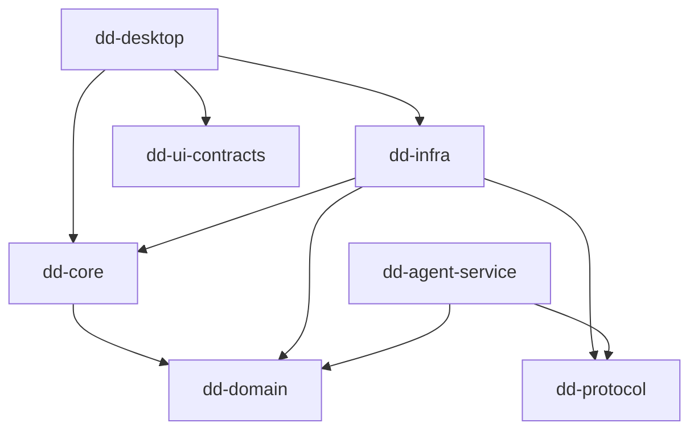
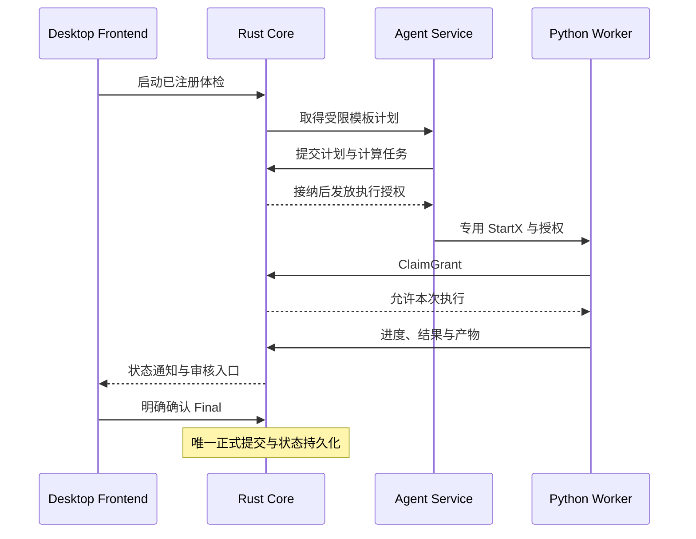

# Dataset Doctor — L3 实现规范与工程任务清单

**文档编号：** DD-IMPL-L3-001  
**版本：** 0.1 · 工程设计评审稿  
**日期：** 2026-11-26  
**继承基线：** L1 定稿 v1.0；L2 方案Ⅰ v1.0  
**当前交付：** 实现约束、工程任务及关联页面原型；未启动产品后端/桌面应用编码  
**关联交付：** 《前端页面与交互设计 v0.1》及 14 个业务页 HTML 原型。

## 阅读导航与状态

| 部分 | 解决的问题 |
|---|---|
| 一、工程边界与源码组织 | 代码放哪里，哪些模块可以依赖谁 |
| 二、关键业务算法与前端接入 | 哪些规则必须一致，页面如何接真实业务 |
| 三、跨语言契约工程 | proto、DTO、JSON Schema、迁移如何维护和生成 |
| 四、运行与一致性约束 | 生命周期、调度、取消、故障恢复与文件提交 |
| 五、工程任务与验收 | AI Coding 从哪里开始，每一步如何判断完成 |
| 六、交付状态与变更记录 | 已完成的设计、待验证事项、使用方法 |

**Confirmed** 仅用于用户已确认的架构选择；本轮新增目录、依赖、适配器与具体实现方式是 **Design Default / Proposed**。PoC 通过后才标为 Validated，业务代码完成后才标为 Implemented。HTML 页面是可操作的设计原型，不能作为真实 IPC、模型、数据安全或三平台打包已通过的证据。

本文依据用户《软件项目设计与开发规范 v1.1》的 L3 要求：只锁定影响正确性、兼容性、维护和协作的细节；普通函数拆分和排版不需要逐项讨论。本轮没有运行真实数据集变更，没有调用模型 API，没有生成生产仓库或可发布安装包。

## 一、工程边界与源码组织

### 1.1 保持不变的约束

| 事项 | 工程约束 |
|---|---|
| 应用与服务 | Tauri 桌面主应用 + Rust Agent Service + Rust 管理的 Python Worker |
| 前端 | React + TypeScript + Vite；Tauri Commands/Events |
| 跨进程 | gRPC + Protobuf + 127.0.0.1；动态端口和受控凭据 |
| 方案Ⅰ | 模板工作流、有限分支与调整；Worker 显式 StartX，无通用 Execute |
| 控制权 | Core 统一任务准入、资源、权威状态和正式文件提交 |
| Agent | 治理协调与视觉审核两个逻辑角色，共享模型客户端和 Key |
| 数据 | JSON 管标注当前内容；SQLite B 管运行与关联；媒体/Artifact 在文件系统 |
| 人工关卡 | AI、追踪和修复输出是候选；正式 Final、Staging 注入由用户确认 |
| 当前版本范围 | bbox 工业视觉、视频样本生成、体检、颜色修复、报告与导出 |
| 不增加 | 数据内容版本管理、跨视频重复/泄漏、完整标注团队平台、分布式服务部署 |

### 1.2 仓库布局

使用一个源码仓库。Rust 采用 Cargo workspace；Python、前端分别维护自身依赖锁；所有语言共用同一契约目录。Cargo workspace 可以共享依赖声明与根锁文件，虚拟 workspace 显式设置 resolver。[E1]

| 目标路径 | 维护内容 | 关键限制 |
|---|---|---|
| `apps/desktop/` | React 页面、组件、状态、Tauri 前端依赖 | 页面只能通过统一 api/client 调业务 |
| `apps/desktop/src-tauri/` | `dd-desktop` 入口、Commands、依赖组装、窗口生命周期 | Command 薄适配，不重复业务判断 |
| `apps/agent-service/` | `dd-agent-service` 入口、两个 Agent、模板推进、模型适配 | 不依赖 Data Manager，不打开业务库 |
| `crates/dd-domain/` | ID、值对象、几何/审核/状态规则 | 不依赖 Tauri、SQLite、RPC 或 OS |
| `crates/dd-core/` | Facade、各 Manager、用例、状态迁移、ports | 不直接使用 rusqlite、进程或具体网络实现 |
| `crates/dd-infra/` | Core 的数据库/文件/进程/RPC/资源适配器 | 不创造绕过 Core 规则的业务入口 |
| `crates/dd-protocol/` | 从 proto 生成的消息与服务桩、少量传输边界工具 | 不承担领域状态权威，不依赖 Core |
| `crates/dd-ui-contracts/` | Tauri Request/Response/Event DTO 与类型导出 | 不依赖 UI 框架或数据库 |
| `services/python-worker/` | pyproject、锁文件、Worker 入口、算法适配器 | 只计算已准入任务与写候选产物 |
| `contracts/proto/` | 进程间协议的唯一源文件 | 禁止各端手写平行消息 |
| `contracts/json-schema/` | 文件、工作清单、配置和工具参数格式 | 离线引用；显式版本与边界 |
| `migrations/app/`、`migrations/workspace/` | 各自的递增 SQL 迁移 | 已发布迁移不可原地修改 |
| `config/` | 非秘密配置样例及默认模板 | 不能保存真实 Key 或机器凭据 |
| `tests/` | 自动化验证代码，按语言与测试类型组织 | 不把测试代码写到 docs 中 |
| `testdata/` | 小型合成 fixture、较大媒体清单与摘要 | 不自动提交真实工业数据/模型权重 |
| `xtask/` | Rust 开发命令实现：生成、检查、打包编排 | 开发工具 crate，不进入产品运行链 |
| `scripts/` | 平台辅助与入口脚本 | 不堆积与 xtask 重复的一套流程 |
| `packaging/` | Tauri 资源清单、Worker 封装、平台构建配置 | 不加入系统级常驻微服务 |
| `docs/` | 设计、开发、测试、部署、决策索引 | 同一主题保持单一权威文档 |

这些是后续工程应创建的位置。本轮只交付设计和 HTML 原型，不用空目录数量冒充开发进度。

### 1.3 Rust 编译依赖与运行连接

箭头表示编译依赖。RPC 的运行时调用另见下图，不把跨进程调用误画成链接依赖。



`dd-core` 定义它需要的 ports，例如 `DatasetRepository`、`TaskRepository`、`FileCommitPort`、`ExecutionPort`、`EventSink`；`dd-infra` 实现这些 ports。只对真正跨边界的能力建 trait，不为每个内部函数新增抽象层。Agent 可复用纯领域值与验证规则，但不能依赖带 Data Manager 的 `dd-infra`。



确定性检查也可由 Core 直接调用 Worker。这样保留混合拓扑；Agent 不必转发所有数据，而 Core 不失去准入和正式数据控制权。

### 1.4 模块内部入口

| 位置 | 推荐逻辑模块 | 公开方式 |
|---|---|---|
| `dd-core` | `workspace`、`dataset`、`annotation`、`video`、`repair`、`export` | Facade 调用用例；只暴露明确 DTO/结果 |
| `dd-core` | `task`、`workflow`、`admission`、`ports` | TaskSpec、计划验证、状态 reducer、资源策略 |
| `dd-infra` | `sqlite`、`files`、`artifacts`、`process`、`grpc`、`events`、`secrets` | 面向 Core ports 的实现与组合工厂 |
| Agent Service | `governance`、`visual_review`、`templates`、`tools`、`model_client` | 既定 Agent RPC；模型输出转受限计划/候选 |
| Python Worker | `rpc`、`execution`、`adapters/image`、`adapters/annotation`、`adapters/video`、`adapters/models`、`adapters/color` | 专用 RPC 转 typed adapter；统一产物封存 |
| Frontend | `app`、`pages`、`features`、`components`、`api`、`state` | 页面调用 feature controller；不散落 invoke |

根 `README.md` 说明运行入口；`docs/README.md` 作为文档导航。沿用用户标准中的 requirements、architecture、modules、interfaces、data、configuration、development、testing、deployment、troubleshooting、decisions 分类。初期文档可合并，不创建无内容占位文件。

### 1.5 工具链与依赖默认

| 范围 | 默认方向 | 锁定与验证 |
|---|---|---|
| Rust | stable，edition 2024，workspace resolver=3 | P00 固定精确工具链；Cargo.lock 入库；不把 stable 当可漂移发布依赖 |
| Rust 异步/RPC | Tokio、tonic、prost，配套生成器 | P01 验证互通；精确依赖由锁文件记录 |
| SQLite | rusqlite + bundled/backup，专用数据库线程 | P00 核验 bundled SQLite 实际版本、补丁与平台；不增加 ORM/第二数据库 |
| 前端构建 | Node 24 LTS 系列、pnpm、已选 React/TS/Vite/Tauri 2 | P00 固定 Node/pnpm 精确版本与依赖锁；Node 不随产品常驻运行 |
| Python | CPython 3.12 作为兼容性候选，uv 管开发依赖 | P00 用真实 CV 依赖解算与打包锁定；不冒充完整组合已验证 |
| Python RPC/算法 | grpcio/protobuf、所选开源库与自有适配器 | 每种 capability 带版本、输入限制与依赖状态 |
| DTO | Serde + ts-rs | 显式字符串整数与判别联合；生成 TS 不等于运行时校验 |
| JSON 验证 | Rust/Python jsonschema，Draft 2020-12 | 使用同一 Schema 与正反例；不在线下载任意 $ref |
| Agent 框架 | Rig v0.47.1，独立 SDK PoC Validated | 保持适配器边界；真实模型与 Core/Worker 集成待验证；可用同接口显式状态机 |
| 发布封装 | 按平台构建 Tauri + PyInstaller onedir Worker | 失败时在相同进程契约下改受控 CPython 目录 |

Node 24 的 LTS 状态、Cargo workspace 机制、rusqlite 的 bundled 方式、uv 锁依赖行为均有官方资料。[E1][E2][E3][E4] 选择这些方向不等于已证明其最新版本互相兼容，精确版本应由一次可复现构建得出，不在设计里猜测一串未经验证的 patch 号。

### 1.6 计划中的统一开发入口

| 入口 | 目的 |
|---|---|
| `cargo xtask contracts generate` | 从权威源生成 Rust/Python/TS 派生产物 |
| `cargo xtask contracts check` | Schema、协议和生成物漂移检查 |
| `cargo xtask dev` | 按契约启动桌面开发环境和受管理服务 |
| `cargo xtask verify --scope slice1` | 首切片的必要契约、集成与业务验收 |
| `cargo xtask package --target <target>` | 按已验证目标打包，输出依赖清单 |

这些是 P00/P01 要实现的开发命令规范，当前尚未创建，不能直接复制后假定能运行。Python 开发依赖使用锁定同步；打包后的用户不需要安装 uv 或手动 pip 安装。

## 二、关键业务算法与前端接入

### 2.1 数据检查与候选生成

| 检查 | 必须固定的规则 | 输出含义 |
|---|---|---|
| 文件/图像 | 能否读取解码、方向归一化、宽高、输入摘要 | 失败是输入问题，不伪造空图片通过 |
| bbox 几何 | 原图像素 xywh，有限值，w/h>0；类别与图像引用合法；按范围报告越界 | 检出问题；不静默裁剪原框并确认 |
| 空标注 | 区分缺 JSON、空 annotations、人工确认负样本 | 空标签不能自动证明“无目标” |
| 模糊/曝光 | 保存算法、阈值、测量值和检测范围 | 阈值需工业样本标定；不承诺一组阈值适合所有产线 |
| 重复 | 当前授权 Dataset 范围内比较；精确重复用内容依据，近似重复作为可复核候选 | 不扩大为跨视频泄漏分析；不自动删除 |
| 标签问题 | 只有相应预测/适配输入可用才运行 Cleanlab 方法 | 得分是可疑程度/证据，不是人工标签必错的证明 |
| 语义审核 | 类别名、当前标注、范围、模型和提示模板冻结；VLM 返回受限结构 | 可疑类别/框、理由、证据与不确定项；不能执行文件操作 |

任何模块不能把“未运行该检查”编码成 `PASS`。规则质量、模型精度与软件正确性分别记录。报告汇总由确定性的 BUILD_REPORT 任务生成，AI 可以解释但不能成为报告能否生成的唯一条件。

### 2.2 Final、类别与导出

1. 每张图片旁的 JSON 保存当前 COCO 内容；草稿/AI 候选在外置 Artifact。
2. Final 有效性由 SQLite 中审核确认和当前 image/annotation/类别字典摘要共同判断；不在 COCO 中新增三套自定义标签数组。
3. 一次明确提交成功后才清理本次 Human/AI 草稿与候选；视频来源与正式 track map 不随之删除。
4. 类别名字直接可编辑，类别 ID 不以数组下标代替；字典改变按 L2 的保守规则使既有确认失效，支持重新核对。
5. 单图 `image.id` 可以重复；导出以 Asset UUID 重映射全局 image ID，并以 `(asset_id,local_annotation_id)` 重映射 annotation ID。
6. 导出冻结选择与摘要清单；读取过程中变化则报告冲突/失败，不能把前后两种事实混成一个成功产物。

对 bbox 缺陷的人工纠错复用审核画布；并未增加全类型独立图片标注产品。导出有效 Final、排除不合格样本的明确选择及原因必须可见。

### 2.3 视频与双采样

Worker 返回实际解码的 display-order 帧身份；保留原始 PTS/timebase/方向映射，展示时间归一化。页面时间和估算 FPS 不能替代 FrameRef。

- 片段为 `[start_us,end_us)`；关键帧必须落在片段内且归属同一视频摘要、流和类别上下文。
- Tracking Sampling 默认逐帧，Dataset Sampling 默认 1000 ms；这些是既定初始参数，不是实测最优值。
- 时间采样选目标时刻之后第一帧，受片段边界约束；按真实帧身份去重。
- 追踪缺失的采样帧补算或保留待标注状态；不把相邻帧框直接作为 Final。
- 图片+JSON 平铺到 Workspace 的对应视频文件夹。Staging 审核注入只改变成员关系。
- 追踪的 target ID 与 track_id 不跨视频关联；遮挡、不确定和断轨可复核。

### 2.4 颜色修复的算法细化默认

颜色操作用于用户指定区域的受控改色，不表示从图像推断物理真实颜色。该部分是 P09 的实现默认，效果需用工业样本验证。

| 环节 | 明确规则 |
|---|---|
| 坐标与输入 | 与方向归一化的原图一致；MVP 优先 RGB/RGBA 8-bit sRGB 工作输入，其他色彩/位深明确转换或拒绝 |
| 区域 | RECT 或不自交 POLYGON；按像素中心覆盖生成掩膜；坐标必须在边界内 |
| HUE_REMAP | 以原像素 HSV 为基础，目标 RGB 提供目标 H，保留原 S/V；低饱和像素不承诺变得鲜艳 |
| SOLID_FILL | 候选色为用户选择的目标 sRGB；明确可能掩盖原始纹理 |
| 色相门控 | 根据原像素 H 与 hue_min/max、wraps_zero 判断，不根据已修改像素再次筛选 |
| 强度 | alpha=区域权重×strength；在规范化 sRGB 数值上混合原色与候选色，不声称光学亮度恒定 |
| 羽化 | 仅向区域内部渐变，外部权重为0；以原图像素距离定义，具体离散栅格黄金样例固定 |
| 透明度 | 保留原 alpha；不因修复改变尺寸或引入几何变形 |
| 编码 | 候选先编码，预览与实际应用同一份字节；JPEG 重编码影响明确记录 |
| 应用后 | 图片摘要变化，旧检查/语义确认过期；bbox 几何可保留待复核 |

不加入去模糊、生成式填补或曝光恢复算法。阈值和候选显示可调整，正式文件提交仍只走统一恢复协议。

### 2.5 前端工程输入

14 页布局与操作详见关联页面文档。正式 React 工程以页面 ID 组织 feature：Workspace、Dataset/Import、Checks、Workflow/Task、Review、Video、Staging、Repair、Export/Report、Settings。

`AnnotationCanvas` 接受不可变媒体引用、原图尺寸、图层、选择与变换，输出编辑意图。显示坐标统一通过变换矩阵映射回原图；DPR、窗口尺寸或缩放不改变保存坐标。Canvas/SVG 的具体承载可在 P05 验证，先完成几何正确性，不提前引入复杂可视化引擎。

查询状态、编辑草稿、纯显示状态分开。前端以一个 api/client 封装全部 Tauri 调用；事件只刷新轻量状态。正式资源读取通过 DisplayLocator，不能把导入路径直接拼成任意本地读取 URL。

HTML 原型只用于确认页面与交互，不要求把原生演示脚本原样塞进 React。原型的统计、时间轴、AI 分值和修复预览都是示例；正式代码必须接入 Core 和真实 Worker 结果。

---

## 三、跨语言契约工程


日期：2026-11-26。状态：Design Default；尚未生成或编译产品契约。本节继承 L2 方案Ⅰ，不改变模板工作流、专用 StartX RPC 或 Core 写入权。

### 1. 单一权威源与目录

| 契约对象 | 人工维护的权威源 | 产物或消费者 | 维护边界 |
|---|---|---|---|
| gRPC 消息与服务 | `contracts/proto/datasetdoctor/v1/*.proto` | `dd-protocol` Rust 类型和服务桩；Worker Python 服务桩 | 不手改生成代码，不将 RPC 类型直接作为领域实体 |
| Tauri 请求、响应、事件 DTO | `crates/dd-ui-contracts/src/` | ts-rs 生成 TypeScript 类型 | Rust DTO 的实际 Serde 输出与 TS 声明必须一致 |
| 持久 JSON 文件 | `contracts/json-schema/v1/` | Rust/Python 验证器、适配器与共同测试向量 | JSON Schema 2020-12 为格式权威；不再由另一套模型反向生成覆盖它 |
| SQLite 工作区结构 | `migrations/workspace/NNNN_*.sql` | Core Data Manager 迁移器 | 八张业务表沿用 L2；迁移器不能成为第二个运行时写入入口 |
| SQLite 全局结构 | `migrations/app/NNNN_*.sql` | Core 的全局设置与 Workspace 索引 | 与工作区迁移独立，不宣称跨库原子事务 |
| 领域规则 | `dd-domain`、`dd-core` 及对应规则说明 | RPC/DTO/文件适配器调用 | 类别归属、状态迁移、审核有效性不能只靠 Schema 表达 |
| 模板、能力与配置契约 | 注册模块与其配置 Schema | Agent/Core/Worker 启动时验证 | 能力版本和协议 major 分开；配置不能新增任意执行能力 |

`contracts/proto` 以 `common.proto`、`execution.proto`、`core_control.proto`、`agent_service.proto`、`worker_service.proto` 和领域消息文件组织；仍统一使用 L2 的 `datasetdoctor.v1` 包。按可维护性拆文件，不为每一个 RPC 建一个服务进程。

`contracts/json-schema/v1/` 至少容纳 workspace-config、coco-single-image、input-manifest、artifact-manifest、review-draft、video-annotation-manifest、track-map、quality-report、template-instance-plan 等持久格式。公共 UUID、摘要、十进制字符串、ArtifactRef 用本地 `$defs`/`$ref` 复用。

InputManifest 只保留一个 Schema，字段来自 L2 数据章 §4.3；API、Worker、Agent 只引用该定义。不能因 RPC 消息需要简化而再创建另一份同名 InputManifest。

### 2. 生成与提交规则

| 路径 | 是否手工编辑 | 是否进入 Git | 规则 |
|---|---|---|---|
| `contracts/proto/**` | 是 | 是 | 协议评审和变更的源文件 |
| `dd-protocol` 的 Cargo `OUT_DIR` | 否 | 否 | 构建时由固定版本工具生成 Rust 桩 |
| `services/python-worker/src/dd_worker/generated/` | 否 | 是 | Python 桩作为可审阅产物提交；CI 重生成后要求无差异 |
| `apps/desktop/src/api/generated/` | 否 | 是 | TypeScript DTO 声明由 Rust 导出；CI 要求无差异 |
| `contracts/json-schema/**` | 是 | 是 | 持久格式与离线引用注册表 |
| `testdata/contracts/**` | 是 | 是 | 小型、非敏感、可重复的契约向量 |
| `target/contract-check/` | 否 | 否 | CI 临时描述符与对照生成产物 |

开发工具入口建议为 `cargo xtask contracts generate` 和 `cargo xtask contracts check`。它们是待实现的统一入口，本轮尚不存在，不应在交付状态里写成已可运行。

生成器版本、protoc、Rust 依赖、Python grpcio/protobuf 和 Node 工具链分别锁定；生成报告记录版本与输入摘要。Rust 与 Python 的生成工具不要求采用相同内部实现版本，但必须各自满足运行时兼容约束，并通过两端互通用例。

当前 tonic 官方 0.14 系列的 Protobuf 集成使用 `tonic-prost` 与 `tonic-prost-build`；工程应按选定版本文档配置，不照搬旧版仅调用 `tonic-build` 的教程。[C1]

Python 桩由 `grpc_tools.protoc` 生成 `*_pb2.py`、`*_pb2_grpc.py` 及 `*.pyi`；包路径在生成命令中一次确定。不能通过在生成文件里逐条修改 import 解决目录错误。[C2]

### 3. Tauri 类型与调用边界

建议用 `ts-rs` 导出 Rust DTO：结构、枚举与判别联合只在 `dd-ui-contracts` 维护。它能够导出类型，但不会自动验证前端运行时输入，也不会自动注册 Tauri 命令。[C3]

每个公开命令必须有独立 Request/Response 类型，并在同一 crate 维护命令名与类型的目录。前端仅经一个 `api/client.ts` 封装调用；组件不得散落裸字符串 `invoke` 或自建另一套 Response 类型。

Tauri 实际命令注册由桌面组合层维护，契约检查应对比“声明命令名集合”和“实际注册集合”。工具无法证明处理器执行正确，因此关键入口仍需集成验收。

大整数显式使用 DecimalU64/DecimalI64 边界包装或 String DTO，并校验十进制语法、符号与范围。不要只把 TypeScript 的 `u64` 映射改为 string，却仍让 Rust 序列化为 JSON number。ts-rs 对大整数的默认 TS 声明为 bigint，更说明这部分需要项目自有边界类型与序列化样例。[C3]

Tauri DTO 不引用 tonic 生成类型；二者都经显式适配器映射到领域值。前端 DTO 中的 `pts_us`、`frame_index` 等保持 L2 的单位与表示，不把 Protobuf JSON 自动序列化当成桌面契约。

`schemars` 不作为持久 JSON 的第二生成源。若未来用于 Agent 工具参数的 Schema 投影，必须指定唯一 Rust 输入类型，生成到独立目录，并以不支持的 Schema 子集显式报错；当前无需为引入它阻塞主线。

### 4. 文件 JSON 的验证与类型投影

Rust 可采用 `jsonschema` crate 的 Draft 2020-12 模式，Python 采用 `jsonschema.Draft202012Validator`。两端使用随应用分发的同一 Schema 注册表，不在运行中按 `$ref` 自动访问任意网络地址。[C4][C5]

共同读取顺序：

1. 校验文件授权、文件大小和编码；解析时拒绝重复对象键与非有限数字。
2. 按明确 schema_id/格式 profile 选择本地 Schema；不靠字段猜测升级格式。
3. 校验结构、类型、边界、判别分支，显式启用所用 format 断言。
4. 映射为语言内部的类型化投影，执行类别/图像引用、几何、身份和摘要规则。
5. 发布或正式写入前，反向序列化并重新验证同一 Schema。

Python 标准解析默认行为与 Rust Value 解析行为不能替代第 1 步的严格解析策略。JSON Schema 看不到已经被解析器合并掉的重复键。

为避免再引入一整套跨语言生成器，MVP 允许内部 Rust struct、Python dataclass/typed adapter 作为格式的投影；这些类型不享有另立格式的权力。完整格式约束只由 Schema 与规则规范维护，适配器通过双端共同样例及序列化输出验证防止漂移。

这不是声称有限样例能够证明所有映射等价。新增可选字段、联合分支、默认值或精度范围时必须同步扩展样例；不支持的内容明确拒绝，禁止反序列化后静默丢弃再覆盖原文件。

对于单图 COCO，JSON 文件不额外塞入 Human/AI/Final 或 track_id；审核和追踪保持 L2 的外置结构。格式版本由应用 profile/导入声明识别，不强迫标准 COCO 顶层增加自定义版本字段。

### 5. 表示映射必须通过的向量

| 输入情形 | 期待行为 |
|---|---|
| uint64 为 9007199254740993 | Tauri JSON/TS 中逐字符保留十进制字符串；Protobuf 往返不丢精度 |
| `pts_us` 为负数或大时间值 | 有符号十进制字符串按契约解析；负值是否可用于业务位置由具体字段验证 |
| sha256 带 `sha256:` 前缀或大写 | 拒绝；应用契约仅 64 位小写十六进制 |
| UUID 字符串不合法 | 入口拒绝，不延迟到数据库写入 |
| 可选字段缺失、显式 null、空字符串 | 分别按 DTO/Schema 明确定义；禁止三者任意等同 |
| Protobuf optional 缺失与数值 0 | 使用 presence 区分；零值不得被当作缺失的通用替代 |
| 未识别 enum/oneof 分支 | 对影响执行的值拒绝执行并给出能力/协议错误 |
| 两个单图文件都使用 image.id=1 | 允许；导出以 Asset UUID 重分配唯一整数 ID |
| annotation.id 跨文件重复 | 允许；导出键为 `(asset_id, local_annotation_id)` |
| bbox 包含 NaN、负宽度或悬空 category_id | 拒绝成为 Final；检查结果仍可报告原标注缺陷 |
| 空 annotations | 不自动成为 CONFIRMED_NEGATIVE |
| InputManifest 摘要与对象不符 | 拒绝执行/接纳；不能由 Worker 重新猜测输入覆盖范围 |

Artifact.sha256 是文件实际字节的摘要；input_fingerprint 是 Core 对规定输入投影的摘要。这两者不能混用，也不能对 protobuf 编码字节求 hash 充当规范化业务指纹。

Core 计算并冻结权威 InputManifest；Worker 验证收到的文件摘要、输入文件摘要和授权，不重新拼接一套可能排序不同的业务清单。具体规范化算法应在公共指纹模块与黄金向量中固定。

### 6. 兼容性规则

| 改动 | 处理 |
|---|---|
| Protobuf 新增可选字段 | 使用新编号，验证旧读取方行为；不改变既有字段含义 |
| 删除字段/枚举值 | 保留编号及名称，不复用；CI 对照发布描述符检查 |
| 改单位、默认语义、必需分支 | 视为语义不兼容，不能借 wire-compatible 逃过评审 |
| 新增 StartX 能力 | 更新 proto、适配器、capability descriptor、测试与模板允许集合 |
| 持久 JSON 不兼容变化 | 新 schema/profile 版本及明确迁移；不把新格式伪装为 v1 |
| 单图 COCO 导入未知字段/形状 | 导入预检列出支持范围和转换损失；不默默舍弃 |
| Tauri DTO 与应用内 UI | 同一发布版本配套；发布前验证命令、事件与类型一致 |
| SQLite 升级 | Core 单点执行递增迁移、维护 schema_meta；拒绝未知更高版本写入 |

协议二进制兼容、代码生成运行时兼容和业务语义兼容是三种检查。Protobuf 官方对生成代码与运行时有特定兼容范围；不能认为“同为 protobuf”即可任意混搭。[C6][C7]

Workspace 的 `schema_meta.schema_version` 是工作区迁移进度。迁移 SQL 发布后不可原地改写；新调整追加迁移。无需为此新增业务版本表。`app.db` 使用独立的迁移版本机制，读取/写入路径不能与 Workspace schema_version 混用。

### 7. 契约 CI 的最小闭环

1. 验证所有 Schema 自身有效，所有 `$ref` 离线可解析，检测重复 schema_id。
2. 编译完整 `.proto`，生成 Rust/Python 桩；禁止未解析消息、占位 bytes/任意 JSON 逃过类型定义。
3. 导出 Tauri TS 声明，比较受版本控制产物；差异要求连同源定义提交。
4. 使用同一 fixture 集在 Rust/Python 验证 JSON；跨语言结果类别一致。
5. 对长整数、optional、oneof、错误码、ArtifactRef 做真实 Rust↔Python RPC 往返。
6. 在空库执行全部迁移，并从上一个发布结构升级；检查八张业务表及索引/外键规则。
7. 对正式命令注册、模板允许操作、Worker StartX 和 capability 清单做集合一致性检查。
8. 验证测试失败时输出契约路径、向量 ID 和稳定错误码；不输出 API Key 或完整用户数据。

首个交付阶段可仅实现已进入垂直切片的接口处理器，但不能让未实现的已声明能力报告 available=true。未实现能力必须在能力清单中关闭，调用返回明确不支持。

CI 不需要默认运行全部真实 VLM/检测模型。契约、故障与迁移使用可控样例；真实模型效果/安装包单列验证门槛，避免把网络波动等同于协议错误。

### 8. L2 编辑勘误与最小闭合

本轮发现一处明确排版错误和一处待细化引用。实施前按以下条目记录到勘误，不将其放大为重做 L2。

| 位置 | 修正或细化 |
|---|---|
| C4.1 `dataset_create` 行 | 输入为 name、category_names；同步输出 DatasetSummary；规则为类名唯一、非空并创建空 Dataset |
| C4.1 混入的 SecretStatus / DatasetSummary 行 | 从“命令清单”移除；类型定义仍以 C12.1 为准 |
| ImportPlan | 由 dataset_import_inspect 的异步结果提供；不作为 dataset_create 返回 |
| `workflow_start.plan_ref` | 保留。C8 与 C5.3 均使用该引用，不依据摘要误删字段 |

PlanRef 的最小闭合定义建议为：`{workflow_run_id:UUID, plan_revision:DecimalU64, input_fingerprint:Sha256}`。它引用 Core 已接纳并保存的 TemplateInstancePlan，不是前端任意路径、自由 JSON 或未授权 Artifact。

预览先创建 DRAFT run 与规划 Task，Core 接纳计划后形成 READY run；预览结果包括 PlanRef 与可展示计划摘要。带 PlanRef 启动时核对当前 Workspace/会话、Dataset 范围、计划修订、当前输入、模板能力和预算，然后启动同一个 READY run。输入已变返回 INPUT_CHANGED；引用过期不静默新建另一 run。

未带 PlanRef 时沿用 L2：创建 DRAFT、规划或合法默认模板、Core 接纳为 READY，然后启动。对同一 PlanRef 的重复启动返回同一运行引用/当前状态；已完成 run 不被重复执行。用户要求“再运行一次”必须新建 run 与幂等键。

Agent `StartWorkflow.accepted_plan_ref` 使用同一逻辑引用，从 Core 权威查询取得完整计划。计划调整递增 plan_revision；不得把数据库 row_revision 当作计划版本传入。此细化不增加 Dataset 内容版本管理。

### 9. 真正需要验证的门槛

| 门槛 | 通过证据 |
|---|---|
| Rust↔Python 生成链 | 锁定版本下完整编译、双端导入、StartX/错误/stream 互通 |
| Tauri Serde↔TS | 判别联合、nullable/optional、十进制字符串用例与 UI 调用通过 |
| 双端 JSON Schema | 同一正反例结果一致，离线引用、重复键、format 与非有限值策略明确 |
| 迁移与兼容性 | 空库/旧库升级、未知高版本拒写、失败后保留可恢复状态 |

以上为待执行验收，文档编写、Schema 示例和 API 名单不构成这些门槛已通过的证据。

### 官方参考

- [C1] tonic-prost-build 官方 crate 文档：https://docs.rs/tonic-prost-build/latest/tonic_prost_build/
- [C2] gRPC Python Quick start：https://grpc.io/docs/languages/python/quickstart/
- [C3] ts-rs 官方 crate 文档：https://docs.rs/ts-rs/latest/ts_rs/
- [C4] Rust jsonschema Draft 2020-12：https://docs.rs/jsonschema/latest/jsonschema/draft202012/index.html
- [C5] Python jsonschema 验证与 format：https://python-jsonschema.readthedocs.io/en/stable/validate/
- [C6] Protobuf proto3 语言指南：https://protobuf.dev/programming-guides/proto3/
- [C7] Protobuf 生成代码与运行时兼容：https://protobuf.dev/support/cross-version-runtime-guarantee/

---

## 四、运行与一致性实现约束

**依据：** L2 方案Ⅰ v1.0 的 §2.4、数据章 §5.2/§7/§8、API 章 C6–C10/C13。下述为 L3 实现默认，不表示已经运行验证。它们细化既定进程边界，不新增服务、业务表或 Dataset 版本功能。

### 1. 模块依赖与运行归属

| 位置 | 本节对应职责 | 禁止依赖或行为 |
|---|---|---|
| `dd-domain` | ID、新旧输入判断、合法状态转换、审核与注入前置条件 | 不访问文件、SQLite、网络和 Tauri |
| `dd-core` | 用例、各 Manager、状态 reducer、准入策略、提交计划；定义基础设施 ports | 不导入 SQLite 连接或具体 gRPC 客户端，不散落直接写文件 |
| `dd-infra` | Data Manager 驱动、文件操作、OS 进程、Semaphore、RPC 客户端/服务适配 | 不绕过 Core 规则创造新的业务终态 |
| Desktop 入口 | 配置解析、依赖组装、启动/停止、Tauri DTO 转换 | 不在 Command 函数内实现第二套业务规则 |
| Agent Service | 已注册模板、两个逻辑 Agent、模型客户端、专用工具适配 | 不持有业务 SQLite，不批准 Final/删除/注入 |
| Python Worker | 已准入 StartX 的计算、任务目录产物、执行事实回报 | 不写正式标注、受管原图或 Workspace 业务库 |

Manager 是逻辑模块，不逐个建立 crate 或 OS 服务。计算和文件 I/O 使用适当执行线程，不在 Tauri 主线程或 Tokio 异步运行线程中执行长时间阻塞工作。

### 2. Data Manager 单写入实现

建议使用 `rusqlite` 的受控 SQLite 构建和备份能力，由 **专用 OS 线程**持有业务写连接；Tokio 任务通过有界消息队列提交类型化读写请求，并用一次性响应通道取结果。不要把永久运行的数据库循环放入 `spawn_blocking` 后期待通过 abort 可靠退出。

- Workspace 内仅 Data Manager 能建立业务写连接；Agent、Worker、UI 不连接它。
- 全局 `app.db` 与当前 `workspace.db` 可由同一 Data Manager 线程持有；两库分别提交，不能描述为跨库事务。
- MVP 的轻量索引读取也通过该入口；列表必须分页。只有实测索引读取构成瓶颈后，才增加只读连接，且不改变单写者。
- 新连接启用并核验外键；本地 Workspace 使用既定 WAL、FULL 同步与有限 busy timeout。实际 SQLite 修补版本由依赖锁文件和打包清单核验。
- 事务只处理短 SQL；摘要计算、图像解码、模型等待、文件大块复制均在事务之外完成。
- 请求队列满时实施背压；不能无限创建内存等待任务。已有任务状态提交与退出控制应有保留容量，不能被进度消息堵塞。
- 数据库请求包含 Workspace 会话和请求身份。执行前再次验证当前会话；关闭后到达的旧消息不得写入新 Workspace。
- 正常停止顺序为停止新业务请求、完成已受理必要提交、提交/回滚当前事务、关闭连接、结束线程并 join。

进度可合并，业务终态与文件提交结果不可丢弃。SQLite 线程不等待 Task Manager 回调，以免形成互相等待。

### 3. Workspace 与服务生命周期

打开 Workspace 的顺序固定为：

1. 获取 Workspace 单实例所有权锁，验证标志文件身份、路径与 Schema；锁实现按目标 OS 验证。
2. 打开 Data Manager；先恢复未完成文件操作，再开放正式修改入口。
3. 建立新的 `workspace_session_id`，使旧会话回调和授权失效。
4. Process Manager 启动受控服务；通过专用启动通道传递端口和短期凭据。
5. 服务注册、协议与能力检查通过后开放对应功能；某可选模型缺失不阻断本地图像/几何检查。

服务启动不要通过 shell 拼接用户文件名；使用进程参数数组。凭据通过受控管道/继承句柄等启动通道提供，不放入 argv、工作文件、普通环境转储或日志。具体跨平台通道由 PoC 验证。

关闭/切换 Workspace 的顺序固定为：停止准入 → 停止 Workflow 派发 → 请求在途取消或等待 → 确认计算停止 → 完成不可中断的正式提交/恢复对账 → 结束服务 → 关闭库 → 释放所有权锁。切换完成前不给新 Workspace 发放资源授权。

真实退出必须回收受管理子进程树；最小化保持现有运行语义。Core 意外退出时，服务应感知控制通道关闭并停止工作；各 OS 对进程组/作业对象、强杀和孤儿回收的行为属于发布前验证项。不能用 PID 数字单独证明某进程仍属于旧执行。

### 4. 调度与 Grant 算法

任务提交、资源占用、执行确认分为不同步骤：

1. 验证模板节点、输入和预算，冻结 InputManifest，持久化逻辑 Task 为 `QUEUED`。
2. 调度器按优先级及同级 FIFO 选择可执行任务；未具备整组资源时继续排队。
3. 对该任务所需 CPU/GPU/视频等资源执行“全部可用才占用”；部分失败立即释放已取得许可，禁止一边占 GPU 一边无限等待另一个额度。
4. 创建新的 attempt、资源保留与 Grant；把当前归属持久化为 `DISPATCHING`。持久化失败就释放保留，不下发 Grant。
5. 分派方通过专用 StartX 调用目标 Worker；Worker 以同一 task/attempt 去重并调用 Core `ClaimGrant`。
6. Core 校验任务、会话、实际执行者、输入/操作指纹、有效期和领取状态；成功后才允许实际计算。
7. Worker 上报开始，Core 接纳后进入 `RUNNING`；最终仅 Core 接纳的终态成为权威状态。

Grant 是一次准入，不是长期资源锁。相同领取和相同 Start 请求返回原执行句柄；不同执行实例不能重复领取同一 Grant。Start 响应丢失时先查原执行，不为同一 attempt 创建第二份计算。

未领取且已到期的 Grant 可撤销后释放资源；已经领取的执行不能仅因开始 deadline 到期被视为停止。GPU 内核或解码任务仍可能运行时，资源保持保留，先确认停止或结束所属进程。

Scheduler 的资源表在内存管理，由当前会话拥有；SQLite 保存对账信息，不保存可跨重启复活的 Semaphore。Core 重启后旧 Grant 全部失效。

### 5. 锁顺序与背压

正式修改采用统一顺序：**Dataset 变更门槛 → 按 Asset ID 排序取得提交锁 → Data Manager 短事务**。普通单图提交只需其 Dataset 的共享门槛及 Asset 独占锁；类别批量变化使用独占门槛。两个数据集涉及同一批操作时先按 Dataset ID 排序。

- 不持有 SQL 事务等待 Asset 锁；不持有调度器锁执行网络 RPC。
- 不跨模型调用、人工审核或完整 Workflow 持有 Asset 写锁。
- 计算读取由冻结输入与前后摘要校验约束；计算资源槽位不兼任数据锁。
- 同一 Workspace 的写操作竞争以 revision/digest 冲突返回；不能用无条件重试吞掉用户编辑冲突。
- 有界队列至少区分任务提交、状态/终态、可丢合并进度三类流量。
- 任务提交容量不足返回 `CAPACITY_EXCEEDED`；进度合并不影响终态接收。
- 不为每张图片常驻创建一个异步任务；数据集批处理使用有界输入批次和迭代器。

队列具体容量由工程配置与负载 PoC 锁定，不能写成已经证明的吞吐指标。默认 CPU/GPU/视频并发沿用 L2，不新增第二组资源参数。

### 6. Python Worker 执行纪律

Worker 保留控制面响应能力，计算不得阻塞接收取消、Health 和 GetExecution。采用受控的计算线程或子进程，选择按实际库特性验证；不是再建立可独立部署的微服务。

- 每次执行仅取得冻结输入定位符与独立 attempt 输出目录；共享模型缓存另行管理。
- 产物先写临时名，完整关闭并校验后封存，再发布 manifest 和终态。
- 记录每一能力是否能安全重试、取消检查点粒度、Checkpoint 支持范围。
- CPU 库或 GPU 框架的内部线程数必须纳入资源配置；Core 分配两个任务槽位不意味着底层库只产生两个线程。
- 模型按需加载；加载失败只使相关 capability 不可用，并返回清楚原因。
- 子进程启动和模型初始化必须显式处理；不得在 Python 模块 import 时启动进程或加载所有模型。
- 强杀整个 Worker 可能中断它承载的多个 Task；Core 必须逐一标记并对账，不能只更新触发强杀的那一个。

Worker 不在运行时偷偷 pip 安装依赖。发布产物绑定可重现的 Python 环境/依赖锁；具体 Python 版本、计算库组合、CPU/GPU分发模式由打包 PoC 决定。

### 7. 取消、超时、重试和恢复

| 发生位置 | 实现规则 |
|---|---|
| 排队 Task | 直接取消并从派发候选移除，没有执行资源需要等待 |
| 已分派/执行中 | 持久化 `CANCELLING`，发送取消请求；确认停止后才进入 `CANCELLED` |
| 取消与完成竞争 | 已接受成功优先保留真实结果；不可把已完成正式写入显示为已取消 |
| RPC deadline | 表示本次调用结果未知，按原 task/attempt/幂等键查询 |
| Task 超时 | 按能力请求取消；不能直接释放仍在运行的资源 |
| 健康探测失败 | 标为失联待对账；无停止证据时不启动同资源的替代执行 |
| 进程退出 | 确认退出，相关执行归为 `INTERRUPTED`，重新启动后按能力恢复 |
| 输入变化 | 新建 Task；旧输入计算不能作为当前数据通过的依据 |
| 可安全重试错误 | 沿用 L2 有限次数与退避，同 Task 换 attempt 和 Grant |
| 模型响应未知 | 保留预算占用/未知用量；不承诺供应商取消或计费恰好一次 |

恢复首先处理 `file_operations`，再重建 Task/Workflow 运行视图。旧 `RUNNING` 不直接改为新的 `RUNNING`；先确认旧执行停止、输入仍一致及能力允许，再产生新的 attempt。没有匹配 Checkpoint 就从头安全计算或等待用户处理。

Workflow 暂停停止后续派发，允许当前计算收尾；`PAUSED` 表示暂停已落实。`WAITING_REVIEW` 是业务等待，不占 GPU。Agent 的有限调整必须经过 Core 验证，不能为绕过失败而删除人工关卡或扩大预算。

### 8. 正式文件与 SQLite 提交

Core 的 File Commit Coordinator 负责统一协议，Annotation/Repair/Dataset Manager 提供业务意图，不各自发明保存流程：

1. 查询幂等键，验证同一操作载荷；已有结果直接返回，未知结果先恢复。
2. 在目标卷可安全替换的位置准备完整临时文件；校验格式、长度和摘要。
3. 写持久操作 manifest，再保存 `PREPARED` 意图。Manifest 包含旧/新摘要、路径、临时产物、预期 SQL 效果。
4. 按统一锁顺序重核当前基线和授权，逐项替换文件；多文件不宣称整体原子。
5. 验证实际新字节后，用一个短 SQL 事务更新当前摘要、审核/引用/成员关系及 `COMMITTED` 收据。
6. 最后清理当前候选/草稿引用和无用临时文件；正式 track map、来源与报告依赖必须保留。

同卷临时替换、写入 flush/sync 和目录持久化由各平台适配器实现并测试。不同 OS、磁盘和外部目录不能统一承诺断电零损失；技术恢复依赖 manifest 与实际文件摘要。

恢复时只区分实际旧字节、新字节和第三种字节：旧字节按授权继续或中止；新字节补齐同一 SQL 效果；第三种进入 `CONFLICT`，不猜测覆盖。状态记录落后时按实际证据对账。

此协议不提供历史内容版本。物理删除完成后不能靠日志恢复原图；日志只帮助完成引用清理并避免重复执行。外部不合作编辑仍存在“检查摘要后被改写”的竞争窗口，不能声称普通 rename 等于跨软件 CAS。

### 9. 事件、配置与日志

权威实体状态提交成功后才发布 CoreEvent；发事件失败不回滚已成功的文件提交。前端通过“先订阅并缓冲 → 取带序号快照 → 应用较新事件”恢复；窗口不足或 epoch 改变重新同步。

配置解析使用 L2 的固定优先级与字段白名单，冻结本次有效配置及来源；旧 Task 不读取之后变更的全局参数。未知字段、非有限数、重复键和非法模式组合拒绝。下级作用域只能收紧资源/模型预算，不能扩权。

结构化日志建议包含 `component`、`level`、`request_id`、`workspace_id`、`workflow_run_id`、`task_id`、`attempt_id`、`executor_session_id`、`error_code` 和耗时。按事件需要选填，不制造不存在的关联 ID。

日志不保存 Key、认证 metadata、完整提示词/模型响应、图片字节或普通用户完整路径。诊断包需要路径或少量证据时采用明确收集范围并脱敏。日志轮转与保留应有容量上限；日志不是任务状态数据库。健康页面展示已注册能力、当前任务数、排队/资源占用、最近失败原因，不能显示秘密。

### 10. 必须验证的故障场景

| 验收 ID | 注入场景 | 通过条件 |
|---|---|---|
| RT-01 | 两个 Core 同开一个 Workspace | 第二个拒绝写入，无第二业务写者 |
| RT-02 | Workspace 切换后旧回报到达 | 会话校验拒绝，不能污染新工作区 |
| RT-03 | Start 已执行但响应丢失 | 查询/重发取得同一执行，没有重复计算 |
| RT-04 | 一个 Grant 被不同执行实例领取 | 只有合法实例成功，资源不重复分配 |
| RT-05 | GPU Task 失联但进程仍存活 | 未确认停止前不回收该槽位、不重启并行副本 |
| RT-06 | 取消与完成同时到达 | 保留合法实际终态，状态不倒退 |
| RT-07 | 正式文件已换、SQL 尚未提交时崩溃 | 重启核验新摘要，幂等补齐 SQL，候选不提前丢失 |
| RT-08 | 文件恢复中发现第三种内容 | 进入冲突并保留证据，不覆盖外部修改 |
| RT-09 | 海量进度上报和低速 UI | 有界内存、进度可合并，终态和退出仍可处理 |
| RT-10 | Worker 强杀时承载多个任务 | 所有受影响任务对账，无资源/子进程遗留 |
| RT-11 | 修改类别、媒体或标注后重报旧结果 | 当前确认失效，旧报告不再给当前输入背书 |
| RT-12 | Core 崩溃/真实退出 | 已声明支持的平台无失控计算，重开可识别中断 |

本节只是测试设计；上述用例尚未执行。需要 PoC 的关键项目是：跨平台子进程回收与凭据通道、Python 重依赖打包、Worker 取消粒度、文件替换/断电窗口、SQLite 实际发行版本和负载下背压。未完成这些验证前，不把“协议已设计”标成“可靠性已证明”。


---

## 五、工程实施顺序、验证门槛与 AI Coding 任务包

### 1. 交付状态和第一条可运行路径

本章规定后续编码的顺序与验收，不表示相关能力已经实现。当前交付物是设计、任务清单和页面原型；所有工程验证初始状态为 `Proposed / 未执行`。进入实现阶段后，以实际记录更新为 `Validated` 或 `Implemented`，不能仅凭文档完整改写状态。

**第一条垂直切片：打开 Workspace → 导入图片与单图 COCO → Worker 执行真实轻量检查 → 用户审核并保存 Final → 汇总导出标准 COCO。**

首切片检验完整的数据与执行通路。它必须包含一个真实 Worker 任务、正式文件提交和导出，不能只用前端假数据证明完成；它可以暂不调用云端大模型。Agent 规划、视频和颜色修复随后接入同一条已经验证的数据通路，仍属于完整 MVP。

| 首切片包含 | 具体要求 |
|---|---|
| Workspace | 创建、打开、关闭；单活动会话；拒绝旧会话响应 |
| 数据导入 | 按原目录引用图片；单图 COCO 检查；未标注图片可登记；导入前展示转换/冲突 |
| 检查执行 | Core 准入，Worker 实际解码图片并检查文件、尺寸、bbox 几何；报告保留未执行项 |
| 人工审核 | 显示原标注，修订 bbox 和类别；显式确认负样本；草稿与 Final 分开 |
| 正式保存 | 相同幂等键不重复提交；外部文件变化阻止旧草稿覆盖；中断可判定恢复 |
| COCO 导出 | 仅有效 Final；重新分配全局 image/annotation ID；保留已审核负样本 |
| 基本异常 | 取消、Worker 退出、Core 重启、离线文件、类别变化后重新确认 |

首切片的本地算法不声称已经能判断每个工业缺陷、错误类别或“最优框”。模型证据与人工结论在后续任务中接入，软件正确性和模型准确性分别验收。

### 2. 任务包与依赖

下列任务包是工作单元，不要求每个任务另建一个服务或 crate。文件路径是后续仓库中的目标位置，本轮不建立生产代码目录。依赖未满足时先使用契约 fixture 或受限测试替身，不得自创与基线冲突的接口。

| ID | 任务与主要目录 | 依赖 | 交付物与完成标准 |
|---|---|---|---|
| P00 | 工具链与最小打包验证；`scripts/`、`packaging/`、`docs/development/` | L3 设计 | 锁定 Rust、Node、pnpm、Python 与生成工具；选定受支持 OS/CPU 矩阵；最小 Worker 包能启动、握手、真实解码一张图并退出 |
| P01 | 契约与迁移；`contracts/`、`crates/dd-protocol/`、`crates/dd-ui-contracts/`、`migrations/` | P00 | Protobuf/DTO/Schema 可生成和校验；Rust/Python/TS fixture 一致；SQLite 空库可迁移；没有通用 Execute 接口 |
| P02 | 数据与文件提交；`crates/dd-domain/`、`crates/dd-core/`、`crates/dd-infra/` | P01 | Workspace、Asset、Dataset、Review 和安全提交可独立联调；外部引用、局部 COCO ID、重复提交、外部修改及崩溃恢复均可验证 |
| P03 | 执行控制；Core 调度、进程管理、Core RPC 与事件 | P01 | Task/Attempt、Grant/Claim、额度、取消、有限重试、INTERRUPTED、快照恢复与子进程回收形成闭环 |
| P04 | 首批真实 Worker；`services/python-worker/` | P01；联调依赖 P03 | `StartProfileDataset`、`StartImageQualityInspection`、`StartAnnotationGeometryAudit` 中首切片所需能力可用；任务产物可校验；不得改正式图片、JSON 或业务 SQLite |
| P05 | 首切片前端；`apps/desktop/` | 页面契约与原型复核；P01；联调依赖 P02/P03 | Workspace、导入、样本浏览、任务、审核、导出页面接真实 Command；图层开关不改变提交集合；缩放与像素坐标一致 |
| P06 | 首切片联调与验收；`tests/integration/`、`tests/e2e/`、`testdata/` | P02–P05 | 用同一小样本完成首切片；目标 COCO 读取器成功加载；中断恢复、冲突、负样本和漏通知场景通过；形成可复现运行说明 |
| P07 | Agent 与治理模板；`apps/agent-service/`、Core plan validation | P03/P04/P06；框架 PoC | 两个逻辑 Agent 共用模型客户端；三种已注册模板契约；有限规划/调整、预算、人工关卡；断云时本地检查仍可运行 |
| P08 | 视频到 Dataset；前端视频工作台、Core Video Manager、Worker 视频适配器 | P02/P03/P05/P06；帧定位 PoC | 权威帧、关键帧、追踪候选、双采样、Staging、审核注入贯通；保留来源和 track 映射；不重复复制帧 |
| P09 | 颜色修复与复检；Repair Manager、Worker、修复页面 | P02/P03/P05/P06 | RECT/POLYGON 区域预览、参数记录和明确采用；应用候选字节一致；输入变化阻止应用；更新后重新检查与确认 |
| P10 | 完整报告、备份、交付；`packaging/`、`docs/deployment/`、`docs/troubleshooting/` | P07–P09；依赖打包验证 | 报告覆盖实际执行/未执行范围；备份含登记资源并可恢复；三平台实际验证；许可清单、依赖/模型来源和已知限制可查 |

P02 与 P03 可在 P01 契约稳定后并行；P04 与前端页面实现可使用同一组 fixture 并行。P08 与 P09 可在基础审核与提交链路稳定后并行。对 `contracts/`、迁移和共享 DTO 采取单一变更负责人，同一时间不由多个 Coding Agent 独立改写。

P07 中三种模板的声明与恢复协议一次确定，视频/修复分支的实际执行依赖 P08/P09；能力未就绪时明确不可启动相应模板，不生成模拟成功报告。

### 3. 必须通过的工程门槛

| 门槛 | 触发时点 | 最小实验与证据 | 未通过时的处理 |
|---|---|---|---|
| G-CONTRACT | P01 结束 | 三语言读取同一协议 fixture；uint64 不丢精度；未知/越界输入拒绝；生成物无漂移 | 修正唯一源与映射，依赖模块只允许 fixture 联调 |
| G-FILE | 真实外部目录写入前 | 在 PREPARED、替换前后、SQL 提交前后注入中断；重开后结果为已提交/未提交/冲突之一 | 不开放正式写入；先修复恢复协议 |
| G-CANVAS | 审核和视频画布接正式保存前 | 100%/缩放/高 DPI/平移/旋转预览下，相同原图坐标读写往返；图层可见性与采用状态独立 | 调整显示映射；保存契约保持原图坐标 |
| G-AGENT | 接入选定框架前 | 受限模板、工具参数校验、预算、取消、模型超时、重启恢复；构造越权/非法计划证明被拒绝 | 换适配器或显式状态机；不把 Core 权威交给框架 |
| G-VIDEO | 正式采样功能开放前 | CFR/VFR、B 帧、旋转、非零起点、重复时间戳、半开边界；帧引用与导出像素对应 | 修正解码适配器或明确限制格式；不使用 FPS 估算冒充真实帧 |
| G-EXPORT | P06 结束 | 两图都使用局部 image.id=1；类别顺序不同；负样本、未审核样本；COCO 读取器加载并核对引用 | 阻止导出交付；修正重映射和资格检查 |
| G-PACKAGE | 对某平台宣称支持前 | 无开发环境、无自备 Python、路径含中文/空格、离线启动本地检查、正常退出/崩溃清理 | 调整封装，或明确该平台尚未验证，不宣称全平台已支持 |

框架 PoC 从“支持 L2 接口与恢复语义”出发，不先按框架示例重构业务。Rig v0.47.1 已完成独立 SDK PoC（见 ../testing/rig_sdk_validation.md），P07 仍需验证生产集成和真实模型。用户无需先完成课程学习才能继续开发。

### 4. 页面设计与原型的接入门槛

已有 L2 页面表说明了路由、职责与 API，不能替代逐页布局、状态与操作流程设计。页面补充文档和逐页 HTML 原型用于确认信息结构、关键操作及错误展示；它们不是已接后端的桌面应用，也不证明 Canvas、Tauri 或视频解码已经通过验收。

| 页面工程输入 | 进入实现前需明确 |
|---|---|
| 每页布局 | 导航、主要信息、主操作、辅助面板、进入与离开路径 |
| 交互状态 | 加载、空数据、错误、离线、处理中、冲突、等待审核和能力不可用 |
| 数据映射 | 字段来自哪个查询/事件；操作调用哪个 Command；长任务返回后去哪里看状态 |
| 编辑保护 | 草稿脏状态、离开提示、保存草稿、确认 Final、失败恢复的区别 |
| 画布与视频 | 原图坐标、图层可见/采用分离、权威帧定位、旧 seek 响应抑制 |

对原型反馈优先集中调整导航和主流程，不为每个像素开启架构确认。影响业务权限、文件归属、Final 规则或新增接口的改动需同步 L2；颜色、间距和普通排版可在同一交互契约内迭代。

### 5. 可复用测试数据与验收记录

测试代码放在 `tests/`，测试资产或受控资产清单放在 `testdata/`，解释与结果摘要放在 `docs/testing/`。不得把用户真实工业数据自动加入仓库、CI 或云端模型测试。小型合成样本优先；较大媒体/模型记录来源、许可、大小与 SHA-256，由可复现步骤取得。

| Fixture | 覆盖风险 |
|---|---|
| `coco_local_ids` | 重复局部 ID、类别顺序差异、多个图片同名、无 JSON、已审核负样本 |
| `annotation_edges` | 越界/零面积/非有限坐标、缺失类别、空标注、类别字典修改后失效 |
| `image_io` | 正常 PNG/JPEG、损坏文件、方向元数据、非 ASCII/空格路径、外部替换 |
| `runtime_faults` | 重复请求、乱序通知、旧 session、Worker 退出、Core 重启、取消中断、额度占用 |
| `video_identity` | CFR/VFR、旋转/B 帧、重复时间戳、片段边界、追踪稀疏而采样密集 |
| `color_regions` | 矩形/多边形、色相门控、PNG 区域外不变、JPEG 重编码、预览后原图变化 |
| `agent_limits` | 非法工具、越权路径、超预算、结构化输出失败、未配置 Key、供应商超时 |

每项结果记录 `case_id / requirement / build_commit / OS与依赖 / fixture_digest / steps / expected / actual / status / defect`。性能记录输入规模、设备、耗时、峰值内存和模型条件，先建立可重复基线，再设置指标；不编造“百万图实时处理”等无实测承诺。

### 6. 跨平台封装与发布证据

发行包默认尝试按 OS/CPU 构建的 PyInstaller `onedir` Worker，保持可诊断的依赖目录。PyInstaller 包含 Python 解释器，但产物与构建平台、解释器和架构相关；动态导入、模型资源和本机库仍需专门检查。该方案是待验证默认值，不是已经验证可打包全部视觉依赖的结论。[PKG1]

| 目标 | 首次验证范围 | 发布前证据 |
|---|---|---|
| Windows x64 | 当前选定 Windows 基线、CPU 检查；GPU 能力另测 | 安装/启动/升级卸载、WebView 依赖、Worker 整树退出、含中文路径 |
| Linux x64 | 明确一套受支持发行版/运行库基线；其他组合单列 | 包安装、WebView/动态库、文件权限、显示环境、CPU 检查 |
| macOS | arm64 与 x64 分别记录；未经验证不宣称双架构 | 签名/分发流程、资源访问、Worker 本机依赖、干净环境运行 |

Tauri 支持平台安装包的构建与分发机制；具体安装器、签名和平台前置条件由打包任务记录。[PKG2] 同一源码与契约跨平台复用，安装包、Python 运行时和本机依赖分别构建。GPU、编解码器与模型支持由能力握手报告，不从系统名称推断。

若 PyInstaller 路线在某依赖组合实测失败，可在相同进程与协议边界下使用受控、可重定位的 CPython 运行时目录；不得直接复制开发者 venv 或依赖用户系统 Python。模型按需安装并校验，代码包、模型权重和数据来源的许可分别记录。公开发布与签名凭据使用不包含在本轮设计执行中。

### 7. 可直接复用的 AI Coding 工单

```text
任务 ID：Pxx / 子任务编号
目标：一句话描述可观察的业务结果。
基线：L1 定稿、L2 方案Ⅰ、L3 对应章节、页面/API/数据契约。
状态：开始前列明依赖是否已实现/验证，不把 Proposed 当作现有能力。
阅读范围：仅列本任务所需文档、共享契约、现有代码和相关测试。
允许修改：列目录/文件；共享契约变更须先说明所有消费者的影响。
必须遵守：Core 唯一业务写入；模板+StartX；当前 JSON；人工正式提交关卡。
实现范围：列输入、输出、错误、状态转换与边界场景。
验收：列 fixture、步骤和可观察预期，不以编译通过代替业务验收。
不明确事项：先核对现有实现；普通细节沿设计默认值，关键冲突报告影响和建议。
完成回报：改动、验证命令与实际结果、设计偏差、未解决项、文档更新。
停止条件：达到本任务验收即停止扩展；不自行新增平台、框架或下一任务。
```

### 8. 阶段完成的判定

L3 设计完成意味着目录、契约维护、算法边界、生命周期、并发、错误与验收已经足以指导实现；不要求此时宣称所有 PoC 通过。进入主体编码时，优先执行 P00/P01，再启动 P02–P05。P06 通过表示第一条真实业务闭环可用；完整 MVP 仍须完成 Agent、视频、修复和交付相关验收。

当前工程文档与页面原型均作为可审阅设计交付。源代码构建、真实数据操作、模型调用、性能测量和平台发行测试尚未执行。某个局部 PoC 失败时，只调整该适配器或公开能力范围，避免重开已经确定的全部 L1/L2 选择。

**本节参考资料：**

- [PKG1] PyInstaller 官方：<https://pyinstaller.org/en/stable/operating-mode.html>。
- [PKG2] Tauri 官方：<https://v2.tauri.app/distribute/>。


## 六、交付状态与使用方式

### 6.1 本轮完成的设计

- L3 工程目录、编译依赖、模块入口、契约维护链、运行与文件一致性规则、P00–P10 任务和验收已经成稿。
- 页面设计补充覆盖 14 个业务页面，另有 index.html 入口；每页都提供可独立打开的 HTML 评审原型。
- L2 的 dataset_create 表格错位在本稿勘误中明确修正；PlanRef 补足可实施定义，执行时按本稿细化，不传播错误行。
- 页面布局与交互仍为待用户审核稿；工程算法与依赖为 Design Default，尚未把 PoC 结果写成已通过。

### 6.2 进入实现阶段的路径

首先按 P00/P01 锁定工具链并固化可编译契约；P02–P05 接入存储、运行时、Worker 与前端，P06 形成首条真实闭环。再完成 P07–P10 的 Agent、视频、颜色修复、备份和交付。

若某个模型或框架不适合，只调整相应适配器。只有改变 Core 权威、进程边界、文件归属、当前 Final 或产品范围时，才需要重新检查 L1/L2。普通目录名、函数分拆和局部 UI 细节采用已列默认，不启动新一轮大范围选型。

HTML 原型的“完成”提示只说明演示交互已发生；它不是业务执行证据。完整后端、可编译生成契约、迁移实现、模型效果、真实视频身份、性能和三平台发行能力均尚待实现或验证。

### 6.3 文档状态记录

| 交付项 | 当前状态 | 真正完成的判断 |
|---|---|---|
| L1 系统架构 | Confirmed | 已有用户确认 |
| L2 方案Ⅰ | Confirmed / Baselined | 模板 + 专用 API 方向已选择 |
| 前端页面设计与 HTML | Proposed / 已生成评审原型 | 用户能逐页审核，后续按反馈迭代 |
| L3 实现规范 | Proposed / 已形成工程稿 | 目录、实现约束、契约维护、验收可指导实现 |
| P00/P01 及后续任务 | 未执行 | 以实际代码、命令和验证记录更新 |
| Agent SDK、打包、视频等 PoC | Rig SDK 独立 PoC Validated；其他 To Validate | 符合对应门槛的真实证据 |

### 6.4 本轮变更记录

| 版本 | 日期 | 变更 |
|---|---|---|
| 0.1 | 2026-11-26 | 基于方案Ⅰ形成 L3 规范；补齐逐页 HTML 原型与页面设计文档；明确 L2 编辑勘误 |

### 工程依据与官方资料

项目依据为用户提供的《软件项目设计与开发规范 v1.1》以及已确认 L1/L2。技术资料用于核对工具能力，不代替本项目测试。

- [E1] Cargo workspaces：https://doc.rust-lang.org/cargo/reference/workspaces.html
- [E2] rusqlite bundled 与备份：https://docs.rs/crate/rusqlite/latest
- [E3] Node.js releases：https://nodejs.org/en/about/previous-releases
- [E4] uv locking and syncing：https://docs.astral.sh/uv/concepts/projects/sync/
- [E5] Tokio spawn_blocking 的取消与线程约束：https://docs.rs/tokio/latest/tokio/task/fn.spawn_blocking.html
- [E6] Tauri sidecar：https://v2.tauri.app/develop/sidecar/

各章节中的 [C1]–[C7]、[PKG1]–[PKG2] 是对应章节末的官方链接。库文档可能随版本变化；P00/P01 必须记录实际锁定组合与验证日期。


### 本轮文件校验

Markdown 结构、Mermaid 代码块和文档链接说明已作静态检查；未在本环境渲染 Mermaid 图。HTML 原型已检查文件完整性、内部链接、重复 ID、外部资源依赖与脚本语法。浏览器渲染/点击验收因环境没有可运行浏览器而未完成。以上仅针对设计交付物，不是对产品功能或工程 PoC 的验收。


> 2026-11-26 更新：采用 Rig v0.47.1（Rust 1.97.1），SDK 独立 PoC 三平台已通过（每平台 10 项），不等同于生产应用集成。Core 持久化、资源准入、授权、人工审核和 Python Worker 职责不变。真实模型、完整恢复与打包仍需验收。
