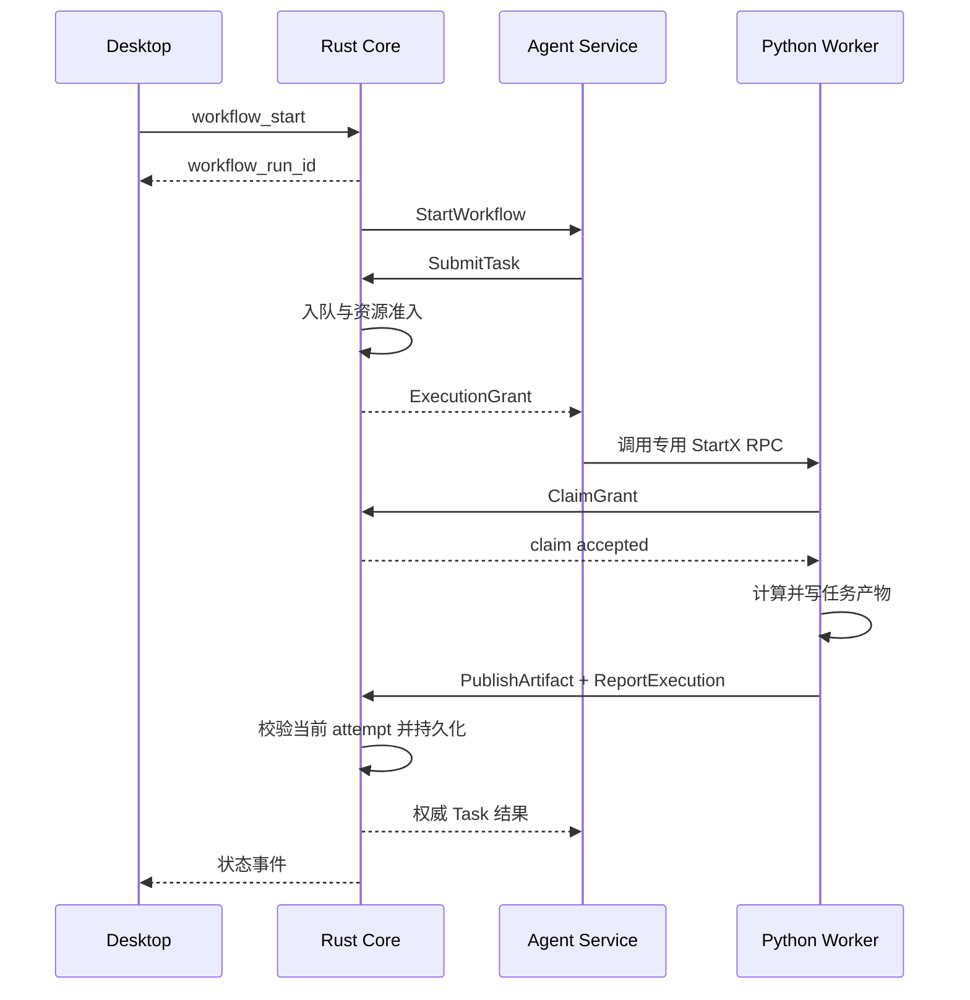
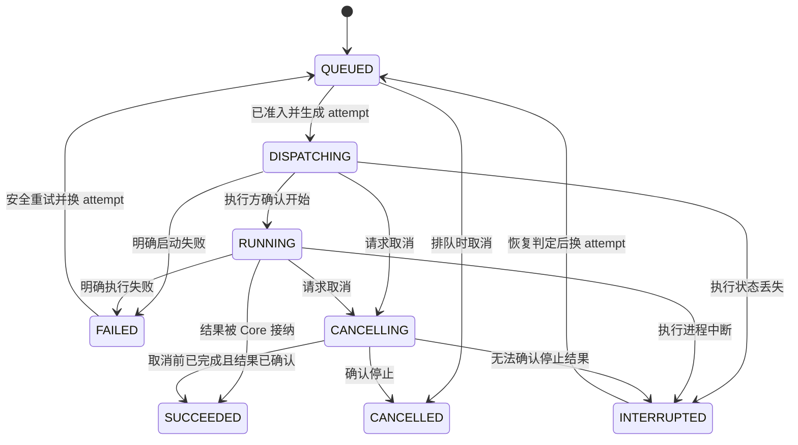
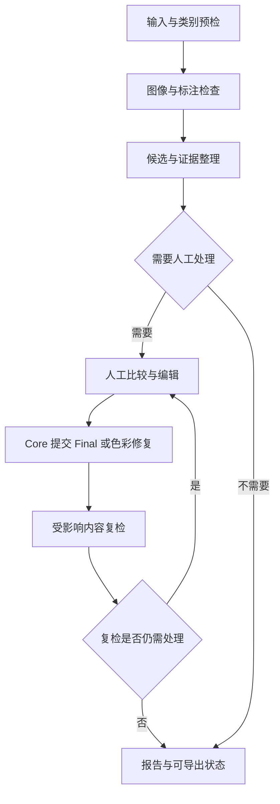

# L2 API、RPC、工具与执行契约

> DD-DESIGN-L2-001 方案Ⅰ v1.0；按主题迁移于 2026-11-26。设计契约非已实现代码。原章节编号保留，导航见 [文档索引](../README.md)。

## 四、API、RPC、工具与执行契约

> 状态：**Design Default / 方案Ⅰ接口基线**。本章给出可映射到 Rust、Protobuf 和 TypeScript 的契约；尚未编码或完成工程验证。接口名、枚举与字段须同步生成和检查，变更按同一基线维护。

### C1. 接口与进程边界

| 边界 | 公开方式 | 可执行的事情 | 不承担的事情 |
|---|---|---|---|
| Desktop → Rust Core | Tauri Command，返回 DTO；Tauri Event 通知状态 | 用户意图、读取、任务提交、人工批准、配置 | 直连 SQLite、持有云模型密钥、直接调用 Worker |
| Core 内部模块 | Rust 类型化接口 | 业务规则、事务、授权文件提交、资源调度 | 再套一层 HTTP 服务 |
| Core ↔ Agent Service | 本机 gRPC | 注册模板、启动/恢复工作流、查询状态、请求规划 | Agent 改写数据库或绕过人工批准 |
| Core ↔ Python Worker | 本机 gRPC | 健康管理、人工发起的确定性任务、执行事实回传 | Worker 写入正式标注或正式图片 |
| Agent → Python Worker | Core 准入后的本机 gRPC | 调用已注册检查、检测、追踪、修复预览 | 绕过 Core 队列、任意路径访问、任意 shell/Python 执行 |
| Agent 内部 → 模型提供方 | 统一 Model Client Adapter | 两个逻辑 Agent 共用一个模型配置和 API Key | 为每个 Agent 单独创建 Key，向 Worker/UI 分发 Key |

Core 统一拥有任务事实和业务数据；Agent 拥有规划与下一步选择的逻辑；Worker 拥有一次计算的执行事实。三者不是三个互相竞争的任务数据库。

本方案使用已注册工作流模板和显式 Worker RPC；模板的人工批准、Core 提交及复检关卡不得由模型移除。

### C2. 公共类型和参数规则

#### C2.1 标识、时间与单位

| 类型/字段 | 契约 |
|---|---|
| workspace_id、dataset_id、asset_id、workflow_run_id、node_id、task_id、attempt_id、review_id、artifact_id、issue_id | 标准 UUID 字符串；文件名、COCO 本地整数 ID 不代替这些标识 |
| workspace_session_id | 每次打开 Workspace 生成的新 UUID；旧会话结果不能写入新会话 |
| executor_session_id | 每次服务进程启动/注册生成的新 UUID；重启不能继承旧执行授权 |
| request_id | 每次请求的追踪 UUID；**不用于保证幂等** |
| idempotency_key | 关键副作用请求的 UUID 去重键；同键必须绑定同一请求指纹 |
| revision | 并发校验计数，不是内容历史版本；JSON 使用十进制字符串，Protobuf 使用 uint64 |
| created_at / updated_at | API 采用 UTC RFC 3339；Protobuf 使用 google.protobuf.Timestamp |
| duration_ms | 非负整数毫秒；单独的具体字段规定上限 |
| pts_us | 有符号十进制字符串，表示解码后帧的展示时间微秒值；原始 PTS 与 time_base 留在来源元数据 |
| bbox_xywh | 原始、方向已规范化图像坐标中的 [x, y, width, height]，单位为像素，float64；不是归一化坐标 |
| size_bytes、event_seq、frame_index | JSON 中以十进制字符串表示大整数；frame_index 是视频流按展示顺序确定、0 起始的帧序号，不是压缩包或解码到达次序 |
| sha256 / fingerprint | 64 位小写十六进制字符；必须说明所覆盖的内容，不能把修改时间当内容指纹 |
| progress | 可空的 [0,1] 浮点数；未知进度用 null，不伪造百分比 |
| page_size | 默认 100，范围 1–500；游标由 Core 生成，列表顺序稳定 |

UUID 是应用身份；COCO 的 image.id、annotation.id 只在对应 JSON 的作用域内使用。帧序号由统一的解码索引策略产生，不能按播放时间乘以帧率推算。

#### C2.2 CommandContext、返回与错误

除打开/创建 Workspace 等引导操作外，所有前端命令包含：

```text
CommandContext {
  request_id: UUID,
  workspace_id: UUID,
  workspace_session_id: UUID,
  idempotency_key?: UUID
}
```

需要防覆盖的修改另有 expected_revision、expected_image_digest 或 expected_annotation_digest。服务端从已经认证的调用来源识别 actor；**不接受调用者自行传 actor="human" 来获得批准权限**。

成功通过 Tauri invoke 返回对应 Response DTO；失败返回结构化 AppError。长任务的正常返回值是 OperationRef，代表“已受理”，不代表检查、写入或导出已经完成。

```text
OperationRef {
  operation_kind: enum,
  task_id?: UUID,
  workflow_run_id?: UUID,
  status: enum,
  accepted_at: timestamp
}
AppError {
  code: stable_string,
  message: user_safe_string,
  request_id: UUID,
  retryable: boolean,
  field_errors?: [{ field, code, message }],
  resource_id?: UUID,
  current_revision?: decimal_string,
  details_ref?: ArtifactRef
}
```

OperationRef 至少有 task_id 或 workflow_run_id；完整治理流程可以同时返回 workflow_run_id 和第一项任务的 task_id。进度页面以 Workflow 为整体、Task 为具体执行单位，不能把两者合并成一个 ID。

| AppError.code | gRPC 状态建议 | 客户端行为 |
|---|---|---|
| INVALID_ARGUMENT / INVALID_BBOX / UNSUPPORTED_FORMAT | INVALID_ARGUMENT | 高亮字段或提示格式；不原样重试 |
| WORKSPACE_NOT_OPEN / STALE_WORKSPACE_SESSION | FAILED_PRECONDITION | 重新获取当前 Workspace；拒绝旧页面写入 |
| NOT_FOUND / ASSET_OFFLINE | NOT_FOUND / FAILED_PRECONDITION | 重新定位或刷新列表 |
| PERMISSION_DENIED / ARTIFACT_ACCESS_DENIED | PERMISSION_DENIED | 检查授权目录/资源范围 |
| REVISION_CONFLICT / INPUT_CHANGED | ABORTED / FAILED_PRECONDITION | 重新读取并比较；不能静默覆盖 |
| REVIEW_REQUIRED / REPORT_STALE / SCHEMA_MISMATCH | FAILED_PRECONDITION | 回到审核、复检或类别映射 |
| RESOURCE_BUSY / CAPACITY_EXCEEDED | RESOURCE_EXHAUSTED | 返回排队信息或稍后再试 |
| MODEL_UNAVAILABLE / CAPABILITY_UNSUPPORTED | FAILED_PRECONDITION | 显示该项未执行，可调整能力选择 |
| DEADLINE_EXCEEDED | DEADLINE_EXCEEDED | 先按 task_id/幂等键查询，不能直接重新创建副作用 |
| IDEMPOTENCY_CONFLICT | ALREADY_EXISTS | 同一键载荷不同；拒绝 |
| INTERNAL / DATA_CORRUPTION | INTERNAL / DATA_LOSS | 保留诊断引用，停止相关提交 |

gRPC 状态描述传输/服务调用结果，AppError 描述业务原因；“RPC 成功但检测发现缺陷”属于正常业务结果，不应编码为 INTERNAL。

#### C2.3 ArtifactRef、输入清单和路径授权

```text
ArtifactRef {
  artifact_id: UUID,
  owner: { kind: TASK | ASSET | REVIEW, id: UUID },
  kind: enum,
  media_type: string,
  size_bytes: decimal_string,
  sha256: string,
  schema_id?: string
}
InputManifestRef = ArtifactRef(schema_id = "datasetdoctor.input-manifest.v1")

```

InputManifest 的完整持久结构以数据章节“输入指纹”小节为唯一权威，使用 label_schema_digest、assets[].media_digest、annotation_digest、source_metadata_digest、resolved_config、capability_id、implementation_version、model_identity 和 input_fingerprint；本章不另建同名简化格式。输入清单以任务 Artifact 保存，RPC 只传引用、摘要和数量；批次大时分片。清单是“本次计算使用哪些现有文件”的证明，不复制全部数据，也不产生 Dataset 内容版本。

前端选目录后由 Core 建立受限 PathGrant；后续 API 传 grant_id，不把任意前端字符串当成可读写路径。Worker 得到 Core 为本次任务解析后的只读输入定位符和独立可写任务目录；定位符有角色、资源、执行实例与生命周期约束。ArtifactRef 是标识，不是 bearer 授权本身；具体读写仍需经过 Core 的调用身份与范围校验。owner 为 TASK、ASSET 或 REVIEW 的判别归属：任务产物按任务 manifest 解析，正式视频工作清单/track map 按 Asset 元数据解析，当前审核草稿按 Review manifest 解析。ASSET/REVIEW 正式当前依赖不会随旧候选 Task 清理。

### C3. 检查、模型证据和候选标注的结果契约

#### C3.1 CheckResult

```text
CheckResult {
  check_id: string,                 // 注册项，例如 image.blur
  check_contract_version: string,
  execution_status: COMPLETED | SKIPPED | UNSUPPORTED | FAILED | CANCELLED,
  assessment: PASS | FINDINGS | INCONCLUSIVE | NOT_EVALUATED,
  input_fingerprint: string,
  processed_assets: integer,
  total_assets: integer,
  finding_count: integer,
  findings_ref?: ArtifactRef,
  evidence_refs: ArtifactRef[],
  skip_or_failure_reason?: { code, message },
  started_at, finished_at
}
```

只有执行完成且覆盖范围满足检查规则，才可给出 PASS。没有预测结果、未安装模型、不支持某格式、网络失败、VLM 无法判断，分别形成明确状态，不能折算成“检查通过”。治理报告分别显示已检查比例、发现的问题和未执行的检查。

#### C3.2 Finding、PredictionEvidence、CandidateRegion

| DTO | 必填字段 | 可选字段与规则 |
|---|---|---|
| Finding | issue_id、check_id、finding_code、severity、input_fingerprint、explanation | asset_id 可空以表示 Dataset 级问题；region、evidence_refs、suggested_action、uncertainty、related_issue_ids |
| PredictionEvidence | evidence_id、asset_id、input_fingerprint、model_id、model_config_fingerprint、prediction_ref | model_weights_digest、model_version、runtime_info、score_definition；没有真实权重 hash 时不能捏造 |
| CandidateRegion | candidate_id、asset_id、review_id、category_id、label_name、bbox_xywh、source、input_fingerprint | confidence、confidence_meaning、evidence_refs、track_id、uncertainty、supersedes_candidate_id |
| AnnotationDraft | review_id、asset_id、draft_revision、image_digest、base_annotation_digest、coco_document | confirmed_negative 是用户提交的明确选项；候选并不因被写进草稿而自动正式确认 |

severity 采用 INFO / WARNING / ERROR / CRITICAL，具体映射由检查规则配置决定，不宣称跨模型的置信度可直接比较。source 采用 HUMAN_IMPORTED / HUMAN_EDITED / DETECTOR / TRACKER / VLM_PROPOSED。置信度只有在来源明确时展示，VLM 自述置信度必须标记为模型自述。

Finding 的 explanation 说明证据与理由；uncertainty 说明缺少什么信息或为什么不能下结论。建议动作仅限 REVIEW_LABEL、REVIEW_BOX、REVIEW_IMAGE、COLOR_PREVIEW、RECHECK、NO_ACTION 等注册类型，不是可以直接执行的脚本文本。

候选框采用全图像素坐标；模型裁剪、缩放、填充产生的预测必须先逆变换，记录 transform/evidence，才能提供给审核界面。bbox 要求有限数值、width>0、height>0；是否允许小数、边界截断和最小尺寸由统一的几何验证器执行。若框越界，检测结果记录问题；不得把原标注悄悄裁剪后当作已通过。

当前审核有效性采用保守的完整 Label Schema 摘要；本轮类别新增、删除、重命名都使旧确认需要重新核对，可提供人工批量确认。活动审核阻止该图片导出；取消审核可返回仍然有效的旧 Final，但输入图像、标注或类别摘要已变时不能借取消恢复有效状态。

标准 COCO 没有 Human/AI/Final 审核状态。当前正式内容保存在单图 COCO 文件；候选和草稿放审核任务 Artifact；审核状态与内容摘要放 SQLite。track_id 的持续映射由数据章节规定的当前追踪元数据保存，不能随着候选清理丢失。

### C4. 前端 Command API 完整职责清单

以下命令组成当前桌面应用的公开业务入口。输入隐含 CommandContext；“异步”返回 OperationRef，“同步”返回具体 DTO。所有数组需有明确上限，批量任务可将大清单落成受控 Artifact。这里的命令是 Tauri 公开命令名，不是 URL 路由。

#### C4.1 Workspace、Dataset、Asset

| 命令 | 输入 DTO 核心字段 | 输出 | 规则/失败重点 |
|---|---|---|---|
| path_select | purpose、kind、access | PathGrant | Core 打开系统选择对话框并登记范围，完整字段见 C13；请求 access 本身不授予权限 |
| workspace_create | directory_grant_id、display_name | WorkspaceSnapshot | 创建标志文件与 workspace.db；目录已包含 Workspace 时引导打开 |
| workspace_open | directory_grant_id | WorkspaceSnapshot + workspace_session_id | 校验格式、恢复未完成文件操作、产生新会话；不默认执行未完成旧任务 |
| workspace_get | context | WorkspaceSnapshot | 包含能力、离线资源统计、进行中任务 |
| workspace_close | mode=WAIT/CANCEL、expected_session_id | CloseReceipt | 停止新任务；等待/取消在途任务；只有实际关闭成功才切换页面 |
| workspace_restore | request_id、folder_name | WorkspaceSnapshot 或取消 | 仅关闭工作区时可用。原生目录选择器依次选择备份包和现有父目录，校验后发布到该父目录下的新目录并打开。已有目标保留原样。 |
| workspace_backup_submit | destination_grant_id、include_reports=true | 异步 | 使用 BACKUP 目录授权，向目标目录创建备份子目录。包含登记的外部资源、报告与恢复清单，SQLite 以在线快照备份。 |
| workspace_backup_latest | context | 最近的备份任务快照或空值 | 重开后展示已存结果，遇到发布回执未知时先对账。 |
| dataset_create | name、category_names[] | ImportPlan | plan_id、input_manifest_ref、plan_fingerprint、source_format、proposed_dataset、file_actions[]、category_mapping、conflicts[]、unsupported_fields[]、requires_explicit_choices[]；file_actions 明确 REFERENCE/CREATE_CONVERTED/WRITE_CONVERTED_TO_SELECTED_ROOT/EXPLICIT_OVERWRITE，不自动选择有损覆盖 |
| SecretStatus | model_profile_id、configured:boolean、credential_ref?、credential_revision；永远不返回已有 Key；new_secret 为非空字符串，最大 8192 UTF-8 字节，不落普通配置与诊断 |
| DatasetSummary | 类名唯一、非空；初始化空 Dataset |
| dataset_import_inspect | root_grant_id、format、image_selection、annotation_locator、target_dataset_id? | 异步，结果 ImportPlan | 只检查和生成预览；列出文件/类别/格式冲突、转换计划和原文件摘要 |
| dataset_import_external | import_plan_ref、plan_fingerprint、category_mapping、approved_conversion_choices、target_dataset_id? | 异步 | 执行已选择的导入计划；源改变拒绝旧计划；默认原地引用，转换/覆盖按显式选择 |
| dataset_get / dataset_list | dataset_id / page_cursor、page_size | DatasetDetail / Page<DatasetSummary> | 返回当前类别、成员统计、报告摘要；不把 bbox 全部塞进列表 |
| dataset_update_categories | dataset_id、expected_revision、categories:[{id:int,name:string}]、mapping? | OperationRef（异步） | 类别新增可直接修改；已有类别删除/重命名影响现有引用时执行显式映射/拒绝悬空引用 |
| dataset_delete_preview | dataset_id | DeleteImpact | 区分受管理资源与外部原文件；列出将删的对象 |
| dataset_delete_submit | dataset_id、impact_fingerprint、idempotency_key | 异步 | 重新验证影响清单；清理受管理数据，外部原数据按已确认所有权规则保留 |
| asset_list | dataset_id?、staging_filter?、kind?、cursor、page_size | Page<AssetSummary> | 本轮不提供跨 Dataset 共享写入 |
| asset_get | asset_id | AssetDetail | 包含来源、路径显示、可用性、当前标注状态和摘要 |
| asset_relink | asset_id 或 registered_root_id、new_grant_id、expected_source_digest | OperationRef（异步） | 验证身份；不将同名但内容不同的文件当原资源 |
| asset_remove_preview | asset_id、mode=UNLINK/DELETE_FILES | DeleteImpact | 列出关系、确切文件和外部原件影响，产生 impact_fingerprint |
| asset_remove_submit | asset_id、mode=UNLINK/DELETE_FILES、impact_fingerprint | 异步 | 物理删除必须是明确用户动作；无回收站；对外部目录规则不能由 Agent 改写 |

Dataset “导入格式”是外部适配器输入；工作文件写成本项目选定的单图 COCO 契约。原文件不是 COCO 时，是否创建相邻新 JSON、如何识别已有同名文件必须由导入预检清单解决；不能以格式转换之名无提示覆盖其他软件文件。

asset_list 保留 dataset_id 指定数据集图片的已有请求。Workspace 源视频使用 kind=VIDEO 并省略 dataset_id，返回同一分页结构，视频条目的 dataset_id 为空。省略全部范围或同时指定数据集和 VIDEO 返回 INVALID_ARGUMENT。视频列表使用登记名称，选择条目后由 video_get 核验源状态。

#### C4.2 标注审核与候选

| 命令 | 输入 | 输出 | 规则/失败重点 |
|---|---|---|---|
| annotation_get | asset_id | AnnotationView | 当前正式文件内容、当前审核状态、草稿/候选引用、image/annotation digest |
| review_open | asset_id、base_image_digest、base_annotation_digest? | ReviewSession | 同一 Asset 仅一个活动审核；重复请求返回当前会话或明确占用 |
| review_save_draft | review_id、expected_review_revision、expected_draft_revision、coco_document | DraftReceipt | 验证几何/类别/图像关联；只保存草稿，不覆盖正式文件 |
| review_candidates_submit | review_id、model_profile_id、check_scope、candidate_policy | 异步 | 创建视觉审核任务；绑定基础图像与标签摘要；不保证新候选更优 |
| review_commit | review_id、expected_review_revision、draft_digest、base_image_digest、base_annotation_digest?、confirmed_negative | 异步 | 用户批准入口；Core 提交最终 JSON；成功后清理活动 Human/AI 草稿与候选，保留报告/证据按保留策略 |
| review_cancel | review_id、expected_revision | ReviewSession | 丢弃活动审核草稿，不改当前正式文件 |
| media_get_locator | asset_id 或 artifact_id、purpose=DISPLAY | DisplayLocator | 返回限范围、可到期的本地展示定位符；不返回 API Key 或任意可写路径 |

“额外手动编辑覆盖人工草稿”体现于 review_save_draft 更新同一份草稿；最终审核可以选择人工、AI 或再次手改的组合。显示/隐藏框、显示颜色、透明度属于前端视图状态，不应每次切换都改业务数据库。

#### C4.3 视频、采样与 Staging

| 命令 | 输入 | 输出 | 规则/失败重点 |
|---|---|---|---|
| video_import | file_grant_id、display_name? | 异步 | 注册视频 Asset、解析流与时间基准；外部原视频继续被引用 |
| video_get | source_video_id | VideoDetail | 媒体信息、来源状态、标注片段、采样配置引用 |
| video_resolve_frame | source_video_id、target={timestamp_ms 或 frame_index}、seek_policy=NEAREST/AT_OR_AFTER | 异步或命中缓存后 FrameRef | 未命中时返回 OperationRef；返回 resolved timestamp 和精确 FrameRef，不承诺请求时间必有同一帧 |
| video_get_keyframe_draft | source_video_id、annotation_ref | 单图 COCO | 只读取该视频当前工作清单仍引用的人工草稿，核验产物摘要和真实帧；不返回内部路径 |
| video_save_keyframe_draft | source_video_id、target_dataset_id、frame_ref、coco_document、expected_video_revision | KeyframeDraftReceipt | Core 保存当前人工关键帧草稿，返回 ASSET 所属的 annotation_ref；不生成 Final 或 Dataset 成员 |
| video_save_segment | source_video_id、target_dataset_id、segment_id?、start_us、end_us、keyframes:[{frame_ref,annotation_ref}]、expected_revision | SegmentReceipt | 区间为 [start_us,end_us)；关键帧引用已保存草稿；全部落在区间内且属于同一源视频摘要与目标类别上下文 |
| video_track_submit | source_video_id、segment_id、tracking_sampling_config、tracker_profile、input_fingerprint | 异步 | 输出逐帧候选轨迹与低置信区间；不直接产生成员关系 |
| video_sample_submit | source_video_id、segment_id、tracking_result_ref?、dataset_sampling_config、target_dataset_id | 异步 | 在 Workspace 视频目录生成图片与单图 JSON/候选；登记 Staging；采样值由用户配置 |
| staging_list | target_dataset_id?、status?、cursor | Page<StagingItem> | 显示标注/检查/审核状态以及来源帧 |
| staging_commit | asset_ids[]、target_dataset_id、quality_report_ref、acknowledged_findings[]、expected_schema_fingerprint | 异步 | 用户明确确认；核对当前摘要、Final 与报告新鲜度；更新关系不复制帧 |
| staging_remove_submit | asset_ids[]、delete_generated_files | 异步 | 删除关系和明确指定的已生成文件；不删除源视频 |

video_get 的 video_annotation_manifest_ref 和 video_annotation_manifest 公开已核验的当前工作引用与内容，未建立时为空。video_get_keyframe_draft 以已保存的 annotation_ref 读取编辑器所需的单图 COCO。画布的类别来自 dataset_get 的当前类别字典。目录和产物文件路径由 Core 管理。

训练采样受理时冻结片段修订、真实帧选择及类别摘要。完成后 task_get 的 video_sample 返回已核验回执和受管样本 ID；登记与成功终态同事务提交。重复采样复用同一帧的受管资产。当前支持人工关键帧以及无候选的实际帧，提供 tracking_result_ref 的入口待追踪任务接通。

桌面对单个 Staging 样本运行几何检查后，Core 使用已接纳的检查结果生成 BUILD_REPORT，并在 staging_list 返回匹配当前内容的 current_report_ref。报告的 Task ID 可通过 report_get 查询。语义证据没有就绪时保留未执行的原因和覆盖缺口。进入 READY_FOR_ACCEPTANCE 仍需有效 Final 及已通过的必需结构检查。

单样本接收成功后，task_get 返回 staging_commit 回执，其中列出数据集、接收的 Asset ID、报告引用和用户逐项确认的覆盖缺口及发现。接收记录与成员关系的更新同事务提交，重开工作区后可继续查询。

帧解析的 accepted 返回持久 Task，成功后通过 task_get 的 video_frame 读取精确 FrameRef。已核验的缓存直接返回 ready。帧图像使用 media_get_locator 的 artifact_id 与 owner_task_id 申请当前会话显示授权，Core 核对已接纳的帧任务和实际图像摘要。旧 asset_id 图片请求继续兼容。混用两种定位范围返回 INVALID_ARGUMENT。

FrameRef 结构见视频章节。video_resolve_frame 响应是明确的判别联合：{kind:"ready",frame:FrameRef} 或 {kind:"accepted",operation:OperationRef}，前端不能把 accepted 当作已有图片。其余长期计算统一使用异步接口，避免客户端猜测是否已完成。

本稿建议在开始某次视频标注时选定目标 Dataset；需要“新建独立 Dataset”时先创建空 Dataset，再标注和注入。这样类别来源明确，同时满足导出新数据集或合入已有数据集两种选择。

#### C4.4 治理、修复、报告和导出

| 命令 | 输入 | 输出 | 规则/失败重点 |
|---|---|---|---|
| workflow_plan_preview | dataset_id 或 staging_scope、template_id、goal、policy_overrides | 异步 | 生成待查看计划与覆盖说明；不应用修复；可选入口，不强制每次先点预览 |
| workflow_start | scope、template_id、plan_ref?、input_fingerprint?、policy_overrides | 异步 | Core 校验已注册模板和授权范围；合法计划在策略内执行；人工提交仍单独批准 |
| workflow_get / workflow_list | workflow_run_id / query | WorkflowSnapshot / Page | 包含固定关卡、节点、关联任务、等待人工事项 |
| workflow_pause / workflow_resume | workflow_run_id、expected_revision；resume 另含恢复策略 | WorkflowControlReceipt | pause 停止继续派发，等待当前计算结束后进入 PAUSED；resume 校验输入与计划后继续，INTERRUPTED 时先核对旧执行并重新准入 |
| workflow_cancel | workflow_run_id、reason? | CancellationReceipt | 停止安排后续节点并请求取消在途任务；不回滚已经确认的文件 |
| task_get / task_list | task_id / filters、cursor | TaskSnapshot / Page | 包含当前 attempt、错误、结果引用、恢复能力 |
| task_cancel | task_id、reason? | CancellationReceipt | 返回 requested=true 不等于已经停止 |
| task_retry | task_id、expected_task_revision、mode=RETRY/RESUME_IF_AVAILABLE | OperationRef | 仅安全失败/中断任务；相同输入重试换 attempt；输入变更须新任务 |
| repair_color_preview | asset_id、region、color_operation、parameters、base_image_digest | 异步 | 输出候选图片和操作掩膜；不改正式图像 |
| repair_color_apply | candidate_artifact_id、asset_id、base_image_digest、expected_asset_revision | 异步 | 用户批准后 Core 应用；图像摘要变化触发相关检查/审核过期 |
| report_get | report_id 或 workflow_run_id/task_id | ReportSummary + ArtifactRef | 展示未执行项、范围、模型/规则来源、问题与修复后的复检 |
| report_export_submit | report_ref、format=JSON/MARKDOWN、destination_grant_id | 异步 | 导出完整报告与必要引用；不导出密钥、临时授权 |
| dataset_export_submit | dataset_id、format=COCO_DETECTION、destination_grant_id、selection、export_policy | 异步 | 仅正式成员与当前可导出 Final；聚合 COCO 并重建整数 ID；未确认条目默认阻止或由明确选择排除 |
| sync_snapshot | known_stream_epoch?、last_event_seq?、requested_scopes | SyncSnapshot | 事件重连后的权威状态快照 |
| settings_get | scope | SettingsSnapshot | 返回非秘密设置、作用层和 config_revision |
| settings_update | scope、patch、expected_config_revision | SettingsSnapshot | 类型化白名单补丁；重启项明确返回 restart_required，密钥使用专用只写接口 |
| model_connection_test | model_profile_id | OperationRef（异步） | 只做最小连接/结构化输出能力检查，不承诺模型精度 |
| model_secret_set | model_profile_id、new_secret、expected_credential_revision | SecretStatus | 只写接口；Core 安全保存并通知 Agent 更新受控内存凭据；请求体与日志不回显 Key |
| model_secret_clear | model_profile_id、expected_credential_revision | SecretStatus | 禁止新的模型请求使用已删除凭据；已发出的远程调用不能声称被撤回 |

所有用户批准写入、删除、导出、备份命令只向 UI 用户入口开放。Agent 的工具目录不注册这些方法，即使模型输出同名 tool call 也必须拒绝。

### C5. gRPC 协议与服务契约

#### C5.1 公共握手、鉴权与消息预算

所有本地服务只绑定 127.0.0.1 的动态端口。Core 启动服务时通过受控启动通道提供服务凭据与端口；凭据不放进命令行日志、工作文件或报告。握手检查 role、executor_session_id、支持的 protocol major、构建信息与 capability 清单。进程可以协商支持的能力；major 不兼容时拒绝运行。

建议包名 datasetdoctor.v1。认证放 gRPC metadata，业务请求仍包含 Workspace/执行范围；客户端不能仅凭知道 task_id 就调用任意任务。单条控制消息默认上限 4 MiB，结果/清单超过上限转 Artifact；不得把高分辨率媒体转 Base64 夹进 RPC。

所有 unary 调用显式设置 deadline；长计算不以延长 unary deadline 代替任务模型。Streaming 有独立保活和重连策略，不能依赖 gRPC 自动提供业务事件持久化。

#### C5.2 Core Control Service

本表除 WatchAssignments 和 WatchCoreEvents 为 **server-streaming** 外，其余均为 **unary**。ReportExecution 采用有界、限流的 unary 事件上报，终态带幂等 execution_event_id；不另造必须维持双向长连接才能提交终态的条件。C5.3 和 C5.4/C5.5 列出的方法均为 unary，Start 迅速受理、实际计算异步。

| RPC | 调用方 | 请求要点 | 返回/行为 |
|---|---|---|---|
| RegisterExecutor | Agent / Worker | role、executor_session_id、protocol、capabilities | 服务注册与可用能力；不授予任意数据访问 |
| SubmitPlan / ProposePlanAdjustment | Agent | workflow_run_id、expected_revision、template_id、计划/变化、reason、input_fingerprint | Core 验证固定关卡、预算与允许范围，持久化或拒绝 |
| SubmitTask | Agent 或 Core 内部适配器 | node_id、TaskSpec、input_manifest_ref、idempotency_key | 持久化 QUEUED 任务；返回 TaskRef |
| WatchAssignments | 获授权的调度调用方，Agent 或 Core 适配器 | dispatch_owner_session_id、stream_epoch、after_seq | 发给负责调用 Worker 的一方；Grant 仍绑定实际目标 Worker 的 executor_session_id；断线需查询待派发任务 |
| WatchCoreEvents | 已授权 Agent 控制器 | workflow_scope、stream_epoch、after_seq | server-streaming 权威任务/工作流事件；超过窗口返回 RESYNC_REQUIRED 并重新取快照 |
| ClaimGrant | 实际执行方，通常 Worker | grant_id、attempt_id、executor_session_id、input/operation 指纹 | 单次领取与身份验证；重复相同领取返回既有执行，不重复准入 |
| ReportExecution | Worker 或执行该任务的 Agent | ExecutionEvent、task/attempt/会话标识、输入与节点规范指纹 | 校验、持久化事实并返回 ReportAck |
| GetTask / GetWorkflow | 已授权 Agent / Worker | 标识与范围 | 权威快照；用于断线或未知提交结果恢复 |
| PublishArtifact | Worker / Agent | task_id、attempt_id、manifest_entry、output fingerprint | 校验本任务产物路径、完成状态和摘要；注册可被上层引用的 Artifact |
| AcknowledgeReviewWait | Agent | workflow_run_id、review_item_refs、expected_revision | Core 切换工作流等待人工；计算资源及时释放 |

Grant 中包含 workspace_session_id、task_id、attempt_id、executor_session_id、operation_digest、input_fingerprint、resource_reservation_id、allowed_artifact_scope、start_deadline。它是准入授权，不是任意机器可复用的任务令牌。

Core 持久化的是与业务恢复有关的 Task/attempt 归属；最小字段落在 tasks.execution_metadata_json，详见 C12。Artifact 索引由 tasks.output_manifest_path 指向的 manifest 保存；不另建第九张业务表。短期随机凭据、活跃连接和信号量不是要在数据库中恢复的全局锁。Core 重启后重新建立进程/会话，旧 Grant 全部失效。

#### C5.3 Agent Service 生命周期

| RPC | 请求 | 响应/责任 |
|---|---|---|
| GetCapabilities | 无业务数据 | 模板、视觉审核能力、模型接口支持、契约版本 |
| StartPlanPreview | 已登记规划任务与 Grant、目标摘要、模板/策略 | 立即返回 ExecutionHandle；稍后提交 PlanProposal |
| StartWorkflow | workflow_run_id、accepted_plan_ref、expected_plan_revision、workspace_session_id | 立即返回 AgentRunHandle；按 Core 已接受状态推进 |
| RestoreWorkflow | workflow_run_id、Core 快照引用、allowed_resume_policy | 从已持久化事实重新构建引擎；不自行推断旧副作用已完成 |
| StartSemanticReview | TaskContext、输入引用、review_scope、model_profile | 立即返回 ExecutionHandle；统一 Model Client 调用 VLM |
| CancelWorkflow / CancelExecution | workflow_run_id 或 task_id+attempt_id | 请求取消；终态另外确认 |
| GetExecution | task_id、attempt_id | Agent 内部执行状态，仅用于与 Core 对账 |
| Health / Shutdown | 健康查询/受控退出模式 | 明确 loaded capabilities、active executions；不暴露 Key |

Core 管理 API Key 的安全持久化，并通过受控方式让已授权 Agent 进程在内存中使用；两个逻辑 Agent 共用 Agent Service 内的 Model Client。不要为了“统一入口”把所有云模型 HTTP 请求再转发到 Rust Core。

#### C5.4 方案Ⅰ Worker API：显式类型方法

| RPC | 输入特化参数 | 结果类型 |
|---|---|---|
| StartProfileDataset | InputManifestRef、统计配置 | DatasetProfile |
| StartImageQualityInspection | 检查项、阈值、解码配置 | CheckResultSet |
| StartAnnotationGeometryAudit | 类别表引用、bbox 验证策略 | CheckResultSet |
| StartDetectorPrediction | detector_profile、批量配置、输入引用 | PredictionBundle |
| StartCleanlabAudit | annotation_ref、prediction_ref、类别映射 | CheckResultSet |
| StartEmbeddingAnalysis | encoder_profile、分析配置、输入引用 | EmbeddingAnalysisResult |
| StartVideoProbe / StartFrameResolve | 视频引用、流/精确定位请求 | VideoMetadata / FrameRef |
| StartTracking | 片段、关键帧标注、tracking_sampling_config、tracker_profile | TrackBundle |
| StartFrameSampling | 片段、dataset_sampling_config、候选轨迹引用 | SampledFrameBundle |
| StartColorPreview | 图像引用、区域掩膜、色彩操作配置 | RepairPreview |
| GetExecution / CancelExecution | task_id、attempt_id | ExecutionSnapshot / CancellationReceipt |
| Health / GetCapabilities / Shutdown | 管理请求 | 管理结果 |

所有 Start 方法都包含相同 TaskContext 与 Grant，并迅速返回 ExecutionHandle，计算在后台完成。显式方法增加时更新 Protobuf 和对应适配器，编译期可发现大部分参数不一致。Embed 分析可注册为可选能力；缺少依赖时返回 UNSUPPORTED，不为维持 API 名单强制 MVP 装入所有模型。

`StartTracking` 使用 `resolved_config.tracking_binding` 核对授权的流、显示索引和原始 PTS、首尾人工框、追踪参数及处理上限。Worker 复查解码尺寸，封存 `VIDEO_TRACK_BUNDLE`，包含候选、待审核区间及尾框核对。当前平移适配器每次接受最多 512 个显示帧及 128 个首帧种子。

#### C5.5 专用 Worker RPC 的 Protobuf 示例

能力清单继续用于握手、配置与输入校验。CapabilityDescriptor 包含 capability_id、contract_version、executor_role、input_type、output_type、resource_profile、checkpoint_support、idempotency_class、side_effect_class、allowed_template_stages。它描述当前发布的内置工具，不启用通用节点端口组合。

下面保留公共消息，并以明确的 StartX 方法表示方案Ⅰ的服务入口。输入消息、任务上下文和结果类型与 C5.4、C12 及领域章节一一对应。

```protobuf
syntax = "proto3";
package datasetdoctor.v1;

message TaskContext {
  string workspace_id = 1;
  string workspace_session_id = 2;
  string workflow_run_id = 3;
  string node_id = 4;
  string task_id = 5;
  string attempt_id = 6;
  string executor_session_id = 7;
  string input_fingerprint = 8;
  string node_spec_fingerprint = 9;
  string grant_id = 10;
}
message ArtifactRef {
  string artifact_id = 1;
  oneof owner {
    string owner_task_id = 2;
    string owner_asset_id = 10;
    string owner_review_id = 11;
  }
  string kind = 3;
  string media_type = 4;
  uint64 size_bytes = 5;
  string sha256 = 6;
  optional string schema_id = 7;
}
message ExecutionHandle {
  string task_id = 1;
  string attempt_id = 2;
  string worker_execution_id = 3;
}
message StartImageQualityInspectionRequest {
  TaskContext context = 1;
  ArtifactRef input_manifest_ref = 2;
  ImageQualityInput parameters = 3;
}
service PythonWorker {
  rpc StartProfileDataset(ProfileRequest) returns (ExecutionHandle);
  rpc StartImageQualityInspection(StartImageQualityInspectionRequest)
      returns (ExecutionHandle);
  rpc StartAnnotationGeometryAudit(GeometryAuditRequest)
      returns (ExecutionHandle);
  rpc StartDetectorPrediction(DetectorRequest) returns (ExecutionHandle);
  rpc StartCleanlabAudit(CleanlabRequest) returns (ExecutionHandle);
  rpc StartEmbeddingAnalysis(EmbeddingRequest) returns (ExecutionHandle);
  rpc StartVideoProbe(VideoProbeRequest) returns (ExecutionHandle);
  rpc StartFrameResolve(FrameResolveRequest) returns (ExecutionHandle);
  rpc StartTracking(TrackingRequest) returns (ExecutionHandle);
  rpc StartFrameSampling(SamplingRequest) returns (ExecutionHandle);
  rpc StartColorPreview(ColorPreviewRequest) returns (ExecutionHandle);
  rpc GetExecution(ExecutionLookup) returns (ExecutionSnapshot);
  rpc CancelExecution(CancelExecutionRequest) returns (CancellationReceipt);
  rpc GetCapabilities(CapabilityQuery) returns (CapabilityList);
  rpc Health(HealthRequest) returns (HealthSnapshot);
  rpc Shutdown(ShutdownRequest) returns (ShutdownReceipt);
}
```

这是设计示例，不是完整可编译的 proto 文件。完整消息需按本基线生成和校验；不能以任意 bytes 或无约束 JSON 替代尚未展开的类型。Artifact.owner 等判别联合仍然保留；它们与是否采用通用计算入口是不同事项。

### C6. 调度、授权与结果提交顺序



同一任务如果来自用户的“抽帧/修复预览”，Core 替代 Agent 发起 Worker Start；仍使用同一队列、Grant 和结果协议。图中的 PublishArtifact 与 ReportExecution 可做一次包含 manifest 的终态请求，但仍应先确保产物写完并可验证，再发布成功。

1. Core 首先持久化 Task，再取得资源并生成本次 attempt 和 Grant。
2. Agent 接到授权后可直调 Worker，不经过 Core 中转全部图像数据。
3. Worker 必须 ClaimGrant；Core 检查该 attempt 仍当前、运行会话有效、参数指纹一致、该授权未被不同执行占用。
4. Worker 内部按 task_id+attempt_id 去重；重复 Start 返回同一 ExecutionHandle。无法确定旧执行是否存在时先查 GetExecution，不启动第二份。
5. Worker 写入自己的任务临时文件，完成后原子命名并提交产物清单；业务层只接纳清单已封存的文件。
6. Core 用 current_attempt_id、Workspace 会话、输入指纹和节点规范指纹校验终态，并按当前任务状态进行条件更新。旧 attempt 的晚到“成功”不能覆盖新尝试。
7. 若整体计划 revision 变化但此节点规范、输入和授权未变，Core 可接受仍被当前计划引用的在途任务；被替换节点的旧结果仅作历史运行产物，不进入新计划。
8. 若报告 RPC 超时，Worker 重报同一 execution_event_id 或查询 Task；不能重新计算并重新产生未知副作用。

计算资源槽位不等于数据锁。GPU/CPU/视频信号量控制占用；Asset 写操作按对象串行化和 revision/digest 校验。心跳丢失时不能立即释放 GPU 槽位并启动重试；先确认旧执行已停止或进程已结束，否则资源保持隔离并显示恢复中。

### C7. Workflow、Node、Task、Attempt 的状态语义

| 对象 | 含义 | 唯一事实来源 |
|---|---|---|
| WorkflowRun | 一次完整数据治理目标、模板及固定关卡 | Core 的 workflow_runs |
| Node | 计划中的一个步骤/阶段内能力节点；可以不需要计算 | workflow_runs 的结构化节点状态 |
| Task | 一项可排队执行的逻辑工作 | tasks |
| Attempt | 同一 Task 的一次执行尝试 | tasks 当前 attempt + 执行日志 Artifact |
| ReviewSession | 一张图的人工审核/提交过程 | review_sessions |

任务重试保留 task_id、产生新 attempt_id；更改输入或重做被修改的标注检查要新建 Task，不能伪装成原任务重试。当前 Task 行保存当前尝试与最终摘要，旧尝试的细节由任务日志保存，不为本轮增加独立 attempts 表。

#### C7.1 Task 状态机



Task 不使用 WAITING_REVIEW。计算完成并产生候选即可 SUCCEEDED；等待人工属于 Workflow 和 ReviewSession。取消响应仅确认请求已接收，实际停止由后续状态确认。已经提交成功的 Core 文件操作不能通过取消倒退；界面必须展示真实结果。

#### C7.2 Workflow 状态与固定关卡

Workflow 状态：DRAFT、READY、RUNNING、WAITING_REVIEW、PAUSED、COMPLETED、FAILED、CANCELLING、CANCELLED、INTERRUPTED。DRAFT 为尚未正式执行的草案；READY 为已通过 Core 规则校验且待启动；PAUSED 为用户或策略主动暂停且已停止继续派发。暂停不承诺把任意正在 GPU 上执行的 kernel 冻结。

模板的固定业务关卡为：



本图体现用户纠正循环；自动重规划次数和复检次数仍受预算限制，不能无限循环。复检发现不确定或无法修复时，可输出“需人工处理/未修复”的明确结果，不应为了让流程完成而伪造通过。自动检查无问题也不等于替用户确认新增训练标签；Staging 注入仍需明确用户确认。

### C8. 模板工作流与有限异常调整

#### C8.1 固定模板 + 有限分支 + 显式调用

注册模板示例为 industrial_dataset_healthcheck.v1 和 video_to_dataset.v1。模板规定先后、允许并行的检查、依赖、审核屏障与复检范围；Planner 从允许清单选择开关、阈值、模型与候选生成策略。

workflow_start 未带 plan_ref 时，Core 先持久化 DRAFT run 和规划 Task，再调用 Agent 的规划入口；合法计划被 Core 接纳后进入 READY，随后 StartWorkflow 推进。携带 plan_ref 时仍重新核对输入与权限。计划预览是可选交互，不要求每次运行额外点击确认。模型未配置时，可以按已注册模板默认参数执行确定性检查，并记录 Agent 规划/语义步骤未执行；不能把默认模板伪称为已经完成的模型规划。

```text
TemplateInstancePlan {
  plan_kind: "template_instance",
  template_id,
  template_contract_version,
  input_manifest_ref,
  enabled_checks[],
  typed_parameters_by_step,
  allowed_fallbacks_by_step,
  max_adjustments,
  required_review_gates[],
  expected_scope_fingerprint
}
```

协调 Agent 根据 Profiler 结果决定“哪些检查值得运行、先查哪些风险、是否需要预测/Embedding/VLM、失败后用哪种已有能力替代”。视觉审核 Agent 负责对可疑样本执行受限的语义判断和候选说明。Worker 负责计算。这仍然是 Agent 参与决策的工作流，不是每个步骤都调用 LLM，也不是只能固定顺序一条线。

示例：图像质量检查与几何检查并行；发现类别可疑时才调用检测/语义复核；缺少检测预测时跳过 Cleanlab 相关项并明确覆盖缺口；追踪置信下降时停止扩展该段、请求补关键帧；模型超时可重试或退回人工，不得改为自动确认。

调整操作只允许 ENABLE_CHECK、CHANGE_ALLOWED_MODEL、REDUCE_BATCH、RETRY_SAFE_STEP、REQUEST_HUMAN_REVIEW、SKIP_WITH_REASON 等预定义变化。每次变化都经 Core 检验并记录原因。开发者新增一种流程能力需要修改模板/适配器并发布应用；契约直观、测试组合相对可控，适合第一版。


### C9. Agent 工具契约与模型接入

#### C9.1 工具不等于 RPC，不等于 Agent

Agent 可使用的工具由服务内适配器注册，例如 read_dataset_profile、request_image_quality_check、request_detector_predictions、request_semantic_review、propose_color_preview、propose_plan_adjustment。工具输入先经过 JSON Schema 与作用域校验，再转成 Core SubmitTask 或受限读取；不把模型输出直接拼接为 RPC 名称或文件路径。

示例工具描述（其余工具复用同样限制）：

```json
{
  "name": "request_image_quality_check",
  "input_schema": {
    "type": "object",
    "additionalProperties": false,
    "required": ["input_manifest_id", "checks"],
    "properties": {
      "input_manifest_id": { "type": "string", "format": "uuid" },
      "checks": {
        "type": "array",
        "minItems": 1,
        "maxItems": 8,
        "uniqueItems": true,
        "items": {
          "enum": ["corrupt", "blur", "overexposure", "underexposure",
                   "exact_duplicate", "near_duplicate"]
        }
      },
      "sample_limit": { "type": "integer", "minimum": 1, "maximum": 100000 }
    }
  }
}
```

跨视频相似帧与泄漏检查不在本轮范围。相似度工具的 cross_video 固定为 false，Agent 无权开启；相同 source_video_id 的帧可组内检查，其他视频来源之间不得比较。普通导入图片可按已选 Dataset 作用域检查；来源未知不等于自动获得跨视频分析能力。

UUID 格式校验之外还需验证该 manifest 在当前工作流可访问。适配器自行注入 task_id、会话、幂等键、资源参数与预算，模型不能自行扩权。sample_limit 只是限制本工具处理量的示例上限；若检查只覆盖子集，报告必须写明抽样范围，不能标记全量通过。

工具返回 ToolResult，包含 execution_status、structured_summary、task_ref、artifact_refs、next_allowed_actions；所有自由文本作为数据处理。来自图片、JSON、模型解释或工具输出的文字不能修改系统工具权限、关闭审核或覆盖既定规则。

#### C9.2 统一模型接口

```text
ModelRequest {
  model_profile_id,
  purpose: PLAN | VISUAL_REVIEW | EXPLAIN_FINDINGS,
  policy_context_ref,
  messages,
  approved_media_refs[],
  response_schema_id,
  max_output_tokens,
  deadline_ms,
  budget_reservation_id
}
ModelResponse {
  provider_request_id?,
  parsed_output?,
  finish_reason,
  usage_report?,
  validation_errors[],
  uncertainty?,
  raw_response_artifact_ref?
}
```

协调 Agent 与视觉审核 Agent 使用不同的系统指令和输出 Schema，共用一个客户端与凭据。Provider Adapter 负责供应商请求格式、结构化输出差异、速率限制、图片尺寸限制与错误映射。不能假定任何模型都支持同一种工具调用或 schema；能力测试失败时降级到明确可解析的受限输出或停用相应能力。

模型输出不符合 Schema 时只允许有限修正重试；超过次数转人工或标记 FAILED/INCONCLUSIVE。模型“建议改红色”只创建 RepairPreview 请求，不能触发正式改图。远程模型会接收选中的图像/裁剪，界面应在模型配置及任务范围中明确这一行为；“本地优先”不等于使用云 VLM 时仍完全离线。

本轮不要求用户给类别写描述。可以使用类别名字和已确认上下文生成系统提示；确有语义歧义时记录不确定性、请求人判断，不能把缺少描述视为必须补填的字段。

### C10. 事件、断线、取消、重试与恢复

#### C10.1 权威事件格式与发布时机

```text
CoreEvent {
  stream_epoch: UUID,
  event_seq: decimal_string,
  event_id: UUID,
  workspace_id,
  workspace_session_id,
  entity_type,
  entity_id,
  entity_revision,
  event_type,
  emitted_at,
  payload
}
ExecutionEvent {
  executor_session_id, task_id, attempt_id,
  source_event_seq, execution_event_id,
  input_fingerprint, node_spec_fingerprint,
  oneof: Started | Progress | Checkpoint | Completed | Failed | Cancelled
}
```

| 事件 | 生产者 → 消费者 | 发布前条件 |
|---|---|---|
| task.state_changed / task.progress | Core → UI/Agent | 核心状态已持久化；高频进度可限流合并 |
| workflow.state_changed / workflow.plan_changed | Core → UI/Agent | 计划/节点变更已经被 Core 接纳 |
| review.required / review.committed | Core → UI | 审核状态已落库；committed 要求正式文件提交完成 |
| asset.changed / asset.offline | Core → UI/Agent | 来源和变更证据已登记，相关旧报告已标过期 |
| staging.ready / dataset.membership_changed | Core → UI | 审核/成员关系已满足业务规则 |
| execution.progress / execution.completed | Worker/Agent → Core | 绑定本次 attempt；只是执行事实，不能直接改变 UI 权威状态 |
| diagnostic.log | 任一组件 → 日志/诊断 | 脱敏；日志不充当业务状态 |

一个 Workspace 会话内的 Core 事件有递增序号；Core 重启换 stream_epoch。MVP 不增加独立持久事件表，也不保证无限重放。Core 保留有限内存事件窗口，持久化的是业务状态、任务、报告与必要恢复信息；超出窗口必须取快照。

UI 先注册事件监听并暂存收到的事件，再调用 sync_snapshot 获取带 epoch/seq 的快照。应用快照后丢弃不大于快照序号的缓存事件，再按序应用后续事件；发现缺口、epoch 变化或会话变化就重新同步。前端的已完成列表不以“是否收到那条成功通知”为唯一依据。

gRPC Streaming 的发送顺序不能代替跨服务全局顺序。Worker 与 Agent 有各自 source_event_seq；Core 根据任务身份和状态规则接纳，之后生成自己的权威序号。重复终态以 execution_event_id 和 completion fingerprint 去重；旧 attempt、旧 Workspace 会话和不再授权的节点结果必须拒绝进入当前状态。

#### C10.2 超时与取消

RPC deadline 限制一次调用等待；task_timeout 限制计算；model_request_timeout 限制供应商调用；idle/heartbeat timeout 仅表示失联。四者不能共用一个“超时后删除任务”的逻辑。

计算取消由 TaskManager 发起、执行方响应；Core 文件提交进入短暂的不可中断提交阶段后，先确定提交结果，再处理取消。用户点击取消后先看到 CANCELLING，只有确认停止才显示 CANCELLED。进程意外退出而结果未知使用 INTERRUPTED。

真实退出应用前停止准入、请求取消/等待、封存可以封存的产物、结束服务并关闭 Workspace；最小化不属于退出。不得在 UI 已切到另一个 Workspace 后让旧回调写入新数据。

#### C10.3 重试、幂等与不确定结果

| 情况 | 推荐动作 |
|---|---|
| 网络瞬断、未收到 Start 响应 | 查询相同 task_id+attempt_id 是否已启动；必要时重发同一 Start |
| 同一 key、同一请求指纹 | 返回既有 Task 或文件操作结果 |
| 同一 key、不同请求指纹 | IDEMPOTENCY_CONFLICT |
| 可重入计算失败 | 有限指数退避；同 Task 新 attempt |
| 输入文件、类别或算法参数变更 | 新 Task；旧结果标过期，不假称重试 |
| 云模型调用响应未知 | 尽可能查询 provider_request_id/日志；不能保证供应商计费恰好一次 |
| Final/修复/导出提交响应未知 | 查询 file_operations / Task；恢复协调器决定，不盲目重做 |
| Worker 崩溃 | 确认进程与子任务停止，Core 标记 INTERRUPTED，重启服务，再按能力决定重试或续跑 |
| Checkpoint 不存在或不匹配当前输入/模型 | 从头安全重试或等待人工，不继续使用过期 Checkpoint |

幂等 key 对关键副作用以 workspace + operation_kind + key 为作用域，绑定请求指纹，保存在 tasks 或 file_operations。request_id 只追踪调用。普通短元数据修改采用 expected_revision 与“赋值”操作防重复；不凭空宣称全部命令都具备跨崩溃的 exactly-once 执行。

Checkpoint 只适用于能力明确支持的粒度，例如一批图片中已完成的独立样本、已封存的视频采样批次。通用模型调用、任意追踪器内部状态和未完成的图片文件不自动具备可恢复性。导出临时目录和待提交文件由文件操作协调器处理，不由 Agent 猜测。

### C11. 与模块实现和测试的交接要求

本章是 L2 合同，进入实现前需要把它映射为单一权威类型来源：Protobuf 管跨进程消息；Rust DTO/生成类型管 Tauri；JSON Schema 管 Agent 工具及 Artifact 内容。三者应由明确适配层转换，不能把同名字段当成天然一致。

建议契约验收至少覆盖：

1. 同一长任务重复提交得到同一 OperationRef；不同载荷重复使用同 key 被拒绝。
2. Worker 没有可认领 Grant 时拒绝执行；同 Grant 重复调用不产生第二个执行。
3. 旧 attempt 的成功消息、旧 Workspace 会话的回调、过期 input fingerprint 不改变当前 Final 和任务结果。
4. RPC 超时但任务完成后，可以通过快照查到成功；不会因此自动重复改图/写标签。
5. 漏掉 UI 状态事件、Core 重启、流窗口过期后，页面可以用快照恢复。
6. 未安装模型、缺少预测、VLM 无法判断分别显示未执行/不确定，不被合计成通过。
7. 拒绝非法模板分支、绕过人工审核、未注册工具和预算越界；有限调整必须再次验证。
8. 任何模型产生的 Final 写入、数据删除、任意路径或任意程序执行请求都无法从工具目录进入执行。
9. 改动图像后旧审核/检查不再视为当前有效；复检和再次确认的结果绑定新摘要。
10. Task 完成只代表该计算或提交完成；工作流、用户审核、Staging 注入、Dataset 导出分别显示自身真实状态。


### C12. DTO 引用闭合与持久化映射

本节补足接口表中的复合类型。字段后标 ? 为可选；未标者必填。列表的 Page<T> 固定为 {items:T[], next_cursor?:string, total_estimate?:uint64}；total_estimate 不是分页一致性保证。所有变更命令还受 C2 的 Context、CAS 与授权规则约束。

#### C12.1 资源、视频、审核与结果 DTO

| 类型 | 必填/可选字段及约束 |
|---|---|
| WorkspaceSnapshot | workspace_id、workspace_session_id、display_name、status=OPENING/OPEN/CLOSING、config_revision、active_task_count、offline_asset_count、capabilities；关闭后返回 {status:CLOSED, workspace_id?}，不保留可写的旧 session |
| CloseReceipt | workspace_id、workspace_session_id、close_state=CLOSING/CLOSED、blocking_task_ids；返回 CLOSING 后通过 workspace_get 和事件确认关闭，不能假定已完成 |
| ImportPlan | plan_id、input_manifest_ref、plan_fingerprint、source_format、proposed_dataset、file_actions[]、category_mapping、conflicts[]、unsupported_fields[]、requires_explicit_choices[]；file_actions 明确 REFERENCE/CREATE_CONVERTED/WRITE_CONVERTED_TO_SELECTED_ROOT/EXPLICIT_OVERWRITE，不自动选择有损覆盖 |
| SecretStatus | model_profile_id、configured:boolean、credential_ref?、credential_revision；永远不返回已有 Key；new_secret 为非空字符串，最大 8192 UTF-8 字节，不落普通配置与诊断 |
| DatasetSummary | dataset_id、name、row_revision、asset_count、pending_count、schema_fingerprint、updated_at |
| DatasetDetail | DatasetSummary 全字段 + categories:[{id:int,name:string}]、import_origin?、latest_report_ref?、availability_summary |
| AssetSummary | asset_id、kind=IMAGE/VIDEO、display_name、availability、annotation_state、thumbnail_ref?、dataset_id? |
| AssetDetail | AssetSummary + row_revision、source_metadata、image_digest?、annotation_digest?、current_review_id?、width?、height?、source_ownership |
| DeleteImpact | target_ids、managed_files[]、external_preserved_files[]、relationship_changes[]、estimated_bytes、impact_fingerprint、expires_at；只返回获授权的显示路径 |
| AnnotationView | asset_id、image_digest、annotation_digest?、formal_coco?、annotation_state、active_review?、candidate_refs[]、draft_ref?；无 JSON 时 formal_coco=null，不生成虚假空 Final |
| ReviewSession | review_id、asset_id、status、row_revision、base_image_digest、base_annotation_digest?、base_label_schema_digest、draft_revision?、draft_ref?、candidate_refs[] |
| DraftReceipt | review_id、draft_revision、draft_digest、review_revision、validation_warnings[] |
| DisplayLocator | locator、media_type、expires_at、resource_digest；仅用于本地展示，范围由 Core 授权；UI 不拿它写文件 |
| VideoDetail | source_video_id、source_digest、duration_ms、streams[]、rotation、variable_frame_rate、video_annotation_manifest_ref?、source_availability |
| FrameRef | source_video_id、source_digest、stream_index、frame_index、pts_us、timestamp_ms、width、height、image_ref；source_video_id 实际引用一个 VIDEO Asset |
| VideoSegment | segment_id、source_video_id、source_digest、start_us、end_us、keyframes:[{frame_ref,annotation_ref}]、target_dataset_id、revision；端点为规范化时间轴微秒十进制字符串，半开区间 [start_us,end_us)，要求 start_us < end_us |
| SegmentReceipt | segment_id、revision、video_annotation_manifest_ref、validation_warnings[]；manifest 为当前标注工作状态，保存在 assets.metadata_json，不随候选清理 |
| TrackingSamplingConfig | sampling_config_id:UUID、mode=EVERY_N_FRAMES/TIME_INTERVAL、every_n?:uint32>0、interval_ms?:uint32>0；按 mode 只填一个；提交参数时可不带ID，由 Core 校验后分配，冻结配置与来源记录中必填 |
| DatasetSamplingConfig | 同上 + include_keyframes:boolean、max_frames?:uint32>0；去重同一帧身份，不把相邻帧默认全部导出 |
| TrackBundle | source_video_id、source_digest、segment_id、tracker_profile_id、input_fingerprint、tracks_ref、uncertain_ranges[]、processed_frame_count；轨迹为候选，不能跳过审核 |
| SampledFrameBundle | source_video_id、source_digest、sampling_config_id、items:[{asset_id,frame_ref,annotation_ref?,staging_state}]、skipped_frames[]、manifest_ref |
| StagingItem | asset_id、target_dataset_id、state、review_state、current_report_ref?、source_frame_ref?、blocking_reasons[]；state 按 C13 推导，不新增数据库状态列 |
| Region | kind=RECT/POLYGON，RECT 使用 bbox_xywh，POLYGON 使用 points_xy；简单多边形至少 3 个不同顶点、不自交、无 NaN，坐标在规范化原图像素坐标系；实际掩膜由 Worker 生成并记录 |
| ColorOperation | method=HUE_REMAP/SOLID_FILL、target_rgb 为 sRGB 三个 0–255 整数、strength 为 [0,1] 默认 1、feather_px 为 0–64 默认 0、source_color_gate? 为色相区间；精确行为以颜色修复契约为准 |
| RepairPreview | preview_id、candidate_artifact_id、asset_id、base_image_digest、region_mask_ref、candidate_image_ref、method、parameters、before_after_metrics?、limitations[]；preview_id 解析至已登记 Artifact |
| ReportSummary | report_id、scope、input_fingerprint、execution_coverage、findings_by_severity、unexecuted_checks[]、repair_outcomes[]、human_ack_status、report_artifact_ref |
| DatasetProfile | input_fingerprint、asset_count、annotation_count、resolution_histogram、class_counts、empty_annotation_count、unannotated_count、file_errors_ref? |
| PredictionBundle | input_fingerprint、model_profile_id、category_mapping_fingerprint、predictions_ref、evidence_refs[]、coverage |
| EmbeddingAnalysisResult | input_fingerprint、encoder_profile_id、embedding_ref、similarity_findings_ref、scope_policy；scope_policy 必须排除跨视频比较 |
| CheckResultSet | checks:CheckResult[]、report_artifact_ref、input_fingerprint；每项有独立执行/评估状态 |

video_get 逐次核验已登记的源文件，source_availability 为 ONLINE、OFFLINE 或 CHANGED。离线或内容变化时仍可读取已封存的探测元数据，帧解码继续要求原摘要匹配。probe_status 显示最近一次探测状态，尚无已确认探测时流清单为空、未知值为空。

VideoDetail 的 duration_ms 使用容器实际报告时长，streams 列出可选择的视频流及其实际 codec、尺寸和流时长。缺失时长保留空值。variable_frame_rate 描述所选流的实际帧时间戳节奏，并容许常帧率在粗时钟下产生的一 tick 舍入误差；样本不足或时间戳不可用时为空值。已有索引未保存这些元数据时仍保留逐帧定位能力。

标注状态至少区分 UNANNOTATED、UNREVIEWED、CONFIRMED_POSITIVE、CONFIRMED_NEGATIVE、STALE。活动审核作为独立 active_review 存在；不能用“JSON 存在”推断该枚举。图像/标签修改后根据摘要重新评估。

ColorOperation 使用领域章节已经给出的 HUE_REMAP / SOLID_FILL 名称与参数。source_color_gate 若启用，采用 {hue_min_deg,hue_max_deg,wraps_zero}，角度范围 [0,360)，wraps_zero 明确是否跨越 0 度；不能让数值范围的含义由不同 Worker 各自推断。

#### C12.2 执行与事件 DTO

```text
OperationKind = PLAN_PREVIEW | PROFILE | IMAGE_QUALITY | GEOMETRY_AUDIT |
  DETECTOR_PREDICT | CLEANLAB_AUDIT | EMBEDDING_ANALYSIS | SEMANTIC_REVIEW |
  VIDEO_PROBE | FRAME_RESOLVE | TRACK_SEGMENT | SAMPLE_FRAMES | COLOR_PREVIEW |
  APPLY_REVIEW | APPLY_COLOR | STAGING_COMMIT | EXPORT_DATASET | EXPORT_REPORT |
  IMPORT_INSPECT | IMPORT_APPLY | BACKUP | DELETE_RESOURCE | UPDATE_CATEGORIES |
  RELINK_RESOURCE | TEST_MODEL_CONNECTION | BUILD_REPORT
TaskSpec {
  operation_kind: OperationKind,
  executor_role: CORE | AGENT | PYTHON_WORKER,
  input_manifest_ref: ArtifactRef,
  input_fingerprint: sha256,
  node_spec_fingerprint: sha256,
  typed_parameters: operation-specific union,
  resource_profile_id: registered string,
  timeout_ms: positive integer,
  checkpoint_policy: NONE | REGISTERED_CAPABILITY
}
TaskSnapshot {
  task_id, workflow_run_id?, node_id?, operation_kind, status,
  current_attempt_id?, attempt_no, row_revision,
  progress?, submitted_at, started_at?, finished_at?,
  input_fingerprint, output_manifest_ref?, error?,
  retry_allowed, resume_available, interruption_reason?
}
WorkflowSnapshot {
  workflow_run_id, template_id, plan_kind, status, row_revision,
  plan_revision, input_fingerprint,
  nodes: [{node_id,stage_id,status,task_id?,blocking_reason?}],
  waiting_review_ids[], adjustment_count, report_ref?
}
CancellationReceipt {
  target_kind: TASK | WORKFLOW,
  target_id, requested: boolean, observed_status, revision
}
ExecutionHandle {
  task_id, attempt_id, worker_execution_id
}
ReportAck {
  execution_event_id,
  disposition: ACCEPTED | DUPLICATE | STALE_ATTEMPT | REJECTED,
  current_task_revision,
  current_task_status,
  reason_code?
}
SyncSnapshot {
  stream_epoch, event_seq, workspace_session_id,
  workspace, workflows[], tasks[], reviews[], dataset_summaries[],
  truncated_scopes[], next_page_cursors
}
```

Node 状态为 PENDING、READY、RUNNING、WAITING_REVIEW、SUCCEEDED、SKIPPED、FAILED、CANCELLED、INTERRUPTED。WAITING_REVIEW 节点是人工屏障，没有需要持续占 GPU 的计算 Task。Node 的 task_id 指向 Task 权威行；不另存一份可以独立修改的任务进度。

Task Artifact manifest 是 UTF-8 JSON，结构固定为 {manifest_contract_version, task_id, attempt_id, input_fingerprint, entries:[{artifact_id, relative_path, kind, media_type, size_bytes, sha256, schema_id?}], sealed_at}。relative_path 只能位于该任务获准产物目录；禁止绝对路径、目录穿越和解析后越界。Core 通过 Task 索引定位 manifest，验证并缓存 artifact_id 映射；不根据 Agent 提供的文件路径直接授予访问。ASSET/REVIEW 的当前 manifest 使用相同 entries 字段，头部改为 owner_kind、owner_id、content_revision、input_fingerprint，不要求虚构 owner_task_id；Core 在所属 Asset/Review 行中保持当前 manifest 引用。

tasks.execution_metadata_json 定义为以下当前尝试对象：

```text
CurrentExecutionMetadata {
  executor_session_id,
  workspace_session_id,
  grant_id,
  resource_reservation_id,
  operation_digest,
  input_fingerprint,
  node_spec_fingerprint,
  grant_state: ISSUED | CLAIMED | REVOKED,
  claimed_execution_id?,
  last_source_event_seq?,
  last_execution_event_id?,
  terminal_receipt?: {
    completion_fingerprint,
    accepted_at,
    result_manifest_ref?
  },
  checkpoint_ref?
}
```

排队尚未准入时该对象可为空，current_attempt_id 也可空；开始准入时一起创建。当前 attempt 的终态与 terminal_receipt 同事务更新，旧尝试元数据在任务日志封存后保留摘要。该字段支持恢复核对，不表示在重启后复活旧 Grant 或旧资源槽位。进度没有逐条永久事件历史承诺。

工作流节点状态、接受的计划、调整原因与 adjustment_count 落 workflow_runs 的结构化 JSON；Task 执行状态落 tasks；实际文件提交进度落 file_operations。CoreEvent 的 stream_epoch 和有限回放窗口只存在于当前 Core 进程；重启以数据库快照和任务产物重建 UI 状态。

#### C12.3 幂等、配置和短命令的保存位置

| 操作类型 | 去重/并发字段 | 持久位置 | 未知结果后的行为 |
|---|---|---|---|
| 长任务提交、导入、导出、备份、物理删除 | operation_kind + idempotency_key + request_fingerprint | tasks | 返回/查询既有 Task，不另建第二项 |
| Final 提交、色彩应用及多文件协调 | 同上 + file_operation_id + result receipt | tasks + file_operations | 恢复协调器核对文件与日志 |
| Workflow 初始提交 | 初始 key + request_fingerprint | workflow_runs | 查询既有 run |
| Dataset 元数据、类别配置 | expected_revision；新值显式赋值 | datasets.row_revision | 冲突后查询，不盲目自动重放 |
| 审核草稿 | expected_review_revision + draft_revision/digest | review_sessions + 当前草稿 Artifact | 查询当前草稿摘要；不把请求超时当保存失败 |
| 全局/Workspace 设置 | expected_config_revision | app.db settings / Workspace 配置文件的 config_revision | 查询当前设置再决定；不持久化明文 Key |
| 纯查询 | 无幂等键要求 | 无新业务行 | 可安全重试 |

workspace_create 对既有目录使用 Workspace 标志身份校验；dataset_create 失败且结果不明时根据返回/请求关联和列表查询确认，不能对所有创建操作泛称“无限跨崩溃去重”。如果实施时需要强保证，可将创建封装为已定义的 Core Task，而非偷偷增加全局去重数据库。

schema_fingerprint、row_revision、plan_revision、config_revision 都用于兼容与并发控制；它们不会保存可切换的历史训练数据集，不与“本轮不做内容版本管理”的决定冲突。

### C13. 跨模块闭合规则

本节固定接口之间的衔接语义，作为方案Ⅰ的配套 Design Default 契约。

#### C13.1 审核状态与 Staging 状态

ReviewSession.status 的完整集合为 **OPEN、COMMITTING、CONFIRMED、CANCELLED、CONFLICT、STALE**：

| 迁移 | 条件与动作 |
|---|---|
| 无活动会话 → OPEN | review_open 读取当前基线；同 Asset 只能有一份活动审核 |
| OPEN → COMMITTING | review_commit 已持久受理；冻结被提交草稿，进入 Core 文件协调 |
| COMMITTING → CONFIRMED | 正式文件、摘要和确认记录均已成功提交；随后清理活动候选 |
| OPEN / COMMITTING → CONFLICT | 输入或类别变化且不能安全提交；保留草稿和冲突信息 |
| COMMITTING → OPEN | 已明确证明正式写入尚未发生且操作已安全中止；结果未知时不能这样回退 |
| CONFLICT → OPEN | 用户重新加载当前基线并复核保留草稿；旧候选不能直接转为当前候选 |
| OPEN / CONFLICT → CANCELLED | 用户取消当前审核，清理活动草稿引用，不修改当前正式文件 |
| CONFIRMED → STALE | 当前图片、标注或完整类别字典的摘要改变；不自动更新确认摘要 |

COMMITTING 状态下取消请求先等待文件操作确定结果。当前 Final 的引用和摘要仍需校验；活动审核阻止导出。取消审核只解除活动阻塞，不能让已经失效的旧 Final 重新有效。旧确认记录可作为操作摘要保留，但不存整套旧标签用于版本回退。

Staging 没有独立 state 列。每次查询由 Asset、Review、任务与报告推导，按下列优先级返回：

| 派生状态 | 判断 |
|---|---|
| OFFLINE | 图片或必须读取的标注不可访问 |
| CONFLICT | 该资源存在未解决的审核/文件提交冲突 |
| ACCEPTING | 当前资源已有正在执行的 STAGING_COMMIT Task |
| CHECKING | 当前输入有 QUEUED / DISPATCHING / RUNNING 的相关检查或报告任务 |
| NEEDS_ANNOTATION | 尚无可用标注内容，且不是有效确认负样本 |
| NEEDS_REVIEW | 无有效 Final、Final 已失效或有活动审核 |
| NEEDS_CHECK | 当前输入没有匹配的检查报告，或报告已失效 |
| READY_FOR_ACCEPTANCE | 当前 Final 有效且报告可供用户作出明确接收决定 |

待接收样本使用目标 Dataset 的类别，通过已有 annotation_get、media_get_locator、几何检查和人工审核入口处理。确认 Final 后更新 staging_items.review_id，使原检查报告的接收依据失效。样本继续处于 Staging，待新报告与明确接收。

注入成功后删除 staging_items 记录并建立 dataset_assets 关系，查询结果不再把该资源作为 Staging；完成结果放在任务回执中，不新增 ACCEPTED 行。

质量门槛分为两种：不可读取媒体、无效 COCO 结构、悬空类别/图像引用及不合法 Final 不允许强制注入；模糊、可疑语义等质量意见可以由用户明确接受并记录理由。可选检查因缺模型未执行时，报告保留覆盖缺口，不能显示 PASS。staging_commit 增加可选的 acknowledged_incomplete_checks:[{check_id,reason}]，用于显式接受这种已知缺口；不能用它绕过必需结构校验。acknowledged_findings 使用 issue_id 和可选 reason，不接收模型代替用户填写的批准。

#### C13.2 视频人工关键帧与采样配置

KeyframeDraftReceipt 固定为 {source_video_id, target_dataset_id, frame_ref, annotation_ref, draft_digest, video_revision}。video_save_keyframe_draft 接收实际 COCO 文档，Core 验证图像尺寸、坐标与 Dataset 类别后，保存为 owner=ASSET、id=source_video_id 的工作 Artifact。它服务于追踪种子，不意味着已经生成训练 Asset 或确认 Final。

片段创建省略 segment_id 并使用 expected_revision=0；修改时匹配当前片段 revision，成功后递增。Core 同时以快照的 assets.row_revision 和当前类别内容条件发布清单，防止覆盖其他工作。短命令结果不明时先用 video_get 读取当前工作状态，再决定重试。移出片段的人工关键帧保留为未分配草稿，尚无关键帧的片段可作为工作状态保存，运行追踪时另行验证可用种子。

video_save_segment 只接收已保存关键帧的 {frame_ref,annotation_ref} 引用。Core 验证引用归属、源摘要、类别摘要和区间；所有关键帧必须满足 start_us ≤ pts_us < end_us。用户所说的“尾部关键帧”是区间内最后一张被选择的实际帧，不把 end_us 边界外的帧纳入。已有片段更换目标 Dataset 时必须重新验证类别及草稿，不能直接沿用不匹配的类别数字。

video_annotation_manifest 的当前载荷固定包含 contract_version、source_video_id、source_digest、target_contexts、segments、unassigned_keyframe_drafts。segments 使用 C12 的 VideoSegment；target_contexts 按 dataset_id 记录 label_schema_digest；unassigned_keyframe_drafts 保存尚未加入片段的关键帧引用。此清单经 Core 文件提交与 assets.row_revision 校验，恢复/备份时保留，候选清理时排除。

传入追踪/采样命令的配置是 SamplingConfigInput；Core 校验并分配 sampling_config_id 后形成 ResolvedSamplingConfig。两者只在是否已有配置 ID 上有区别。每 N 帧模式使用 every_n；时间模式使用 interval_ms；Dataset Sampling 另有 include_keyframes，默认 false。任务开始后冻结解析值；用户修改设置会产生新的配置 ID，不改变旧任务的抽帧含义。

#### C13.3 报告、Artifact 和字段表示

- 每条完整体检流程包含 BUILD_REPORT 节点，由 Core 执行确定性聚合；可把 Agent 已生成的说明作为证据引用，不依赖再次调用模型才能生成报告。
- 聚合报告列出所需检查、实际覆盖、失败/跳过原因、问题和输入摘要。workflow_runs.result_manifest_path 指向其产物；staging_items.check_task_id 指向这个聚合报告 Task，不随意指向最后一个算法任务。
- report_id 是相应报告 Artifact 的 artifact_id，不增加 reports 业务表。模型调用失败也能生成包含未执行项的有效报告。
- Artifact 的归属与读取授权分开。TASK 所属产物经任务 manifest 定位；ASSET / REVIEW 所属产物经当前元数据/审核 manifest 定位。候选清理先核对正式依赖，不能删除当前 track map、视频工作状态、已引用报告或仍待恢复的文件。
- Core 内部的路径字段与对外 ArtifactRef 是不同 DTO。对外引用不带任意可写路径；内部定位字段只由 Core 解析与授权。
- API JSON 的 uint64、revision、frame_index 使用十进制字符串；COCO 安全整数及本地 SQLite INTEGER、Workspace 配置文件中的非负修订整数保持各自格式。Rust DTO 适配层负责转换，前端不能把 uint64 转为不安全的 JavaScript Number。
- API 时间用 UTC RFC 3339；SQL 时间用 Unix 毫秒；原始视频 PTS 与规范化 pts_us 分开保存。它们的单位和表示不同不代表多个相互竞争的时间事实。

#### C13.4 入口、执行控制与限额

补充 path_select 命令：输入 purpose=WORKSPACE/IMPORT/EXPORT/RELINK/BACKUP、kind=FILE/DIRECTORY、access=READ/READ_WRITE；由 Core 打开系统选择对话框，返回 PathGrant {grant_id,display_path,allowed_operations,expires_at}。授权范围由目的与用户选择共同决定；调用者传 access 不能单独获得任意目录写权。创建/打开 Workspace 的引导操作不要求先有 Workspace 会话。

WorkflowControlReceipt 固定为 {workflow_run_id,requested,observed_status,revision,blocking_task_ids}。workflow_pause 是“停止派发后续任务并等待当前计算结束”，不强制冻结任意计算；pause_requested 放入 workflow_runs.node_states_json.control，实际进入 PAUSED 后发布状态事件。node_states_json 采用 {nodes,control} 包装，其中 nodes 保存节点控制状态及 Task 引用；Task 的运行事实仍从 tasks 读取。workflow_resume 先核对输入、模板与待恢复任务；不恢复旧 Grant，不能将 CANCELLED run 直接改为 RUNNING。

workflow_runs.plan_json 采用 {plan_revision,plan,adjustment_count,adjustments} 包装，plan 是 TemplateInstancePlan，adjustments 只保存调整原因和节点规范摘要。plan_revision 只在计划结构/参数被 Core 接纳变更时递增；row_revision 负责整个 Workflow 行的并发校验，两者不能混用。

当前方案内置模板至少包含：

| template_id | 固定业务目标 |
|---|---|
| industrial_dataset_healthcheck.v1 | 现有 Dataset 预检、质量检查、审核候选、按需提交/复检、报告 |
| video_to_dataset.v1 | 片段/关键帧、追踪、间隔采样、Staging 检查、人工审核与注入 |
| repair_recheck.v1 | 用户指定候选修复、对比、应用后复检和更新报告 |

普通批量修改命令单次 asset_ids 不超过 1000；更大计算范围使用 Core 创建的选择清单引用，成员变更按显式批次提交。一个关键帧草稿不超过 10000 个框、片段关键帧不超过 1000 条；超过控制消息 4 MiB 时返回 PAYLOAD_TOO_LARGE，禁止静默截断或自动丢框。各限制是初始产品保护值，不是已经测得的吞吐能力。

RPC unary 默认 10000 ms。安全计算最多执行 3 次，包含首次；重试退避初始 500 ms、倍率 2、上限 5000 ms，加入 0.8–1.2 倍抖动；只有能力明确允许且当前输入未变时才使用。模型结构化输出最多额外修正 1 次，计入云调用与 Token 预算，不再叠加一层无限重试。task_timeout 必填，来自能力配置；队列等待不消耗执行超时，任务总等待与资源预算分别显示。

所有控制 JSON、参数 Schema 和注册能力由程序定义。配置中的预算可以更严格，不能被 Agent 放宽。模板分支与有限调整规则见 C8，Core 的最终验证不信任 Agent 自报的“已经验证”。


#### C13.5 格式、协议与数据迁移

本项目 JSON 和工作清单采用 UTF-8，拒绝重复对象键、非有限数值和不合法类型。Agent 工具 Schema 按 JSON Schema 2020-12 定义；format 校验和业务条件由验证器显式开启/实现，不能以解析成 JSON 作为验证成功。[S12]

Protobuf 新增可选字段使用新编号；删除字段保留其编号和名称；不复用编号、不更换既有字段的单位或含义。新旧组件不能理解同一个 oneof 分支或必需能力时，握手/能力校验失败，不将未知输入当空请求执行。[S11]

数据库迁移由 Core 单点执行。打开前检查 Workspace 标志和 schema_meta 的身份一致性及 Schema 版本；遇到高于本应用支持的版本拒绝写入。升级在停止计算准入后执行，先建立数据库可恢复副本，再进行已登记迁移并校验；这份技术恢复副本不增加 Dataset Version 功能。不能将 app.db 与 workspace.db 的两个独立事务描述为一个跨库原子提交：全局入口索引可以从实际 Workspace 重新登记，业务事实以对应工作区为准。

实际使用 SQLite 时，每个连接核验 foreign_keys=ON，业务写入由 Data Manager 串行控制；短事务不跨越模型等待或媒体计算。WAL 仅用于适用的本地文件系统，并使用锁定、已修补的 SQLite 发行版本。数据库备份采用 SQLite 支持的一致副本机制，文件媒体另行协调，不用直接复制仍在运行的单个 db 文件替代完整备份。[S3][S4][S5][S6]

Tauri Commands 负责有返回值的业务调用，事件负责轻量状态通知；跨进程 gRPC 提供请求响应与流通道。本项目自行定义上述持久化、幂等、快照及恢复规则；这些不是换用某种 RPC 后自动获得的业务保证。[S7][S8][S9][U1]


---


> 2026-11-26 更新：采用 Rig v0.47.1（Rust 1.97.1），SDK 独立 PoC 三平台已通过（每平台 10 项），不等同于生产应用集成。Core 持久化、资源准入、授权、人工审核和 Python Worker 职责不变。真实模型、完整恢复与打包仍需验收。
