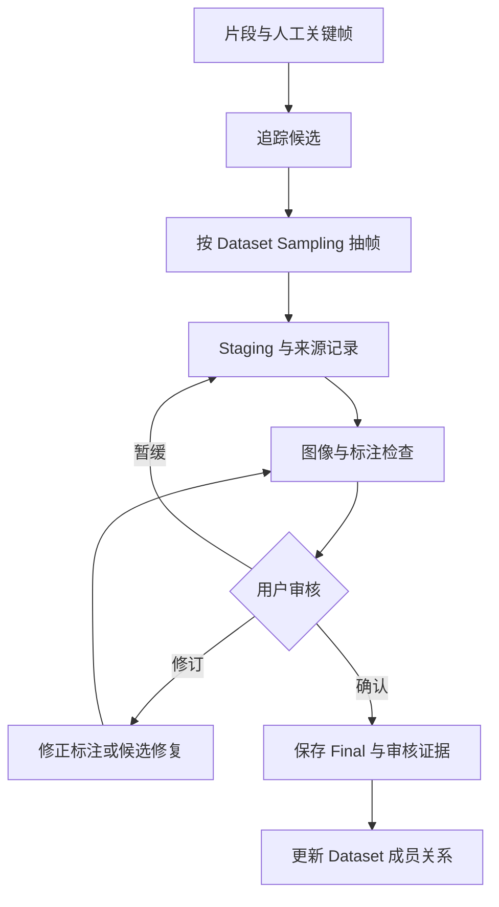

# L2 视频、标注审修与颜色修复

> DD-DESIGN-L2-001 方案Ⅰ v1.0；按主题迁移于 2026-11-26。设计契约非已实现代码。原章节编号保留，导航见 [文档索引](../README.md)。

### 领域执行细则：视频、标注审修、颜色修复

本节规定方案Ⅰ的领域、页面和配置契约。已确认的产品能力保持有效；DTO 补充、具体参数和页面组织作为 **Design Default** 维护，工程验收尚待执行。这里的流程编号、格式标识和输入摘要用于通信与一致性，不引入 Dataset / Annotation 历史版本功能。

#### 视频业务模块与计算适配层

Video Manager 是 Rust Core 中的业务模块。它管理视频来源、用户选定的时间段、关键帧、目标身份、追踪和采样任务；前端负责播放交互，Python Worker 的视频适配层负责解码、权威帧定位与追踪计算。Worker 输出的追踪框仍是候选。

| 能力 / 命令 | 输入和前置条件 | 输出与副作用 | 失败处理 |
|---|---|---|---|
| `video_import` | 用户授予访问的路径、当前 Workspace；视频内容可读 | 注册 `source_video_id`，异步探测媒体并建立帧索引；外部视频不复制 | 缺少解码能力时保留来源记录，标明能力不可用；不能伪报成功抽帧 |
| `video_get` | `source_video_id` | 返回编码、尺寸、时间轴、可用流、索引状态、预览能力、已有片段 | 源文件离线和解码失败分别展示 |
| `video_resolve_frame` | `source_video_id`、目标时间或既有帧身份、当前源摘要 | 返回权威 `FrameRef` 和受限预览引用 | 目标超范围、源文件变化、索引未就绪分别报告；旧 seek 请求不得覆盖新请求画面 |
| `video_save_segment` | 原视频、半开时间区间、目标 Dataset、关键帧及标注草稿 | 保存工作片段定义；不生成正式 Dataset 成员 | 关键帧不在片段内、类别不存在、空区间时拒绝保存 |
| `video_track_submit` | 已保存片段、人工种子框、Tracking Sampling、所选追踪器 | 返回异步操作引用；形成逐帧候选和轨迹产物 | 丢失、遮挡、低置信度和算法不支持的种子约束标为待审核；不补造“成功”轨迹 |
| `video_sample_submit` | 已有追踪结果或人工标注、Dataset Sampling、目标 Dataset | 提取实际原视频帧；落盘到视频目录；创建 Staging 记录和待审核内容 | 缺少候选的采样帧可补算或标未标注，不能仅复制上一帧框后宣称确认 |

##### 1. 帧身份和显示坐标

`FrameRef` 的领域语义如下；RPC 中具体类型以公共契约章节为准。

| 字段 | 类型 / 单位 | 约束 |
|---|---|---|
| `source_video_id` | UUID | Workspace 中稳定的视频身份，不由文件名推导 |
| `source_digest` | 摘要字符串 | 绑定当次索引所依据的视频内容；源变化后旧索引和候选失效 |
| `stream_index` | 非负整数 | 在有多个视频流时明确选择，不能默认混用 |
| `frame_index` | 十进制字符串编码的非负整数，展示顺序，0 起始 | 表示该视频流中实际解码帧的位置；不是简单的 `time × fps` 结果 |
| `pts_us` | 十进制字符串，微秒 | 规范化显示时间轴上的实际帧时间；RPC 保持整数语义，前端不靠浮点秒恢复身份 |
| `timestamp_ms` | 数值，毫秒 | 可由 `pts_us` 派生，仅用于时间轴展示和来源信息；不作为唯一键 |
| `width` / `height` | 正整数，像素 | 已应用显示旋转后的标注平面尺寸 |
| `image_ref` | 受授权的 Artifact / 媒体引用 | 对应这一个实际帧，供画布读取；不在通知事件内放大图 |

原始 PTS、time base、视频旋转和时间轴偏移保存在帧索引或来源产物中；显示时间轴以第一张可显示视频帧为零点。若输入有重复时间戳，仍由 `frame_index` 区分。若时间戳严重缺失或不可可靠排序，当前 MVP 明确限制该视频的时间采样功能，可提供按已建立帧索引采样；不能悄悄把估算时间当作真实 PTS。

视频导入可以先显示媒体信息，再异步建立/补齐索引。支持标注的帧必须已经完成可靠定位；“可播放”不自动等于“可精确定位”。包含 B 帧的视频按显示顺序建立索引，不能拿解码顺序代替。

所有 bbox、修复区域和鼠标坐标都转换到原始标注平面坐标后提交。画布缩放、平移、设备像素比只影响显示。旋转归一化策略必须由解码适配器记录，预览、抽帧图片和 COCO 尺寸采用同一策略；改变策略会使旧坐标待复核。

##### 2. Tracking Sampling 与 Dataset Sampling 的具体规则

| 配置 | Tracking Sampling | Dataset Sampling |
|---|---|---|
| 目的 | 决定追踪器处理哪些帧 | 决定生成哪些训练样本 |
| 默认建议 | `EVERY_N_FRAMES`，`every_n=1` | `TIME_INTERVAL`，`interval_ms=1000` |
| 可选模式 | 每 N 帧；算法声明支持时可用固定时间间隔 | 每 N 帧或固定时间间隔 |
| 结果 | 跟踪工作产物，不自动注入 Dataset | 图片、对应标注工作文件、来源信息、Staging 记录 |
| 人工关键帧 | 始终作为约束保留，不受追踪间隔丢弃 | 默认不强制额外导出，可配置 `include_keyframes=true` |
| 边界 | `[start_us, end_us)` | `[start_us, end_us)` |

两组配置各自具有 `sampling_config_id`。ID 用于指明“本次取帧依据了哪些参数”，不是 Dataset 内容版本号。配置的解析后副本进入任务输入产物，任务开始后不随设置页面变化。

固定时间间隔采样使用目标序列 `start + k × interval`，每个目标选择区间内第一张实际显示时间不早于目标的帧；多个目标落到同一实际帧时只保留一次。最后一个目标或关键帧必须仍在半开区间内，不额外复制边界外的帧。固定帧间隔从片段第一张有效帧开始按实际帧索引取样。相邻片段共享边界时，半开区间减少重复；最终仍按实际帧身份去重。

例如一个 30 秒片段用每帧追踪、每 1000 毫秒采样，追踪器可以计算大量连续帧，训练样本只取规定时间点对应的真实帧。变帧率视频采用实际时间戳；不会按名义 FPS 制造本来不存在的帧。FFmpeg 的 `fps` 过滤器可能通过丢帧/重复帧形成指定恒定帧率，因此若选用相关工具，适配器必须保留源帧映射并落实本产品“不重复导出同一源帧”的规则，而不能把过滤器输出序号直接当原视频帧身份。[V1]

对于追踪稀疏、训练采样更密的配置：采样器先检查目标帧是否具有有效候选。需要时发起该帧补算；如果所用算法不能补算，则保留“未标注 / 待审核”状态。对 bbox 做线性插值可以作为明确标记的候选生成方法，但不能在未审核的情况下变成 Final。

##### 3. 片段、关键帧和轨迹

片段定义包含 `segment_id`、`source_video_id`、源摘要、时间区间、目标 Dataset、两组采样配置和关键帧引用。手工标记开头与结尾可作为追踪器的约束：支持双向约束的适配器按其能力使用；只支持首帧种子的适配器可以向前追踪并将尾部关键帧用于核对。界面必须说明采用了哪一种方式。

`track_id` 在一个视频的工作上下文内唯一，推荐 UUID；同一对象跨帧沿用该 ID。跨视频重识别不在 MVP 范围。类别变化、对象消失、遮挡和中途重现由用户修订或确认，系统不把“同一轨迹”直接当作正确类别的证据。

标准 COCO 检测文件没有统一的 `track_id` 字段。本方案将当前轨迹映射保存在持久来源元数据/专用产物中：`asset_id + local_annotation_id → track_id + segment_id + FrameRef`。通过 `assets.metadata_json.current_track_map_ref` 关联当前映射，映射同时绑定 `annotation_digest`；源视频的索引使用 `video_frame_index_ref`。确认 Final 后清除的是当次候选和草稿，当前已采用标注对应的轨迹映射必须保留。导出单份标准 COCO 时可不携带轨迹字段；可选来源清单不改变 COCO 主文件契约。

##### 4. 从视频到 Dataset 的提交关卡

采用目标 Dataset 的当前类别集合开展标注。若用户要独立创建 Dataset，可先建立空 Dataset 作为类别上下文，再将通过审核的 Staging 批次注入。该选择不要求先生成一份训练导出，也不增加一个暂存类别数据库。

帧与同名 JSON 保存在 `video_annotations/<视频名>/`；同名视频目录追加 `(1)` 等后缀。注入只改变成员关系，文件留在该目录。缺少 JSON 的未标注帧可以留在 Staging，但不能越过“确认 Final + 用户质量确认”的注入关卡。

#### 标注审核交互的契约

“Human”在界面中表示导入的人工内容或正在编辑的人工草稿；“AI Candidate”表示某次检查/推理提供的建议；“Final”表示当前正式内容及其审核状态。采用每图 COCO 工作文件后，这三个视图不要求在同一个 COCO 文件里同时嵌套三套自定义字段；具体存储由数据契约章节规定。

| 交互 / 状态 | 必须满足的行为 |
|---|---|
| 人工 / AI / Final 图层 | 各自提供可见开关；隐藏只影响显示，不改变选中、保存或导出结果 |
| 单框对比 | 显示类别、坐标差异、来源、候选分值和可用证据；“更高分”不得改称“已证明更正确” |
| 选择组合 | 支持逐框采用人工候选、AI 候选或手工修订结果；不要求整图只能二选一 |
| 手工修订 | 更改类别、调整框、删除错框、补充漏框；写当前审核草稿，不立即覆盖正式文件 |
| `review_save_draft` | 保存当前工作选择及乐观并发条件；不是 Final 提交；页面离开后可恢复 |
| `review_commit` | 用户明确提交选定结果；Core 检查输入摘要和类别、几何约束，保存成功后才清当前草稿与候选 |
| 空标注 | 用户确认“该图片无目标”才成为已审核负样本；空数组本身不能证明审核通过 |
| 外部变化 | 显示冲突，旧审核证据失效；先重新加载/复查，再允许新的确认 |
| 提交进行中 | 禁止重复提交和切换当前编辑对象造成的隐式保存；失败仍保留可恢复草稿 |
| 重开审核 | 保留现有正式内容，建立新的当前审核会话；最终采用什么由新的提交决定，不创建历史浏览版本 |

画布用颜色与线型共同区分来源，不能只靠红绿颜色。AI 候选的分数与算法名称一起显示，不把不同模型的原始分数直接作为同一尺度排名。用户要求的“眼睛”按钮对应图层可见性；“采用”按钮对应业务选择，两种状态分开保存。

需要修正导入图片标签时，复用同一审核画布；当前版本不再扩展一个具有团队任务分发、复杂标注模板和全类型绘制工具的独立图片标注平台。

#### 颜色修复契约

Repair Manager 负责用户意图、候选与提交；Worker 仅按授权读取图片、计算候选并输出任务产物。正式应用由 Core 进行，且以当前图片摘要和对应标注状态为条件。

| 字段 | 类型 / 默认建议 | 校验与含义 |
|---|---|---|
| `asset_id` / `base_image_digest` | UUID / 必填摘要 | 避免把旧预览应用到已被改过的图片 |
| `region` | `RECT` 或 `POLYGON` | 原图坐标；矩形正面积；简单多边形至少 3 点，拒绝自交和无效区域 |
| `method` | `HUE_REMAP` | MVP 默认改变色相、尽量保留原亮度；`SOLID_FILL` 可作为明确选项 |
| `target_rgb` | 3 个 0–255 整数 | 用户选定的目标 sRGB 颜色；不推断物理真实颜色 |
| `strength` | 0–1，默认 1 | 改色强度；0 产生无变化结果，界面提前提示 |
| `feather_px` | 0–64 像素，默认 0 | 羽化边界；实现统一按原图像素解释 |
| `source_color_gate` | 可空的色相范围 | 只修改区域内符合条件的像素；空表示使用完整区域 |
| `candidate_artifact_id` | 预览成功后返回 | 指定被用户看到并采用的候选，不在提交时悄悄换算法再算 |

`repair_color_preview` 返回异步操作引用，完成后提供候选、差异预览、处理参数和变更区域。`repair_color_apply` 使用候选 ID、预期输入摘要和幂等键，交给统一文件提交机制处理。预览不改正式图片；应用成功后产生新的当前事实，触发需要的图像质量/语义复检和标注复核。

颜色变化不改变几何尺寸时可以保留已有 bbox 内容，但既有审核证据不能被假定对新图像自动成立；例如红灯改为绿色可能改变类别判断。修复后是否接受由用户审核，系统不自动把类别一并改成某个猜测结果。纯色填充和色相调整也可能抹去工业缺陷证据，因此报告必须记录实际操作与参数。

PNG 等无损编码可约束区域外解码像素保持不变；若覆盖 JPEG 并重新编码，区域外像素也可能因压缩发生数值变化。预览与应用必须使用同一编码结果，界面说明这种差异；不对所有格式承诺“只修改框内像素”。暂不加入去模糊、重建细节、过曝恢复或生成式图像修补。
