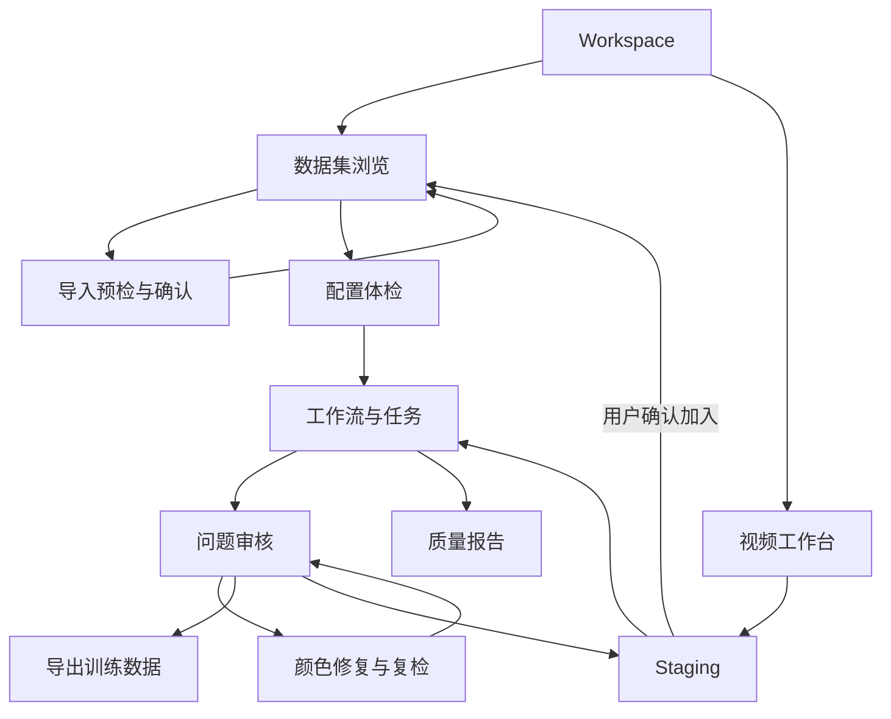
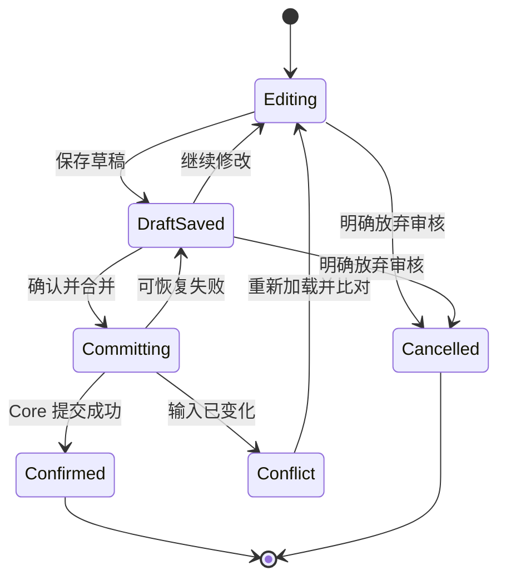

# Dataset Doctor — 前端页面与交互设计

**文档编号：** DD-UI-L2-001  
**版本：** 0.1 · 页面评审稿  
**日期：** 2026-11-26  
**依据：** L1 定稿、L2 方案Ⅰ设计基线、用户要求逐页 HTML 原型审核  
**状态：** 页面视觉风格已确认作为实现参考；具体交互设计仍按契约验收；HTML 原型可用于审核，不代表桌面应用或后端已经实现。

## 1. 本次补齐的内容

原 L2 已定义页面职责、路由、组件和 Command 映射。本文件补齐每个页面的空间布局、主次操作、进入与离开路径、异常状态，以及可直接打开的 HTML 审核原型。

本次包含 **14 个业务页面 + 1 个总览入口**。HTML 是离线、独立可打开的设计原型，使用同一套示例数据和界面样式；页面间通过相对链接跳转。标注图层、采用选择、视频时间轴、颜色预览等交互只改变演示状态，不读取用户资源，不调用真实模型，不写入业务 SQLite 或训练数据。所有工业画面是原创合成示意图。

打开 `prototype/index.html`，页面链接最完整。也可以单独打开某一页 HTML；该页的样式、脚本和示意图均内嵌，不依赖在线字体、CDN 或框架安装。

### 1.1 评审的重点

1. 是否容易找到“导入 → 体检 → 审核 → 导出”的主流程。
2. 审核页是否清楚区分“看见哪个图层”和“最终采用哪些框”。
3. 视频页是否清楚区分追踪处理间隔与训练样本生成间隔。
4. 用户是否知道哪些结果已经正式保存、哪些只是草稿或 AI 建议。
5. 检查未执行、资源离线、外部修改、取消中等状态是否会造成误解。

颜色、间距和普通文案可以集中调整；涉及数据权威、人工确认、API 或文件归属的反馈必须同步对应契约。本次不要求逐按钮重新进行架构选型。

## 2. 信息架构与页面目录

### 2.1 页面文件与正式路由

| ID | HTML 文件 | 正式应用路由或容器 | 主要目标 |
|---|---|---|---|
| INDEX | `index.html` | 原型审核入口，不是产品必备页面 | 浏览全部页面与审核顺序 |
| W01 | `01-workspaces.html` | `#/workspaces` | 创建、打开或重新定位 Workspace |
| W02 | `02-workspace.html` | `#/workspace` | 当前工作区概览、数据集/视频/任务入口 |
| D01 | `03-dataset.html` | `#/datasets/:dataset_id` | 浏览样本、类别、审核和检查状态 |
| D02 | `04-import.html` | D01/W02 内导入向导 | 文件选择、预检、映射、明确执行导入 |
| Q01 | `05-healthcheck.html` | `#/datasets/:dataset_id/checks/new` | 选择检查范围、能力和执行策略 |
| Q02 | `06-workflow.html` | `#/runs/:workflow_run_id` | 了解步骤、Agent 调整和人工关卡 |
| Q03 | `07-task.html` | `#/tasks/:task_id` | 查看某次执行的事实、失败与恢复 |
| A01 | `08-review.html` | `#/reviews/:review_id` | 组合人工、AI、手工修订并确认 Final |
| V01 | `09-video.html` | `#/videos/:source_video_id` | 关键帧、片段、追踪与采样 |
| V02 | `10-staging.html` | `#/datasets/:dataset_id/staging` | 审核视频样本并加入 Dataset |
| R01 | `11-color-repair.html` | `#/repairs/:asset_id` | 区域改色、预览、应用和复检 |
| E01 | `12-export.html` | `#/datasets/:dataset_id/export` | 校验资格并导出训练数据 |
| E02 | `13-report.html` | `#/reports/:task_id` | 阅读本次检查覆盖和问题依据 |
| S01 | `14-settings.html` | `#/settings` | 模型、执行能力、资源和默认配置 |

原型把导入向导单独展示为 HTML，便于审核，不新增后端服务。正式应用可用页面或大尺寸抽屉实现。数据集/视频/任务的总体列表由 Workspace 概览的选中区域承载，不必为此增加新的领域模型。

### 2.2 核心页面流

图中的回流是业务路径：审核、修复和复检可能发生多次，但不创建可浏览的 Dataset 历史版本。任务报告可以保留各次检查结果。

## 3. 全局布局与视觉规则

### 3.1 桌面布局

| 区域 | 设计默认 | 作用 |
|---|---|---|
| 左侧导航 | 常规宽 216 px；较窄窗口可压缩 | Workspace、数据集、视频、Staging、任务、报告、设置 |
| 顶栏 | 高 66 px | 工作区上下文、面包屑、运行状态；原型额外显示“示例数据” |
| 页面头部 | 标题、简短上下文、右侧主操作 | 用户先知道当前对象和可做的主要动作 |
| 主内容区 | 一般卡片/表格；编辑工作台采用三栏或两栏 | 让内容宽度服务于样本与画布 |
| 反馈区 | 局部校验、页面级提示、任务详情入口 | 长任务不能只弹一个成功提示后失去去向 |

首轮视觉审核以 1440×900 为参考；正式桌面建议最小窗口约 1100×720。大表格与画布保留独立滚动；窄窗口收起辅助面板，不缩小 bbox 的业务坐标。HTML 为便于审核也支持更窄窗口，正式小窗口行为仍需 Tauri 环境验证。

### 3.2 视觉语义

- 浅色内容区配深色导航，青绿色作为主要动作与已确认状态。
- 人工框：蓝色实线；AI 候选：紫色虚线；当前采用/Final：绿色实线。同步显示来源文字，不能只靠颜色判断。
- 橙色表示待处理或不确定；红色表示阻塞错误；“未执行”使用明确文字，不能混成绿色通过。
- 工程 ID、摘要、attempt 等放在详情展开区。主流程优先使用“当前样本”“待审核”“已确认”等产品语言。
- 类别直接显示名称，无必填描述。实际标签名按纯文本渲染，避免被解释为 HTML。
- 统计数、问题数量、覆盖比例分别表达。首版不放一个没有标定依据的“数据集综合健康 99 分”。

### 3.3 三类前端状态

| 状态类型 | 示例 | 保存与刷新规则 |
|---|---|---|
| Core 权威状态 | Task 终态、Final 有效性、成员关系 | 查询/订阅获得；前端不自行宣布成功 |
| 编辑草稿 | 拖动的框、候选选择、颜色区域 | 可保存草稿；正式确认是独立动作 |
| 显示状态 | 图层眼睛、缩放、排序、面板折叠 | 不修改标签、审核结论或导出集合 |

页面缓存包含 workspace_session_id。切换 Workspace 后清理旧订阅和查询；迟到的任务或 seek 结果不得污染新上下文。

## 4. 逐页设计

### W01 — 工作区入口

**页面目标：** 不要求用户先理解 Dataset、SQLite 或 Worker，就能打开一个本地工作环境。

| 位置 | 内容与交互 |
|---|---|
| 主区域 | “创建工作区”“打开已有工作区”两个明确入口 |
| 最近工作区 | 名称、用户可识别的路径、最近打开、可用/离线状态 |
| 底部说明 | Workspace 包含多个数据集、视频与检查任务；导入数据可原地引用 |

创建填写名称并通过系统目录选择器选位置；打开验证标志文件和兼容性。已有活动工作区时先走关闭/切换流程。最近目录离线时提供重新定位，不直接删除记录。

**API：** `path_select`、`workspace_create`、`workspace_open`、`workspace_close`。最近列表由既定 app.db 的 Workspace 注册信息提供，不让前端直接读库。

**状态：** 正在打开、恢复文件操作、版本不兼容、无权限、路径不存在。打开尚未完成时不显示可编辑工作区。

### W02 — 工作区概览

**页面目标：** 告诉用户现在有什么数据、哪些事情需要处理，以及从哪里继续。

| 位置 | 内容与交互 |
|---|---|
| 顶部摘要 | 数据集数、视频数、待审核样本、进行中任务 |
| 左侧主体 | 最近数据集，显示当前规模、类别数和需要处理的状态 |
| 右侧辅助 | 待审核事项、最近视频、正在执行的任务 |
| 主操作 | 导入数据集、导入视频；已有对象直接进入对应工作台 |

摘要聚合当前工作区，不展示跨视频相似性分析。某模型不可用不阻断整个工作区打开。

**API：** `workspace_get`、`dataset_list`、`asset_list(kind=VIDEO)`、`task_list`、`workflow_list`。长任务进度从 Core 状态获取。

### D01 — 数据集浏览与管理

**页面目标：** 以样本为中心查看数据和发现问题，进入体检或审核。

| 位置 | 内容与交互 |
|---|---|
| 页头 | Dataset 名、总量、类别标签；“开始体检”“导出训练数据” |
| 筛选栏 | 文件名、类别、审核状态、问题类型、来源 |
| 主区域 | 缩略图网格/表格切换；每项显示名称、来源、Final 状态与问题提示 |
| 详情侧栏 | 当前样本尺寸、类别、可用性、来源视频/帧、检查摘要 |
| 次级操作 | 增加样本、编辑类别、重定位、移出 Dataset、明确删除文件 |

原型提供典型筛选与样本打开；实际列表采用分页/虚拟化。样本选择不能只缓存当前可见页就声称选中了整个 Dataset。

类别只需名称；新增直接编辑 Label Schema。类别字典变更使相关审核依据失效，界面提示需要重新确认，不悄悄维持旧的绿色状态。删除清单区分外部原文件与受管理产物。

**API：** `dataset_get`、`asset_list`、`asset_get`、`dataset_update_categories`、`asset_remove_preview/submit`、`dataset_delete_preview/submit`、`review_open`。

### D02 — 导入向导

采用四步：选择来源 → 预检 → 类别/格式处理 → 导入结果。

| 步骤 | 用户看到什么 | 必须防止的问题 |
|---|---|---|
| 来源 | 目录、输入格式、创建/选择目标 Dataset | 把任意输入字符串当作文件访问权限 |
| 预检 | 图片/JSON 对应、未标注数量、冲突和不支持字段 | 未知格式被静默当空标注 |
| 处理预览 | 类别映射、将创建/转换/覆盖的确切文件 | “检查一下”就覆盖已有标注 |
| 导入结果 | 接受/拒绝数、逐项原因、进入 Dataset | 部分失败却显示全部导入成功 |

外部图片与标签默认直接引用；工作格式为每图 COCO，导出才聚合。原生 AnyLabeling 文件是否支持由适配能力决定，界面不能提前假装全部格式兼容。

**API：** `path_select`、`dataset_import_inspect`、`dataset_import_external`、`dataset_create`、`task_get`。

### Q01 — 配置数据体检

| 位置 | 内容与交互 |
|---|---|
| 左侧主区 | 检查项组：基础统计、图像质量、标注几何、模型证据/语义检查 |
| 右侧配置 | 范围、可用模型、资源/云端预算、预计执行的固定步骤 |
| 底部动作 | “预览计划”“开始体检”；计划预览是可选入口 |

每个检查项标明依赖与覆盖范围。Cleanlab 检查需要可用预测证据及相应适配；不是没有模型输出也可以保证完成标签检测。语义检查若缺 Key/模型，显示未配置与设置入口。本地检查可以单独执行，报告必须列出未执行项。

Agent 只选择已注册步骤与允许参数。用户可以写目标说明，但不是自由 Python 或任意工具执行输入。云端检查明确说明发送整图/裁剪及范围；预算是上限，不显示虚构的精确费用。

**API：** `workflow_plan_preview`、`workflow_start`、`settings_get`。PlanRef 引用 Core 已接纳计划；再次启动前仍校验输入。

### Q02 — 治理工作流

**页面目标：** 看懂系统正在做什么，以及何时需要自己判断。

| 位置 | 内容与交互 |
|---|---|
| 顶部 | 模板名称、处理范围、整体状态、暂停/继续/取消 |
| 主区 | 固定步骤列表：检查、预测、审核、按需复检、报告 |
| 节点详情 | 当前 Task、处理计数、输入范围、结果/失败原因 |
| 右侧面板 | Agent 计划摘要、有限调整原因、预算使用、人工待办 |

不提供通用工作流画布编辑器。`WAITING_REVIEW` 显示“去审核”；`PAUSING` 类显示语义通过控制请求和实际状态表达，不能把尚未落实暂停直接写成已暂停。进度未知时用阶段与计数，不生成假的百分比。

**API：** `workflow_get`、`workflow_pause/resume/cancel`、`task_get`。从运行详情进入报告、Task 或 Review。

### Q03 — 单任务详情

展示一个 Task 的本次执行：状态、阶段、处理计数、结果 Artifact、输入摘要和可理解错误原因。技术详情默认折叠，里面显示 task/attempt/session 标识与日志摘要。

“安全重试”“从检查点恢复”只在 Core 声明允许时出现。取消先显示正在请求，终态确认后才显示已取消；输入变化提示重新创建检查，不把旧任务结果套到新数据。

**API：** `task_get`、`task_cancel`、`task_retry`、`media_get_locator`、`report_get`。

### A01 — 标注审核工作台

这是最重要的页面，采用三栏布局。

| 区域 | 内容 |
|---|---|
| 左栏 | 待审队列、问题类型、当前/下一样本、筛选与处理进度 |
| 中栏 | 原图画布、缩放/平移、图层眼睛、当前选择；底部草稿状态 |
| 右栏 | 框的类别/坐标、人工与 AI 差异、证据、采用与手工修订 |
| 底部主操作 | 保存草稿、确认负样本、确认并合并为 Final |

**图层与采用是两套独立状态。** 隐藏 AI 候选只改变显示；“采用 AI 框”才改变待提交集合。可以一张图部分采用人工、部分采用 AI，并补充手工框。高分仅是证据，不使用“AI 已证明更好”文案。

新开的审核中，当前采用集合从现有人工标注或有效 Final 初始化。用户调整 bbox/类别、删除错框、补框均进入同一草稿。当前版本提供这些纠错能力，不扩展成完整静态图片标注平台。

确认流程：保存草稿并得到摘要 → `review_commit` 受理 → 提交进行中 → Core 确认成功 → 显示当前 Final，清理本次 Human/AI 草稿与候选。失败或冲突时不能先清空候选；原有来源与 track 映射保留。

本图是页面交互状态，不替换 L2 的数据库枚举。离开脏草稿时提供保存草稿、放弃、留在页面；页面导航本身不得隐式确认 Final。

**API：** `annotation_get`、`review_open`、`review_save_draft`、`review_candidates_submit`、`review_commit`、`review_cancel`、`media_get_locator`。

**原型可审核：** 人工/AI/当前采用图层显隐，来源选择，拖动补充演示框，草稿与正式确认的区分。

### V01 — 视频标注工作台

| 区域 | 内容 |
|---|---|
| 中央 | 视频播放/精确帧画布；显示来源、实际帧号和时间 |
| 下方 | 时间轴、片段范围、人工关键帧、追踪候选与不确定区间 |
| 右栏 | 目标 Dataset、类别、当前片段、追踪配置、训练采样配置 |
| 主操作 | 保存关键帧 → 保存片段 → 追踪 → 生成待审核样本 |

开始标注前选择目标 Dataset；新数据集先创建空的类别上下文。暂停后等待 `video_resolve_frame` 返回真正 FrameRef，再开放正式关键帧保存；浏览器播放时间不是源帧身份。

**两个采样设置分开：** 追踪采样决定算法分析哪些帧；训练采样决定生成哪些图片+JSON。训练采样默认按时间间隔，用户可配置；如果采样比追踪更密，缺失候选的帧补算或标记未标注，不能复制相邻框冒充已确认标签。

首尾标注应落在半开片段 `[start,end)` 内。连续轨迹、遮挡、断轨必须可见；支持在不确定处补关键帧。原型时间轴使用模拟播放，不包含实际解码、目标追踪或定位精度承诺。

生成的图片与 JSON 保存在 `video_annotations/<视频名>/`，同名视频目录加 `(1)`。页面提示进入 Staging，不能直接宣布生成的所有样本都是 Final。

**API：** `video_import/get/resolve_frame`、`video_save_keyframe_draft`、`video_save_segment`、`video_track_submit`、`video_sample_submit`。

### V02 — Staging 待加入样本

**页面目标：** 把“已生成”“检查过”“人工确认”“正式加入 Dataset”分开呈现。

表格包含选中、缩略图、视频/时间、标注状态、检查状态、阻塞原因、目标 Dataset。顶部给出数量分类：全部、需要标注、需要检查、需要审核、允许加入、离线/冲突。

批量操作为体检、进入审核、加入目标 Dataset、移除。加入按钮只对 Core 判定可接受的条目开放；旧报告、未确认 Final 或类别变化必须阻止注入。允许用户查看并确认已知问题，但不能绕过输入一致性和正式标注条件。

加入时不复制视频帧，不新建内容版本。用户可先新建空 Dataset，再以同一路径加入。删除生成帧必须明确，移除 Staging 不删除源视频。

**API：** `staging_list`、`workflow_start`、`review_open`、`staging_commit`、`staging_remove_submit`。

### R01 — 区域颜色修复

中央并排原图与候选，右侧是区域、目标色、强度、羽化与可选色相范围。矩形/多边形表示待处理区域，与类别标注框分开。

主操作分为“生成候选”和“应用此候选”。预览不改原图；应用的是已审核的同一编码产物，之后进入复检和再次确认。默认 HUE_REMAP，明确的 SOLID_FILL 选项不暗示能恢复真实物理颜色。

界面显示候选是否过期。原图在预览后改变则禁用应用并提示重做。PNG 与 JPEG 的编码影响不同，不承诺 JPEG 区域外像素绝对不变。原型演示用于审核流程和对比布局，最终算法效果单独验证。

**API：** `repair_color_preview`、`repair_color_apply`、`task_get`、`media_get_locator`。

### E01 — 导出训练数据

导出页左侧选择正式 Dataset 成员范围、格式和目标目录；右侧展示可导出、未审核、过期、离线及活动审核等阻塞数量。

默认仅当前有效 Final。若存在不合格条目，默认阻止，用户可明确选择排除并在清单中保留原因；不能静默丢掉样本。COCO 输出汇总为一个 annotation 文件并重映射 image/annotation ID；单图本地 JSON 仍保留当前形式。

提交后转到任务详情，完成后才提供打开目录/查看清单。该输出是本次训练数据产物，不是 Dataset 历史版本管理界面。

**API：** `dataset_get`、`asset_list`、`path_select`、`dataset_export_submit`、`task_get`。最终资格由 Core 在导出时再次核对。

### E02 — 质量报告

页头显示检查时间、Dataset 范围、是否仍适用于当前数据。正文依次展示执行覆盖、问题分组、样本证据、人工处理结果、修复后复检与未执行项。

比例必须写分母：例如图像检查 `1264/1264`、计划语义抽查 `0/80，模型未配置`。不同检查可能作用于不同子集，不把所有分母拼成虚假整体质量分。空检查或失败不写为通过。

报告的 AI 解释与算法证据分别标明来源。报告保留任务历史，但不提供标签/图像版本回滚。进入具体问题时打开当前样本，若已变化提醒原报告对应的是旧输入。

**API：** `report_get`、`report_export_submit`、`asset_get`、`review_open`。

### S01 — 设置与执行能力

设置按应用、Workspace、Dataset 可用作用域组织；不可用作用层明确禁用。常用项包括共享模型连接、资源并发、视频默认采样、能力状态和路径诊断。

Key 仅支持输入新值/替换/清除；已保存 Key 只显示“已配置”，无读回按钮。原型不会保存或发送输入，且提示不要填写真实密钥。两个逻辑 Agent 共用模型连接，页面不要求每个 Agent 再填一把 Key。

能力表显示本地 Worker、解码、模型与设备的真实可用性；缺少可选模型不会显示整个应用故障。配置变更只影响新任务，运行中的任务继续用冻结参数。需要重启的设置说明何时生效。

**API：** `settings_get/update`、`model_connection_test`、`model_secret_set/clear`；配额以 Core 上限校验为准。

## 5. 全局异常与反馈规则

| 情况 | 用户看到什么 | 允许操作 |
|---|---|---|
| 首次加载 | 结构占位与加载阶段 | 可取消导航，不展示假样本 |
| 空数据 | 原因和下一步入口 | 导入、清除筛选或返回 |
| 长任务受理 | 已排队/处理中 + 任务入口 | 查询、按能力取消 |
| Worker 不可用 | 当前能力受限及错误摘要 | 重试连接；其他可用功能继续 |
| 图片/视频离线 | 原路径提示与离线标记 | 重新定位；不自动删登记 |
| 外部修改 | 当前证据已过期/冲突 | 保留草稿、重新载入并比对 |
| 重复提交 | 继续显示原操作及结果 | 复用同一幂等操作，不能双写 |
| 断开后重连 | 同步状态中 | 查询快照；不根据本地计时推断成功 |
| 取消中 | 请求已发出，等待停止 | 继续查看实际状态 |
| 权限不足 | 指明受影响位置与操作 | 重新选择授权范围，不降级为静默写入 |

HTML 每页底部带“审核辅助”状态选择器，用来查看文案位置。它只展示设计示例，不等同真实页面已经实现全部状态行为。正式应用还需要端到端验证按钮禁用、草稿保留和恢复顺序。

## 6. 组件与前端工程映射

| 组件 | 输入/输出职责 | 复用页面 |
|---|---|---|
| AppShell / WorkspaceSwitcher | 导航与当前会话，不持有数据访问授权 | 全局 |
| DatasetAssetGrid / AssetTable | 分页资源、选择、筛选意图 | D01、V02、E01 |
| ImportWizard | 来源、ImportPlan、显式处理选择 | D02 |
| CheckSelector / PlanPreview | 能力、范围、受限参数 | Q01 |
| WorkflowStepList / TaskDetail | Core 权威快照与控制意图 | Q02、Q03 |
| AnnotationCanvas | 原图平面、框/区域、可见性、采用与编辑意图 | A01、V01、R01 |
| LayerSwitch / CandidateInspector | 只控制显示、独立表达采用与证据 | A01 |
| VideoTimeline / SamplingForm | 精确帧引用、片段与两类配置 | V01 |
| StagingEligibilityTable | 阻塞原因与明确注入集合 | V02 |
| RepairComparison | 同一候选字节的前后展示 | R01 |
| ReportCoverage / FindingList | 检查覆盖、问题、处理与未执行范围 | E02 |
| ModelConnectionForm / CapabilityList | 非秘密配置、只写密钥和能力 | S01 |

HTML 原型采用原生 HTML/CSS/JavaScript 以便离线审核；正式应用仍采用已选的 **React + TypeScript + Vite + Tauri 2**。原型代码可以作为视觉与交互参考，不能直接当成已经遵守 Core 状态/授权契约的生产组件。

## 7. 页面验收清单

| 验收 ID | 通过标准 |
|---|---|
| UI-P01 | 14 个业务页均有独立 HTML，入口目录可到达，每页能返回总览 |
| UI-P02 | 无外部网络资源依赖；没有真实模型、文件或数据库操作 |
| UI-P03 | 审核显隐不改采用集合；草稿、当前采用和 Final 状态有清楚说明 |
| UI-P04 | 人工/AI/手工修订能进入同一审核流程，允许明确负样本确认 |
| UI-P05 | 视频的追踪间隔与训练采样间隔有独立控件和解释 |
| UI-P06 | 生成视频样本进入 Staging，加入 Dataset 是后续明确动作 |
| UI-P07 | 修复候选与应用分开，应用后显示需要复检 |
| UI-P08 | 任务受理、取消中、失败、等待审核不被显示为成功 |
| UI-P09 | 报告有执行覆盖分母和未执行项，没有未经定义的综合质量分 |
| UI-P10 | 实际桌面实现后，缩放/高 DPI/旋转/旧帧响应/冲突保护通过 L3 工程测试 |

UI-P01～UI-P09 可在本轮原型中审核其表达和有限演示；UI-P10 及真实数据一致性需要实现后验证。设计状态不会因 HTML 能打开而自动成为 Implemented。

## 8. 关联文档与后续使用

- L2 方案Ⅰ为业务、API 与数据模型基线；本文是页面设计补充。
- 《Dataset Doctor L3 实现规范与工程任务清单》将页面映射到模块、契约与开发任务。
- 审核时可直接按“页面 ID + 位置 + 修改意见”反馈，例如“A01 右侧证据太拥挤，采用按钮需要更突出”。无需重新逐项回答架构问题。
- 前端界面定稿前，工程工作可先进行公共契约、数据正确性和必要 PoC；视觉细节不应迫使后端绕过既定权限边界。

### 变更记录

| 版本 | 日期 | 内容 |
|---|---|---|
| 0.1 | 2026-11-26 | 补齐 14 页设计、主要交互、状态与 API 映射，提供逐页离线 HTML 审核原型 |

## 9. 本轮原型验证记录

- 已生成并核对 15 份 HTML：14 个业务页及 1 个总览。
- 全部 HTML 内部页面链接可解析到交付文件，无重复元素 ID。
- 内嵌 JavaScript 已通过 Node 语法检查；页面没有外部脚本、字体或图片依赖。
- 浏览器自动渲染与实际点击验收未完成：当前执行环境未提供可运行浏览器，安装下载受限。不能把静态检查当作已完成视觉/交互验收。
- 所有示例操作均为页面演示。Tauri、IPC、真实视频解码、模型、文件保存和三平台安装包均未在本轮实现或测试。

原型入口：[prototype/index.html](prototype/index.html)。
