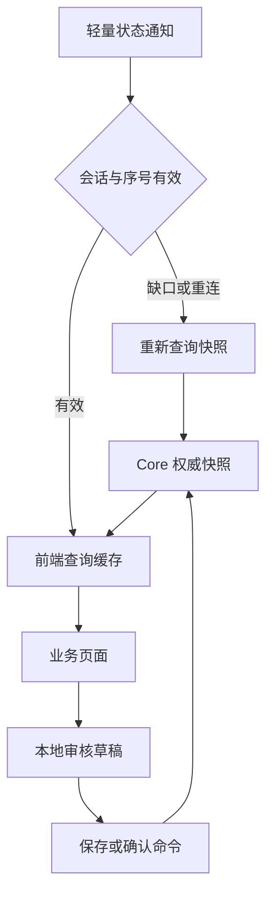

# L2 前端模块、状态与接口映射

> DD-DESIGN-L2-001 方案Ⅰ v1.0；按主题迁移于 2026-11-26。设计契约非已实现代码。原章节编号保留，导航见 [文档索引](../README.md)。

### 前端模块、状态与接口映射

#### 页面和组件边界

React + TypeScript + Vite 以及 Tauri 已确认。本轮确定组件职责和接口，不再增加一次绘图库、UI 库的选型讨论；Canvas / SVG 的具体实现可在 L3 验证后锁定，但必须服从同一 `AnnotationCanvas` 契约。

| 页面 / 模块 | 主要组件与负责内容 | 对接命令 | 不在该层承担的职责 |
|---|---|---|---|
| Workspace 入口 | 最近列表、打开/创建、缺失路径重定位、运行能力摘要 | Workspace 创建/打开/关闭/定位命令 | 不直接读写数据库，不绕过退出关卡切目录 |
| Dataset 浏览 | 列表、样本缩略图、类别筛选、统计、导入、Staging 列表 | Dataset 查询/导入命令、`staging_list` | 不以页面筛选结果代替正式 Dataset 成员关系 |
| 体检配置 | 检查项、模型可用性、云端范围、预算、计划预览 | `workflow_plan_preview`、`workflow_start` | 不生成任意 RPC 或任意 Python 参数 |
| 任务与计划 | 进度、节点/步骤、日志摘要、重试、暂停/继续、取消、等待审核入口 | `task_get`、`workflow_get`、`task_cancel`、`task_retry`、`workflow_pause`、`workflow_resume`、`workflow_cancel` | 不根据本地计时器推断任务成功 |
| 问题审核 | `AnnotationCanvas`、来源图层、候选证据、人工修订、确认 | `annotation_get`、`review_open`、`review_save_draft`、`review_commit`、`review_cancel` | 不直接写 COCO 文件，不把隐藏图层当作删除 |
| 视频工作台 | 播放、时间轴、片段、关键帧、轨迹、采样设置、帧审核 | `video_get`、`video_resolve_frame`、`video_save_keyframe_draft`、`video_save_segment`、`video_track_submit`、`video_sample_submit` | 不用浏览器当前画面自动认定权威帧 |
| 修复对比 | 区域选择、颜色参数、前后对比、采用候选 | `repair_color_preview`、`repair_color_apply` | 不自动覆盖原图片 |
| 导出与报告 | 范围、缺失/未审核样本说明、目标位置、报告阅读 | `dataset_export_submit`、任务/报告查询、`staging_commit` | 不临时拼一个绕过审核的导出文件 |
| 设置与能力 | 模型连接、Key 更新、资源配额、默认采样、工具能力 | `settings_get`、`settings_update`、`model_connection_test` | 不读取或展示完整已保存 Key，不加载未授权可执行文件 |

计划页面显示模板步骤、当前分支、任务状态和调整原因。当前不增加通用工作流编辑器。

桌面应用采用同一套内部 hash 路由；路由中的 ID 仅用于选中资源，不能成为越过 Core 授权的访问证明。推荐路由映射如下：

| 路由 | 页面 / 进入条件 |
|---|---|
| `#/workspaces` | Workspace 入口；无活动 Workspace 时默认页面 |
| `#/workspace` | 当前 Workspace 概览；要求活动会话 |
| `#/datasets/:dataset_id` | Dataset 浏览与统计；ID 必须属于当前 Workspace |
| `#/datasets/:dataset_id/staging` | 该 Dataset 的待注入批次 |
| `#/datasets/:dataset_id/checks/new` | 体检配置与计划预览 |
| `#/reviews/:review_id` | 当前审核会话；找不到时转到相应样本并说明失效 |
| `#/videos/:source_video_id` | 视频工作台；片段选择作为可选查询参数 |
| `#/repairs/:asset_id` | 颜色修复对比；候选选择可作查询参数，不隐式应用 |
| `#/runs/:workflow_run_id` | Workflow 阶段、任务与人工关卡 |
| `#/tasks/:task_id` | 单任务详情，可从 Workflow 中跳转 |
| `#/datasets/:dataset_id/export` | 导出范围与资格预检 |
| `#/reports/:task_id` | 通过 `report_get` 读取报告，`report_export_submit` 导出报告 |
| `#/settings` | 设置、模型连接与执行能力 |

页面导航不会自动提交脏草稿。离开编辑页时先保存草稿、明确放弃，或取消导航；正式 Final 仍必须显式确认。Workspace 关闭和备份分别调用 `workspace_close`、`workspace_backup_submit`，不会通过页面卸载事件直接触碰文件。

`AnnotationCanvas` 的输入是不可变图像引用、原图尺寸、各图层框/区域、可见性、当前选择和显示变换。输出是 `select_object`、`change_bbox`、`change_category`、`create_bbox`、`delete_object`、`change_region` 等受限编辑意图；组件不接收 SQLite 连接、任意文件路径或模型密钥。几何修改先进入本地草稿，再经显式命令保存。

#### 状态来源、缓存和通知

前端将状态分成三类，避免出现“界面认为成功、Core 实际失败”的第二套业务真相：

1. **Core 快照**：Dataset、任务、审核状态和配置等；查询后缓存，收到通知后更新或重新查询。
2. **会话草稿**：尚未正式提交的框、区域和候选选择；有脏状态，并可通过 `review_save_draft` 持久化。
3. **纯显示状态**：缩放、平移、图层可见性、表格排序；不影响 Final、任务状态或导出资格。

查询缓存键至少包含 `workspace_session_id` 和资源 ID。切换 Workspace 后清理旧缓存和订阅；任何晚到响应只有匹配当前会话与请求序号才可显示。以同一幂等键重发保存请求时不能同时构造另一份内容，否则应返回幂等冲突。

启动订阅时按公共事件契约取快照与游标；通知丢失、游标失效或 Core 重启时重新查询。前端页面重载不丢失已入库任务，任务是否可恢复由 Core 判断。事件只用于轻量通知；Tauri 官方事件机制并不针对大体积、高吞吐数据，图片、视频和完整报告使用受限引用读取。[U1]

长任务按钮点击后展示“已受理 / 排队”，不能立即显示“完成”。取消按钮先展示“正在请求取消”，收到终态才显示“已取消”。`WAITING_REVIEW` 展示明确操作入口，不显示仍占用 GPU 的假进度。进度未知时显示阶段和处理计数，不拼出不可信的精确百分比。

#### 前端媒体与权限边界

媒体读取走 Core 解析的 `asset_id` / `artifact_id`，返回短生命周期、绑定 Workspace 会话和窗口的读取引用。文件选择对话框只授权用户选定范围。Core 检查实际解析路径、符号链接和访问根，不能仅依赖字符串前缀判断路径合法。

Tauri 窗口能力、可调用命令清单和 CSP 采用最小集合；权限在命令处理器内再次按 Workspace / 对象 / 操作检查。界面不获得通用 shell、任意 SQL 或 Worker 直接连接能力。Tauri 的能力机制约束前端能调用的接口，但不等于给 Rust Core 或 Python Worker 增加操作系统沙箱；事件内容也不能假定受到与命令完全相同的精细权限控制。[U1][U2]

导入的标签名称、模型说明和报告文本作为数据渲染，禁止拼接成可执行脚本或不受过滤的 HTML。界面展示云端检查会发送哪些图像/裁剪，由用户配置的云端开关和任务范围控制；不能把“本地优先”表述成“从不向外发送数据”。
