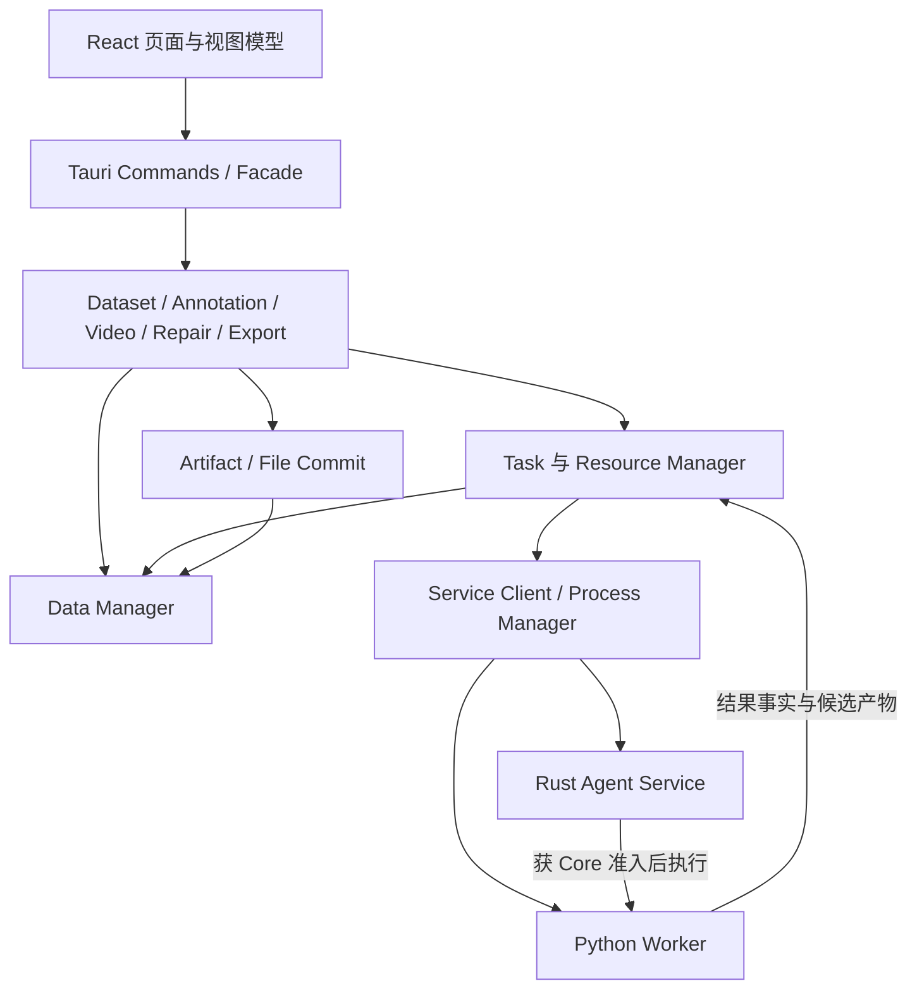

# L2 模块职责与共同契约

> DD-DESIGN-L2-001 方案Ⅰ v1.0；按主题迁移于 2026-11-26。设计契约非已实现代码。原章节编号保留，导航见 [文档索引](../README.md)。

## 二、共同模块契约

### 2.1 依赖方向

前端只表达用户意图；领域模块决定业务规则；Core 的控制组件执行准入与持久化；外部进程执行计算。执行结果只有经 Core 校验后，才影响正式标注或 Dataset 成员。

模块之间传业务 DTO 和引用，不传裸数据库连接，不让前端执行任意文件路径写入。Data Manager 是业务 SQLite 写入唯一入口；Artifact / File Commit 是正式媒体和 JSON 的受控提交入口。两者协作，不把数据库事务误当成跨文件系统事务。

### 2.2 模块职责与输入输出

表内的接口归属是逻辑所有权；对应 Tauri 命令与 gRPC 名称在 API 章节统一规定。

| 模块 | 输入与输出 | 主要责任与依赖 | 持久化与边界 |
|---|---|---|---|
| Workspace Manager | 打开/切换/关闭请求 → WorkspaceContext、生命周期状态 | 注册目录、建立 session、恢复未完文件操作、检查服务状态 | app.db 登记；workspace.db 会话内业务；不允许两个活动 Workspace 同时提交 |
| Dataset Manager | 导入清单、类别变更、成员接收 → DatasetView、成员结果、长任务句柄 | 格式预检、类别映射、成员关系、Staging 接收；依赖 Annotation 和 Data | datasets、dataset_assets、staging_items；不直接维护第二套 bbox |
| Annotation Manager | 当前 JSON、候选、人工选择 → ReviewSnapshot、确认结果 | 类别/几何校验、候选合并、负样本确认、冲突检测；依赖 File Commit | review_sessions 与当前单图 JSON；不负责模型推理或自由图片标注平台 |
| Video Manager | 视频引用、时间段、关键帧、双采样参数 → FrameRef、追踪/采样任务 | 定位帧身份、管理标注时间段、组织追踪与输出归属；依赖 Worker | assets 来源元数据、任务产物；前端播放时间不是帧身份权威 |
| Repair Manager | 图片指纹、区域、颜色参数 → 修复候选、应用结果 | 创建候选任务、对比、提交后使相关检查失效并安排复检 | task artifacts、file_operations；Worker 不覆盖正式图片 |
| Export Manager | Dataset、格式、输出位置、选定样本 → 导出任务和清单 | 校验当前 Final、一致性读清单、COCO ID 重映射、产物发布 | task artifacts/清单；不导出未确认或已过期的候选 |
| Task / Resource Manager | TaskSpec、预算、结果事实 → 准入授权、TaskSnapshot | 队列、资源配额、attempt、状态迁移、取消/重试/恢复、事件 | tasks、workflow_runs；不自己判断 VLM 结论正确与否 |
| Process Manager | 运行环境、能力要求 → ServiceSession、健康状态 | 启动、握手、凭据、退出、崩溃恢复；依赖受控运行环境 | 最小运行配置与诊断；不将进程存活等同于任务成功 |
| Data Manager | 受限 Repository/事务操作 → 领域记录 | SQL、FK、事务、乐观更新、迁移、索引和恢复查询 | 独占业务写入口；Agent/Worker 无 workspace.db 连接 |
| Artifact / File Commit | AssetRef/ArtifactRef、写入意图、预期摘要 → 授权引用、提交结果 | 授权范围、临时产物、摘要校验、提交日志、清理 | 文件系统与 file_operations；不接受模型提供的任意路径 |
| Agent Service | 目标、模板、能力、证据、预算 → 受约束计划/视觉候选/摘要 | 协调 Agent、视觉审核 Agent、Workflow Engine、Tool Adapter、统一模型客户端 | 上报 Core；自己的缓存不成为业务权威 |
| Python Worker | 已准入的类型化工具请求 → CheckResult、Frame/Track/Repair 产物 | Python 库与模型适配、批处理、取消检查、输出验证 | 仅可写授权任务产物位置；无业务 DB 写入，无正式 Final 写入 |
| Frontend View Models | 查询快照、状态事件、交互 → 命令与可见状态 | 分页、过滤、图层、编辑草稿、任务展示、错误和冲突处理 | UI 缓存可丢失；不得以“按钮成功”替代 Core 的持久化确认 |

### 2.3 核心用例的业务步骤与失败边界

#### 用例 A：导入一个已有 Dataset

1. 用户选定目录/标注文件，Core 创建受限选择引用，不能让普通字符串路径自动获得读写权限。
2. 导入预检生成清单：格式、图片与 JSON 配对、类别映射、同名冲突、缺失文件、不支持字段和权限情况。
3. 用户确认导入方案。原地文件转换是单独明确的副作用，不能作为只读扫描的一部分偷偷发生。
4. Core 登记 Dataset 和 Asset，建立成员关系；未被人工确认的数据保留待审核状态。
5. 确定性检查与模型检查各自报告覆盖情况；无法执行的检查不会被计作通过。

**失败规则：** 单个文件不可读可以生成逐项报告，但导入必须说明接受/拒绝数量。未知格式不得默认为空标注。涉及写入的转换按 file_operations 恢复；输入变化则要求重新预检。登记不意味着复制原图，也不意味着立即认可外部标注为 Final。

#### 用例 B：现有图片审核与提交

1. Annotation Manager 读取当前图片/JSON 指纹及确认状态，创建或复用该 Asset 的活动审核会话。
2. UI 同时显示人工草稿、AI 候选和已有 Final，各图层可独立显隐；候选包含证据、不确定性和来源。
3. 用户选择、组合、修改或补框；所有坐标换算到原图像素空间。追加修改覆盖当前草稿，不积累用户可浏览的标注历史。
4. 提交包含会话 ID、预期输入摘要、最终选择、是否确认负样本和幂等键。Core 重新校验。
5. Core 完成文件提交及审核状态登记后，才清理当前候选和草稿；失败或冲突时不能先清候选。
6. 当前 Final 指的是成功提交并绑定当前输入的标注。重新审阅时可保留上一次当前 Final 供对比；默认在活动重审或输入已变化时阻止该样本导出，直到再次确认。

**失败规则：** 晚到 AI 候选、修改前图片的预测、重复提交和旧 workspace session 均不能覆盖新结果。用户不采纳候选时，仍可保留已有有效 Final；取消审核的明确语义见审核契约。空标注只有显式确认成负样本后才可导出。

#### 用例 C：视频生成训练数据

1. Video Manager 登记源视频与流信息；用户选择时间段和类别上下文。
2. UI 播放或 seek 后，请求 Worker 定位真实解码帧，返回带来源摘要的 FrameRef，再允许标注关键帧。
3. Tracking Sampling 决定追踪算法处理哪些帧；Dataset Sampling 决定哪些实际帧生成训练样本。
4. Worker 输出追踪候选和选定帧；Core 校验产物，登记来源、track 关联与 Staging。
5. 视频帧与 JSON 保存在 Workspace 的视频文件夹中；审核后不再复制一份媒体。
6. 样本进入统一体检/审核流程，用户接收后更新 Dataset 成员关系；导出仍使用同一 Export Manager。

**失败规则：** 追踪丢失、遮挡或不可信区间必须显式断轨/待审；不得跨越失败帧“自动宣布正确”。缺失精确采样帧的标注时需补算或人工审核，不能把邻帧框直接复制当成已确认标签。源视频变更后，旧追踪和采样来源失效。

#### 用例 D：区域改色与复检

1. 用户在确定图片上定义矩形或多边形区域及颜色调整参数。
2. Worker 在任务目录生成候选和摘要；显示原图/候选、区域及颜色变化。
3. 用户应用时 Core 核对图片摘要与区域归属，按文件提交协议替换当前工作图片。
4. 图片摘要变化使相关质量检查与语义审核依据失效；原 bbox 可以保留为待复核几何信息，不因几何未变就自动保留全部质量结论。
5. 复检后重新人工确认；Agent 可以提出建议或说明失败，不能自行把修复结果升级为 Final。

**失败规则：** 区域外像素变化超过约定、候选尺寸改变、色彩解释不明确或输入变化，应拒绝直接应用。颜色参数不会由 Agent 静默从“黄色”改为“红色”的真实标签判断。

#### 用例 E：导出与备份

导出关注训练可用数据，备份关注 Workspace 可恢复性，两者使用不同清单。导出使用成员及指纹清单、逐图校验和 COCO ID 重映射；备份包含登记的外部媒体、JSON 与业务索引，并记录新路径映射。SQLite 的在线备份机制只解决数据库副本；完整 Workspace 的媒体一致性仍需要应用协调。[S3]

**失败规则：** 导出中途变化不能生成一个看似成功、实际混合前后状态的数据集。备份不能遗漏 WAL 中尚未 checkpoint 的业务状态，也不能把只复制 workspace.db 描述为完整备份。未完成产物保留为未发布，UI 不提供成功下载/打开标记。

### 2.4 内部调用、锁与状态规则

- 普通 Core 模块间使用 Rust 类型化调用；本机网络接口只存在于跨进程边界。
- I/O 或计算步骤可异步执行，但状态改变必须经过所属 Manager 的规则校验。
- 任务资源使用 Core 的 Semaphore/配额；文件提交使用 Asset 级互斥与预期摘要；SQLite 使用短事务。
- 不跨整个 Workflow 持有数据库事务或图片写锁；等待模型和人工审核时不占 GPU 许可。
- 数据库行的 row_revision、计划修订号和 attempt 是并发控制，不是用户数据版本。
- 外部不协作软件可能在摘要检查后继续改文件；本应用只能降低和检测冲突，不能宣称普通文件原子替换天然具有跨软件 compare-and-swap 语义。
- 对用户长期编辑但未提交的草稿，不让异步刷新自动覆盖。UI 检测冲突时提供重新加载、保留草稿和重新比对的明确操作。

### 2.5 模块契约的验收对应

| 模块 | 必须证明的关键结果 |
|---|---|
| Workspace / Process | 切换后旧任务回报不能污染新 Workspace；退出无失控后台计算 |
| Dataset | 类别映射、成员唯一性和 Staging 接收不会重复注入 |
| Annotation | 当前图片/JSON 不匹配时拒绝提交；负样本与缺标签区分 |
| Video | 变帧率、seek、重复采样仍能对应相同真实帧 |
| Repair | 只应用用户确认的候选，冲突不覆盖，应用后复检依据更新 |
| Export | 局部 COCO ID 重复不造成聚合碰撞；未确认样本不被偷带入 |
| Task / Agent | 无准入不可执行，旧 attempt 不改新状态，重规划不能绕过人工关卡 |
| Data / File Commit | 崩溃窗口可识别；恢复不能猜测并静默删除/覆盖外部内容 |
| Frontend | 图层与状态一致；事件丢失可查询恢复，密钥和完整路径不经全局事件广播 |

后面的数据字典、API、状态机和验收矩阵是上述模块的具体输入输出契约，而不是独立于模块的另一套设计。

---
