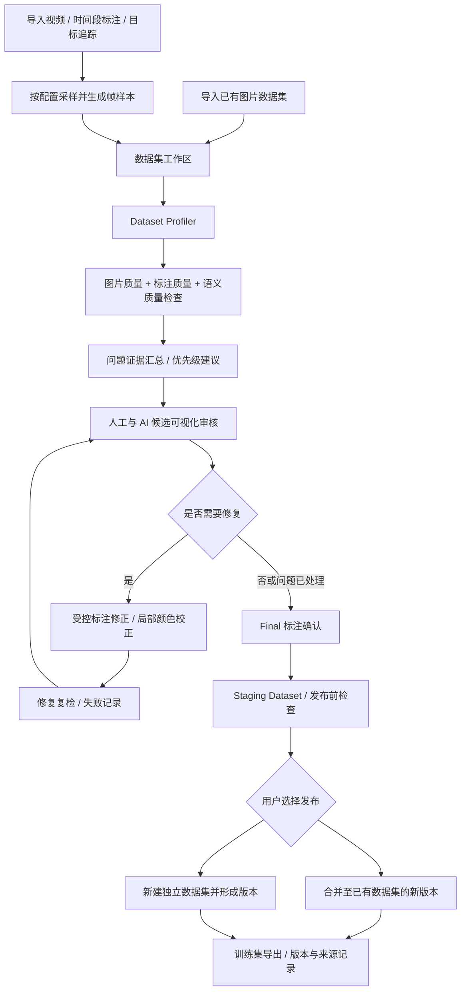

# Dataset Doctor — 项目背景、研究上下文与产品愿景

**文档编号：** DD-CTX-001  
**版本：** 0.1  
**记录日期：** 2026-11-15  
**状态：** Context Baseline（背景与意向记录；不是已验收的完整需求或架构规范）  
**建议存放位置：** `docs/requirements/project_context_and_vision.md`  
**依据：** 项目发起者与 AI 协作者的连续产品讨论、已形成的 L1 架构讨论版、延后功能清单，以及《软件项目设计与开发规范》v1.1（SPD-STD-001）。

> **阅读目的：** 让新加入的开发者或 AI Coding 执行者理解：为什么要开发 Dataset Doctor、调研过什么、想解决什么问题、产品的期望体验和价值在哪里、哪些已确认、哪些暂缓、工程设计目前推进到哪一步。  
> **重要边界：** 本文是“项目上下文与设计意图”，**不是 API 契约、数据库 Schema、开发任务书或编码授权**。遇到与具体需求、架构、接口、配置、测试文档的内容冲突时，以对应专题的已确认权威文档为准，并记录待解决冲突，不得自行推断。

---

## 1. 项目缘起

### 1.1 发起者的初始动机

项目起点是：希望借助 AI Coding 自主开发并长期维护一个公开的 GitHub 开源软件。这个软件应当：

- 具有真实、可重复的用户需求，而不仅是套用模型 API 的演示项目；
- 以 AI 为主题，最好能够体现 AI Agent 的规划、工具调用和工作流能力；
- **纯软件实现**，不依赖专有工厂设备或特定硬件板卡；
- 适合个人持续维护，并能积累 Rust、Agent Engineering、跨平台桌面软件和系统架构方面的能力；
- 具有明确的差异化方向，允许逐步吸引开源贡献者，而不是只追求功能数量和 GitHub Stars。

在最初探索阶段，曾同时关注两个独立候选方向：

1. **CodeGraph 类 AI Coding 工具**：通过代码结构、依赖关系和知识图谱改善 Agent 的代码检索与上下文利用，研究 Token 成本优化；
2. **Dataset Doctor**：帮助 CV 开发者检查、审核、修复和整理训练数据集。

经过进一步调研与讨论，**Dataset Doctor 被选为当前推进的软件项目**。CodeGraph 类工具仍是独立的个人学习/项目兴趣，**不是 Dataset Doctor 的模块需求**，不应擅自合并进当前仓库。

### 1.2 为什么选择工业视觉数据集场景

发起者已有计算机视觉、工业现场数据、模型训练与推理、数据集清洗、标注和软件工程实践经验。讨论中反复出现的具体问题包括：

- 工厂 PPE 数据集中，人体、安全帽等目标的 **Bounding Box 漏标、错标、框选不准确**；
- 工业信号灯红/黄/绿等颜色受到相机曝光、白平衡、传感器/ISP 处理、环境光影响，造成 **颜色偏移与标注歧义**；
- 视频可产生大量连续、相似的帧，若直接全部导出，训练数据会高度冗余；
- 现有工具擅长不同环节，但从“发现异常”到“比较候选、人工确认、局部修复、复检、生成可追溯训练集”仍可能需要使用者自行组织流程。

这些经历提供了**初始测试场景与产品洞察**，但 Dataset Doctor 不应硬编码工厂类别、相机设备或单个业务数据集。其基础能力应该适用于常见计算机视觉数据集，工业视觉作为优先验证和展示场景。

### 1.3 核心问题陈述

目前成熟的开源生态已经能够分别完成图片质量检测、标注错误发现、数据集可视化、视频标注与版本管理。**因此，Dataset Doctor 不以“重新实现已有算法”作为目标**。

项目希望解决的是一条跨工具、跨数据状态的治理链路：

> **导入数据 → 理解数据 → 检查图像/标签/语义质量 → 汇总问题证据 → 比较人工与 AI 候选 → 人工确认及受控修复 → 复检 → 输出可追溯的训练数据集。**

核心价值假设是：让用户从“自己运行和拼接多个工具”转向“在一个本地工作台中完成可解释、可审核、可回滚的数据治理流程”。**该差异化目前是待验证假设，不宣称市场上不存在类似功能。**

---

## 2. 产品愿景与定位

### 2.1 当前产品定义

**项目名称：** Dataset Doctor（工作名称）  
**产品描述：** *Agentic Dataset Quality & Curation Workbench*  
**中文定位：** 面向计算机视觉开发者的、本地优先的 AI Agent 数据集体检、审核、修复与训练集整理工作台。

**目标用户：** 主要是独立 CV 工程师、小型模型开发团队、工业视觉应用研发人员；不以大型标注外包团队的管理和云端 MLOps 为首要用户场景。

**交付形态意向：** Windows、Linux、macOS 跨平台桌面应用；Rust 为主要开发语言；采用本地优先原则。界面技术及部分组件仍待完成设计选型。

### 2.2 想要提供的体验

用户可以导入图片数据集，或者从工厂视频中按时间段标注、追踪并采样得到候选训练样本；随后在同一个应用中运行多维质量检查、看到每个问题的证据、对比人工与 AI 标注、在必要时修正标签或颜色，最终只把**已确认的标注**发布为新的训练数据集版本。

希望应用的核心交互不是“必须学习各种库的代码调用方式”，而是围绕 **Dataset / Asset / Issue / Review / Repair / Version** 这些数据治理对象组织。

### 2.3 不追求的产品方向

- 不做与 CVAT、X-AnyLabeling 全面竞争的**完整静态图片从零标注平台**；但必须允许对已有图片的错类、错框和漏框进行修正。
- 不建设团队任务派单、权限层级复杂的企业标注协作平台。
- 不做 ClearML 类完整的训练实验管理、集群调度、模型部署平台。
- 不在当前版本做通用音频、文本、点云的全模态数据标注系统。
- 不让 AI Agent 在无审批的情况下原位覆盖原始数据或发布未确认的候选标注。

以上是当前产品边界，不是对未来方向的永久禁止；变更需重新评审。

---

## 3. 竞品与开源生态调研记录

**调研记录口径：** 根据截至 2026-11-15 的公开 README、官方文档及产品讨论整理。以下只描述公开资料明确支持的能力，不表示已在本项目中安装、实测或成功集成。功能覆盖和商业/开源版本边界可能持续变化。项目间不能简单用 Stars 排名比较质量。

| 项目 | 调研所得的突出能力 | 对 Dataset Doctor 的启发 | 与我们可能重叠或仍需验证的地方 |
|---|---|---|---|
| **Cleanlab** | 通过统计方法与模型预测，识别分类/目标检测标签问题；目标检测支持分析漏框、类别错误、框位置问题 | 复用成熟标签质量方法；明确模型预测、人工标签及分数的来源 | 不能假定 Cleanlab 直接读取原始图片就能独立完成全部目标检测审计；需要适配预测输入 |
| **CleanVision** | 图片模糊、曝光异常、近似/完全重复、尺寸等图像问题发现 | 作为图片质量检测的算法参考/候选依赖 | 检测异常不等于恢复真实图像；修复工作流需要另行建设 |
| **FiftyOne** | 数据集探索、可视化、Embedding、相似性、模型评估、数据质量和标注管理 | 学习数据检视与可疑样本筛选体验 | 已有 Agent Ecosystem 和 dataset-curation skill；**Agent 串联检测不是独有卖点** |
| **CVAT** | 图片/视频标注、Review/Issue 工作流、Track、关键帧与插值 | 学习视频时间段、帧、轨迹、人工复核的交互语义 | 不复制完整的多人协作和专业标注平台范围 |
| **X-AnyLabeling** | 桌面 AI 辅助标注、丰富的视觉模型、视频跟踪/分割、格式导入导出及审核相关能力 | 研究 AI 候选与人工标注的结合、视频辅助标注及本地桌面体验 | 功能覆盖广，需认真评估区别；其主仓库为 GPL-3.0，不能未经许可直接搬用代码 |
| **ClearML** | 数据集版本、数据血缘、实验与 Pipeline 管理 | 学习非破坏性版本、溯源与发布记录 | 不建设全生命周期 MLOps；ClearML 不同数据产品及部分企业功能要区分 |
| **Datumaro** | CV 数据集读写、格式转换、比较、统计及处理 | 研究格式转换和样本组织，避免在转换功能上重复造轮子 | 是否直接依赖、是否覆盖所需格式，需要按版本和实际数据验证 |

### 3.1 本次调研中的重要认知变化

**认知 A：单一质量检测算法并非空白。**  
CleanVision 与 Cleanlab 已经分别覆盖大量图片和标签问题。Dataset Doctor 的价值应更多来自可用性、治理过程和结果可信度，而不以宣称某个算法必然优于它们作为目标。

**认知 B：FiftyOne 已有 Agent 数据集整理能力。**  
公开文档包含通过 Agent Skills / MCP 运行数据集质量检查、标注审计、重复检测和数据集整理的流程。因此，不能把“有多个 Agent 或能够串联几个算法库”直接当作产品创新。应重点验证**工业场景语义模板、问题证据、人工审核、局部颜色修复、修复验证及发布追溯**的端到端使用体验。

**认知 C：视频标注早有成熟工具。**  
CVAT、FiftyOne 和 X-AnyLabeling 等已有不同程度的视频标注/追踪能力。Dataset Doctor 的视频功能应服务于“生成、检查和发布训练数据”，而不是做一个功能全覆盖的视频标注平台。

**认知 D：版本能力不是单纯的文件复制。**  
ClearML 的数据版本和血缘值得参考；我们的重点是确保每次修复、审核、合并、导出都可追溯，正式版本不能被未经审核的结果污染。

### 3.2 竞品差异化假设（尚待实测）

| 假设 ID | 希望体现的用户价值 | 不能预先作出的断言 | 后续验证方式 |
|---|---|---|---|
| H-01 | 一次任务中统一图片、标注和语义质量检查结果 | “其他软件无法串联检测” | 以相同数据集对比任务步骤与检查覆盖率 |
| H-02 | **类别语义规范 + Prompt 模板 + VLM** 用于工业标签审核 | “VLM 必然比原有标注或专业模型准确” | 标注错误测试集、误报/漏报/人工复核时间评估 |
| H-03 | 发现问题后可直接对比、修正、验证、回滚 | “竞品都没有修复工作流” | 实测竞品对审核—修复—发布的连续体验 |
| H-04 | 将视频标注、追踪采样、训练抽帧、质量检查连成一条链路 | “必须建立全功能视频标注平台” | 视频小样本端到端生成训练数据并复核 |
| H-05 | 本地优先、可解释、适合个人/小团队的使用体验 | “桌面软件天然更快或更安全” | 真实跨平台安装、操作成本、隐私与性能评测 |

### 3.3 参考资料（官方入口）

- Cleanlab：<https://github.com/cleanlab/cleanlab>；目标检测教程：<https://docs.cleanlab.ai/stable/tutorials/object_detection.html>
- CleanVision：<https://github.com/cleanlab/cleanvision>
- FiftyOne：<https://github.com/voxel51/fiftyone>；Agent Ecosystem：<https://docs.voxel51.com/agents/index.html>；Dataset Curation Skill：<https://docs.voxel51.com/agents/skills_ecosystem/fiftyone-dataset-curation.html>
- CVAT：<https://github.com/cvat-ai/cvat>；Manual QA：<https://docs.cvat.ai/docs/manual/advanced/analytics-and-monitoring/manual-qa/>
- X-AnyLabeling：<https://github.com/CVHub520/X-AnyLabeling>
- ClearML：<https://github.com/clearml/clearml>；ClearML Data：<https://clear.ml/docs/latest/docs/clearml_data/>
- Datumaro：<https://github.com/open-edge-platform/datumaro>

> **合规提醒：** “项目开源”不表示所有第三方模型权重、插件、数据、附属服务均采用同一许可。尤其 X-AnyLabeling 为 GPL-3.0；若复用它的代码，须事先检查相关著作权与许可义务。使用 Cleanlab、CleanVision 等 Python 包也需核查具体依赖和发布形式。对竞品只学习产品理念与公开接口，不构成复制代码的授权。

---

## 4. 核心业务设想：不是只有检测，而是完整治理闭环

### 4.1 产品级用户旅程

**图示说明：** 这是产品层面的目标流程，不是最终调度状态机；详细质量门槛、异常分支、并发、失败恢复和数据契约分别在 L1/L2/L3 设计，不应直接据图编写完整程序。

### 4.2 当前希望保留的六类核心能力

| 能力 | 用户关注的关键问题 |
|---|---|
| **Dataset Profiler** | 数据量、类别、标注与图片分布是否清楚？ |
| **Image Quality Inspector** | 是否模糊、过曝/欠曝、损坏、重复或存在其他基础异常？ |
| **Annotation Auditor** | 是否漏标、类别错误、BBox 越界、尺寸或定位异常？ |
| **Semantic Inspector** | 根据可编辑的类别定义/提示词模板，标注内容是否与业务语义相符？ |
| **Dataset Intelligence Agent** | 能否规划工具、汇总证据、识别不确定性、提出处理建议并在异常时调整？ |
| **Dataset Report / Repair** | 能否审核、受控修复、复检、记录失败、追溯版本并输出训练数据？ |

不要求所有能力由 LLM 实现。**规则、图像算法和专业模型执行确定性/统计检测；Agent 负责在有意义的地方进行规划、协调、分析和异常处理。**

---

## 5. 标注与视频业务的特殊期望

### 5.1 Annotation Manager：审核比从零标注更重要

用户已经明确希望：同一图片/视频帧可同时查看**原人工标注、AI 候选标注、最终审核标注**。

- 通过独立的“眼睛/可见性”控制，分别显示或隐藏不同标注框图层；显示控制不应修改数据。
- 直观查看类别、位置、遗漏目标等差异与检查依据；**不得默认假设 AI 候选优于人工**。
- 人工可选取已有框、AI 候选，或对不正确的候选进行额外手动修正/补框。
- 点击 **Merge / Commit** 后，以审核通过的工作区内容生成新的 **Final 标注版本**；当前视图默认只显示 Final。
- 原人工标注、AI 候选及其来源历史**继续保存**，不因界面“合并”而物理删除。
- 正式训练集只采用已确认的 Final 标注；不能自动发布未审核 AI 候选。
- 当前不做批量静态图片从零标注的完整工具，但质量检查后的**错框/错类/漏框修正**必须具备。

### 5.2 Video Manager：为训练集服务的视频标注

用户强调视频功能不是独立的媒体编辑器，其最终目的是**生成可以用于模型训练、且经过质量治理的视频来源样本**。

- 导入并播放视频，可暂停、逐帧定位，按时间段标注事件或类别；
- 在关键帧上绘制 BBox 等必要标注，并对限定视频片段进行追踪辅助；
- **Tracking Sampling** 与 **Dataset Sampling** 明确分离：前者偏向轨迹连续性，后者按用户配置的时间/帧间隔减少训练帧冗余；
- 追踪模型产生的跨帧候选仍需通过人工/AI 对比审核，不能自动成为 Final；
- 抽帧得到的图像都应保存可追溯的 **Image Metadata**：至少能关联原视频、帧序号、时间戳、采样批次、标注版本等概念；
- 视频样本先进入 **Staging Dataset**，接受质量检查与必要复检；
- 最后由用户选择合并至已有数据集或新建数据集，**两条路径都生成新版本，不覆盖原始数据**。

### 5.3 当前合并限制（特意记录）

当前阶段，合并已有数据集的业务要求是：**将来源数据转换为同一支持的目标格式后进行合并**，不引入完整的跨数据集类别本体兼容性检查、自动语义映射或跨视频相似帧/泄漏专项审计。

**已知风险：** 格式一致不保证不同数据集的类别名称、ID 与语义完全一致。该问题是后续发布流程设计需要呈现的风险，而不是本上下文文档擅自增加的当前功能。

### 5.4 图像修复的当前偏好

目前强调的是**局部颜色校正**：用户用矩形/不规则区域或 Brush 选择图片中的目标区域，对颜色偏移进行受控调整，并查看前后差异。动机来自工业灯色可能出现红色被拍成偏黄、局部黄白高亮等现象。

- 保存原图，修复生成独立版本，并记录掩膜/区域、参数与历史；
- 原始颜色信息在通道饱和/过曝后可能无法恢复；软件只能提供**可追溯的颜色校正**，不能将推测后的颜色宣称为真实原始颜色；
- 模糊、过曝/欠曝等**质量检测**保留；复杂去模糊、曝光恢复等**自动修复**暂不进入当前版本。

---

## 6. AI Agent 的开发意图与边界

### 6.1 为什么要有 Agent

Agent 的期望不是在工作台右侧增加一个聊天窗口，而是让应用可根据用户目标：

1. 理解要检查的数据集类型和业务关注点；
2. 选择、组合合适的质量检测工具；
3. 决定何时对可疑样本使用 VLM 或其他模型；
4. 汇总多种工具的证据，说明问题和不确定性；
5. 建议修复、等待人工批准，处理执行失败并触发复检；
6. 生成可追溯的检查结果，而不是只给出不可验证的文字结论。

### 6.2 当前认可的组织思想

**Agent 规划 + Workflow 保证执行 + 异常动态调整。**

总体上由 Orchestrator 负责规划；专业执行单元负责图片、标注、语义、视频、修复与验证等任务。**专业单元不必都是独立 LLM Agent**：可以直接封装传统算法、模型或确定性检查过程。

当前选择通过统一 LLM Client **共享一个 API Key**；并不要求每个专业执行单元分别配置 Key。云端模型调用的费用、网络失败和用户数据出机隐私提示必须在后续设计中明确。

### 6.3 安全与可信原则

- Agent 不得直接把预测结果宣布为真实标签；
- Agent / Python Worker 不拥有核心业务数据库的直接写入权；
- AI 建议与人工作为不同来源保存，最终发布必须符合确认规则；
- 修复失败、模型不可用、置信不足、格式转换失败等需要**明确报告和可恢复处理**；
- 原始图片/视频与原始数据集不被无记录地覆盖；
- Agent 框架可以复用，但仍需验证 Checkpoint、人工审批、重试、取消和跨平台兼容性。

---

## 7. 工程实现方向：已确认与待选型分开

本节仅为避免后续交接时丢失关键技术意向；**不替代 `docs/architecture/` 的系统设计**。

| 方面 | 当前记录 | 状态 |
|---|---|---|
| 软件形态 | Windows / Linux / macOS 本地优先桌面应用 | `Confirmed` |
| 核心开发语言 | Rust | `Confirmed` |
| 桌面统一入口 | Tauri Command API + Rust Application Facade | `Confirmed`（方向） |
| 前端框架 | React / Vue / 其他尚未最终选择 | `Pending` |
| 应用核心 | Dataset、Annotation、Video、Task、Repair、Export 等业务模块 | `Confirmed`（职责方向） |
| 独立执行边界 | Rust Agent Service 与 Python AI Worker | `Confirmed`（方向） |
| 质量算法 | 优先复用 Cleanlab、CleanVision 及必要的成熟 CV 工具 | `Confirmed`（原则），具体依赖需验证 |
| 核心数据库写入 | Rust Core 中的 Data Manager 为唯一写入入口 | `Confirmed` |
| 数据库产品/Schema | 尚未确定 | `Pending` |
| Agent Framework | Rig v0.47.1；保持可替换适配器 | `Validated`（独立 SDK PoC）；业务集成待验证 |
| 进程通信 | 本地 IPC / RPC；Agent 与 Python 直接通信还是经 Core 转发待定 | `Pending` |
| 运行、部署与依赖 | 本地管理的 Python Runtime / Worker；跨平台分发细节待验证 | `Proposed / Pending` |

特别说明：这里的 **API Facade 是 Rust Application Process 内的统一入口，不是已经决定部署一个独立 HTTP API Gateway**。

---

## 8. 当前版本边界与延后事项

详细列表及状态以 `docs/requirements/deferred_feature_backlog.md` 为准。此处只保留背景层面的提醒。

### 8.1 已明确暂缓

- 跨**不同视频**的近似帧检索、重复检测专项工作流；
- 跨视频或 Train/Val/Test 来源泄漏专项检查；
- 模糊、复杂过曝/欠曝等图像增强/恢复算法（当前优先局部颜色校正）。

### 8.2 未来候选而非当前承诺

- 基于运动、姿态、灯色变化、遮挡等的自适应抽帧；
- 高级轨迹质量审计、身份切换自动诊断；
- 完整交互式 Embedding 聚类与分布可视化；
- 更广泛的关键点、分割、OBB 等任务深度支持；
- 可安装插件市场、对外 CLI/SDK/远程服务等。

### 8.3 绝对不能因“缩小 MVP”而丢失的业务点

- 视频时间段标注、帧级标注、局部目标追踪与间隔抽帧；
- 已有图片标注修正、AI/人工/Final 三种标注的对比与历史；
- 三种图层的可见性控制、审核、Merge/Commit；
- 统一的图片/标注/语义质量检查；
- 修复建议、失败反馈、人工确认、复检；
- 视频来源元数据和数据集非破坏性版本管理；
- 训练数据集导出**只使用已确认的 Final 标注**。

---

## 9. 阶段目标、产品期望与如何判断值得继续做

### 9.1 项目发起者的长期期望

- 项目可以放在 GitHub 长期维护，代码、文档、测试和演进记录清晰；
- 从真实工业视觉问题起步，但形成可复用的通用 CV 数据治理能力；
- 通过实际产品开发学习 Rust、Agent Workflow、多进程通信、跨平台桌面应用，而不是先停下项目去学完全部理论；
- 利用 AI Coding 辅助实现，但架构边界、重要业务规则、验收标准仍由项目发起者确认；
- 追求真实可用、故障可诊断、数据可追溯，并能积累长期工程能力和开源作品价值。

### 9.2 需要用实际效果检验的产品假设

| 验证问题 | 可能的观察方式（尚未确定具体指标） |
|---|---|
| 使用者是否减少了工具拼接和重复操作？ | 完成同样体检任务所需步骤、人工时间、额外脚本数 |
| Agent 是否能比固定工作流带来收益？ | 有/无智能调度对比，正确完成率、成本与失败率 |
| 标签语义审核是否真正有帮助？ | 错标发现准确性、误报、人工审核时间 |
| 修复流程是否可信？ | 原始数据不破坏、成功/失败可追溯、复检及回滚有效性 |
| 视频到训练集是否流畅？ | 时间段/Track/Frame 来源可追溯，采样导出结果正确 |
| 跨平台桌面使用是否现实？ | 三个平台安装、运行、打开数据集和 Worker 执行的验证 |

**重要：** 这些是建议的验证维度，暂时不是已确认的 KPI、性能承诺或测试通过结果。

### 9.3 工程协作方式

依据《软件项目设计与开发规范》v1.1，项目按 Stage 0（需求分析）→ L1（系统设计）→ L2（模块设计）→ L3（实现约束）→ Stage 4（实现与验收）推进。设计允许迭代，但不得在关键需求、契约和权限边界未明确时直接让 AI Coding 自行补充。

**截至本文件日期的实际进度：** Stage 0 已积累主要场景和边界，仍需在正式需求文档中归档可检验的验收条件；L1 已形成**服务职责与边界讨论版**，下一主题为 **服务通信与调用拓扑**；数据库产品、API/IPC、Agent 框架、前端技术栈及跨平台分发细节仍未最终确认。**没有因写出本文就宣称系统已经实现或 L1 已全部验收。**

---

## 10. 与其他设计文档的关系及 AI Coding 阅读顺序

| 文档 | 建议位置 | 权威职责 |
|---|---|---|
| **本文：项目背景与愿景** | `docs/requirements/project_context_and_vision.md` | 为什么做、研究脉络、产品意向、差异化假设 |
| 延后功能与非目标清单 | `docs/requirements/deferred_feature_backlog.md` | 哪些暂不实现、哪些只是未来候选 |
| L1 系统总体架构 | `docs/architecture/system_overview.md` | 当前进程、组件、服务职责和数据流 |
| 模块设计 | `docs/modules/` | 功能边界、交互规则与处理步骤 |
| 接口契约 | `docs/interfaces/` | Tauri Command、IPC、Tool 输入输出 Schema |
| 数据模型与数据库 | `docs/data/` | Asset、Frame、Track、Annotation、Issue、Version 等结构和关系 |
| 配置 | `docs/configuration/` | 视频抽帧、模型、Worker、Agent 等可配置行为 |
| 测试与验收 | `docs/testing/` | 实际需求验收、算法与 Agent 回归、数据正确性验证 |
| 技术决策 | `docs/decisions/` | 影响系统设计的重要决定与取舍 |

建议首次阅读顺序：**本文 → `docs/README.md` → 当前任务相关的需求/架构 → 对应模块/接口/数据文档**。不要求每次任务都把所有 docs 加载进模型上下文。

### 给后续 AI Coding 执行者的约束

1. **本文不授权编码**：先阅读当前任务所需的已确认需求和架构契约。
2. 必须区分 `Confirmed`、`Proposed`、`Pending`、`Validated` 与 `Implemented`；未确认项不可默认为已选方案。
3. 不得把竞品“已有能力”写成 Dataset Doctor 已经实现的能力。
4. 不得擅自扩大到完整静态图片标注、企业 MLOps 或跨视频泄漏检测。
5. 不得自行增加独立微服务、独立 API Gateway，或决定尚未选型的数据库/前端框架。
6. 标注修复、视频导出、数据集版本和核心写入权限必须遵守已确认的非破坏性与 Final 审核规则。
7. 每次架构或需求变更应同步更新受影响文档，避免与实现、接口、测试长期分叉。

---

## 11. 文档维护

- 本文只在**产品愿景、项目动机、调研结论、范围定位或重要研究假设**变化时更新；不记录日常开发流水。
- 更细的实现细节、数据库表、API 字段、视频采样配置默认值不在这里维护第二份副本。
- 如果竞品版本更新改变了原先的结论，补充**来源、日期、结论变化**，不要无证据地声称自己比竞品更完整。
- 若某条未来建议被正式纳入开发，先更新需求/Backlog 状态，再同步架构和测试，不仅修改本文。

**相关工程规范：** 《软件项目设计与开发规范》v1.1（SPD-STD-001）。

> 历史进度仅供背景参考；当前 L1/L2 方案Ⅰ为设计基线，前端风格已确认，L3 实施规范可作为开发参考。2026-11-26 更新：采用 Rig v0.47.1（Rust 1.97.1），SDK 独立 PoC 三平台已通过（每平台 10 项），不等同于生产应用集成。Core 持久化、资源准入、授权、人工审核和 Python Worker 职责不变。真实模型、完整恢复与打包仍需验收。
